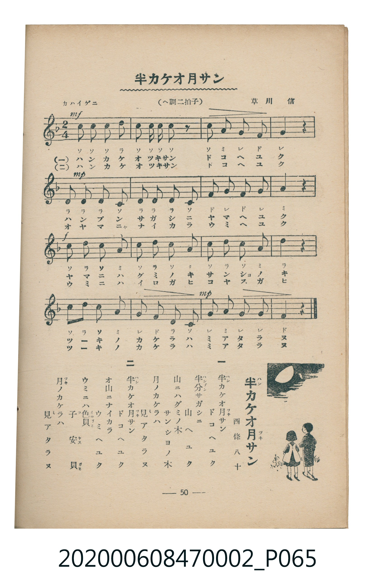

# 半カケオ月サン

<audio controls src="hankake_otsukisan.mp3"></audio>

- 詞：西條八十
- 曲：草川信
- 臺灣教育會公認《新定兒童唱歌》尋常科第二學年用（2020.006.0847.0002）

## 說明

・出處：臺灣教育會公認《新定兒童唱歌》尋常科第二學年用（2020.006.0847.0002）
・調性與拍號：調號 ?= F，拍號 <2/4>，速度 != 96

## 歌詞

```text
一
半カケオ月サン　ドコヘユク
半分サガシニ　山ヘユク
山ニハグミノ木　サンシヨノ木
月ノカケラハ　見アタラヌ

二
半カケオ月サン　ドコヘユク
オ山ニナイカラ　ウミヘユク
ウミニハ色貝　子安貝
月ノカケラハ　見アタラヌ
```

## ABC

```abc
X:1
T:半カケオ月サン
C:曲：草川信
M:2/4
L:1/16
Q:1/4=96
K:F
V:V1 name="Piano" snm="Pia"
[V:V1]
c2 c2 c2 d2 | c2 c c c2 z2 | c2 a2 g2 f2 | g4 z4 |
d2 d2 d2 c2 | d2 d2 d2 c2 | f2 g2 f2 g2 | a4 z4 |
c2 d2 c2 a2 | c2 d2 c2 a2 | c2 d2 c c a2 | d4 z4 |
c2 d2 c2 a2 | g2 f2 d2 c2 | g2 a2 g2 g2 | f4 z4 |
```

## TMD 檔案連結

- [主旋律 TMD 檔案](hankake_otsukisan.tmd)
- [鋼琴伴奏 TMD 檔案](hankake_otsukisan_piano.tmd)

## 分析

```text
================================================================================
📊 TMD Song Profile: [ 半カケオ月サン ]
================================================================================
⏱  Duration:       0:20 (20.0s), 16 measures total
🎼 Key & Tempo:    首調基準 F, != 96.0 BPM, <2/4>
   - 分析範圍：      由實際發聲的音符與和弦推測調性；播放脈絡另行呈現
🎤 人聲音域:    C4 (MIDI 60) – D5 (MIDI 74) [跨度: 14 個半音 / 1.2 個八度, 難度: moderate]
   - 最低音:  C4 in [Main #1 @ m.5, 0:05]
   - 最高音: D5 in [Main #1 @ m.1, 0:00]
   - 適合: soprano, mezzo-soprano, contralto, tenor, baritone, bass
🏛  結構:      Main (20.0s)
⚡ 編曲密度:        Peak 1 軌道同時演奏
🗝  調性診斷：       C 大調（純淨自然大調，未偵測到可信轉調）
   - 風格氣質:    純淨自然大調（陽光明朗、易唱易記，無明顯調外色彩）
   - 轉調歷程:    全曲維持單一推測調性（未偵測到可信轉調）
   - 核心骨幹音:  C, D, G, A, F
   - 調性數值:    C 大調 [相關度: 0.78, 穩定度: High, 自然音純度: 100.0%]
   - 候選調性 (K-S): C 大調 (0.78), F 大調 (0.62), G 大調 (0.58)
   - 五度圈歷程:   +0
   - 各段落調性細節:
     • [Main #1]: C 大調 (r: 0.78, 自然音純度: 100.0%)

  [ 五度圈游移軌跡 ]
              [C ]*
         F            G  
      Bb               D  
      Eb               A  
         Ab           E  
            Db       B  
               F# 
     (* = active key center)

  [ 十二半音累積音高分佈 ]
     C  : ████████████████████████  32.7%
     C# :                            0.0%
     D  : ███████████████████       25.5%
     D# :                            0.0%
     E  :                            0.0%
     F  : ████████                  10.9%
     F# :                            0.0%
     G  : ████████████              16.4%
     G# :                            0.0%
     A  : ███████████               14.5%
     A# :                            0.0%
     B  :                            0.0%
--------------------------------------------------------------------------------
Assignment 軌道音域：
  - Piano         : C4 – D5 (14 個半音 / 1.2 個八度, 53 個音符)
================================================================================
```


## 原書掃描頁




