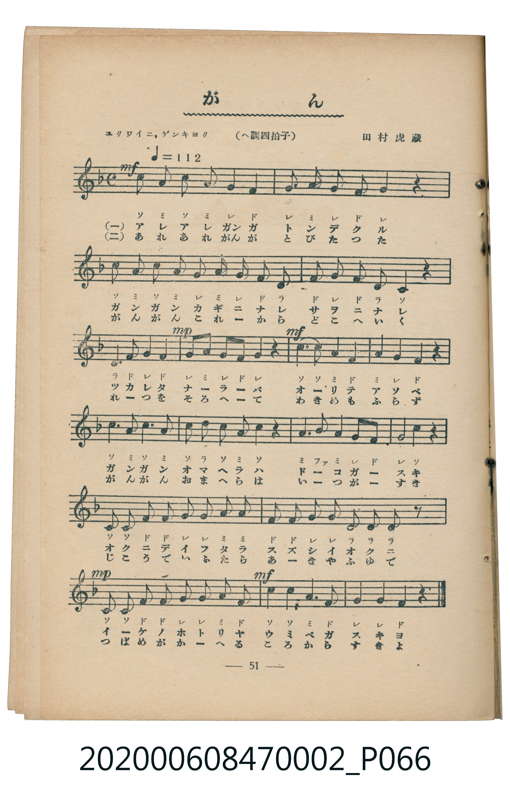
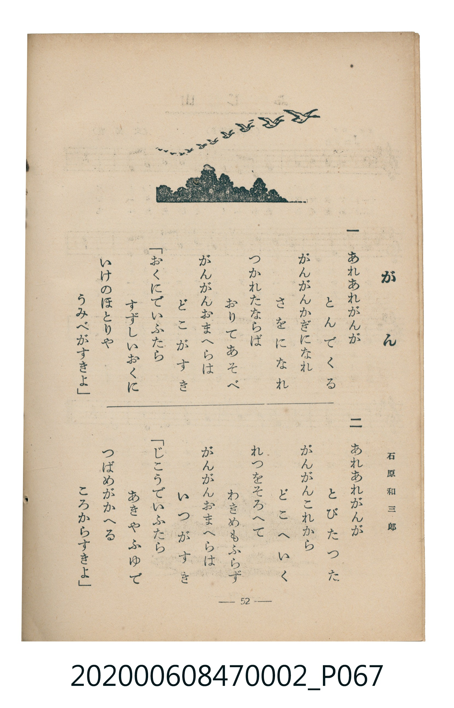

# がん

<audio controls src="gan.mp3"></audio>

- 詞：石原和三郎
- 曲：田村虎藏
- 臺灣教育會公認《新定兒童唱歌》尋常科第二學年用（2020.006.0847.0002）

## 說明

・出處：臺灣教育會公認《新定兒童唱歌》尋常科第二學年用（2020.006.0847.0002）
・調性與拍號：調號 ?= F，拍號 <4/4>，速度 != 112

## 歌詞

```text
一
あれあれ　がんがとんでくる
がんがん　かぎになれさをになれ
つかれたならば　おりてあそべ
がんがん　おまへらはどこがすき
おくにでいふたら　すずしいおくに
いけのほとりや　うみべがすきよ

二
あれあれ　がんがおりてくる
がんがん　なきながらおりてくる
つかれたはねを　やすめようと
がんがん　おまへらはなにがすき
たべものいふたら　たんぼのおこめ
はすのわかめや　こざかなすきよ
```

## ABC

```abc
X:1
T:がん
C:曲：田村虎藏
M:4/4
L:1/16
Q:1/4=112
K:F
V:V1 name="Piano" snm="Pia"
[V:V1]
c4 A4 c4 A4 | G8 F8 | G4 A4 G4 F4 | G12 z4 |
c4 A4 c4 A4 | G4 A4 G4 F4 | D4 F4 G4 F4 | D8 C4 z4 |
D2 F2 G2 F2 G4 A4 | G4 F4 G4 z4 | c4 c4 A4 F4 | A4 G4 F4 z4 |
c4 A4 c4 A4 | c2 d2 c2 A2 c4 z4 | A4 B4 A4 G4 | F4 G4 C4 z4 |
C4 C4 F4 F4 | G4 G4 A4 A4 | F4 F4 G4 G4 | D4 D4 D4 z4 |
C4 C4 F4 F4 | G4 G4 A4 F4 | c4 c4 A4 F4 | G4 G4 F4 z4 |
```

## TMD 檔案連結

- [主旋律 TMD 檔案](gan.tmd) [[在 TMD Studio 編輯](https://tmdlang.github.io/Tmd-TS/#tmd=s7IKdvYPcrWy4qpTUCpJTLdSSM7PyUlNLsnMz7MqzsjMK0nNjM_KTMmPL87Iz05Ugisry88pzU21Si9KTEmNN4o3MjAyiDcwMIs3sDAxBzIMjBBKi_NLi5JTrYqTM_Lzc-JLUitKkvLzsxHyBUX5Zal5iXlANQVFIBtTwIoQClLLMlNSQdKpKZkl-UWZiTlI7kgtKga7FWxJfElRYl5xclFmAcgDCFUlGalAxybmZeaC9HJpaSk8bux53DRZQUuLS9FWwdDQiMveVsGNy8ZE38QOpOtF-67njYufTZ35omnTsznNT1vXvFjV-7ih69m0DU_XzXraOun56qVPp2x8trbncUP30w3dT3fseL584vM1a57s6nm6dsfTnVueT1nxfk8HKFz0gOGiBwoXIMPA6P2eTrC7Xqyc937PrOfzNz_tm_90Us-THZ0vm_vAMs9mbwLJTNnwbO7EFzP7XkzvBzpZX4vryY4GrseNTY-beqBkQwPEFyCycQWYsfxxY__jpm6gOpgEkASp637c2Pe4cfXjxlVg_VMfN02Cc4Gql4BUgCTmg4U6HzduAGvretzU9bhxGcjCxrmPG3diGgyU3ve4cQdYz_rHjSsfN0LcM_NxYy9QNVC6H2wR0GUtjxu3gmwAKgXpBKqY9bhxOlgcqgyoAciZ-Lhx3ePG3WA_AR3QAlbd9rhxP9ABcLMfN3VwcQFDG0-QwB2PPUhWgUwBkUARoOPRVSMHCdBja0EhBtQGdA7Q_qZGoP1gR60gGCRAG4D-RwQJ0Lydj5uAAQr0JFqQABlAg_aApYCmTAbaA9QANAOodd3jJmAQAZ0EtBoSJECl08AxC7QBFiRa-lxcvomZeVYBmYl5-Q41BjUK1VwKQGBjoWUHZtQomCroKhgDMYyuUTACkiBoCKUhIiA5EA0SRagBQQOQCF7TUPWaxUOZaEIgaApiIBsIlDEEKgRhZBNh2sFKwbbBbIQYiGwjfveZKpgBsTFYBGIaSNwEydU1cNswXAcWABMgJYiggTkWYgVMDiYD9S-CIMVIiAimj2FqED6u5eLStVMAxb8CkFbm4gIA)]
- [鋼琴伴奏 TMD 檔案](gan_piano.tmd) [[在 TMD Studio 編輯](https://tmdlang.github.io/Tmd-TS/#tmd=s7IKdvYPcrWy4uLS0lJ43NjzuGny-z0dT_Zsebq0_8nuGe_3dCpoaXEp2ioYGhpx2dsquHHZmOib2HHVKSi9aN_1vHHxs6kzXzRtejan-Wnrmhereh83dD2btuHpullPWyc9X7306ZSNz9b2PG7ofrqh--mOHc-XT3y-Zs2TXT1P1-54unPL8ykrgJYZGRgZ6BkYmOkZWJiYAxkGRkBblcA2rJz3fs-s5_M3P-2b_3RSz5MdnS-b-8Ayz2ZvAslM2fBs7sQXM_teTO9X4uLyTczMswrITMzLD_JwqDGoUajmUgACGwstOzCjRsFUQVfBGIhhdI2CEZAEQUMoDREByYFokChCDQgagETwmoaq1yweykQTAkFTEAPZQKCMIVAhCCObCNMOVgq2DWYjxEBkG_G7z1TBDIiNwSIQ00DiJkiuroHbhuE6sACYAClBBA3MsRArYHIwGah_EQQpRkJEMH0MU4PwcS1y9PvgiH5DkE3RhrEgnQgmyBlgnmk8uTJQCtlrpNtlApExAcsYgdlGWGTAepBtwpTFaheEA4l14h1HjJfQxTHsQDEWiwxqkiA9LnBbZQbhmoG5EA4VLSMq7IApU9dOAZQ4FYC0MhcXAA)]

## 分析

```text
================================================================================
📊 TMD Song Profile: [ がん ]
================================================================================
⏱  Duration:       0:51 (51.4s), 24 measures total
🎼 Key & Tempo:    首調基準 F, != 112.0 BPM, <4/4>
   - 分析範圍：      由實際發聲的音符與和弦推測調性；播放脈絡另行呈現
🎤 人聲音域:    C4 (MIDI 60) – D5 (MIDI 74) [跨度: 14 個半音 / 1.2 個八度, 難度: moderate]
   - 最低音:  C4 in [Main #1 @ m.8, 0:16]
   - 最高音: D5 in [Main #1 @ m.14, 0:28]
   - 適合: soprano, mezzo-soprano, contralto, tenor, baritone, bass
🏛  結構:      Main (51.4s)
⚡ 編曲密度:        Peak 1 軌道同時演奏
🗝  調性診斷：       C 調性不明確（純淨自然大調，未偵測到可信轉調）
   - 風格氣質:    純淨自然大調（陽光明朗、易唱易記，無明顯調外色彩）
   - 轉調歷程:    全曲維持單一推測調性（未偵測到可信轉調）
   - 核心骨幹音:  G, F, C, A, D
   - 調性數值:    C 調性不明確 [相關度: 0.76, 穩定度: Ambiguous, 自然音純度: 98.9%]
   - 候選調性 (K-S): C 大調 (0.76), F 大調 (0.75), A 小調 (0.54)
   - 五度圈歷程:   +0
   - 各段落調性細節:
     • [Main #1]: C 調性不明確 (r: 0.76, 自然音純度: 98.9%, 調外音: A#)

  [ 五度圈游移軌跡 ]
              [C ]*
         F            G  
      Bb               D  
      Eb               A  
         Ab           E  
            Db       B  
               F# 
     (* = active key center)

  [ 十二半音累積音高分佈 ]
     C  : ██████████████████        20.5%
     C# :                            0.0%
     D  : ███████                    8.0%
     D# :                            0.0%
     E  :                            0.0%
     F  : ████████████████████      22.7%
     F# :                            0.0%
     G  : ████████████████████████  27.8%
     G# :                            0.0%
     A  : █████████████████         19.9%
     A# : █                          1.1%
     B  :                            0.0%
--------------------------------------------------------------------------------
Assignment 軌道音域：
  - Piano         : C4 – D5 (14 個半音 / 1.2 個八度, 87 個音符)
================================================================================
```


## 原書掃描頁






