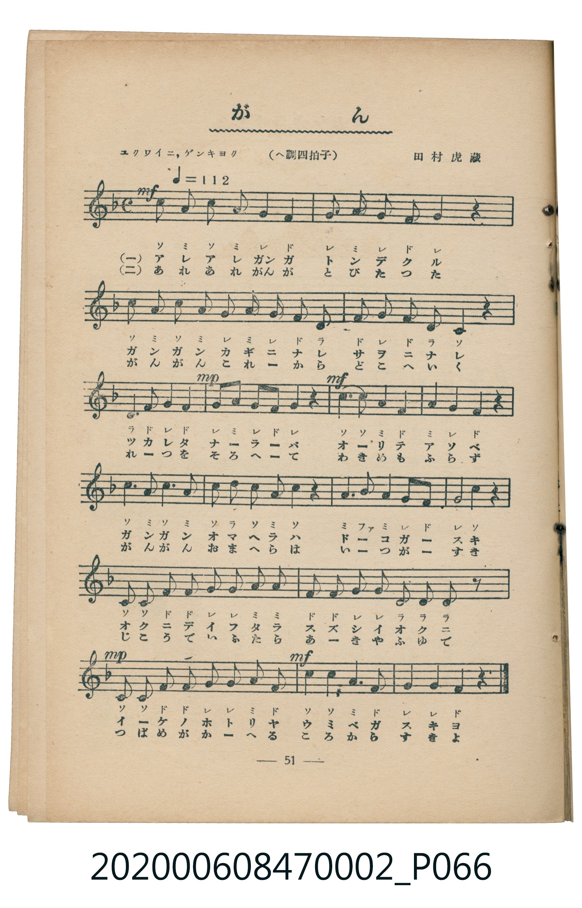
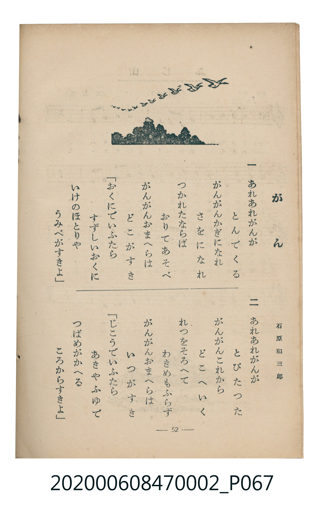

# がん（雁）

> Re:Shōka 使用 AI 協助辨識與重建樂譜，可能會有錯誤。歡迎回報。

- **NEUTRINO 歌聲合成版**：<br><audio controls src="gan_neutrino.mp3"></audio>
- **鋼琴伴奏版**：<br><audio controls src="gan.mp3"></audio>


- 詞：石原和三郎
- 曲：田村虎藏
- 臺灣教育會公認《新定兒童唱歌》尋常科第二學年用（2020.006.0847.0002）

## 說明

曲目說明
中文解釋：描寫雁群飛過天空、成群遷徙的景象。

## 歌詞

```text
一
あれあれ　がんがとんでくる
がんがん　かぎになれさをになれ
つかれたならば　おりてあそべ
がんがん　おまへらはどこがすき
「おくにでいふたら　すずしいおくに
いけのほとりや　うみべがすきよ」

二
あれあれ　がんがとびたつた
がんがん　これからどこへいく
れつをそろへて　わきめもふらず
がんがん　おまへらはいつがすき
「じこうでいふたら　あきやふゆで
つばめがかへる　ころからすきよ」
```

## ABC

```abc
X:1
T:がん（雁）
C:曲：田村虎藏
M:4/4
L:1/16
Q:1/4=112
K:F
V:V1 name="Piano" snm="Pia"
[V:V1]
!mf! c2 A2 c2 A2 G4 F4 | G2 A2 G2 F2 G4 z4 | c2 A2 c2 A2 G2 A G F2 D2 | F2 G2 F2 D2 C4 z4 |
w: 1.~あ れ あ れ がん が | と ん で く る | が ん が ん か ぎ に な れ | さ を に な れ
w: 2.~あ れ あ れ がん が | と び た つ た | が ん が ん こ れ _ か ら | ど こ へ い く
D6 F2 G4 F4 | !mp! G2 A2 G2 F2 G4 z4 | !mf! c6 c2 A4 F4 | A4 G4 F4 z4 |
w: 1.~つ か れ た | な _ ら _ ば | お _ り て | あ そ べ
w: 2.~れ つ を そ | ろ _ へ _ て | わ き め も | ふ ら ず
c6 A2 c6 A2 | c2 d2 c2 A2 c4 z4 | A6 B2 A4 G2 F2 | G8 c4 z4 |
w: 1.~が ん が ん | お ま へ ら は | ど _ こ が _ | す き
w: 2.~が ん が ん | お ま へ ら は | い _ つ が _ | す き
C2 C2 F2 F2 G2 G2 A2 A2 | F2 F2 G2 G2 D2 D2 D2 z2 | !mp! C2 C2 F2 F2 G2 G2 A2 F2 | !mf! c4 c4 A6 F2 |
w: 1.~お く に で い ふ た ら | す ず し い お く に | い _ け の ほ と り や | う み べ が
w: 2.~じ こ う で い ふ た ら | あ _ き や ふ ゆ で | つ ば め が か _ へ る | こ ろ か ら
G4 G4 F4 z4 |
w: 1.~す き よ
w: 2.~す き よ
```

## TMD 檔案連結

- [主旋律 TMD 檔案](gan.tmd) [[在 TMD Studio 編輯](https://tmdlang.github.io/Tmd-TS/#tmd=s7IKdvYPcrWy4qpTUCpJTLdSSM7PyUlNLsnMz7MqzsjMK0nNjM_KTMmPL87Iz05Ugisry88pzU21Si9KTEmNN4o3MjAyiDcwMIs3sDAxBzIMjBBKi_NLi5JTrYqTM_Lzc-JLUitKkvLzsxHyBUX5Zal5iXlANQVFIBtTwIoQClLLMlNSQdKpKZkl-UWZiTlI7kgtKga7FWxJfElRYl5xclFmAcgDCFUlGalAxybmZeaC9HJpaSk8bux53DT5_Z6Ol7Mb3-_pVNDS4lK0VTA0NOKyt1Vw47Ix0TexA2l_0b7reePiZ1Nnvmja9GxO89PWNS9W9T5u6Ho2bcPTdbOetk56vnrp0ykbn63tedzQ_XRD99MdO54vn_h8zZonu3qert3xdOeW51NWAK0BBZAeMID0QAEEZBgYAW1V4tLXUng2e9Pz2eterFr1bEYfl4KCwpMda59Na3-xfPHL9u73e2Y96-9_un410JXP9y15uXj2y8a-p0tWPl-563FD47OOCSDBxu1P9818Pqvl2cz1LzYufNzQxKWlD3b6ynlA_c_nb37aN__ppJ4nOzpfNveBwwRoJUhmyoZncye-mNn3Yno_MFD0tbie7GjgetzY9LipB0o2NEDCCUQ2rgAzlj9u7H_c1A1UB5MAkiB13Y8b-x43rn7cuAqsf-rjpklwLlD1EpAKkMR8sFDn48YNYG1dj5u6HjcuA1nYOPdx405Mg4HS-x437gDrWf-4ceXjRoh7Zj5u7OV63ABkAVX0g-0COq7lceNWkCVA1SDNQEWzHjdOB4tDlQFtAHImPm5c97hxN9hbQDe0gFW3PW7cD3QD3PjHTR2PG3q5uICRiTdgGjeD_QX043xM908GawN6Huh-iON3gF3QzwWWWAIOqLmPm3rBEstAepqA7gRa3vi4CRgqW8E6ZxEMGKCRQAegBMwMsHVAX2EGDNBgoA1gwSaQAkgUbQBZCjIDGJtAg7thHgC6DeIBpFABpjIu38TMPKuAzMS8fIcag5pqUPpVsDE007IDs2oUqnPTahVMFXQVjIEYRhsBMQgaQukasAhMBiQKU2EAUwE2zsewBphvm4B8YMCBSBQ2KFigyoEcuNHA6AErAskBvQkm-8Ei3VA18aiWGJFvSeNmMDkfTC6BszEtqcEaJsZAEuR7M5DiGnhAwIVMYYZgCxaw-6C-RGaDfAnMmUC8GohXwf0C0jMVzJsEVrEaTCLkcYUMLnvAJDSUwHY2dUJtWYmQb9wBJlvAJCgWsAUN2K8wiJwaEOmlOreglnCiQaQ-GISFNqppMBF0e7AFMyhWYRDmUVhwIWIbpBIUlGBRcEBA5DdAWXAvA8W6kEyEqIeJAAsDJHWgZAgRnQtn7UQ3DxFRcFdBVIJTIziqUc0AqeyFi4KiB9VmJJc2wSIMogKkC1hawF0Ncx_IrVvhogi_z8LqVkhOgEFYjkDmQ1SYQWWQVSAiGhaDIGgCVQWCsKQBKWGQIYYZaFkJ7k-kpI4qBos7YCEMJsFJG-xfYGkMVYkcz6BsgAwhWQLCQi5JZmKo60U3DS07Ut-toAyK6gZYuifPrcA4hBdgoPiAZVdYFobEM7oMuCBAEKCoQo4miIfAZTm09IKU7pDSBZQEoUUxvCQCOReSEIFNAiS16CaBy1-kQJ4BloEEbhtRNiEyKyhAgPUsQmUTwgSEPdAiDX8oQVIySqEGo5EzAGqCJ6ZQg0U3sFUEJteByd1gElJ7gkMI7AuQepAPIOr3w1mwogiRSJATCCJhABsPUBa25AypNEHFJKRogdYx4IIWYg4k6YL4IPXwLIRUiMHUQsSR456wS2q5uHTtFECtGgUgrcwFAA)]
- [鋼琴伴奏 TMD 檔案](gan_piano.tmd) [[在 TMD Studio 編輯](https://tmdlang.github.io/Tmd-TS/#tmd=s7IKdvYPcrWy4uLS0lJ43NjzuGny-z0dT_Zsebq0_8nuGe_3dCpoaXEp2ioYGhpx2dsquHHZmOib2HHVKSi9aN_1vHHxs6kzXzRtejan-Wnrmhereh83dD2btuHpullPWyc9X7306ZSNz9b2PG7ofrqh--mOHc-XT3y-Zs2TXT1P1-54unPL8ykrgJYZGRgZ6BkYmOkZWJiYAxkGRkBblcA2rJz3fs-s5_M3P-2b_3RSz5MdnS-b-8Ayz2ZvAslM2fBs7sQXM_teTO9X4uLyTczMswrITMzLD_JwqDGoqeZSAAIbQzMtOzCrRqE6N61WwVRBV8EYiGG0ERCDoCGUrgGLwGRAojAVBjAVYON8DGuAIdYE5D9u6gGRKGxQSEKVAzlwox83rgArAsk9blwOJvvBIt1QNfGolhiRb0njZjA5H0wugbMxLanBGibGQBLkezOQ4hp4QMCFTGGGYAsWsPugvkRmg3z5uLEPiFcD8Sq4X0B6poJ5k8AqVoNJhDyukMFlD5iEhhLYzqZOqC0rEfKNO8BkC5gExQK2oAH7FQaRUwMivVTnFtQSTjSI1AeDsNBGNQ0mgm4PtmAGxSoMwjwKCy5EbINUgoISLAoOCIj8BigL7mWgWBeSiRD1MJHHjcuQ1IGSIUR0Lpy1E908RETBXQVRCU6N4KhGNQOkshcuCooeVJuRXNoEizCICpCux02NcFfD3Ady61a4KMLvs7C6FZITYBCWI5D5EBVmUBlkFYiIhsUgCJpAVYEgLGlAShhkiGEGWlaC-xMpqaOKweLuceM-MAlO2mD_Pm5cD1WJHM-gbIAMIVkCwkIuSWZiqOtFNw0tO1LfraAMiuoGWLonz63AOIQXYKD4gGVXWBaGxDO6DLggQBCgqEKOJoiHwGU5tPSClO6Q0gWUBKFFMbwkAjkXkhAfN05HUotuErj8RQrkGWAZSOC2EWUTIrOCAuRxE5LKJoQJCHugRRr-UIKkZJRCDUYjZwDUBE9MoQaL7seNE8HkOjC5G0xCak9wCIF9AVIP8gFE_X44C1YUIRIJcgJBJIzHTR1QFrbkDKk0QcUkpGiB1jHgghZiDiTpgvgg9fAshFSIwdRCxJHjnrBLapEbNT44GjWGIPXRhrFAEolpGg9mm8ajiYPSPnYZFHHUeCHdEhOIjAlYBoWDpAzdEtyaqOUbHP7AzkRRjcse4gKKCAuwM7G6HFd4orgRLWiIdT9R4UlUIJlBOGZIHESZSaFFRAQtib4HZjVdOwVQbov2AUnB2EZgtjIXAA)]

## 分析

```text
================================================================================
📊 TMD Song Profile: [ がん（雁） ]
================================================================================
⏱  Duration:       0:36 (36.4s), 17 measures total
🎼 Key & Tempo:    首調基準 F, != 112.0 BPM, <4/4>
   - 分析範圍：      由實際發聲的音符與和弦推測調性；播放脈絡另行呈現
🎤 人聲音域:    C4 (MIDI 60) – D5 (MIDI 74) [跨度: 14 個半音 / 1.2 個八度, 難度: moderate]
   - 最低音:  C4 in [Main #1 @ m.4, 0:07]
   - 最高音: D5 in [Main #1 @ m.10, 0:19]
   - 適合: soprano, mezzo-soprano, contralto, tenor, baritone, bass
🏛  結構:      Main (36.4s)
⚡ 編曲密度:        Peak 1 軌道同時演奏
🗝  調性診斷：       C 大調（純淨自然大調，未偵測到可信轉調）
   - 風格氣質:    純淨自然大調（陽光明朗、易唱易記，無明顯調外色彩）
   - 轉調歷程:    全曲維持單一推測調性（未偵測到可信轉調）
   - 核心骨幹音:  G, C, F, A, D
   - 調性數值:    C 大調 [相關度: 0.81, 穩定度: Moderate, 自然音純度: 99.2%]
   - 候選調性 (K-S): C 大調 (0.81), F 大調 (0.76), A 小調 (0.60)
   - 五度圈歷程:   +0
   - 各段落調性細節:
     • [Main #1]: C 大調 (r: 0.81, 自然音純度: 99.2%, 調外音: A#)

  [ 五度圈游移軌跡 ]
              [C ]*
         F            G  
      Bb               D  
      Eb               A  
         Ab           E  
            Db       B  
               F# 
     (* = active key center)

  [ 十二半音累積音高分佈 ]
     C  : ███████████████████████   24.8%
     C# :                            0.0%
     D  : ███████                    7.4%
     D# :                            0.0%
     E  :                            0.0%
     F  : ███████████████████       20.7%
     F# :                            0.0%
     G  : ████████████████████████  26.0%
     G# :                            0.0%
     A  : ███████████████████       20.2%
     A# : █                          0.8%
     B  :                            0.0%
--------------------------------------------------------------------------------
Assignment 軌道音域：
  - Piano         : C4 – D5 (14 個半音 / 1.2 個八度, 87 個音符)
================================================================================
```


## 原書掃描頁






