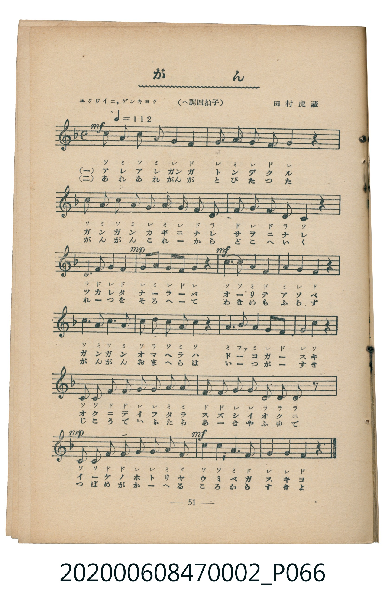
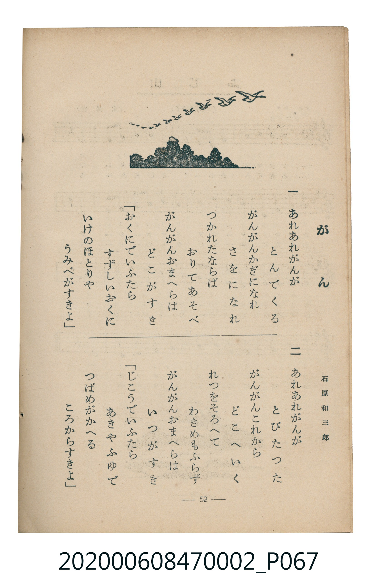

# がん（雁）

> Re:Shōka 使用 AI 協助辨識與重建樂譜，可能會有錯誤。歡迎[回報](https://github.com/TMDLang/reshoka/issues)。

- **鋼琴伴奏版**：<br><audio controls src="gan.mp3"></audio>
- **NEUTRINO 歌聲合成版**：<br><audio controls src="gan_neutrino.mp3"></audio>

- 詞：石原和三郎
- 曲：田村虎藏
- 臺灣教育會公認《新定兒童唱歌》尋常科第二學年用（2020.006.0847.0002）

## 說明

曲目說明
中文解釋：描寫雁群飛過天空、成群遷徙的景象。


## 歌詞

```text
一
あれあれ　がんがとんでくる
がんがん　かぎになれさをになれ
つかれたならば　おりてあそべ
がんがん　おまへらはどこがすき
「おくにでいふたら　すずしいおくに
いけのほとりや　うみべがすきよ」

二
あれあれ　がんがとびたつた
がんがん　これからどこへいく
れつをそろへて　わきめもふらず
がんがん　おまへらはいつがすき
「じこうでいふたら　あきやふゆで
つばめがかへる　ころからすきよ」
```

## ABC

<div class="abc-score" data-abc-src="gan.abc" aria-label="五線譜載入中"></div>

[下載 ABC 原始檔](gan.abc)

## TMD 檔案連結

- [主旋律 TMD 檔案](gan.tmd) [[在 TMD Studio 編輯](https://tmdlang.github.io/Tmd-TS/#tmd=s7IKdvYPcrWy4qpTUCpJTLdSSM7PyUlNLsnMz7MqzsjMK0nNjM_KTMmPL87Iz05Ugisry88pzU21Si9KTEmNN4o3MjAyiDcwMIs3sDAxBzIMjBBKi_NLi5JTrYqTM_Lzc-JLUitKkvLzsxHyBUX5Zal5iXlANQVFIBtTwIoQClLLMlNSQdKpKZkl-UWZiTlI7kgtKga7FWxJfElRYl5xclFmAcgDCFUlGalAxybmZeYi6wUalZ6ZZ5WbmpmVicVd-UUlGflADxZkVFplZBaDbE5OzInPTsxDCgeovQWJ6alWAQZmZrpAwlyJi0tLS-FxY8_jpsnv93S8nN34fk-ngpYWl6KtgqGhEZe9rYIbl42JvokdyJwX7bueNy5-NnXmi6ZNz-Y0P21d82JV7-OGrmfTNjxdN-tp66Tnq5c-nbLx2dqexw3dTzd0P92x4_nyic_XrHmyq-fp2h1Pd255PmUF0BpQHOgB40APFAdAhoER0FYlLn0thWezNz2fve7FqlXPZvRxKSgoPNmx9tm09hfLF79s736_Z9az_v6n61cDXfl835KXi2e_bOx7umTl85W7Hjc0PuuYABJs3P5038zns1qezVz_YuPCxw1NXFr6YKevnAfU_3z-5qd9859O6nmyo_Nlcx84cIBWgmSmbHg2d-KLmX0vpvcDA0Vfi-vJjgaux41Nj5t6oGRDAyScQGTjCjBj-ePG_sdN3UB1MAkgCVLX_bix73Hj6seNq8D6pz5umgTnAlUvAakAScwHC3U-btwA1tb1uKnrceMykIWNcx837sQ0GCi973HjDrCe9Y8bVz5uhLhn5uPGXq7HDUAWUEU_2C6g41oeN24FWQJUDdIMVDTrceN0sDhUGdAGIGfi48Z1jxt3g70FdEMLWHXb48b9QDfAjX_c1PG4oZeLCxiZeAOmcTPYX0A_zsd0_2SwNqDnge6HOH4H2AX9XGCJJeCAmvu4qRcssQykpwnoTqDljY-bgKGyFaxzFsGAARoJdABKwMwAWwf0FWbAAA0G2gAWbAIpgETRBpClIDOAsQk0uBvmAaDbIB5AChVgKuPyTQTm0YDMxLx8hxqDmmpQ-lWwMTTTsgOzahSqc9NqFUwVdBWMgRhGGwExCBpC6RqwCEwGJApTYQBTATbOx7AGmG-bgHxgwIFIFDYoWKDKgRy40cDoASsCyQG9CSb7wSLdUDXxqJYYkW9J42YwOR9MLoGzMS2pwRomxkAS5HszkOIaeEDAhUxhhmALFrD7oL5EZoN8CcyZQLwaiFfB_QLSMxXMmwRWsRpMIuRxhQwue8AkNJTAdjZ1Qm1ZiZBv3AEmW8AkKBawBQ3YrzCInBoQ6aU6t6CWcKJBpD4YhIU2qmkwEXR7sAUzKFZhEOZRWHAhYhukEhSUYFFwQEDkN0BZcC8DxbqQTISoh4kACwMkdaBkCBGdC2ftRDcPEVFwV0FUglMjOKpRzQCp7IWLgqIH1WYklzbBIgyiAqQLWFrAXQ1zH8itW-GiCL_PwupWSE6AQViOQOZDVJhBZZBVICIaFoMgaAJVBYKwpAEpYZAhhhloWQnuT6SkjioGiztgIQwmwUkb7F9gaQxViRzPoGyADCFZAsJCLklmYqjrRTcNLTtS362gDIrqBli6J8-twDiEF2Cg-IBlV1gWhsQzugy4IEAQoKhCjiaIh8BlObT0gpTukNIFlAShRTG8JAI5F5IQgU0CJLXoJoHLX6RAngGWgQRuG1E2ITIrKECA9SxCZRPCBIQ90CINfyhBUjJKoQajkTMAaoInplCDRTewVQQm14HJ3WASUnuCQwjsC5B6kA8g6vfDWbCiCJFIkBMIImEAGw9QFrbkDKk0QcUkpGiB1jHgghZiDiTpgvgg9fAshFSIwdRCxJHjnrBLarm4dO0UQK0aBSCtzAUA)]
- [鋼琴伴奏 TMD 檔案](gan_piano.tmd) [[在 TMD Studio 編輯](https://tmdlang.github.io/Tmd-TS/#tmd=s7IKdvYPcrWy4qpTUCpJTLdSyC8qychPL0osyKi0ysgsLskvykxOzInPTsxLVIIrKs4vLUpOjS9ITE-1CjAwM9MFEuZKXFxaWgqPG3seN01-v6fjyZ4tT5f2P9k94_2eTgUtLS5FWwVDQyMue1sFNy4bE30TO5BpL9p3PW9c_GzqzBdNm57NaX7auubFqt7HDV3Ppm14um7W09ZJz1cvfTpl47O1PY8bup9u6H66Y8fz5ROfr1nzZFfP07U7nu7c8nzKCqBlRgZGBnoGBmZ6BhYm5kCGgRHQVrB7X6yc937PrOfzNz_tm_90Us-THZ0vm_vAMs9mbwLJTNnwbO7EFzP7XkzvB_rANzEzzyogMzEvP8jDocagpppLAQhsDM207MCsGoXq3LRaBVMFXQVjIIbRRkAMgoZQugYsApMBicJUGMBUgI3zMawBhlgTkP-4qQdEorBBIQlVDuTAjX7cuAKsCCT3uHE5mOwHi3RD1cSjWmJEviWNm8HkfDC5BM7GtKQGa5gYA0mQ781AimvgAQEXMoUZgi1YwO6D-hKZDfLl48Y-IF4NxKvgfgHpmQrmTQKrWA0mEfK4QgaXPWASGkpgO5s6obasRMg37gCTLWASFAvYggbsVxhETg2I9FKdW1BLONEgUh8MwkIb1TSYCLo92IIZFKswCPMoLLgQsQ1SCQpKsCg4ICDyG6AsuJeBYl1IJkLUw0QeNy5DUgdKhhDRuXDWTnTzEBEFdxVEJTg1gqMa1QyQyl64KCh6UG1GcmkTLMIgKkC6Hjc1wl0Ncx_IrVvhogi_z8LqVkhOgEFYjkDmQ1SYQWWQVSAiGhaDIGgCVQWCsKQBKWGQIYYZaFkJ7k-kpI4qBou7x437wCQ4aYP9-7hxPVQlcjyDsgEyhGQJCAu5JJmJoa4X3TS07Eh9t4IyKKobYOmePLcC4xBegIHiA5ZdYVkYEs_oMuCCAEGAogo5miAeApfl0NILUrpDShdQEoQWxfCSCORcSEJ83DgdSS26SeDyFymQZ4BlIIHbRpRNiMwKCpDHTUgqmxAmIOyBFmn4QwmSklEKNRiNnAFQEzwxhRosuh83TgST68DkbjAJqT3BIQT2BUg9yAcQ9fvhLFhRhEgkyAkEkTAeN3VAWdiSM6TSBBWTkKIFWseAC1qIOZCkC-KD1MOzEFIhBlMLEUeOe8IuqUVu1PggN2os4G0aw3iFaMNYGGUaD6RN4-F8UFJHFYHzEQmYsCEmIBEToAicAZVCNgRTEamuQXMHKgWXRTcDt0dwGIBKodiM7j-4XUhOx2c_Tv_h9IQZiGEGZRiQbhAOrxJwLTBl6dopgBJXtA9QEM42ArOVuQA)]

## 分析

```text
================================================================================
📊 TMD Song Profile: [ がん（雁） ]
================================================================================
⏱  Duration:       0:36 (36.4s), 17 measures total
🎼 Key & Tempo:    首調基準 F, != 112.0 BPM, <4/4>
   - 分析範圍：      由實際發聲的音符與和弦推測調性；播放脈絡另行呈現
🎤 人聲音域:    C4 (MIDI 60) – D5 (MIDI 74) [跨度: 14 個半音 / 1.2 個八度, 難度: moderate]
   - 最低音:  C4 in [Main #1 @ m.4, 0:07]
   - 最高音: D5 in [Main #1 @ m.10, 0:19]
   - 適合: soprano, mezzo-soprano, contralto, tenor, baritone, bass
🏛  結構:      Main (36.4s)
⚡ 編曲密度:        Peak 1 軌道同時演奏
🗝  調性診斷：       C 大調（純淨自然大調，未偵測到可信轉調）
   - 風格氣質:    純淨自然大調（陽光明朗、易唱易記，無明顯調外色彩）
   - 轉調歷程:    全曲維持單一推測調性（未偵測到可信轉調）
   - 核心骨幹音:  G, C, F, A, D
   - 調性數值:    C 大調 [相關度: 0.81, 穩定度: Moderate, 自然音純度: 99.2%]
   - 候選調性 (K-S): C 大調 (0.81), F 大調 (0.76), A 小調 (0.60)
   - 五度圈歷程:   +0
   - 各段落調性細節:
     • [Main #1]: C 大調 (r: 0.81, 自然音純度: 99.2%, 調外音: A#)

  [ 五度圈游移軌跡 ]
              [C ]*
         F            G  
      Bb               D  
      Eb               A  
         Ab           E  
            Db       B  
               F# 
     (* = active key center)

  [ 十二半音累積音高分佈 ]
     C  : ███████████████████████   24.8%
     C# :                            0.0%
     D  : ███████                    7.4%
     D# :                            0.0%
     E  :                            0.0%
     F  : ███████████████████       20.7%
     F# :                            0.0%
     G  : ████████████████████████  26.0%
     G# :                            0.0%
     A  : ███████████████████       20.2%
     A# : █                          0.8%
     B  :                            0.0%
--------------------------------------------------------------------------------
Assignment 軌道音域：
  - Piano         : C4 – D5 (14 個半音 / 1.2 個八度, 87 個音符)
================================================================================
```


## 原書掃描頁






