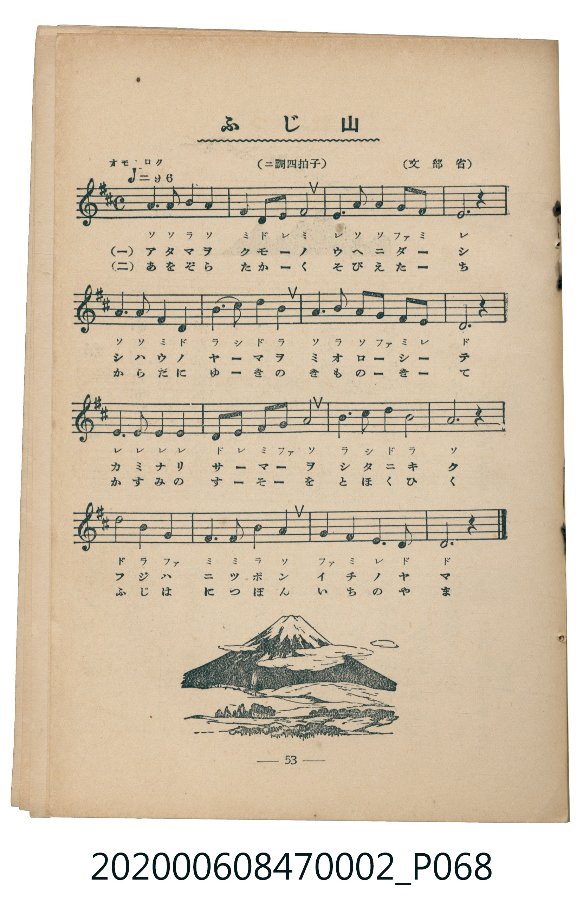

# ふじ山

> Re:Shōka 使用 AI 協助辨識與重建樂譜，可能會有錯誤。歡迎[回報](https://github.com/TMDLang/reshoka/issues)。

- **鋼琴伴奏版**：<br><audio controls src="fujisan.mp3"></audio>
- **NEUTRINO 歌聲合成版**：<br><audio controls src="fujisan_neutrino.mp3"></audio>

- 臺灣教育會公認《新定兒童唱歌》尋常科第二學年用（2020.006.0847.0002）
- 文部省

## 說明


- 出處：臺灣教育會公認《新定兒童唱歌》尋常科第二學年用（2020.006.0847.0002）
- 出處：文部省
- 調性與拍號：調號 ?= D，拍號 <4/4>，速度 != 96


## 歌詞

```text
一
あたまをくもの　うへにだし
しはうのやまを　みおろして
かみなりさまを　したにきく
ふじはにつぽん　いちのやま

二
あをぞらたかく　そびえたち
からだにゆきを　きものきて
かすみのすそを　とほくひく
ふじはにつぽん　いちのやま
```

## ABC

<div class="abc-score" data-abc-src="fujisan.abc" aria-label="五線譜載入中"></div>

[下載 ABC 原始檔](fujisan.abc)

## TMD 檔案連結

- [主旋律 TMD 檔案](fujisan.tmd) [[在 TMD Studio 編輯](https://tmdlang.github.io/Tmd-TS/#tmd=s7IKdvYPcrWy4qpTUCpJTLdSSM7PyUlNLsnMz7MqzsjMK0nNjM_KTMmPL87Iz05Ugisry88pzU21Si9KTEmNN4o3MjAyiDcwMIs3sDAxBzIMjBBKi_NLi5JTrYqTM_Lzc-JLUitKkvLzsxHyBUX5Zal5iXlANQVFIBtTwIoQClLLMlNSQdKpKZkl-UWZiTlI7kgtKga7FWxJfElRYl5xclFmAcgDCFUlGalAx-YllpQWpaKLFuQkJiMJAs1Pz8yzys3PSyoF-hlTIjUzKxOLL_KLSjLygcFRkFFplZFZDHJncmJOfHZiHlKoQV1ZkJieahVgYGahxMWlpaXwuHHr48YZTzduVNDS4lK0VbA047K3VXDhsjHRN7ED6X3Rvut54-JnU2e-aNr0bE7z09Y1L1b1Pm7oejZtw9N1s562Tnq-eunTKRufre153ND9dEP30x07ni-f-HzNmie7ep6u3fF055bnU1a839MBiiU9YCzpgWIJyDAwer-nE-y6Z9PaXzaveD6nEegifS2uJzsauB43Nj1unP-4cd_jpkmPG_sfNwG56x43NDxubHvcuONx4-rHjQseN04Hqpv-uHE9WHTd46YWqAaQuv2PG7seN_WCFSwDqusGC6163NT1uHEqkjqgNNAeoHlApf1AdaDQABsJFFryuHHv46bJYHVAsxfCLeHiAnoO7EiQ8-Y9buoEmwK0ox-seO7jxs2PGzvAggvBloNUAF28-nET0Km9MMuBDLDHQJZDHTkT7E6gEJAxF6ZuxePG3SCzGzeR4kgtfS4u30RgsgnITMzLd6gxqKnmUgACGwstOzCjRsFUQRcITRXMwKQuUMQYSBoqGIFpEKwBsiFqQPImQHGYCAQagNSATfMxrAGmpiawKNDnQLwPxGqaBDYF6HAwDyQPdCLcdGDcQXXsAOLVYNYCqMx0JHviEfYYIdkDNB0YAWBWJ1TXfLAZ3WASZCfMnrlQezYDcQfUjRCZhVjtQYQOJExAakHhZK5gGAdmQAyGKDID0qDAMQKKgJTiCh6Il4BxB_U4JCiAMk0tUJl90CCDOXs_VLwLKN4LZoHMAMkswxM8IO9DAgUSnJCgBdkDC-5etGgAmQ2JIIg4RAS3PbBkYASmQRjkc1DCMYGGCUhEAxJQ5pqqGrq6mqCQA4UVathhDymoD4D-B2ZbsMu6oO6ZCg0nWOKC2oQI3Pma8KQE8RUiARIIr8aZ0BCHxwtQBMQDJR4021ZAtewG2QZO3I2bCNoGDCNQEECSDCg_wfKcLpBE5EKQOEgUEsSGBBLVVqg4sFQAk-uhTgAFAYi_BIj3gj0wGSoDSmyQdA9LBKAECJIBBSuuQKKtPbVcXLp2CqACSwFIK3MBAA)]
- [鋼琴伴奏 TMD 檔案](fujisan_piano.tmd) [[在 TMD Studio 編輯](https://tmdlang.github.io/Tmd-TS/#tmd=s7IKdvYPcrWy4qpTUCpJTLdSyC8qychPL0osyKi0ysgsLskvykxOzInPTsxLVIIrKs4vLUpOjS9ITE-1CjAws1Di4tLSUnjcuPVx44ynGze-39PxZM-Wp0v7n-ye8X5Pp4KWFpeirYKlGZe9rYILl42JvokdyKgX7bueNy5-NnXmi6ZNz-Y0P21d82JV7-OGrmfTNjxdN-tp66Tnq5c-nbLx2dqexw3dTzd0P92x4_nyic_XrHmyq-fp2h1Pd255PmUF0C4jAyMDPQMDMz0DCxNzIMPACGgp2LHPprW_bF7xfE4j0IG-iZl5VgGZiXn5QR4ONQY11VwKQGBjoWUHZtQomCroAqGpghmY1AWKGANJQwUjMA2CNUA2RA1I3gQoDhOBQAOQGrBpPoY1wOBoAos-bpwPxPtArKZJYFMeN_aDeSD5x43r4KY_bmyD6tgBxKvBrAVQmelI9sQj7DFCsgdo-uPGeWBWJ1TXfLAZ3WASZCfMnrlQezYDcQfUjRCZhVjtQYQOJExAakHhZK5gGAdmQAyGKDID0qDAMQKKgJTiCh6Ilx43rod6HBIUQJmmFqjMPmiQwZy9HyreBRTvBbNAZoBkluEJHpD3IYECCU5I0ILsgQV3L1o0gMyGRBBEHCKC2x5YMjAC0yAM8jko4ZhAwwQkogEJKHNNVQ1dXU1QyIHCCjXssIcU1AdA_z9uXAV2WRfUPVOh4QRLXFCbEIE7XxOelCC-QiRAAuHVOBMa4vB4AYqAeKDEg2bbCqiW3SDbwIm7cRNB24BhBAoCSJIB5SdYntMFkohcCBIHiUKC2JBAotoKFQeWRGByPdQJoCAA8ZcA8V6wByZDZUCJDZLuYYkAlABBMqBgxRVItLWnFrm88kEur0zg5ZVhvEK0YayCCZAyiUXwoRQwQcUDWabxsQgGkhiYMEBEBJpeqKFws7GZBVUMwgiD8CgkbDiao9DVQQ0wAyk3A5tsBGQZ4XMUMBx17RRAQRntAxSCs4GagGxlLgA)]

## 分析

```text
================================================================================
📊 TMD Song Profile: [ ふじ山 ]
================================================================================
⏱  Duration:       0:40 (40.0s), 16 measures total
🎼 Key & Tempo:    首調基準 D, != 96.0 BPM, <4/4>
   - 分析範圍：      由實際發聲的音符與和弦推測調性；播放脈絡另行呈現
🎤 人聲音域:    D4 (MIDI 62) – D5 (MIDI 74) [跨度: 12 個半音 / 1.0 個八度, 難度: easy]
   - 最低音:  D4 in [Main #1 @ m.2, 0:03]
   - 最高音: D5 in [Main #1 @ m.6, 0:13]
   - 適合: soprano, mezzo-soprano, contralto, tenor, baritone, bass
🏛  結構:      Main (40.0s)
⚡ 編曲密度:        Peak 1 軌道同時演奏
🗝  調性診斷：       D 大調（純淨自然大調，未偵測到可信轉調）
   - 風格氣質:    純淨自然大調（陽光明朗、易唱易記，無明顯調外色彩）
   - 轉調歷程:    全曲維持單一推測調性（未偵測到可信轉調）
   - 核心骨幹音:  A, D, E, B, F#
   - 調性數值:    D 大調 [相關度: 0.85, 穩定度: Moderate, 自然音純度: 100.0%]
   - 候選調性 (K-S): D 大調 (0.85), A 大調 (0.80), B 小調 (0.62)
   - 五度圈歷程:   +2
   - 各段落調性細節:
     • [Main #1]: D 大調 (r: 0.85, 自然音純度: 100.0%)

  [ 五度圈游移軌跡 ]
               C  
         F            G  
      Bb              [D ]*
      Eb               A  
         Ab           E  
            Db       B  
               F# 
     (* = active key center)

  [ 十二半音累積音高分佈 ]
     C  :                            0.0%
     C# : █                          1.2%
     D  : ████████████████████      20.0%
     D# :                            0.0%
     E  : ███████████████████       19.2%
     F  :                            0.0%
     F# : ██████████████            14.2%
     G  : ██████                     5.8%
     G# :                            0.0%
     A  : ████████████████████████  24.2%
     A# :                            0.0%
     B  : ███████████████           15.4%
--------------------------------------------------------------------------------
Assignment 軌道音域：
  - Piano         : D4 – D5 (12 個半音 / 1.0 個八度, 55 個音符)
================================================================================
```


## 原書掃描頁




