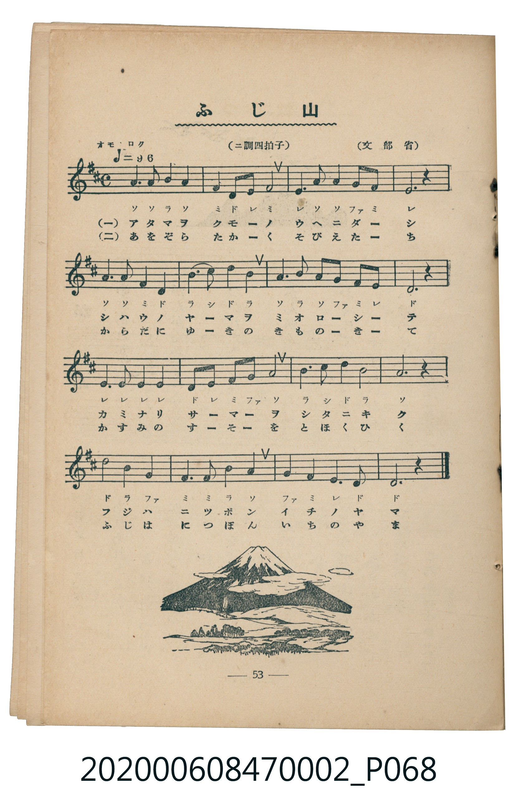

# ふじ山

> Re:Shōka 使用 AI 協助辨識與重建樂譜，可能會有錯誤。歡迎回報。

- **NEUTRINO 歌聲合成版**：<br><audio controls src="fujisan_neutrino.mp3"></audio>
- **鋼琴伴奏版**：<br><audio controls src="fujisan.mp3"></audio>


- 臺灣教育會公認《新定兒童唱歌》尋常科第二學年用（2020.006.0847.0002）
- 文部省

## 說明


- 出處：臺灣教育會公認《新定兒童唱歌》尋常科第二學年用（2020.006.0847.0002）
- 出處：文部省
- 調性與拍號：調號 ?= D，拍號 <4/4>，速度 != 96


## 跨冊／重複收錄參照

> 同曲＋同名異曲（《公學校唱歌》第三學年、《公學校唱歌集》與《新定兒童唱歌》第二學年為文部省『尋常小學唱歌』「あたまを雲の上に出し…」同曲；《公學校唱歌》第二學年〈フヂサン〉為低學年別曲）

- **[同曲]** 《公學校唱歌》第二學年用（昭和11年／1936）：[**〈フジサン（富士山）〉**](../../../kogakko_shoka/grade_2/8_fujisan/index.md)（`D` / `4/4` — [原始 TMD](../../../kogakko_shoka/grade_2/8_fujisan/fujisan.tmd)）
- **[同曲]** 《公學校唱歌集》（大正4年／1915，國臺圖 0725 26）：[**〈富士山〉**](../../../kogakko_shokashu_1915/5_02_fujisan/index.md)（`D` / `4/4` — [原始 TMD](../../../kogakko_shokashu_1915/5_02_fujisan/fujisan.tmd)）
- **[同名異曲]** 《共益商社唱歌教科書》卷四・教師用（明治33年／1900）：[**〈富士山〉**](../../../kyoeki_shoka/kan_4_854865/6_fujisan/index.md)（`E,` / `4/4` — [原始 TMD](../../../kyoeki_shoka/kan_4_854865/6_fujisan/fujisan.tmd)）
- 總表：[跨冊重複與同名歌曲總索引](../../../duplicate_songs.md)

## 歌詞

```text
一
あたまをくもの　うへにだし
しはうのやまを　みおろして
かみなりさまを　したにきく
ふじはにつぽん　いちのやま

二
あをぞらたかく　そびえたち
からだにゆきを　きものきて
かすみのすそを　とほくひく
ふじはにつぽん　いちのやま
```

## ABC

```abc
X:1
T:ふじ山
M:4/4
L:1/16
Q:1/4=96
K:D
V:V1 name="Piano" snm="Pia"
[V:V1]
A6 A2 B4 A4 | F4 D2 E2 F8 | E6 A2 A4 G2 F2 | E12 z4 |
w: 1.~あ た ま を | く も _ の | う へ に だ _ | し
w: 2.~あ を ぞ ら | た か _ く | そ び え た _ | ち
A6 A2 F4 D4 | B4 c2 d2 B8 | A6 B2 A2 G2 F2 E2 | D12 z4 |
w: 1.~し は う の | や _ ま を | み お ろ _ し _ | て
w: 2.~か ら だ に | ゆ _ き の | き も の _ き _ | て
E6 E2 E4 E4 | D2 E2 F2 G2 A8 | B3 c d4 B8 | A12 z4 |
w: 1.~か み な り | さ _ ま _ を | し た に き | く
w: 2.~か す み の | す _ そ _ を | と ほ く ひ | く
d8 B4 G4 | F6 F2 B4 A4 | G4 F4 E6 D2 | D12 z4 |
w: 1.~ふ じ は | に つ ぽ ん | い ち の や | ま
w: 2.~ふ じ は | に つ ぽ ん | い ち の や | ま
```

## TMD 檔案連結

- [主旋律 TMD 檔案](fujisan.tmd) [[在 TMD Studio 編輯](https://tmdlang.github.io/Tmd-TS/#tmd=s7IKdvYPcrWy4qpTUCpJTLdSSM7PyUlNLsnMz7MqzsjMK0nNjM_KTMmPL87Iz05Ugisry88pzU21Si9KTEmNN4o3MjAyiDcwMIs3sDAxBzIMjBBKi_NLi5JTrYqTM_Lzc-JLUitKkvLzsxHyBUX5Zal5iXlANQVFIBtTwIoQClLLMlNSQdKpKZkl-UWZiTlI7kgtKga7FWxJfElRYl5xclFmAcgDCFUlGalAx-YllpQWpaKLFuQkJgMFubS0FB43bn3cOOPpxo0KWlpcirYKlmZc9rYKLlw2JvomdiBtL9p3PW9c_GzqzBdNm57NaX7auubFqt7HDV3Ppm14um7W09ZJz1cvfTpl47O1PY8bup9u6H66Y8fz5ROfr1nzZFfP07U7nu7c8nzKivd7OkDBpQcMLj1QcAEZBkbv93SCHfZsWvvL5hXP5zQCXaSvxfVkRwPX48amx43zHzfue9w06XFj_-MmIHfd44aGx41tjxt3PG5c_bhxwePG6UB10x83rgeLrnvc1ALVAFK3_3Fj1-OmXrCCZUB13WChVY-buh43TkVSB5QG2gM0D6i0H6gOFBpgI4FCSx437n3cNBmsDmj2QrglXFxAz4EdCXLevMdNnWBTgHb0gxXPfdy4-XFjB1hwIdhykAqgi1c_bgI6tRdmOZAB9hjIcqgjZ4LdCRQCMubC1K143LgbZHbjJlIcqaXPxeWbmJlnFZCZmJfvUGNQU82lAAQ2Flp2YEaNgqmCLhCaKpiBSV2giDGQNFQwAtMgWANkQ9SA5E2A4jARCDQAqQGb5mNYA0xNTWBRoM-BeB-I1TQJbArQ4WAeSB7oRLjpwLiD6tgBxKvBrAVQmelI9sQj7DFCsgdoOjACwKxOqK75YDO6wSTITpg9c6H2bAbiDqgbITILsdqDCB1ImIDUgsLJXMEwDsyAGAxRZAakQYFjBBQBKcUVPBAvAeMO6nFIUABlmlqgMvugQQZz9n6oeBdQvBfMApkBklmGJ3hA3ocECiQ4IUELsgcW3L1o0QAyGxJBEHGICG57YMnACEyDMMjnoIRjAg0TkIgGJKDMNVU1dHU1QSEHCivUsMMeUlAfAP0PzLZgl3VB3TMVGk6wxAW1CRG48zXhSQniK0QCJBBejTOhIQ6PF6AIiAdKPGi2rYBq2Q2yDZy4GzcRtA0YRqAggCQZUH6C5TldIInIhSBxkCgkiA0JJKqtUHFgqQAm10OdAAoCEH8JEO8Fe2AyVAaU2CDpHpYIQAkQJAMKVlyBRFt7arm4dO0UQAWWApBW5gIA)]
- [鋼琴伴奏 TMD 檔案](fujisan_piano.tmd) [[在 TMD Studio 編輯](https://tmdlang.github.io/Tmd-TS/#tmd=s7IKdvYPcrWy4uLS0lJ43Lj1ceOMpxs3vt_T8WTPlqdL-5_snvF-T6eClhaXoq2CpRmXva2CC5eNib6JHVedgtKL9l3PGxc_mzrzRdOmZ3Oan7auebGq93FD17NpG56um_W0ddLz1UufTtn4bG3P44bupxu6n-7Y8Xz5xOdr1jzZ1fN07Y6nO7c8n7ICaJeRgZGBnoGBmZ6BhYk5kGFgBLRUCWTDs2ntL5tXPJ_TqMTF5ZuYmWcVkJmYlx_k4VBjUFPNpQAENhZadmBGjYKpgi4QmiqYgUldoIgxkDRUMALTIFgDZEPUgORNgOIwEQg0AKkBm-ZjWAMMjiaw6OPG-UC8D8RqmgQ25XFjP5gHkn_cuA5u-uPGNqiOHUC8GsxaAJWZjmRPPMIeIyR7gKY_bpwHZnVCdc0Hm9ENJkF2wuyZC7VnMxB3QN0IkVmI1R5E6EDCBKQWFE7mCoZxYAbEYIgiMyANChwjoAhIKa7ggXjpceN6qMchQQGUaWqByuyDBhnM2fuh4l1A8V4wC2QGSGYZnuABeR8SKJDghAQtyB5YcPeiRQPIbEgEQcQhIrjtgSUDIzANwiCfgxKOCTRMQCIakIAy11TV0NXVBIUcKKxQww57SEF9APT_48ZVYJd1Qd0zFRpOsMQFtQkRuPM14UkJ4itEAiQQXo0zoSEOjxegCIgHSjxotq2AatkNsg2cuBs3EbQNGEagIIAkGVB-guU5XSCJyIUgcZAoJIgNCSSqrVBxYEkEJtdDnQAKAhB_CRDvBXtgMlQGlNgg6R6WCEAJECQDClZcgURbe2qRyysf7OWVIUhptGEsKOjATBMQE0UciQlMYPFgnmk8iIvCQZODUoiQxW0mksUobsBnF5IBEBLZIiI1ku4ILJ7CpQ_JcDOIEWZQFxiBeUbEewoYj7p2CqCojPYBCcPYICPsFJS5AA)]

## 分析

```text
================================================================================
📊 TMD Song Profile: [ ふじ山 ]
================================================================================
⏱  Duration:       0:40 (40.0s), 16 measures total
🎼 Key & Tempo:    首調基準 D, != 96.0 BPM, <4/4>
   - 分析範圍：      由實際發聲的音符與和弦推測調性；播放脈絡另行呈現
🎤 人聲音域:    D4 (MIDI 62) – D5 (MIDI 74) [跨度: 12 個半音 / 1.0 個八度, 難度: easy]
   - 最低音:  D4 in [Main #1 @ m.2, 0:03]
   - 最高音: D5 in [Main #1 @ m.6, 0:13]
   - 適合: soprano, mezzo-soprano, contralto, tenor, baritone, bass
🏛  結構:      Main (40.0s)
⚡ 編曲密度:        Peak 1 軌道同時演奏
🗝  調性診斷：       D 大調（純淨自然大調，未偵測到可信轉調）
   - 風格氣質:    純淨自然大調（陽光明朗、易唱易記，無明顯調外色彩）
   - 轉調歷程:    全曲維持單一推測調性（未偵測到可信轉調）
   - 核心骨幹音:  A, D, E, B, F#
   - 調性數值:    D 大調 [相關度: 0.85, 穩定度: Moderate, 自然音純度: 100.0%]
   - 候選調性 (K-S): D 大調 (0.85), A 大調 (0.80), B 小調 (0.62)
   - 五度圈歷程:   +2
   - 各段落調性細節:
     • [Main #1]: D 大調 (r: 0.85, 自然音純度: 100.0%)

  [ 五度圈游移軌跡 ]
               C  
         F            G  
      Bb              [D ]*
      Eb               A  
         Ab           E  
            Db       B  
               F# 
     (* = active key center)

  [ 十二半音累積音高分佈 ]
     C  :                            0.0%
     C# : █                          1.2%
     D  : ████████████████████      20.0%
     D# :                            0.0%
     E  : ███████████████████       19.2%
     F  :                            0.0%
     F# : ██████████████            14.2%
     G  : ██████                     5.8%
     G# :                            0.0%
     A  : ████████████████████████  24.2%
     A# :                            0.0%
     B  : ███████████████           15.4%
--------------------------------------------------------------------------------
Assignment 軌道音域：
  - Piano         : D4 – D5 (12 個半音 / 1.0 個八度, 55 個音符)
================================================================================
```


## 原書掃描頁




