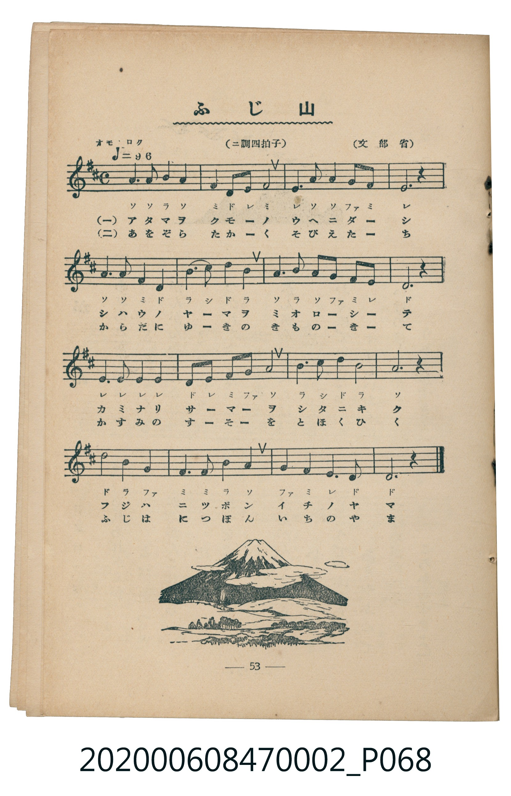

# ふじ山

<audio controls src="fujisan.mp3"></audio>

- 臺灣教育會公認《新定兒童唱歌》尋常科第二學年用（2020.006.0847.0002）
- 文部省

## 說明

・出處：臺灣教育會公認《新定兒童唱歌》尋常科第二學年用（2020.006.0847.0002）
・出處：文部省
・調性與拍號：調號 ?= D，拍號 <4/4>，速度 != 96

## 歌詞

```text
一
あたまをくもの　うへにだし
しはうのやまを　みおろして
かみなりさまを　したにきく
ふじはにつぽん　いちのやま

二
あをぞらたかく　そびえたち
からだにゆきを　きものきて
かすみのすそを　とほくひく
ふじはにつぽん　いちのやま
```

## ABC

```abc
X:1
T:ふじ山
M:4/4
L:1/16
Q:1/4=96
K:D
V:V1 name="Piano" snm="Pia"
[V:V1]
A6 A2 B4 A4 | F4 D2 E2 F8 | E6 A2 A4 G2 F2 | E12 z4 |
A6 A2 F4 D4 | B4 c2 d2 B8 | A6 B2 A2 G2 F2 E2 | D12 z4 |
E6 E2 E4 E4 | D2 E2 F2 G2 A8 | B4 c4 d4 B4 | A12 z4 |
d4 B4 G8 | F6 F2 B4 A4 | G4 F4 E6 D2 | D12 z4 |
```

## TMD 檔案連結

- [主旋律 TMD 檔案](fujisan.tmd) [[在 TMD Studio 編輯](https://tmdlang.github.io/Tmd-TS/#tmd=s7IKdvYPcrWy4qpTUCpJTLdSSM7PyUlNLsnMz7MqzsjMK0nNjM_KTMmPL87Iz05Ugisry88pzU21Si9KTEmNN4o3MjAyiDcwMIs3sDAxBzIMjBBKi_NLi5JTrYqTM_Lzc-JLUitKkvLzsxHyBUX5Zal5iXlANQVFIBtTwIoQClLLMlNSQdKpKZkl-UWZiTlI7kgtKga7FWxJfElRYl5xclFmAcgDCFUlGalAx-YllpQWpaKLFuQkJgMFubS0FB43bn3cOOPpxo0KWlpcirYKlmZc9rYKLlw2JvomdiBtL9p3PW9c_GzqzBdNm57NaX7auubFqt7HDV3Ppm14um7W09ZJz1cvfTpl47O1PY8bup9u6H66Y8fz5ROfr1nzZFfP07U7nu7c8nzKivd7OkDBpQcMLj1QcAEZBkbv93SCHfZsWvvL5hXP5zQCXaSvxfVkRwPX48amx43zHzfue9w06XFj_-MmIHfd44aGx41tjxt3PG5c_bhxwePG6UB10x83rgeLrnvc1ALVAFK3_3Fj1-OmXrCCZUB13WChVY-buh43TkVSB5QG2gM0D6i0H6gOFBpgI4FCSx437n3cNBmsDmj2QrglXFxAz4EdCXLevMdNnWBTgHb0gxXPfdy4-XFjB1hwIdhykAqgi1c_bgI6tRdmOZAB9hjIcqgjZ4LdCRQCMubC1K143LgbZHbjJlIcqaXPxeWbmJlnFZCZmJfvUGNQo1DNpQAENhZadmBGjYKpgi4QmiqYgUldoIgxkDRUMALTIFgDZEPUgORNgOIwEQg0AKlBMw1iBkgvyFxzBcM4MANiHESRGZAGGWYEFAEpxWYcxBojMA3CIJUgh5lAzUBYALQuDmwowgJM4-BKTOC6IZ40RvI-SA4kCrHbEKvrarm4dO0UQEGrAKSVubgA)]
- [鋼琴伴奏 TMD 檔案](fujisan_piano.tmd) [[在 TMD Studio 編輯](https://tmdlang.github.io/Tmd-TS/#tmd=s7IKdvYPcrWy4uLS0lJ43Lj1ceOMpxs3vt_T8WTPlqdL-5_snvF-T6eClhaXoq2CpRmXva2CC5eNib6JHVedgtKL9l3PGxc_mzrzRdOmZ3Oan7auebGq93FD17NpG56um_W0ddLz1UufTtn4bG3P44bupxu6n-7Y8Xz5xOdr1jzZ1fN07Y6nO7c8n7ICaJeRgZGBnoGBmZ6BhYk5kGFgBLRUCWTDs2ntL5tXPJ_TqMTF5ZuYmWcVkJmYlx_k4VBjUKNQzaUABDYWWnZgRo2CqYIuEJoqmIFJXaCIMZA0VDAC0yBYA2RD1IDkTYDiMBEINACpQTMNYgZIL8hccwXDODADYhxEkRmQBhlmBBQBKcVmHMQaIzANwiCVIIeZQM1AWAC0Lg5sKMICTOPgSkzguiGeNEbyPkgOJAqx2xCr62qRQ9YHR8gaxgPVRhvGguwDM01ATBRxJCbQ1fFgnmk8iIvCQZODUig-w2EmksUobsBnF5IBEBIlgonTSLojsHgKlz4kw80gRphBXWAE5hkR7ylgROraKYDiUgFIK3NxAQA)]

## 分析

```text
================================================================================
📊 TMD Song Profile: [ ふじ山 ]
================================================================================
⏱  Duration:       0:40 (40.0s), 16 measures total
🎼 Key & Tempo:    首調基準 D, != 96.0 BPM, <4/4>
   - 分析範圍：      由實際發聲的音符與和弦推測調性；播放脈絡另行呈現
🎤 人聲音域:    D4 (MIDI 62) – D5 (MIDI 74) [跨度: 12 個半音 / 1.0 個八度, 難度: easy]
   - 最低音:  D4 in [Main #1 @ m.2, 0:03]
   - 最高音: D5 in [Main #1 @ m.6, 0:13]
   - 適合: soprano, mezzo-soprano, contralto, tenor, baritone, bass
🏛  結構:      Main (40.0s)
⚡ 編曲密度:        Peak 1 軌道同時演奏
🗝  調性診斷：       D 調性不明確（純淨自然大調，未偵測到可信轉調）
   - 風格氣質:    純淨自然大調（陽光明朗、易唱易記，無明顯調外色彩）
   - 轉調歷程:    全曲維持單一推測調性（未偵測到可信轉調）
   - 核心骨幹音:  A, E, D, F#, B
   - 調性數值:    D 調性不明確 [相關度: 0.85, 穩定度: Ambiguous, 自然音純度: 100.0%]
   - 候選調性 (K-S): D 大調 (0.85), A 大調 (0.82), B 小調 (0.59)
   - 五度圈歷程:   +2
   - 各段落調性細節:
     • [Main #1]: D 調性不明確 (r: 0.85, 自然音純度: 100.0%)

  [ 五度圈游移軌跡 ]
               C  
         F            G  
      Bb              [D ]*
      Eb               A  
         Ab           E  
            Db       B  
               F# 
     (* = active key center)

  [ 十二半音累積音高分佈 ]
     C  :                            0.0%
     C# : ██                         2.5%
     D  : ██████████████████        18.3%
     D# :                            0.0%
     E  : ███████████████████       19.2%
     F  :                            0.0%
     F# : ██████████████            14.2%
     G  : ███████                    7.5%
     G# :                            0.0%
     A  : ████████████████████████  24.2%
     A# :                            0.0%
     B  : ██████████████            14.2%
--------------------------------------------------------------------------------
Assignment 軌道音域：
  - Piano         : D4 – D5 (12 個半音 / 1.0 個八度, 55 個音符)
================================================================================
```


## 原書掃描頁




