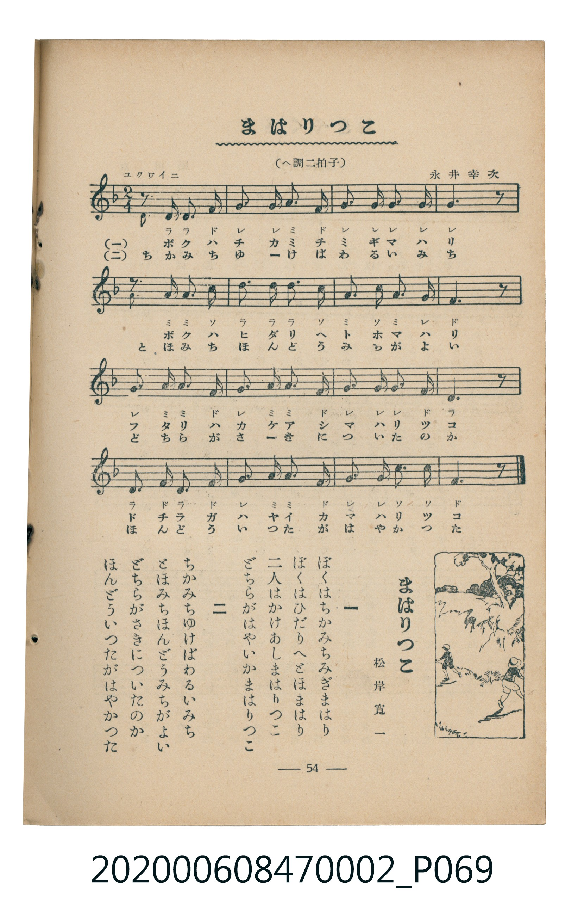

# まはりつこ（轉圈遊戲）

> Re:Shōka 使用 AI 協助辨識與重建樂譜，可能會有錯誤。歡迎回報。

- **NEUTRINO 歌聲合成版**：<br><audio controls src="mawarikko_neutrino.mp3"></audio>
- **鋼琴伴奏版**：<br><audio controls src="mawarikko.mp3"></audio>


- 詞：松岸寬一
- 曲：永井幸次
- 臺灣教育會公認《新定兒童唱歌》尋常科第二學年用（2020.006.0847.0002）

## 說明

曲目說明
中文解釋：描寫孩子一起旋轉、嬉戲的活潑遊戲。


## 歌詞

```text
一
ぼくはちかみちみぎまはり
ぼくはひだりへとほまはり
二人はかけあしまはりつこ
どちらがはやいかまはりつこ

二
ちかみちゆけばわるいみち
とほみちほんどうみちがよい
どちらがさきについたのか
ほんどういつたがはやかっつた
```

## ABC

```abc
X:1
T:まはりつこ（轉圈遊戲）
C:曲：永井幸次
M:2/4
L:1/16
Q:1/4=108
K:F
V:V1 name="Piano" snm="Pia"
[V:V1]
z3 D D3 F | G3 G A3 F | G3 G G3 G | G6 z2 |
w: 1.~ぼ く は | ち か み ち | み ぎ ま は | り
w: 2.~ち か み | ち ゆ け ば | わ る い み | ち
z3 A A3 c | d3 d d3 c | A3 c A3 G | F6 z2 |
w: 1.~ぼ く は | ひ だ り へ | と ほ ま は | り
w: 2.~と ほ み | ち ほ ん どう | み ち が よ | い
G3 A A3 F | G3 A A3 F | G3 G G3 F | D6 z2 |
w: 1.~ふ た り は | か け あ し | ま は り つ | こ
w: 2.~ど ち ら が | さ _ き に | つ い た の | か
D3 F D3 F | G3 A A3 F | G3 G C3 C | F6 z2 |
w: 1.~ど ち ら が | は や い か | ま は り つ | こ
w: 2.~ほ ん ど う | い つ た が | は や か つ | た
```

## TMD 檔案連結

- [主旋律 TMD 檔案](mawarikko.tmd) [[在 TMD Studio 編輯](https://tmdlang.github.io/Tmd-TS/#tmd=s7IKdvYPcrWy4qpTUCpJTLdSSM7PyUlNLsnMz7MqzsjMK0nNjM_KTMmPL87Iz05Ugisry88pzU21Si9KTEmNN4o3MjAyiDcwMIs3sDAxBzIMjBBKi_NLi5JTrYqTM_Lzc-JLUitKkvLzsxHyBUX5Zal5iXlANQVFIBtTwIoQClLLMlNSQdKpKZkl-UWZiTlI7kgtKga7FWxJfElRYl5xclFmAcgDCFUlGalAxybn5-aW5mWWVCIkgKalZ-ZZlSRmAv0H8mN5YnxuYmZeTmJeihIXl5aWwuPGfY8b1z9u6nrcuORx4-T3ezpe7O18OqfjZWPXs45N7_d0KmhpcSnaKhgaWHDZ2yq4cdkY6ZvYgSx40b7reePiZ1Nnvmja9GxO89PWNS9W9T5u6Ho2bcPTdbOetk56vnrp0ykbn63tedzQ_XRD99MdO54vn_h8zZonu3qert3xdOeW51NWAO0Dha0eMGz1QGELZBgYAW1V4tLXUng2e9Pz2eterFr1bEYfl4KCwpMda59Na3-xfPHL9u73e2Y96-9_un7107Urn66d8GRHw4ut259N7wa6_nFD49M1nUDXP5_V8mzL7md7J0I887ihiUtLH-z0lfNA-ufue7ppx9P1a4CawUEGtA8kvGHHk11Tn-7c8WzNQmAY6WtxAeW5HjfuedzYDwqqxoWPG7sfN-4HM4BkHzwIkRVtety4AByqOx43rnjcuBuhCOj9J7t2gRUBjZn4uLHpceN0tGgAmrQSZH5T5-PGHrBEy-NGIAJqQFUHMg2oGMlJTW1gQzc8bup_3AQUBOoCiQMVQZwBcffux02TwXYAVUNEeh43dQBVo9k89XFj7-PG1WDbgCbNf9y4DmgVUBGyAUAJoDRQDu5UoL2LIYKgEOfyBSY5q4DMxLx8hxqDmmpQXCrYGJpp2YFZNQoGCrpAaBYPQiCWIVDMCMwyUjDGEIHRMBEIBJlRAzbPx7BGAWIOMD6AuB_KXg_UAfQalNcNxPuh7IVgGRivD5QpkPU0dSHZAzIZao8Rwp6FYBMh7P3I9jS1AdkToTIbwKZB3dMEckELFj3o9sDCxxgaFqZAETNIiEFpkAhMDkKDQseQjNDZBOUtgPsamILBMiugvN1khM4KsD4soQMyrWkylA1KTCgRAQrUHmhgdYBlIMGFGUCQhAALIERiwRSBJR-QCDS1YQuhx41boY6YjxQSkDCCxfNEIG6CsqeDZRDhgtCzBCwD8SO2MAL6G-Hdpk4ouwesaypUBzATQunVYPElUF4L2H0Q9jokt2EGEDxjYeQwbEFkClEEpPClInwuXw_hNYFcCEvj3RSEETT1ANMKwlZIYoGZvgQpLDDdAIsziE0Qdcg21XJx6dopgMopBSCtzAUA)]
- [鋼琴伴奏 TMD 檔案](mawarikko_piano.tmd) [[在 TMD Studio 編輯](https://tmdlang.github.io/Tmd-TS/#tmd=s7IKdvYPcrWy4uLS0lJ43LjvceP6x01djxuXPG6c_H5Px5M9W54u7X-ye8b7PZ0KWlpcirYKhgYWXPa2Cm5cNkb6JnZcdQpKL9p3PW9c_GzqzBdNm57NaX7auubFqt7HDV3Ppm14um7W09ZJz1cvfTpl47O1PY8bup9u6H66Y8fz5ROfr1nzZFfP07U7nu7c8nzKCqBlRgZGBnoGBmZ6BhYm5kCGgRHQViWwDSvnvd8z69ncfU837Xi6fs2THQ1g4WezN4GEN-x4smvq0507nq1ZqMTF5ZuYmWcVkJmYlx_k4VBjUFPNpQAENoZmWnZgVo2CgYIuEJrFgxCIZQgUMwKzjBSMMURgNEwEAkFm1IDN8zGsUYCY87hxDxD3Q9nrgToeNy6E8rqBeD-UvRAsA-P1gYIdWU9TF5I9IJOh9hgh7FkINhHC3o9sT1MbkD0RKrMBbBrUPU0gF7Rg0YNuDyx8jKFhYQoUMYOEGJQGicDkIDQodAzJCJ1NUN4CuK8fN-4Ay6yA8naTETorwPqwhA7ItKbJUPbKx41tKBEBCtQeaGB1gGUgwYUZQJCEAAsgRGLBFIElH5AINLVhC6HHjVuhjpiPFBKQMILF80QgboKyp4NlEOGC0LMELAPxI7YwAvob4d2mTii7B6xrKlTH48ZeKL0aLL4EymsBuw_CXofkNswAgmcsjByGLYhMIYqAFL5UhM_l6yG8JpALYWm8m4IwgqYeYFpB2ApJLDDTlyCFBaYbYHEGsQmiDtmmWuRiygdPMWUSD9IQbRIfi6BqgCEFFjUFcw3BbEMsMigcNDkohQhiiH1IhsGMNIG4AMMqJA6aRRiGINtCpNuJ9pUZhGsG8RWEQrYPJQRROOTaiMN7wDjVtVMARWu0D0gYxjYCs5W5AA)]

## 分析

```text
================================================================================
📊 TMD Song Profile: [ まはりつこ（轉圈遊戲） ]
================================================================================
⏱  Duration:       0:17 (17.8s), 16 measures total
🎼 Key & Tempo:    首調基準 F, != 108.0 BPM, <2/4>
   - 分析範圍：      由實際發聲的音符與和弦推測調性；播放脈絡另行呈現
🎤 人聲音域:    C4 (MIDI 60) – D5 (MIDI 74) [跨度: 14 個半音 / 1.2 個八度, 難度: moderate]
   - 最低音:  C4 in [Main #1 @ m.15, 0:16]
   - 最高音: D5 in [Main #1 @ m.6, 0:05]
   - 適合: soprano, mezzo-soprano, contralto, tenor, baritone, bass
🏛  結構:      Main (17.8s)
⚡ 編曲密度:        Peak 1 軌道同時演奏
🗝  調性診斷：       G 大調（流行色彩大調，未偵測到可信轉調）
   - 風格氣質:    流行大調（略帶和弦色彩音與裝飾副屬和弦）
   - 轉調歷程:    全曲維持單一推測調性（未偵測到可信轉調）
   - 核心骨幹音:  G, A, D, F, C
   - 調性數值:    G 大調 [相關度: 0.66, 穩定度: Moderate, 自然音純度: 82.5%]
   - 候選調性 (K-S): G 大調 (0.66), G 小調 (0.62), D 小調 (0.61)
   - 五度圈歷程:   +1
   - 各段落調性細節:
     • [Main #1]: G 大調 (r: 0.66, 自然音純度: 82.5%, 調外音: F)

  [ 五度圈游移軌跡 ]
               C  
         F           [G ]*
      Bb               D  
      Eb               A  
         Ab           E  
            Db       B  
               F# 
     (* = active key center)

  [ 十二半音累積音高分佈 ]
     C  : ████                       6.1%
     C# :                            0.0%
     D  : ██████████████            20.2%
     D# :                            0.0%
     E  :                            0.0%
     F  : ████████████              17.5%
     F# :                            0.0%
     G  : ████████████████████████  34.2%
     G# :                            0.0%
     A  : ███████████████           21.9%
     A# :                            0.0%
     B  :                            0.0%
--------------------------------------------------------------------------------
Assignment 軌道音域：
  - Piano         : C4 – D5 (14 個半音 / 1.2 個八度, 50 個音符)
================================================================================
```


## 原書掃描頁




