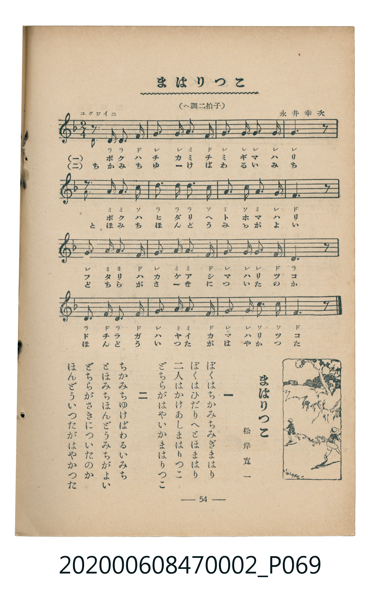

# まはりつこ

<audio controls src="mawarikko.mp3"></audio>

- 詞：松岸寬一
- 曲：永井幸次
- 臺灣教育會公認《新定兒童唱歌》尋常科第二學年用（2020.006.0847.0002）

## 說明

・出處：臺灣教育會公認《新定兒童唱歌》尋常科第二學年用（2020.006.0847.0002）
・調性與拍號：調號 ?= F，拍號 <2/4>，速度 != 108

## 歌詞

```text
一
ぼくはちかみちみぎまはり
ぼくはひだりへとほまはり
二人はかけあしまはりつこ
どちらがはやいかまはりつこ

二
ちかみちゆけばわるいみち
とほみちほんどうみちがよい
どちらがさきについたのか
ほんどういつたがはやかっつた
```

## ABC

```abc
X:1
T:まはりつこ
C:曲：永井幸次
M:2/4
L:1/16
Q:1/4=108
K:F
V:V1 name="Piano" snm="Pia"
[V:V1]
z2 D2 D2 F2 | G2 G2 A2 F2 | G2 G2 G2 G2 | G6 z2 |
z2 A2 A2 c2 | d2 d2 d2 c2 | A2 c2 A2 G2 | F6 z2 |
G2 A2 A2 F2 | G2 A2 A2 F2 | G2 G2 G2 F2 | D6 z2 |
D2 F2 D2 F2 | G2 A2 A2 F2 | G2 G2 C2 C2 | F6 z2 |
```

## TMD 檔案連結

- [主旋律 TMD 檔案](mawarikko.tmd) [[在 TMD Studio 編輯](https://tmdlang.github.io/Tmd-TS/#tmd=s7IKdvYPcrWy4uLS0lJ43LjvceP6x01djxuXPG6crKClxaVoq2BoYMFlb6vgxmVjpG9ix1WnoPSifdfzxsXPps580bTp2Zzmp61rXqzqfdzQ9WzahqfrZj1tnfR89dKnUzY-W9vzuKH76Ybupzt2PF8-8fmaNU929Txdu-Ppzi3Pp6x4v6fDyMDIQM_AwEzPwMLEHMgwMHq_p1MJbMPKee_3zHo2d9_TTTuerl_zZEcDWPjZ7E0g4Q07nuya-nTnjmdrFipxcelrcQHluR437nnc2A9yf-PCx43djxv3gxlAsg_uL2RFmx43LgB7dcfjxhWPG3cjFAFd-WTXLrAioDETHzc2PW6cjhY2QJNWgsxv6nzc2AOWaHncCERADajqQKYBFSM5qakNbOiGx039j5uAgkBdIHGgIogzIO7e_bhpMtgOoGqISM_jpg6gajSbpz5u7H3cuBpsG9Ck-Y8b1wGtAipCNgAoAZQGysGdCrR3MUSQS0ufi8s3MTPPKiAzMS_focagRqGaSwEIbAzNtOzArBoFAwVdBbN4GGEIxDUKRkAShI0xRGAYIgKDIDNqkMwD6QNhU7BKM5DhUAwRgcmBaIhpIFuwmQZzBapLMEVgGCIC9go24-B-RPMsdgNNQYrABDYH1nJx6dopgMJXAUgrc3EBAA)]
- [鋼琴伴奏 TMD 檔案](mawarikko_piano.tmd) [[在 TMD Studio 編輯](https://tmdlang.github.io/Tmd-TS/#tmd=s7IKdvYPcrWy4uLS0lJ43LjvceP6x01djxuXPG6c_H5Px5M9W54u7X-ye8b7PZ0KWlpcirYKhgYWXPa2Cm5cNkb6JnZcdQpKL9p3PW9c_GzqzBdNm57NaX7auubFqt7HDV3Ppm14um7W09ZJz1cvfTpl47O1PY8bup9u6H66Y8fz5ROfr1nzZFfP07U7nu7c8nzKCqBlRgZGBnoGBmZ6BhYm5kCGgRHQViWwDSvnvd8z69ncfU837Xi6fs2THQ1g4WezN4GEN-x4smvq0507nq1ZqMTF5ZuYmWcVkJmYlx_k4VBjUKNQzaUABDaGZlp2YFaNgoGCroJZPIwwBOIaBSMgCcLGGCIwDBGBQZAZNUjmgfSBsClYpRnIcCiGiMDkQDTENJAt2EyDuQLVJZgiMAwRAXsFm3FwP6J5FruBpiBFYAKbA2uRg9cHX_CaxIPMiDaJj0VQNUCDwaKmYK4hmG2IRQaFgyYHpdCDH8kwmJEmEBdgWIXEQbMIwxBkW4h0O9G-MoNwzSC-glDI9qGEIAqHXBtxeA8Yqbp2CqB4VQDSylxcAA)]

## 分析

```text
================================================================================
📊 TMD Song Profile: [ まはりつこ ]
================================================================================
⏱  Duration:       0:17 (17.8s), 16 measures total
🎼 Key & Tempo:    首調基準 F, != 108.0 BPM, <2/4>
   - 分析範圍：      由實際發聲的音符與和弦推測調性；播放脈絡另行呈現
🎤 人聲音域:    C4 (MIDI 60) – D5 (MIDI 74) [跨度: 14 個半音 / 1.2 個八度, 難度: moderate]
   - 最低音:  C4 in [Main #1 @ m.15, 0:16]
   - 最高音: D5 in [Main #1 @ m.6, 0:05]
   - 適合: soprano, mezzo-soprano, contralto, tenor, baritone, bass
🏛  結構:      Main (17.8s)
⚡ 編曲密度:        Peak 1 軌道同時演奏
🗝  調性診斷：       D 調性不明確（純淨自然大調，未偵測到可信轉調）
   - 風格氣質:    純淨自然大調（陽光明朗、易唱易記，無明顯調外色彩）
   - 轉調歷程:    全曲維持單一推測調性（未偵測到可信轉調）
   - 核心骨幹音:  G, F, A, D, C
   - 調性數值:    D 調性不明確 [相關度: 0.63, 穩定度: Ambiguous, 自然音純度: 100.0%]
   - 候選調性 (K-S): D 小調 (0.63), F 大調 (0.63), C 大調 (0.58)
   - 五度圈歷程:   +2
   - 各段落調性細節:
     • [Main #1]: D 調性不明確 (r: 0.63, 自然音純度: 100.0%)

  [ 五度圈游移軌跡 ]
               C  
         F            G  
      Bb              [D ]*
      Eb               A  
         Ab           E  
            Db       B  
               F# 
     (* = active key center)

  [ 十二半音累積音高分佈 ]
     C  : ███████                    8.6%
     C# :                            0.0%
     D  : █████████████             17.2%
     D# :                            0.0%
     E  :                            0.0%
     F  : ███████████████████       24.1%
     F# :                            0.0%
     G  : ████████████████████████  31.0%
     G# :                            0.0%
     A  : ███████████████           19.0%
     A# :                            0.0%
     B  :                            0.0%
--------------------------------------------------------------------------------
Assignment 軌道音域：
  - Piano         : C4 – D5 (14 個半音 / 1.2 個八度, 50 個音符)
================================================================================
```


## 原書掃描頁




