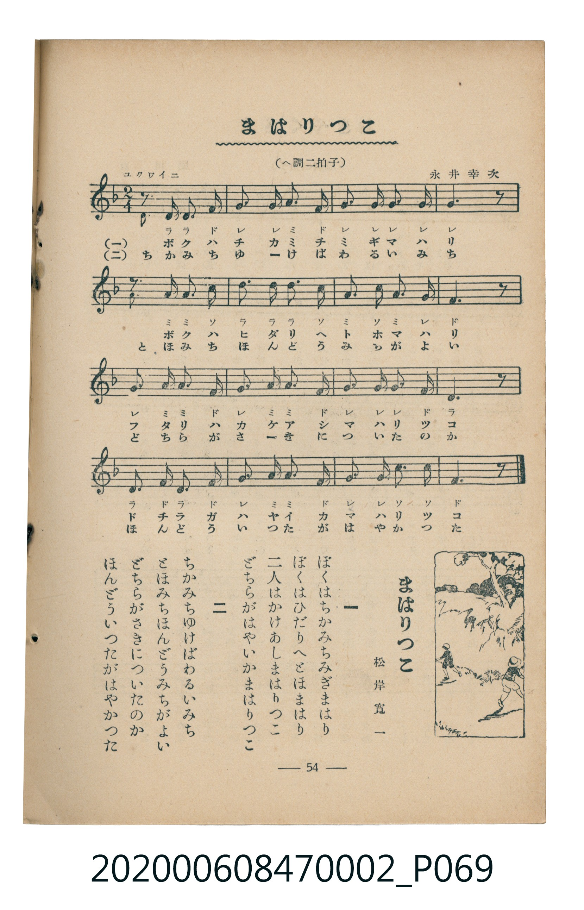

# まはりつこ（轉圈遊戲）

> Re:Shōka 使用 AI 協助辨識與重建樂譜，可能會有錯誤。歡迎[回報](https://github.com/TMDLang/reshoka/issues)。

- **鋼琴伴奏版**：<br><audio controls src="mawarikko.mp3"></audio>
- **NEUTRINO 歌聲合成版**：<br><audio controls src="mawarikko_neutrino.mp3"></audio>

- 詞：松岸寬一
- 曲：永井幸次
- 臺灣教育會公認《新定兒童唱歌》尋常科第二學年用（2020.006.0847.0002）

## 說明

曲目說明
中文解釋：描寫孩子一起旋轉、嬉戲的活潑遊戲。


## 歌詞

```text
一
ぼくはちかみちみぎまはり
ぼくはひだりへとほまはり
二人はかけあしまはりつこ
どちらがはやいかまはりつこ

二
ちかみちゆけばわるいみち
とほみちほんどうみちがよい
どちらがさきについたのか
ほんどういつたがはやかっつた
```

## ABC

<div class="abc-score" data-abc-src="mawarikko.abc" aria-label="五線譜載入中"></div>

[下載 ABC 原始檔](mawarikko.abc)

## TMD 檔案連結

- [主旋律 TMD 檔案](mawarikko.tmd) [[在 TMD Studio 編輯](https://tmdlang.github.io/Tmd-TS/#tmd=s7IKdvYPcrWy4qpTUCpJTLdSSM7PyUlNLsnMz7MqzsjMK0nNjM_KTMmPL87Iz05Ugisry88pzU21Si9KTEmNN4o3MjAyiDcwMIs3sDAxBzIMjBBKi_NLi5JTrYqTM_Lzc-JLUitKkvLzsxHyBUX5Zal5iXlANQVFIBtTwIoQClLLMlNSQdKpKZkl-UWZiTlI7kgtKga7FWxJfElRYl5xclFmAcgDCFUlGalAxybn5-aW5mWWVCIkgKalZ-ZZlSRmAv0H8mN5YnxuYmZeTmJeCrKqkox8oFcLMiqtMjKLQW5ITsyJz07MQwoRqAsKEtNTrQIMzCyVuLi0tBQeN-573Lj-cVPX48Yljxsnv9_T8WJv59M5HS8bu551bHq_p1NBS4tL0VbB0MCCy95WwY3LxkjfxA5k6Iv2Xc8bFz-bOvNF06Znc5qftq55sar3cUPXs2kbnq6b9bR10vPVS59O2fhsbc_jhu6nG7qf7tjxfPnE52vWPNnV83Ttjqc7tzyfsgJoHyhq9IBRoweKGiDDwAhoqxKXvpbCs9mbns9e92LVqmcz-rgUFBSe7Fj7bFr7i-WLX7Z3v98z61l__9P1q5-uXfl07YQnOxpebN3-bHo30PWPGxqfrukEuv75rJZnW3Y_2zsR4pnHDU1cWvpgp6-cB9I_d9_TTTuerl8D1AwOJqB9IOENO57smvp0545naxYCw0hfiwsoz_W4cc_jxn5QUDUufNzY_bhxP5gBJPvgQYisaNPjxgXgUN3xuHHF48bdCEVA7z_ZtQusCGjMxMeNTY8bp6NFA9CklSDzmzofN_aAJVoeNwIRUAOqOpBpQMVITmpqAxu64XFT_-MmoCBQF0gcqAjiDIi7dz9umgy2A6gaItLzuKkDqBrN5qmPG3sfN64G2wY0af7jxnVAq4CKkA0ASgClgXJwpwLtXQwRBIU4ly8wxVoFZCbm5TvUGNRUg-JSwcbQTMsOzKpRMFDQBUKzeBACsQyBYkZglpGCMYYIjIaJQCDIjBqweT6GNQoQc4DxAcT9UPZ6oA6g16C8biDeD2UvBMvAeH2gTIGsp6kLyR6QyVB7jBD2LASbCGHvR7anqQ3IngiV2QA2DeqeJpALWrDoQbcHFj7G0LAwBYqYQUIMSoNEYHIQGhQ6hmSEziYobwHc18AUDJZZAeXtJiN0VoD1YQkdkGlNk6FsUGJCiQhQoPZAA6sDLAMJLswAgiQEWAAhEgumCCz5gESgqQ1bCD1u3Ap1xHykkICEESyeJwJxE5Q9HSyDCBeEniVgGYgfsYUR0N8I7zZ1Qtk9YF1ToTqAmRBKrwaLL4HyWsDug7DXIbkNM4DgGQsjh2ELIlOIIiCFLxXhc_l6CK8J5EJYGu-mIIygqQeYVhC2QhILzPQlSGGB6QZYnEFsgqhDtqmWi0vXTgFUTikAaWUuAA)]
- [鋼琴伴奏 TMD 檔案](mawarikko_piano.tmd) [[在 TMD Studio 編輯](https://tmdlang.github.io/Tmd-TS/#tmd=s7IKdvYPcrWy4qpTUCpJTLdSyC8qychPL0osyKi0ysgsLskvykxOzInPTsxLVIIrKs4vLUpOjS9ITE-1CjAws1Ti4tLSUnjcuO9x4_rHTV2PG5c8bpz8fk_Hkz1bni7tf7J7xvs9nQpaWlyKtgqGBhZc9rYKblw2RvomdiATX7Tvet64-NnUmS-aNj2b0_y0dc2LVb2PG7qeTdvwdN2sp62Tnq9e-nTKxmdrex43dD_d0P10x47nyyc-X7Pmya6ep2t3PN255fmUFUDLjAyMDPQMDMz0DCxMzIEMAyOgrWA3v1g57_2eWc_m7nu6acfT9Wue7GgACz-bvQkkvGHHk11Tn-7c8WzNQqA_fBMz86wCMhPz8oM8HGoMaqq5FIDAxtBMyw7MqlEwUNAFQrN4EAKxDIFiRmCWkYIxhgiMholAIMiMGrB5PoY1ChBzHjfuAeJ-KHs9UMfjxoVQXjcQ74eyF4JlYLw-ULAj62nqQrIHZDLUHiOEPQvBJkLY-5HtaWoDsidCZTaATYO6pwnkghYsetDtgYWPMTQsTIEiZpAQg9IgEZgchAaFjiEZobMJylsA9_Xjxh1gmRVQ3m4yQmcFWB-W0AGZ1jQZyl75uLENJSJAgdoDDawOsAwkuDADCJIQYAGESCyYIrDkAxKBpjZsIfS4cSvUEfORQgISRrB4ngjETVD2dLAMIlwQepaAZSB-xBZGQH8jvNvUCWX3gHVNhep43NgLpVeDxZdAeS1g90HY65DchhlA8IyFkcOwBZEpRBGQwpeK8Ll8PYTXBHIhLI13UxBG0NQDTCsIWyGJBWb6EqSwwHQDLM4gNkHUIdtUi1xM-SAXUxZIpZRJfLxCtEl8LISoAQYQkG8KZBoCaUMUETgDSQxMGCDlaqg2iFYTkNlIRkEZSAYhKUeYgscNeF1lBmKagVwFIhDmwf0IZxBrIprzgEGqa6cACtVoH6AQnG0EZitzAQA)]

## 分析

```text
================================================================================
📊 TMD Song Profile: [ まはりつこ（轉圈遊戲） ]
================================================================================
⏱  Duration:       0:17 (17.8s), 16 measures total
🎼 Key & Tempo:    首調基準 F, != 108.0 BPM, <2/4>
   - 分析範圍：      由實際發聲的音符與和弦推測調性；播放脈絡另行呈現
🎤 人聲音域:    C4 (MIDI 60) – D5 (MIDI 74) [跨度: 14 個半音 / 1.2 個八度, 難度: moderate]
   - 最低音:  C4 in [Main #1 @ m.15, 0:16]
   - 最高音: D5 in [Main #1 @ m.6, 0:05]
   - 適合: soprano, mezzo-soprano, contralto, tenor, baritone, bass
🏛  結構:      Main (17.8s)
⚡ 編曲密度:        Peak 1 軌道同時演奏
🗝  調性診斷：       G 大調（流行色彩大調，未偵測到可信轉調）
   - 風格氣質:    流行大調（略帶和弦色彩音與裝飾副屬和弦）
   - 轉調歷程:    全曲維持單一推測調性（未偵測到可信轉調）
   - 核心骨幹音:  G, A, D, F, C
   - 調性數值:    G 大調 [相關度: 0.66, 穩定度: Moderate, 自然音純度: 82.5%]
   - 候選調性 (K-S): G 大調 (0.66), G 小調 (0.62), D 小調 (0.61)
   - 五度圈歷程:   +1
   - 各段落調性細節:
     • [Main #1]: G 大調 (r: 0.66, 自然音純度: 82.5%, 調外音: F)

  [ 五度圈游移軌跡 ]
               C  
         F           [G ]*
      Bb               D  
      Eb               A  
         Ab           E  
            Db       B  
               F# 
     (* = active key center)

  [ 十二半音累積音高分佈 ]
     C  : ████                       6.1%
     C# :                            0.0%
     D  : ██████████████            20.2%
     D# :                            0.0%
     E  :                            0.0%
     F  : ████████████              17.5%
     F# :                            0.0%
     G  : ████████████████████████  34.2%
     G# :                            0.0%
     A  : ███████████████           21.9%
     A# :                            0.0%
     B  :                            0.0%
--------------------------------------------------------------------------------
Assignment 軌道音域：
  - Piano         : C4 – D5 (14 個半音 / 1.2 個八度, 50 個音符)
================================================================================
```


## 原書掃描頁




