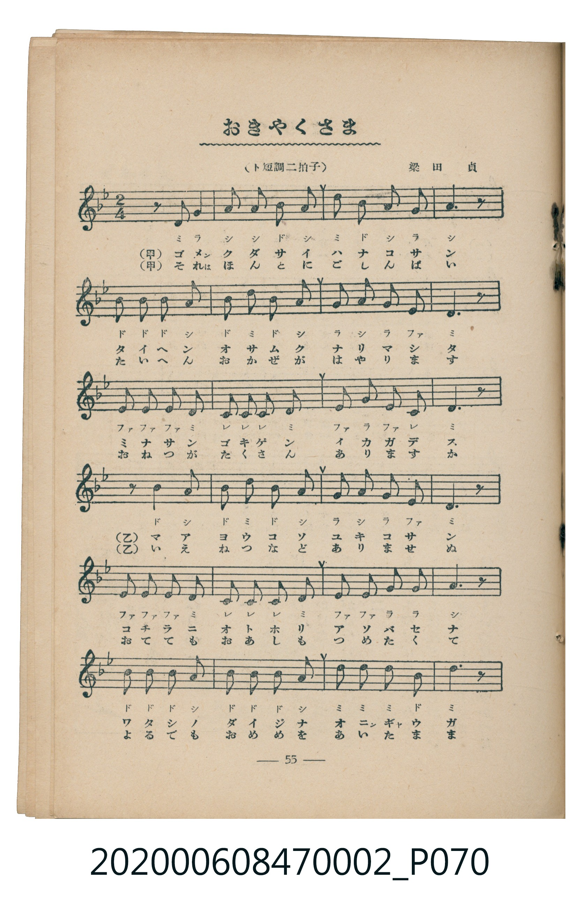
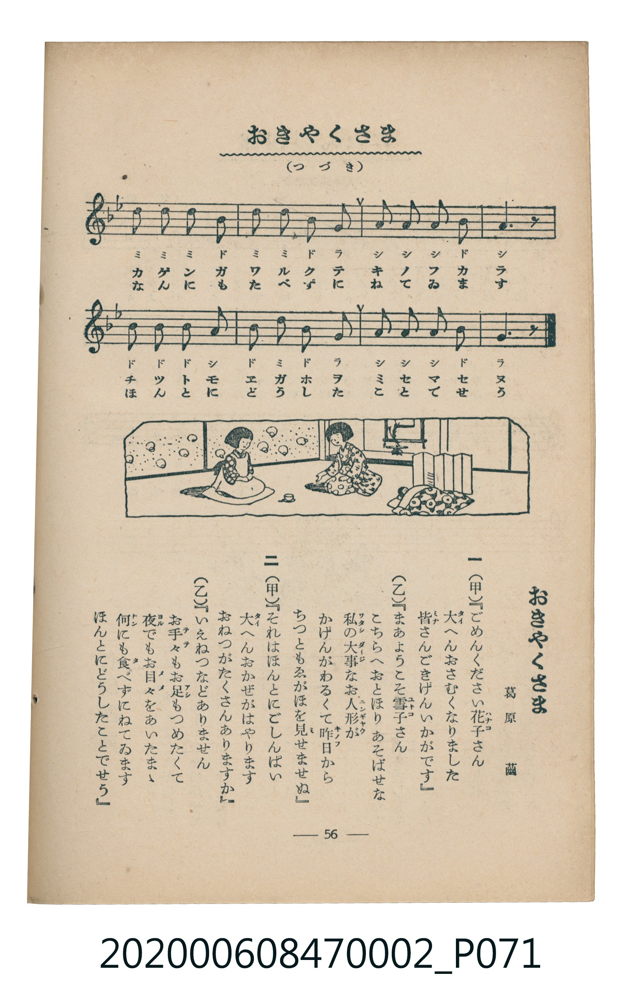

# おきやくさま（客人）

> Re:Shōka 使用 AI 協助辨識與重建樂譜，可能會有錯誤。歡迎回報。

- **NEUTRINO 歌聲合成版**：<br><audio controls src="okyaku_sama_neutrino.mp3"></audio>
- **鋼琴伴奏版**：<br><audio controls src="okyaku_sama.mp3"></audio>


- 詞：葛原齒
- 曲：梁田貞
- 臺灣教育會公認《新定兒童唱歌》尋常科第二學年用（2020.006.0847.0002）

## 說明

曲目說明
中文解釋：描寫客人來訪時的迎接、招待與日常禮貌。


## 跨冊／重複收錄參照

> 同曲（《大正幼年唱歌》第七集〈お客様〉；收錄於《新定兒童唱歌》二年級與《唱歌帖》P161）

- **[同曲]** 楊金土手抄《唱歌帖》第 1 冊（2020.006.0843）：[**〈お客様〉**](../../../shokacho/vol_01/p161_okyakusama/index.md)（`B,` / `2/4` — [原始 TMD](../../../shokacho/vol_01/p161_okyakusama/okyakusama.tmd)）
- 總表：[跨冊重複與同名歌曲總索引](../../../duplicate_songs.md)

## 歌詞

```text
一
（甲）『ごめんください花子さん
大へんおさむくなりました
皆さんごきげんいかがです』
（乙）『まあようこそ雪子さん
こちらへおとほりあそばせな
私の大事なお人形が
かげんがわるくて昨日から
ちつともゑがほを見せませぬ』

二
（甲）『それはほんとにごしんぱい
大へんおかぜがはやります
おねつがたくさんありますか』
（乙）『いえねつなどありません
お手々もお足もつめたくて
夜でもお目々をあいたまゝ
何にも食べずにねてゐます
ほんとにどうしたことでせう』
```

## ABC

```abc
X:1
T:おきやくさま（客人）
C:曲：梁田貞
M:2/4
L:1/16
Q:1/4=96
K:Bb
V:V1 name="Piano" snm="Pia"
[V:V1]
z2 D2 G4 | A2 A2 B2 A2 | d2 B2 A2 G2 | A6 z2 |
w: 1.~ご めん | く だ さ い | は な こ さ | ん
w: 2.~そ れは | ほ ん と に | ご し ん ぱ | い
B2 B2 B2 A2 | B2 d2 B2 A2 | G2 A2 G2 E2 | D6 z2 |
w: 1.~た い へ ん | お さ む く | な り ま し | た
w: 2.~た い へ ん | お か ぜ が | は や り ま | す
E2 E2 E2 D2 | C2 C2 C2 D2 | E2 G2 E2 C2 | D6 z2 |
w: 1.~み な さ ん | ご き げ ん | い か が で | す
w: 2.~お ね つ が | た く さ ん | あ り ま す | か
z2 B4 A2 | B2 d2 B2 A2 | G2 A2 G2 E2 | D6 z2 |
w: 1.~ま あ | よ う こ そ | ゆ き こ さ | ん
w: 2.~い え | ね つ な ど | あ り ま せ | ん
E2 E2 E2 D2 | C2 C2 C2 D2 | E2 E2 G2 G2 | A6 z2 |
w: 1.~こ ち ら へ | お と ほ り | あ そ ば せ | な
w: 2.~お て て も | お あ し も | つ め た く | て
B2 B2 B2 A2 | B2 B2 B2 A2 | d2 d2 d2 B2 | d6 z2 |
w: 1.~わ た し の | だ い じ な | お にん ぎや う | が
w: 2.~よ る で も | お め め を | あ い た ま | ま
d2 d2 d2 B2 | d2 d2 B2 G2 | A2 A2 A2 B2 | A6 z2 |
w: 1.~か げ ん が | わ る く て | き の ふ か | ら
w: 2.~な ん に も | た べ ず に | ね て ゐ ま | す
B2 B2 B2 A2 | B2 d2 B2 G2 | A2 A2 A2 B2 | G6 z2 |
w: 1.~ち つ と も | ゑ が ほ を | み せ ま せ | ぬ
w: 2.~ほ ん と に | ど う し た | こ と で せ | う
```

## TMD 檔案連結

- [主旋律 TMD 檔案](okyaku_sama.tmd) [[在 TMD Studio 編輯](https://tmdlang.github.io/Tmd-TS/#tmd=s7IKdvYPcrWy4qpTUCpJTLdSSM7PyUlNLsnMz7MqzsjMK0nNjM_KTMmPL87Iz05Ugisry88pzU21Si9KTEmNN4o3MjAyiDcwMIs3sDAxBzIMjBBKi_NLi5JTrYqTM_Lzc-JLUitKkvLzsxHyBUX5Zal5iXlANQVFIBtTwIoQClLLMlNSQdKpKZkl-UWZiTlI7kgtKga7FWxJfElRYl5xclFmAcgDCFUlGalAxybn5-aW5mWWVCpxcWlpKTxu7Hrc2Pu4qeVxY__jxqmPG_e939PxdN2iJ7t2vd_TqaClxaVoq2BpxmVvq-Ckw2VjpG9iBzLwRfuu542Ln02d-aJp07M5zU9b17xY1fu4oevZtA1P18162jrp-eqlT6dsfLa253FD99MN3U937Hi-fOLzNWue7Op5unbH051bnk9ZAbQJFGR6wCDTAwUZkGFgBLRViUtfS-HZ7E3PZ697sWrVsxl9XAoKCk92rH02rf3F8sUv27vf75n1rL__6frVEIc-2df2YsWqZzObns9qebG_71nf0scNjc-6Zz_d1_qio_3Z9KUg25ete7EJ6JgmLi19sAdWzgOa8mLi7Kd981_unQQOJaCVIJMXNT6fsuHFpnnAANLX4nqyo4EL6NDnU4BynY8b-h43Tnnc1Pi4aTI4wBaAw6zlRdfGp2sngNhNk7meLln-uHEHWAUwbIFCDWClqx43Abn7HjdOf9w4n-v5rDaIcpB5wAhonARmA6Oh-3Fjz-NGoBEzHzf0g6x-snMmzGqg7qbHTR2PG4Gagarnvpy9CmEvWGjh46ZOkO0gq1c8btwNtrQJqPRx44bHjbOBzuB6vrzxceM6oCuf7ALatQqoFBiGT_cuAtoLNAMoBHFKz-Om_sdNQC7Q7cuezVgBDEeQbFMnUNHCx41LQOY3AV0zEexeoEWTXiwDqgZaAXQlkFwDcj4XML7Rgm_u4yag-vVgLUBrgI5cDQ6D6WDuRmAYoIUg0NA5YDvWg5IpNBBnAl0BZK0FOwQoNx-afkF6gI6CKgJpxghEYBgDQxCiE-j7lUgaZkPCsetZJ1BfK8h7jV0vtm0GM5aAoh1qzzKgE4FuWg5RAUynYNWTwCENNB6oaN_jprlcT_YCE8dqoKKXi4FCOx83zgJ7Fmj1ssdNwGiD-gM5IICuAcYtKImAoxMoCAwKYGi2gfwBTLpcvomZeVYBmYl5-Q41BjXVoKyhYGNopmUHZtUoGCjoKhjHAwkzEAGCNQrmICaYMIQxahSMkblgxVCFMAgyqQZsqo9hjQJIBhhPIBKc_OGGAwMELLUATE4Fky1QmfVg3iowCdIBkQfKwPWDINhuiEVGMIvmgi0CRTqSRbvBghCDVoDJ1VAZsLsapyPJb4TKgJyCaVEN2OswDA0REBMlVGog4YIIIRNo0OEOJmDEwUMAmIbhDgLJdCFCqKkBzAaFHEgGHEJNEPl9cK_ATMMeToRt6gaTc8BkD1QGHCNNYD1I9oFkZuIIKLCfEQTY7zUKRiAKQUBFwSoQIQWWIhBc-8GOgCQRSNDAPAGJ014wOQlFBuJliPdAHgNmEryegAQXxLtrweQSlECBBCQkGaO6oQktoCA2gGRAtmMLLpD_QAkIBKmYriC5AuQEEIQ4DJSPOsC8NjAJSfignAOSgYhBgo-0vAfLMsByEupZ5ECDRNVKnAE0G68tZKQnRKIiXErBvLoQ7KxOMBuUNRDxDyk3ICUJSATuCUiR07gB2RNgz-JPT8sQZBM0UqAyEFMhZRJMBhyETY1gGUSqA8mATCChnEITAiUvGAYJQ0RwhFETJKVD7Ae7r3Ed1BWQQhySv2aASVAIIPwErMwgAdwHLUTASQ8kD8pLOEIKkkibIPkVlFPRQgoSHlASlNMRcQKxA-JSWEEFywToIYU9DGA85LSDWh8SSFAQZyMKIHixAQlGqLcgQQqKRJAeSK4DBerjxq1gEqQKpAeUJHElKEgtALEDVLEhggkSADvB5Cy4PCJnQpLfBJRgwlWeE6j48IUTvEmBLZzAWQ5aRoAzGcz1TRPhoQbLeLBIhhT-oMyGVno0rsETTribAaBSCVYaQhI2KOQQxQJENTgJwm0CqUa1qZaLS9dOAdTQUgDSylwA)]
- [鋼琴伴奏 TMD 檔案](okyaku_sama_piano.tmd) [[在 TMD Studio 編輯](https://tmdlang.github.io/Tmd-TS/#tmd=s7IKdvYPcrWy4uLS0lJ43Nj1uLH3cVPL48b-x41THzfue7-n48meLU-X9j_ZPeP9nk4FLS0uRVsFSzMue1sFJx0uGyN9EzuuOgWlF-27njcufjZ15oumTc_mND9tXfNiVe_jhq5n0zY8XTfraeuk56uXPp2y8dnanscN3U83dD_dseP58onP16x5sqvn6dodT3dueT5lBdAyIwMjAz0DAzM9AwsTcyDDwAhoqxLYhpXz3u-Z9WLi7Kd981_unQQWezZ7E1Ds2aLG51M2vNg0T4mLyzcxM88qIDMxLz_Iw6HGoKaaSwEIbAzNtOzArBoFAwVdMDaOBxJmIKJGwRxEgQlDGKNGwRiZi6wQBkGm1IBN9TGsUQDJgPDjxikgsqnxcdNksB5gWIKFF4DJqWCyBSqzHsxbBSZBqiHyQBmwXhgE2w2xyAjZorlgi3ogxoCM2w0WgBi0AkyuhsqA3dQ4HUl-I1QG5BRMi2rAXodhaIiAmCihUgMJF0QImUCDDncwPW6cDw-Bx4074A4CyXQhQqipAcwGhRxIBhxCTRD5fXCvwEzDHk6EbeoGk3PAZA9UBhwjTWA9SPaBZGbiCCiwnxEE2O81CkYgCkFARcEqECEFliIQXPvBjoAkEUjQwDwBidNeMDkJRQbiZYj3QB573LgcrycgwQXx7lowuQQlUCABCUnGqG5oQgsoiA0gGZDt2IILlv-onK4QuQLiDJDDQPmoA8xrA5OQhA_KNSAZiBgk-EjPe5AgBpkO8ixyoEGiaiXOAJqN1xYy0hMiUREupWBeXQh2VieYDcoaiPiHlBuQkgQkAvcEpLhp3IDsCbBn8aenZQiyCRopUBmIqZAyCSYDDsKmRrAMItWBZEAmkFBOoQmBkhcMg4QhIjjCqAmS0iH2g93XuA7qCkghDon8GWASFAIIP62GFa990EIEnPRA8qC8hCOkIIm0CZJfQTkVLaQg4QElQTkdEScQOyAuhRVUIBpbSGEPAxgPoyqE14cEEhTE2YgCCF5sQIIR6i1IkIIiEaQHkutAgfq4cSuYBKkC6QElSVwJClILQOwAVWyIYIIEwE4wOQsuj8iZkOQ3ASWYcJXnBCo-fOEElsMVTuAsBy0jwJkM5vqmifBQg2U8WCRDCn9QZkMrPRrX4Akn3M0AUKkEKw0hCRsUcohiAaIanAThNoFUo9pUi9zO8iHQzjKLB2mKNouPBZtnDOEag7koHFDwISnFpw9KIUIYv16i5cBFa7QRcTYiKUbRZwrRZwrWgMLBrYeQXTgCc1B6jE4RZwjmGYI4SEzC9uHSR3TiQ0u0tPIf0RkFSkHsBGZNXTsFUO6M9gF5DMYGxYydgjIXAA)]

## 分析

```text
================================================================================
📊 TMD Song Profile: [ おきやくさま（客人） ]
================================================================================
⏱  Duration:       0:40 (40.0s), 32 measures total
🎼 Key & Tempo:    首調基準 B,, != 96.0 BPM, <2/4>
   - 分析範圍：      由實際發聲的音符與和弦推測調性；播放脈絡另行呈現
🎤 人聲音域:    C4 (MIDI 60) – D5 (MIDI 74) [跨度: 14 個半音 / 1.2 個八度, 難度: moderate]
   - 最低音:  C4 in [Main #1 @ m.10, 0:11]
   - 最高音: D5 in [Main #1 @ m.3, 0:02]
   - 適合: soprano, mezzo-soprano, contralto, tenor, baritone, bass
🏛  結構:      Main (40.0s)
⚡ 編曲密度:        Peak 1 軌道同時演奏
🗝  調性診斷：       G 小調（純淨自然小調，未偵測到可信轉調）
   - 風格氣質:    純淨自然小調（陰鬱抒情、旋律集中，無明顯調外色彩）
   - 轉調歷程:    全曲維持單一推測調性（未偵測到可信轉調）
   - 核心骨幹音:  D, A, A#, G, D#
   - 調性數值:    G 小調 [相關度: 0.69, 穩定度: Moderate, 自然音純度: 100.0%]
   - 候選調性 (K-S): G 小調 (0.69), D 小調 (0.59), A# 大調 (0.55)
   - 五度圈歷程:   +1
   - 各段落調性細節:
     • [Main #1]: G 小調 (r: 0.69, 自然音純度: 100.0%)

  [ 五度圈游移軌跡 ]
               C  
         F           [G ]*
      Bb               D  
      Eb               A  
         Ab           E  
            Db       B  
               F# 
     (* = active key center)

  [ 十二半音累積音高分佈 ]
     C  : ██████                     5.9%
     C# :                            0.0%
     D  : ████████████████████████  24.6%
     D# : ██████████                10.2%
     E  :                            0.0%
     F  :                            0.0%
     F# :                            0.0%
     G  : ████████████              12.7%
     G# :                            0.0%
     A  : ███████████████████████   23.7%
     A# : ██████████████████████    22.9%
     B  :                            0.0%
--------------------------------------------------------------------------------
Assignment 軌道音域：
  - Piano         : C4 – D5 (14 個半音 / 1.2 個八度, 100 個音符)
================================================================================
```


## 原書掃描頁






