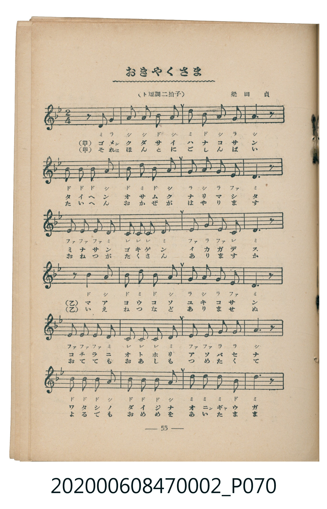
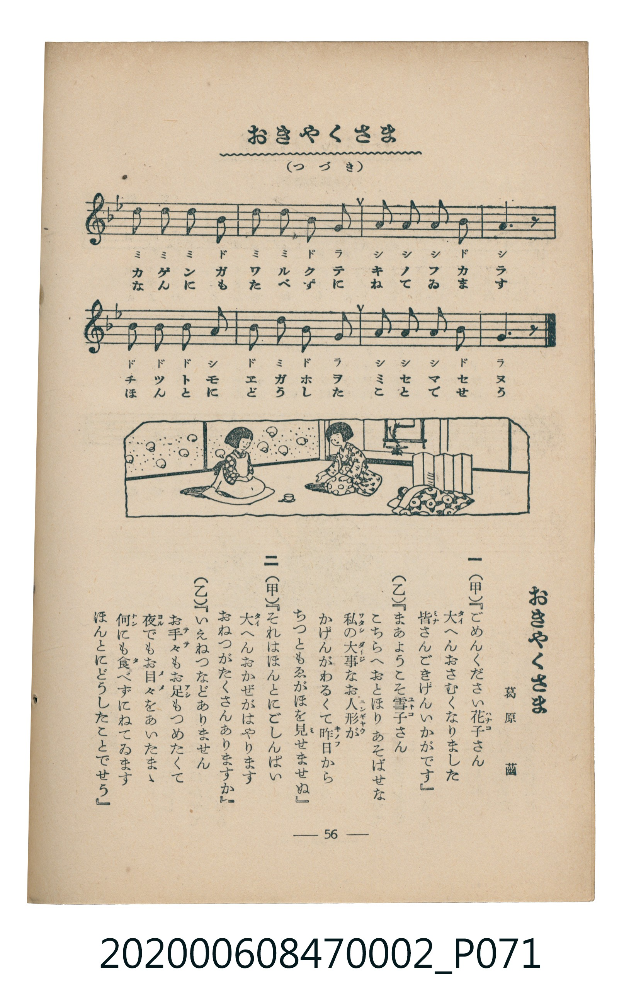

# おきやくさま

<audio controls src="okyaku_sama.mp3"></audio>

- 詞：葛原齒
- 曲：梁田貞
- 臺灣教育會公認《新定兒童唱歌》尋常科第二學年用（2020.006.0847.0002）

- note

・出處：臺灣教育會公認《新定兒童唱歌》尋常科第二學年用（2020.006.0847.0002）
・調性與拍號：調號 ?= B,，拍號 <2/4>，速度 != 96

## 歌詞

```text
一
（甲）『ごめんください花子さん
大へんおさむくなりました
皆さんごきげんいかがです』
（乙）『まあようこそ雪子さん
こちらへおとほりあそばせな
私の大事なお人形が
かげんがわるくて昨日から
ちつともゑがほを見せませぬ』

二
（甲）『それはほんとにごしんぱい
大へんおかぜがはやります
おねつがたくさんありますか』
（乙）『いえねつなどありません
お手々もお足もつめたくて
夜でもお目々をあいたまゝ
何にも食べずにねてゐます
ほんとにどうしたことでせう』
```

## 原書掃描頁





## 調性分析

```text
================================================================================
📊 TMD Song Profile: [ おきやくさま ]
================================================================================
⏱  Duration:       0:40 (40.0s), 32 measures total
🎼 Key & Tempo:    首調基準 B,, != 96.0 BPM, <2/4>
   - 分析範圍：      由實際發聲的音符與和弦推測調性；播放脈絡另行呈現
🎤 人聲音域:    C4 (MIDI 60) – D5 (MIDI 74) [跨度: 14 個半音 / 1.2 個八度, 難度: moderate]
   - 最低音:  C4 in [Main #1 @ m.10, 0:11]
   - 最高音: D5 in [Main #1 @ m.3, 0:02]
   - 適合: soprano, mezzo-soprano, contralto, tenor, baritone, bass
🏛  結構:      Main (40.0s)
⚡ 編曲密度:        Peak 1 軌道同時演奏
🗝  調性診斷：       G 小調（純淨自然小調，未偵測到可信轉調）
   - 風格氣質:    純淨自然小調（陰鬱抒情、旋律集中，無明顯調外色彩）
   - 轉調歷程:    全曲維持單一推測調性（未偵測到可信轉調）
   - 核心骨幹音:  D, A, A#, G, D#
   - 調性數值:    G 小調 [相關度: 0.68, 穩定度: Moderate, 自然音純度: 100.0%]
   - 候選調性 (K-S): G 小調 (0.68), D 小調 (0.60), A# 大調 (0.54)
   - 五度圈歷程:   +1
   - 各段落調性細節:
     • [Main #1]: G 小調 (r: 0.68, 自然音純度: 100.0%)

  [ 五度圈游移軌跡 ]
               C  
         F           [G ]*
      Bb               D  
      Eb               A  
         Ab           E  
            Db       B  
               F# 
     (* = active key center)

  [ 十二半音累積音高分佈 ]
     C  : ██████                     6.0%
     C# :                            0.0%
     D  : ████████████████████████  25.0%
     D# : ██████████                10.3%
     E  :                            0.0%
     F  :                            0.0%
     F# :                            0.0%
     G  : ████████████              12.1%
     G# :                            0.0%
     A  : ███████████████████████   24.1%
     A# : ██████████████████████    22.4%
     B  :                            0.0%
--------------------------------------------------------------------------------
Assignment 軌道音域：
  - Piano         : C4 – D5 (14 個半音 / 1.2 個八度, 100 個音符)
================================================================================
```

## ABC

```abc
X:1
T:おきやくさま
C:曲：梁田貞
M:2/4
L:1/16
Q:1/4=96
K:Bb

V:V1 name="Piano" snm="Pia"

[V:V1]
z2 z2 d2 g2 | a2 a2 b2 a2 | d2 b2 a2 g2 | a6 z2 |
b2 b2 b2 a2 | b2 d2 b2 a2 | g2 a2 g2 e2 | d6 z2 |
e2 e2 e2 d2 | c2 c2 c2 d2 | e2 g2 e2 c2 | d6 z2 |
z2 z2 b2 a2 | b2 d2 b2 a2 | g2 a2 g2 e2 | d6 z2 |
e2 e2 e2 d2 | c2 c2 c2 d2 | e2 e2 g2 g2 | a6 z2 |
b2 b2 b2 a2 | b2 b2 b2 a2 | d2 d2 d2 b2 | d6 z2 |
d2 d2 d2 b2 | d2 d2 b2 g2 | a2 a2 a2 b2 | a6 z2 |
b2 b2 b2 a2 | b2 d2 b2 g2 | a2 a2 a2 b2 | g6 z2 |
```

- [主旋律 TMD 檔案](okyaku_sama.tmd)
- [鋼琴伴奏 TMD 檔案](okyaku_sama_piano.tmd)
