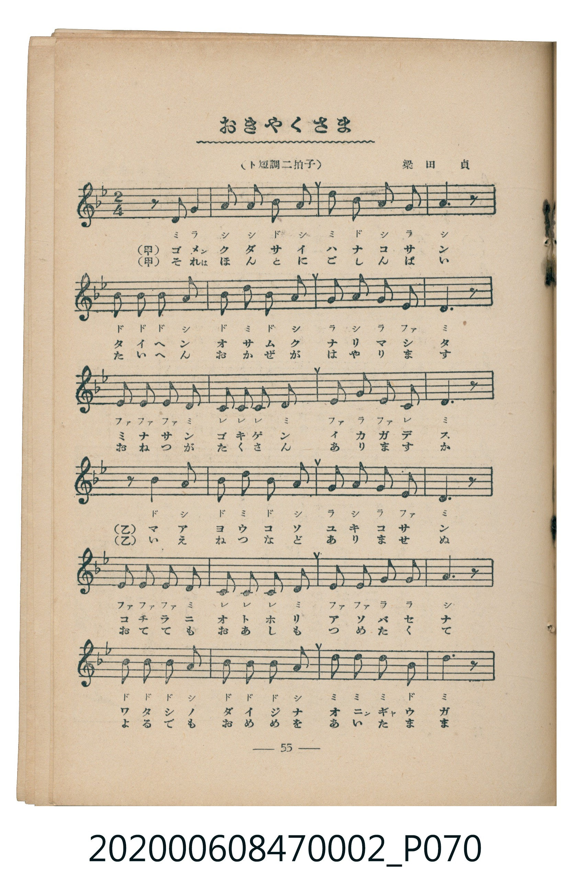
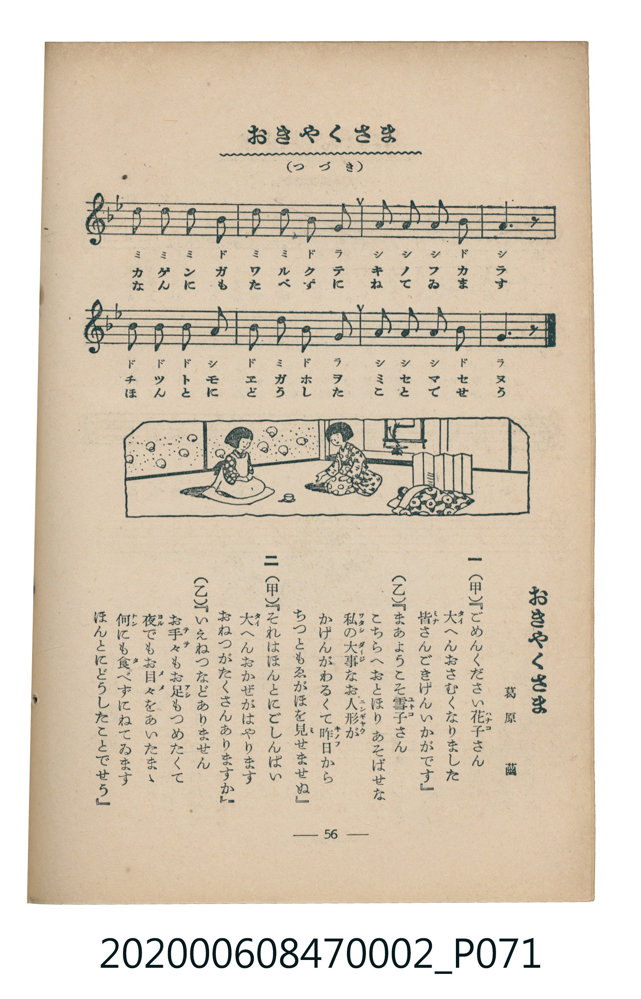

# おきやくさま（客人）

> Re:Shōka 使用 AI 協助辨識與重建樂譜，可能會有錯誤。歡迎回報。

- **鋼琴伴奏版**：<br><audio controls src="okyaku_sama.mp3"></audio>
- **NEUTRINO 歌聲合成版**：<br><audio controls src="okyaku_sama_neutrino.mp3"></audio>

- 詞：葛原𦱳
- 曲：梁田貞
- 臺灣教育會公認《新定兒童唱歌》尋常科第二學年用（2020.006.0847.0002）

## 說明

曲目說明
中文解釋：描寫客人來訪時的迎接、招待與日常禮貌。


## 歌詞

```text
一
（甲）『ごめんください花子さん
大へんおさむくなりました
皆さんごきげんいかがです』
（乙）『まあようこそ雪子さん
こちらへおとほりあそばせな
私の大事なお人形が
かげんがわるくて昨日から
ちつともゑがほを見せませぬ』

二
（甲）『それはほんとにごしんぱい
大へんおかぜがはやります
おねつがたくさんありますか』
（乙）『いえねつなどありません
お手々もお足もつめたくて
夜でもお目々をあいたまゝ
何にも食べずにねてゐます
ほんとにどうしたことでせう』
```

## ABC

<div class="abc-score" data-abc-src="okyaku_sama.abc" aria-label="五線譜載入中"></div>

[下載 ABC 原始檔](okyaku_sama.abc)

## TMD 檔案連結

- [主旋律 TMD 檔案](okyaku_sama.tmd) [[在 TMD Studio 編輯](https://tmdlang.github.io/Tmd-TS/#tmd=s7IKdvYPcrWy4qpTUCpJTLdSSM7PyUlNLsnMz7MqzsjMK0nNjM_KTMmPL87Iz05Ugisry88pzU21Si9KTEmNN4o3MjAyiDcwMIs3sDAxBzIMjBBKi_NLi5JTrYqTM_Lzc-JLUitKkvLzsxHyBUX5Zal5iXlANQVFIBtTwIoQClLLMlNSQdKpKZkl-UWZiTlI7kgtKga7FWxJfElRYl5xclFmAcgDCFUlGalAxybn5-aW5mWWVCIkgKalZ-ZZ5aZmZmVicRpUuiQxE-h9UBCUJ8bnJmbm5STmpSCrKsnIB4ZEQUalVUZmMciJyYk58dmJeUgBBnVgQWJ6qlWAgbmBLpAwVOLi0tJSeNzY9bix93FTy-PG_seNUx837nu_p-PpukVPdu16v6dTQUuLS9FWwdKMy95WwUmHy8ZI38QOZOyL9l3PGxc_mzrzRdOmZ3Oan7auebGq93FD17NpG56um_W0ddLz1UufTtn4bG3P44bupxu6n-7Y8Xz5xOdr1jzZ1fN07Y6nO7c8n7ICaBMo7vSAcacHijsgw8AIaKsSl76WwrPZm57PXvdi1apnM_q4FBQUnuxY-2xa-4vli1-2d7_fM-tZf__T9ashDn2yr-3FilXPZjY9n9XyYn_fs76ljxsan3XPfrqv9UVH-7PpS0G2L1v3YhPQMU1cWvpgD6ycBzTlxcTZT_vmf1i2cTM4sIB2goxe1Ph8yoYXm-YBQ0hfi-vJjgYuoEufTwHKdT5u6HvcOOVxU-PjpsngEFsADrSWF10bn66dAGI3TeZ6umT548YdYBXAwAUKNYCVrnrcBOTue9w4_XHjfK7ns9ogykHmAWOgcRKYDYyH7seNPY8bgUbMfNzQD7L6yc6ZMKuBupseN3U8bgRqBqqe-3L2KoS9YKGFj5s6QbaDrF7xuHE32NImoNLHjRseN84GOoPr-fLGx43rgK58sgto1yqgUmAgPt27CGgv0AygEMQpPY-b-h83AblAty97NmMFMCBBsk2dQEULHzcuAZnfBHTNRLB7gRZNerEMqBpoBdCVQHINyPlcwAhHC765j5uA6teDtQCtATpyNTgMpoO5G4FhgBaCQEPngO1YD0qn0ECcCXQFkLUW7BCg3HxoAgbpAToKqgikGSMQgWEMDEGITqDvVyJpmA0Jx65nnUB9rSDvNXa92LYZzFgCinaoPcuATgS6aTlEBTChglVPAoc00Higon2Pm-ZyPdkLTByrgYpeLgYK7XzcOAvsWaDVyx43AaMN6g_kgAC6Bhi3oCQCjk6gIDAogKHZBvIHMO1y-QLLAKuAzMS8fIcag5pqUN5QsLHQsgMzahQMFIzjFcziFXSBbPN4EDIEETUKxhAGUAosoQuEBgo1YF0-hjUK8cCiYIoCJGWDNQP9CcQLgHgqELeARdYD8SogngwWBYqA1eoCNUMNMoIYNBcoA4ovqEG7wQqBngHi1WARoE2N06GiG8EiLSgG1QAdC4JglxvC3F4Dcj3EDyZgL2F6AxhuYMOAyQdsPEikC-KHpgawn0AiQD80gUT3gZ0B0YXuD1wmdQPxHCDugYVIE1AN1DSQyEw0jwBdCkFA19YoGMVDEZgHFIX4BSiAwzv7oUEO8gDEEaCw6wXiSXARkCNBzuoB4uVYHAHxDsiJa4F4CdzxIA-CIhlhdhNSwMwEi3SjeccAGBW6pMcLKFXsA4qBrAClmw4gqw2akuaCRUA8kLcIpS1QQgFmYLDjYN4BBdBKDA_MxmIKwfiARAmuXAJx3kKgsZ3ghAELV1DKBqXyLpgjQFmgcQPMEUAHYo-PZRDcBA4UsAhILyhnQESAnmtqhMcUSGQZvnwCZxqDoSGYheGHJlCcg0wE2tO4DmwqKJuDUtEMsFthbgGWXCDv9oGTODC6QOI9mD4BRWYTKP0tR_YJyN1gPAkeJiBTQPZCMgooOSD7BNnNIBoWB7BSDEeEgCyGZAVosgZ5D-wckDeXga0Cpat1QLwVrB6kphNLhIBKBZApq-HeADl2JxDPAovCUhwowibAvYGe3zEKLkx_gItndH8AExU4LQOTEsT2polgH0ESFiQQQYXBbLDNsIS1Bos_MIvbleDog0T4fLAITB4YZVCT2uAm1XJx6dopgOoZBSCtzAUA)]
- [鋼琴伴奏 TMD 檔案](okyaku_sama_piano.tmd) [[在 TMD Studio 編輯](https://tmdlang.github.io/Tmd-TS/#tmd=s7IKdvYPcrWy4qpTUCpJTLdSyC8qychPL0osyKi0ysgsLskvykxOzInPTsxLVIIrKs4vLUpOjS9ITE-1CjAwN9AFEoZKXFxaWgqPG7seN_Y-bmp53Nj_uHHq48Z97_d0PNmz5enS_ie7Z7zf06mgpcWlaKtgacZlb6vgpMNlY6RvYgcy-UX7rueNi59NnfmiadOzOc1PW9e8WNX7uKHr2bQNT9fNeto66fnqpU-nbHy2tudxQ_fTDd1Pd-x4vnzi8zVrnuzqebp2x9OdW55PWQG0zMjAyEDPwMBMz8DCxBzIMDAC2gp2-4uV897vmfVi4uynffM_LNu4GSz4bPYmoOCzRY3Pp2x4sWke0Be-iZl5VgGZiXn5QR4ONQY11VwKQGBjoWUHZtQoGAChcbyCWTyQbR4PQoYgokbBGMKASegCoYFCDViXj2GNQjwQPm6covC4qfFx02SgGmAYAfECIJ4KxC1gkfVAvAqIJ4NFgSJAlSCDgGZCDDKCGTQXKNcD0gDSthus8HHjCiBeDRYB2tM4HSq6ESzSgmJQDdCxIAh2uSHM7TUg10P8YAL2EqY3HjfOBxv2uHEH2HiQSBfED00NYD-BRIB-aAKJ7gM7A6IL3R-4TOoG4jlA3AMLkSagGqhpIJGZaB4BuhSCgK6tUTCKhyIwDygK8QtQAId39kODHOQBiCNAYdcLxJPgIiBHgpzVA8TLsTgC4h2QE9cC8RK440EeBEUywuwmpICZCRbpRvMOKH2RES-QVAEytgmcbjqArDZoSpoLFgHxQN4inLZA3u0AOw7mHVAArcTwwGwsphCMD0iU4MolEOctBBrbCU4YsHAFpWxQKu-COQKUARo3wBwBdCD2-FgGwU3gQAGLgPSCcgZEBOi5pkZ4TIFEluHLJ3CmMRgaglkYfmgCxTnIRKA9jevApoKyOShYZ4DdCnPLakgG7QMncWB0gcR7MH0CiswmUPpbjuwTkLvBeBI8TECmgOyFZJR9aD5BdjOIRirCwKUYjggBWQzJCtBkDfIe2Dkgby4DWwVKV-uAeCtYPUhNJ5YIAZUKIFNWw70BcuxOIJ4FFoWlOFCETYB7Az2_YxRcmP4AimD6A5iowGkZmJQgtjdNBPsIkrAggQgqDGaDbYYlrDVY_IFZ3K4ERx8kwueDRWDywCiDmtQGN6kWuZrxwV3NmMXHK0SbxceCczyQaQxkwhkgX0KlsakDE7AAwK4Wrxgwx0Yb4TMRqgCuzhSkzhSoBM7AVIPLLDTP0s1hVAw4QyDLMBZG4TYPXR3eSESKbErdhzcBgQmQmcCUqWunAEqc0T5A58HZwLACspW5AA)]

## 分析

```text
================================================================================
📊 TMD Song Profile: [ おきやくさま（客人） ]
================================================================================
⏱  Duration:       0:40 (40.0s), 32 measures total
🎼 Key & Tempo:    首調基準 B,, != 96.0 BPM, <2/4>
   - 分析範圍：      由實際發聲的音符與和弦推測調性；播放脈絡另行呈現
🎤 人聲音域:    C4 (MIDI 60) – D5 (MIDI 74) [跨度: 14 個半音 / 1.2 個八度, 難度: moderate]
   - 最低音:  C4 in [Main #1 @ m.10, 0:11]
   - 最高音: D5 in [Main #1 @ m.3, 0:02]
   - 適合: soprano, mezzo-soprano, contralto, tenor, baritone, bass
🏛  結構:      Main (40.0s)
⚡ 編曲密度:        Peak 1 軌道同時演奏
🗝  調性診斷：       G 小調（純淨自然小調，未偵測到可信轉調）
   - 風格氣質:    純淨自然小調（陰鬱抒情、旋律集中，無明顯調外色彩）
   - 轉調歷程:    全曲維持單一推測調性（未偵測到可信轉調）
   - 核心骨幹音:  D, A, A#, G, D#
   - 調性數值:    G 小調 [相關度: 0.69, 穩定度: Moderate, 自然音純度: 100.0%]
   - 候選調性 (K-S): G 小調 (0.69), D 小調 (0.59), A# 大調 (0.55)
   - 五度圈歷程:   +1
   - 各段落調性細節:
     • [Main #1]: G 小調 (r: 0.69, 自然音純度: 100.0%)

  [ 五度圈游移軌跡 ]
               C  
         F           [G ]*
      Bb               D  
      Eb               A  
         Ab           E  
            Db       B  
               F# 
     (* = active key center)

  [ 十二半音累積音高分佈 ]
     C  : ██████                     5.9%
     C# :                            0.0%
     D  : ████████████████████████  24.6%
     D# : ██████████                10.2%
     E  :                            0.0%
     F  :                            0.0%
     F# :                            0.0%
     G  : ████████████              12.7%
     G# :                            0.0%
     A  : ███████████████████████   23.7%
     A# : ██████████████████████    22.9%
     B  :                            0.0%
--------------------------------------------------------------------------------
Assignment 軌道音域：
  - Piano         : C4 – D5 (14 個半音 / 1.2 個八度, 100 個音符)
================================================================================
```


## 原書掃描頁






