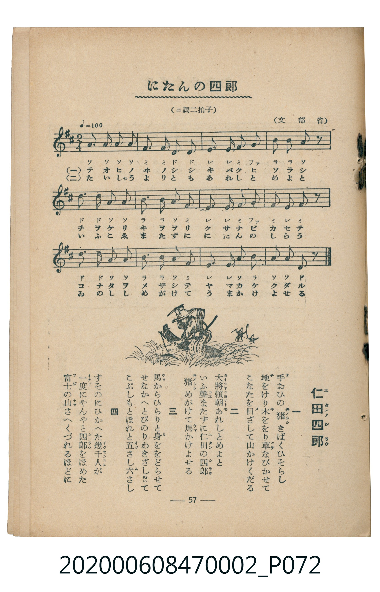

# にたんの四郎

> Re:Shōka 使用 AI 協助辨識與重建樂譜，可能會有錯誤。歡迎[回報](https://github.com/TMDLang/reshoka/issues)。

- **鋼琴伴奏版**：<br><audio controls src="nitan_no_shiro.mp3"></audio>
- **NEUTRINO 歌聲合成版**：<br><audio controls src="nitan_no_shiro_neutrino.mp3"></audio>

- 臺灣教育會公認《新定兒童唱歌》尋常科第二學年用（2020.006.0847.0002）
- 文部省

## 說明


- 出處：臺灣教育會公認《新定兒童唱歌》尋常科第二學年用（2020.006.0847.0002）
- 出處：文部省
- 調性與拍號：調號 ?= D，拍號 <2/4>，速度 != 100


## 歌詞

```text
一
手おひの猪きばくひそらし
地をけり木ををり草なびかせて
こなたを目ざして山かけくだる

二
大將賴朝あれしとめよと
いふ聲またずに仁田の四郎
猪めがけて馬かけよせる

三
馬からひらりと身ををどらせて
せなかへとびのりわきざしぬいて
こぶしもとほれと五さし六さし

四
すそのにひかへた幾千人が
一度にやんやと四郎をほめた
富士の山さへくづれるほどに
```

## ABC

<div class="abc-score" data-abc-src="nitan_no_shiro.abc" aria-label="五線譜載入中"></div>

[下載 ABC 原始檔](nitan_no_shiro.abc)

## TMD 檔案連結

- [主旋律 TMD 檔案](nitan_no_shiro.tmd) [[在 TMD Studio 編輯](https://tmdlang.github.io/Tmd-TS/#tmd=s7IKdvYPcrWy4qpTUCpJTLdSSM7PyUlNLsnMz7MqzsjMK0nNjM_KTMmPL87Iz05Ugisry88pzU21Si9KTEmNN4o3MjAyiDcwMIs3sDAxBzIMjBBKi_NLi5JTrYqTM_Lzc-JLUitKkvLzsxHyBUX5Zal5iXlANQVFIBtTwIoQClLLMlNSQdKpKZkl-UWZiTlI7kgtKga7FWxJfElRYl5xclFmAcgDCFUlGalAx6bl52Tn5BelIsSBhqVn5lnl5ucllQI9iCxRkpEP9FxBRqVVRmYxyNbkxJz47MQ8pDCA2lmQmJ5qFWBgDvQyl5aWwuPG1Y8b5z9umvy4cd3T2bNfNvcpaGlxKdoqGBoYcNnbKrhw2Rjpm9iBTHnRvut54-JnU2e-aNr0bE7z09Y1L1b1Pm7oejZtw9N1s562Tnq-eunTKRufre153ND9dEP30x07ni-f-HzNmie7ep6u3fF055bnU1a839MBCn09YOjrgUIfyDAwer-nE-zOZ9PaXzaveD6nEeg2fS2uJzsauJ51dj9u7HrcuAnovuc9qx439j5u3PC4sR8sMvdxU-fjxulcT-dseNw06XHjxMdNXc_mrACxQajrRS9QGqhn8-NGoCmzHzcu43rcCPQpUAjo5UnPZ6973DgNaABQ4unGjWBFE8FmL3jc1M3FBXQ319Mly59uaH-xecuzOXMfNzY9buoBqwfa0fi4qQPIAJrY8rhx6wuQe_aBzG2cBQzTJ7sbn08BuhMaplwgpwN1NAJ1A21Y9nLZGqhtIDNmQ2zb0ckFFQf5ahOIbAL6fMWLXauhPmpcCZaCegRIAT0CNGUHyD0gT64DaWgCuh8YSBB_AY0Dug7q7W0goaYmsOrdYJ-seLJryuPGqUDxp61rIQwuLqCTgepngoIXaCIofQC9BrFm_tOd-572Nj_ZtQvoFVD8PN21DKSiqQWUgoBk4wqIh8GuBdoB9PJ8rqfre54uBhqzDhzIQEuAJgEduRTkhCagwbtBHmtczaWlz8XlmwhM4QGZiXn5DjUGNdVcCkBgY2imZQdm1SiYKugCoSmYBuEaBWOwiLGCIZAE4RoFI7CIEVjGBCxiBiRBGKTDACQCNs3HsAaY_peBVQMTGRBvArPWgfU8bpoAlVkHxNPBLBAJ0tMLldkAxP1gFkgnSGYuiNfUCVcdj7DNCCQ_H6qzBSQPDDEwpw1qYQdEsgnklBVgVhPUWBAN4vfAnQKSB-lpBIuDdELEkCw0BukEmQ2S2wfE3XDHgWRATobwQTYimdm4HyozCYxBMiuhtkE8NhtMggIOyTYTkM6ZUNvmQoMRGK2otgHdAIx_MAsUFCAZUBiA-P0wk5smQ2VAeiE8YHJDsa1GwTAOrA1IIZICKIpBEQ3igSIfW1IAsUCiIBo9KSxE-LtxIjQmUCIcESJwGVD0g9w3FYhXgVmboTLg0MYeVuCkAPP3ViAG-7EJZCdIZh9UZj4Qz0IJRRANlYGGCzSxQlIFNH5AcY6eDkDuAMmtgrsMFAsgGVCsQ9wNjTOY35pgfusF4mlgFiwDrAHzIKkXWzqA-W0hNO3AfQBO8ZBYhaV-WKoDmQ1Nj2AfQEIaJLMbzAOndHCqIT8dgERAspCCBIRBRQZ6OgCFLCysQPbBXQJ2A0hmGizEwb5H8hcin4FTECyFAKsUsDkgGbR0gLuYgdsGyvXg9AizDTNXw2yDlgSQfIRmGzgdwPy2DZ5mYGUMLB3sBpczyDED89sSIJ6K4sIGMA8hhp4OtkJ1zoCmLRBEDy2IblhqhKW5pTBXgH0BTwVIqQliVy0Xl66dAqjaUADSylwA)]
- [鋼琴伴奏 TMD 檔案](nitan_no_shiro_piano.tmd) [[在 TMD Studio 編輯](https://tmdlang.github.io/Tmd-TS/#tmd=s7IKdvYPcrWy4qpTUCpJTLdSyC8qychPL0osyKi0ysgsLskvykxOzInPTsxLVIIrKs4vLUpOjS9ITE-1CjAwN1Li4tLSUnjcuPpx4_zHTZMfN657Onv2y-a-93s6nuzZ8nRp_5PdM97v6VTQ0uJStFUwNDDgsrdVcOGyMdI3sQMZ-qJ91_PGxc-mznzRtOnZnOanrWterOp93ND1bNqGp-tmPW2d9Hz10qdTNj5b2_O4ofvphu6nO3Y8Xz7x-Zo1T3b1PF274-nOLc-nrABaZmRgZKBnYGCmZ2BhYg5kGBgBbQU7-9m09pfNK57PaQQ61TcxM88qIDMxLz_Iw6HGoKaaSwEIbAzNtOzArBoFUwVdIDQF0yBco2AMFjFWMASSIFyjYAQWMQLLmIBFzIAkCIN0GIBEwKb5GNYAQ2YZWPXjxi4g3gRmrQPredzYApVZB8TTwSwQCZLphcpsAOJ-MAukEyQzF8Rr6oSrjkfYZgSSnw_V2QKSf9zUDua0QTQ3dUAkm0BOWQFmNUGNBdEgfg_cKSB5kJ5GsDhIJ0QMyUJjkE6Q2SC5fUDcDXccSAbkZAgfZCOSmY37oTKTwBgksxJqG8Rjs8EkKOCQbDMB6ZwJtW0uNBiBCQ_VNqAbHjfuALNAQYEczP0wk5smQ2VAeiG8x409KLbVKBjGgbUBKURSAEUxKKJBPFDkY0sKIBZIFESjJ4WFCH83ToTGBEqEI0IELgOKfpD7pgLxKjBrM1QGHNrYwwqcFGD-3grEED-CYhEksw8qMx-IZ6GEIoiGykDDBZZYwakCGj-gOEdPByB3gORWwV0GigWQDCjWIe6GxhnMb00wv_UC8TQwC5YB1oB5IB9gTwcwvy2Eph24D5qgMkDXQ9iIVAcyG5oewT6AhDRIZjeYB07p4FRDfjoAiYBkIQUJCIOKDPR0AApZWFiB7IO7BOwGkMw0WIiDfY_kL0Q-A6cgWAp53LgAbA5IBlc6wChm4LaBcj04PcJsw8zVMNugJQEkH6HZBk4HML9tg6cZWBkDSwe7weUMcszAXLgEiKeiuLABzEOIoaeDrVCdM6BpCwTRQwuiG5YaYWluFswVYF_AUwFSaoLYVYtca_gg1xoW8ErDMF4h2jAWRmHyTeOBLNP4WASjRsEEyDIBqzFApDU0fQg1uM1B6CHeHCMgwwjFFDgTag7Q17p2CiCPR_sAtcDZQF1wtjESG2g6kK3MBQA)]

## 分析

```text
================================================================================
📊 TMD Song Profile: [ にたんの四郎 ]
================================================================================
⏱  Duration:       0:14 (14.4s), 12 measures total
🎼 Key & Tempo:    首調基準 D, != 100.0 BPM, <2/4>
   - 分析範圍：      由實際發聲的音符與和弦推測調性；播放脈絡另行呈現
🎤 人聲音域:    D4 (MIDI 62) – D5 (MIDI 74) [跨度: 12 個半音 / 1.0 個八度, 難度: easy]
   - 最低音:  D4 in [Main #1 @ m.2, 0:01]
   - 最高音: D5 in [Main #1 @ m.5, 0:04]
   - 適合: soprano, mezzo-soprano, contralto, tenor, baritone, bass
🏛  結構:      Main (14.4s)
⚡ 編曲密度:        Peak 1 軌道同時演奏
🗝  調性診斷：       A 調性不明確（純淨自然大調，未偵測到可信轉調）
   - 風格氣質:    純淨自然大調（陽光明朗、易唱易記，無明顯調外色彩）
   - 轉調歷程:    全曲維持單一推測調性（未偵測到可信轉調）
   - 核心骨幹音:  A, F#, D, E, B
   - 調性數值:    A 調性不明確 [相關度: 0.81, 穩定度: Ambiguous, 自然音純度: 95.6%]
   - 候選調性 (K-S): A 大調 (0.81), D 大調 (0.79), F# 小調 (0.65)
   - 五度圈歷程:   +3
   - 各段落調性細節:
     • [Main #1]: A 調性不明確 (r: 0.81, 自然音純度: 95.6%, 調外音: G)

  [ 五度圈游移軌跡 ]
               C  
         F            G  
      Bb               D  
      Eb              [A ]*
         Ab           E  
            Db       B  
               F# 
     (* = active key center)

  [ 十二半音累積音高分佈 ]
     C  :                            0.0%
     C# :                            0.0%
     D  : ████████████              15.6%
     D# :                            0.0%
     E  : ████████████              15.6%
     F  :                            0.0%
     F# : ██████████████            17.8%
     G  : ███                        4.4%
     G# :                            0.0%
     A  : ████████████████████████  31.1%
     A# :                            0.0%
     B  : ████████████              15.6%
--------------------------------------------------------------------------------
Assignment 軌道音域：
  - Piano         : D4 – D5 (12 個半音 / 1.0 個八度, 45 個音符)
================================================================================
```


## 原書掃描頁




