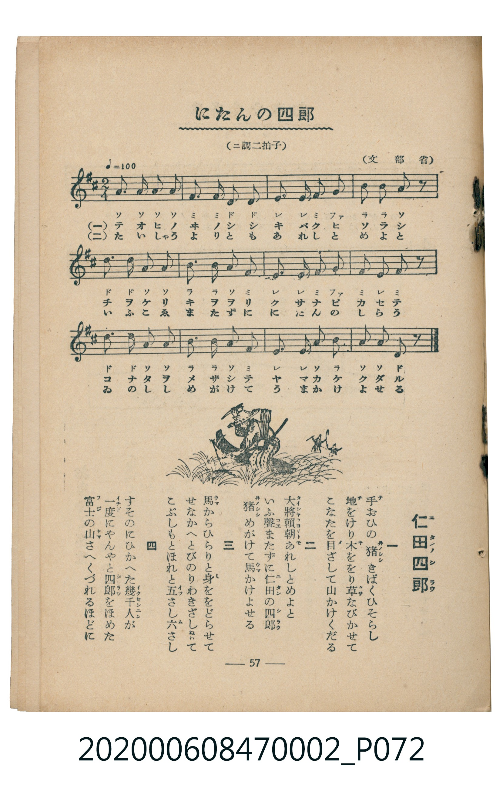

# にたんの四郎

<audio controls src="nitan_no_shiro.mp3"></audio>

- 臺灣教育會公認《新定兒童唱歌》尋常科第二學年用（2020.006.0847.0002）
- 文部省

- note

・出處：臺灣教育會公認《新定兒童唱歌》尋常科第二學年用（2020.006.0847.0002）
・出處：文部省
・調性與拍號：調號 ?= D，拍號 <2/4>，速度 != 100

## 歌詞

```text
一
手おひの猪きばくひそらし
地をけり木ををり草なびかせて
こなたを目ざして山かけくだる

二
大將賴朝あれしとめよと
いふ聲またずに仁田の四郎
猪めがけて馬かけよせる

三
馬からひらりと身ををどらせて
せなかへとびのりわきざしぬいて
こぶしもとほれと五さし六さし

四
すそのにひかへた幾千人が
一度にやんやと四郎をほめた
富士の山さへくづれるほどに
```

## 原書掃描頁



## 調性分析

```text
================================================================================
📊 TMD Song Profile: [ にたんの四郎 ]
================================================================================
⏱  Duration:       0:14 (14.4s), 12 measures total
🎼 Key & Tempo:    首調基準 D, != 100.0 BPM, <2/4>
   - 分析範圍：      由實際發聲的音符與和弦推測調性；播放脈絡另行呈現
🎤 人聲音域:    D4 (MIDI 62) – D5 (MIDI 74) [跨度: 12 個半音 / 1.0 個八度, 難度: easy]
   - 最低音:  D4 in [Main #1 @ m.2, 0:01]
   - 最高音: D5 in [Main #1 @ m.5, 0:04]
   - 適合: soprano, mezzo-soprano, contralto, tenor, baritone, bass
🏛  結構:      Main (14.4s)
⚡ 編曲密度:        Peak 1 軌道同時演奏
🗝  調性診斷：       A 調性不明確（純淨自然大調，未偵測到可信轉調）
   - 風格氣質:    純淨自然大調（陽光明朗、易唱易記，無明顯調外色彩）
   - 轉調歷程:    全曲維持單一推測調性（未偵測到可信轉調）
   - 核心骨幹音:  A, F#, D, E, B
   - 調性數值:    A 調性不明確 [相關度: 0.81, 穩定度: Ambiguous, 自然音純度: 95.6%]
   - 候選調性 (K-S): A 大調 (0.81), D 大調 (0.79), F# 小調 (0.65)
   - 五度圈歷程:   +3
   - 各段落調性細節:
     • [Main #1]: A 調性不明確 (r: 0.81, 自然音純度: 95.6%, 調外音: G)

  [ 五度圈游移軌跡 ]
               C  
         F            G  
      Bb               D  
      Eb              [A ]*
         Ab           E  
            Db       B  
               F# 
     (* = active key center)

  [ 十二半音累積音高分佈 ]
     C  :                            0.0%
     C# :                            0.0%
     D  : ████████████              15.6%
     D# :                            0.0%
     E  : ████████████              15.6%
     F  :                            0.0%
     F# : ██████████████            17.8%
     G  : ███                        4.4%
     G# :                            0.0%
     A  : ████████████████████████  31.1%
     A# :                            0.0%
     B  : ████████████              15.6%
--------------------------------------------------------------------------------
Assignment 軌道音域：
  - Piano         : D4 – D5 (12 個半音 / 1.0 個八度, 45 個音符)
================================================================================
```

## ABC

```abc
X:1
T:にたんの四郎
C:TMD (Chen, Chih-Han / aguai)
M:2/4
L:1/16
Q:1/4=100
K:D

V:V1 name="Piano" snm="Pia"

[V:V1]
a2 a2 a2 a2 | f2 f2 d2 d2 | e2 e2 f2 g2 | b2 b2 a2 z2 |
d2 d2 a2 a2 | b2 b2 a2 f2 | e2 e2 f2 g2 | f2 e2 f2 z2 |
d2 d2 a2 a2 | b2 b2 a2 f2 | e2 e2 a2 b2 | a2 a2 d2 z2 |
```

- [主旋律 TMD 檔案](nitan_no_shiro.tmd)
- [鋼琴伴奏 TMD 檔案](nitan_no_shiro_piano.tmd)
