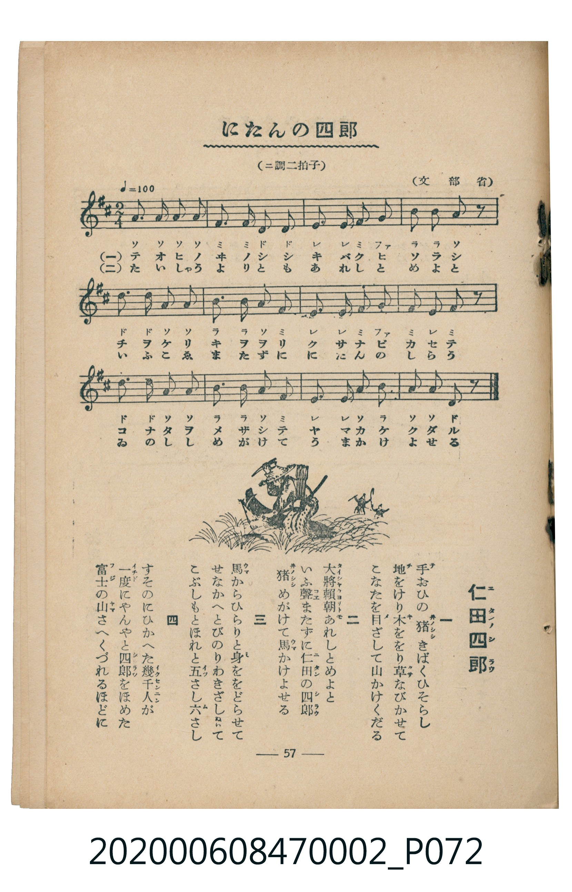

# にたんの四郎

> Re:Shōka 使用 AI 協助辨識與重建樂譜，可能會有錯誤。歡迎回報。

- **鋼琴伴奏版**：<br><audio controls src="nitan_no_shiro.mp3"></audio>
- **NEUTRINO 歌聲合成版**：<br><audio controls src="nitan_no_shiro_neutrino.mp3"></audio>

- 臺灣教育會公認《新定兒童唱歌》尋常科第二學年用（2020.006.0847.0002）
- 文部省

## 說明


- 出處：臺灣教育會公認《新定兒童唱歌》尋常科第二學年用（2020.006.0847.0002）
- 出處：文部省
- 調性與拍號：調號 ?= D，拍號 <2/4>，速度 != 100


## 歌詞

```text
一
手おひの猪きばくひそらし
地をけり木ををり草なびかせて
こなたを目ざして山かけくだる

二
大將賴朝あれしとめよと
いふ聲またずに仁田の四郎
猪めがけて馬かけよせる

三
馬からひらりと身ををどらせて
せなかへとびのりわきざしぬいて
こぶしもとほれと五さし六さし

四
すそのにひかへた幾千人が
一度にやんやと四郎をほめた
富士の山さへくづれるほどに
```

## ABC

```abc
X:1
T:にたんの四郎
M:2/4
L:1/16
Q:1/4=100
K:D
V:V1 name="Piano" snm="Pia"
[V:V1]
A3 A A2 A2 | F3 F D2 D2 | E3 E F2 G2 | B2 B2 A2 z2 |
w: 1.~て お ひ の | ゐ の し し | き ば く ひ | そ ら し
w: 2.~た い しや う | よ り と も | あ れ し と | め よ と
w: 3.~う ま か ら | ひ ら り と | み を を ど | ら せ て
w: 4.~す そ の に | ひ か へ た | い く せ ん | に ん が
d3 d A2 A2 | B3 B A2 F2 | E3 E F2 G2 | F2 E2 F2 z2 |
w: 1.~ち を け り | き を を り | く さ な び | か せ て
w: 2.~い ふ こ ゑ | ま た ず に | に た ん の | し ら う
w: 3.~せ な か へ | と び の り | わ き ざ し | ぬ い て
w: 4.~い ち ど に | や ん や と | し ら う を | ほ め た
d3 d A2 A2 | B3 B A2 F2 | E3 E A2 B2 | A2 A2 D2 z2 |
w: 1.~こ な た を | め ざ し て | や ま か け | く だ る
w: 2.~ゐ の し し | め が け て | う ま か け | よ せ る
w: 3.~こ ぶ し も | と ほ れ と | い つ さ し | む さ し
w: 4.~ふ じ の _ | や ま さ へ | く づ れ る | ほ ど に
```

## TMD 檔案連結

- [主旋律 TMD 檔案](nitan_no_shiro.tmd) [[在 TMD Studio 編輯](https://tmdlang.github.io/Tmd-TS/#tmd=s7IKdvYPcrWy4qpTUCpJTLdSSM7PyUlNLsnMz7MqzsjMK0nNjM_KTMmPL87Iz05Ugisry88pzU21Si9KTEmNN4o3MjAyiDcwMIs3sDAxBzIMjBBKi_NLi5JTrYqTM_Lzc-JLUitKkvLzsxHyBUX5Zal5iXlANQVFIBtTwIoQClLLMlNSQdKpKZkl-UWZiTlI7kgtKga7FWxJfElRYl5xclFmAcgDCFUlGalAx6bl52Tn5BelIsSBhqVn5lnl5ucllQI9qMTFpaWl8Lhx9ePG-Y-bJj9uXPd09uyXzX0KWlpcirYKhgYGXPa2Ci5cNkb6JnYgQ16073reuPjZ1JkvmjY9m9P8tHXNi1W9jxu6nk3b8HTdrKetk56vXvp0ysZna3seN3Q_3dD9dMeO58snPl-z5smunqdrdzzdueX5lBXv93SAgk8PGHx6oOADMgyM3u_pBDvz2bT2l80rns9pBLpNX4vryY4Grmed3Y8bux43bgK673nPqseNvY8bNzxu7AeLzH3c1Pm4cTrX0zkbHjdNetw48XFT17M5K0BsEOp60QuUBurZ_LgRaMrsx43LuB43An0KFAJ6edLz2eseN04DGgCUeLpxI1jRRLDZCx43dXNxAd3N9XTJ8qcb2l9s3vJsztzHjU2Pm3rA6oF2ND5u6gAygCa2PG7c-gLknn0gcxtnAcP0ye7G51OA7oSGKRfI6UAdjUDdQBuWvVy2BmobyIzZENt2dHJBxUG-2gQim4A-X_Fi12qojxpXgqWgHgFSQI8ATdkBcg_Ik-tAGpqA7gcGEsRfQOOAroN6extIqKkJrHo32Ccrnuya8rhxKlD8aetaCIOLC-hkoPqZoOAFmghKH0CvQayZ_3Tnvqe9zU927QJ6BRQ_T3ctA6loagGlICDZuALiYbBrgXYAvTyf6-n6nqeLgcasAwcy0BKgSUBHLgU5oQlo8G6QxxpXc2npc3H5JgKTaEBmYl6-Q41BTTWXAhDYGJpp2YFZNQqmCrpAaAqmQbhGwRgsYqxgCCRBuEbBCCxiBJYxAYuYAUkQBukwAImATfMxrAGm_2Vg1cBEBsSbwKx1YD2PmyZAZdYB8XQwC0SC9PRCZTYAcT-YBdIJkpkL4jV1wlXHI2wzAsnPh-psAckDQwzMaYNa2AGRbAI5ZQWY1QQ1FkSD-D1wp4DkQXoaweIgnRAxJAuNQTpBZoPk9gFxN9xxIBmQkyF8kI1IZjbuh8pMAmOQzEqobRCPzQaToIBDss0EpHMm1La50GAERiuqbUA3AOMfzAIFBUgGFAYgfj_M5KbJUBmQXggPmNxQbKtRMIwDawNSiKQAimJQRIN4oMjHlhRALJAoiEZPCgsR_m6cCI0JlAhHhAhcBhT9IPdNBeJVYNZmqAw4tLGHFTgpwPy9FYjBfmwC2QmS2QeVmQ_Es1BCEURDZaDhAk2skFQBjR9QnKOnA5A7QHKr4C4DxQJIBhTrEHdD4wzmtyaY33qBeBqYBcsAa8A8SOrFlg5gflsITTtwH4BTPCRWYakflupAZkPTI9gHkJAGyewG88ApHZxqyE8HIBGQLKQgAWFQkYGeDkAhCwsrkH1wl4DdAJKZBgtxsO-R_IXIZ-AUBEshwCoFbA5IBi0d4C5m4LaBcj04PcJsw8zVMNugJQEkH6HZBk4HML9tg6cZWBkDSwe7weUMcszA_LYEiKeiuLABzEOIoaeDrVCdM6BpCwTRQwuiG5YaYWluKcwVYF_AUwFSaoLYVcvFpWunAKo2FIC0MhcA)]
- [鋼琴伴奏 TMD 檔案](nitan_no_shiro_piano.tmd) [[在 TMD Studio 編輯](https://tmdlang.github.io/Tmd-TS/#tmd=s7IKdvYPcrWy4uLS0lJ43Lj6ceP8x02THzeuezp79svmvvd7Op7s2fJ0af-T3TPe7-lU0NLiUrRVMDQw4LK3VXDhsjHSN7HjqlNQetG-63nj4mdTZ75o2vRsTvPT1jUvVvU-buh6Nm3D03WznrZOer566dMpG5-t7Xnc0P10Q_fTHTueL5_4fM2aJ7t6nq7d8XTnludTVgAtMzIwMtAzMDDTM7AwMQcyDIyAtiqBbHg2rf1l84rncxqVuLh8EzPzrAIyE_PygzwcagxqqrkUgMDG0EzLDsyqUTBV0AVCUzANwjUKxmARYwVDIAnCNQpGYBEjsIwJWMQMSIIwSIcBSARsmo9hDTBkloFVP27sAuJNYNY6sJ7HTROgMuuAeDqYBSJBenqhMhuAuB_MAukEycwF8Zo64arjEbYZgeTnQ3W2gOQfN7WAOW1QCzsgkk0gp6wAs5qgxoJoEL8H7hSQPEhPI1gcpBMihmShMUgnyGyQ3D4g7oY7DiQDcjKED7IRyczG_VCZSWAMklkJtQ3isdlgEhRwSLaZgHTOhNo2FxqMwISHahvQDY8bd4BZoKAAyYDCAMTvh5ncNBkqA9IL4T1u7EGxrUbBMA6sDUghkgIoikERDeKBIh9bUgCxQKIgGj0pLET4u3EiNCZQIhwRInAZUPSD3DcViFeBWZuhMuDQxh5W4KQA8_dWIAb7sQlkJ0hmH1RmPhDPQglFEA2VgYYLNLFCUgU0fkBxjp4OQO4Aya2CuwwUCyAZUKxD3A2NM5jfmmB-6wXiaWAWLAOsAfMgqRdbOoD5bSE07cB9AE7xkFiFpX5YqgOZDU2PYB9AQhoksxvMA6d0cKohPx2ARECykIIEhEFFBno6AIUsLKxA9sFdAnYDSGYaLMTBvkfyFyKfgVMQLIU8blwANgckg5YOcBczcNtAuR6cHmG2YeZqmG3QkgCSj9BsA6cDmN-2wdMMrIyBpYPd4HIGOWZgflsCxFNRXNgA5iHE0NPBVqjOGdC0BYLooQXRDUuNsDS3FOYKsC_gqQApNUHsqkWuNXxw1BqGILXRhrFAEomJW9w0HswzjQdxUTg1CiZgnglcDyLx4DYPXQ8x9qCbRYk9RmCOERZbULhI9gCDVddOARSy0T4gQ2BskBkwtjESG2SnnYIyFwA)]

## 分析

```text
================================================================================
📊 TMD Song Profile: [ にたんの四郎 ]
================================================================================
⏱  Duration:       0:14 (14.4s), 12 measures total
🎼 Key & Tempo:    首調基準 D, != 100.0 BPM, <2/4>
   - 分析範圍：      由實際發聲的音符與和弦推測調性；播放脈絡另行呈現
🎤 人聲音域:    D4 (MIDI 62) – D5 (MIDI 74) [跨度: 12 個半音 / 1.0 個八度, 難度: easy]
   - 最低音:  D4 in [Main #1 @ m.2, 0:01]
   - 最高音: D5 in [Main #1 @ m.5, 0:04]
   - 適合: soprano, mezzo-soprano, contralto, tenor, baritone, bass
🏛  結構:      Main (14.4s)
⚡ 編曲密度:        Peak 1 軌道同時演奏
🗝  調性診斷：       A 調性不明確（純淨自然大調，未偵測到可信轉調）
   - 風格氣質:    純淨自然大調（陽光明朗、易唱易記，無明顯調外色彩）
   - 轉調歷程:    全曲維持單一推測調性（未偵測到可信轉調）
   - 核心骨幹音:  A, F#, D, E, B
   - 調性數值:    A 調性不明確 [相關度: 0.81, 穩定度: Ambiguous, 自然音純度: 95.6%]
   - 候選調性 (K-S): A 大調 (0.81), D 大調 (0.79), F# 小調 (0.65)
   - 五度圈歷程:   +3
   - 各段落調性細節:
     • [Main #1]: A 調性不明確 (r: 0.81, 自然音純度: 95.6%, 調外音: G)

  [ 五度圈游移軌跡 ]
               C  
         F            G  
      Bb               D  
      Eb              [A ]*
         Ab           E  
            Db       B  
               F# 
     (* = active key center)

  [ 十二半音累積音高分佈 ]
     C  :                            0.0%
     C# :                            0.0%
     D  : ████████████              15.6%
     D# :                            0.0%
     E  : ████████████              15.6%
     F  :                            0.0%
     F# : ██████████████            17.8%
     G  : ███                        4.4%
     G# :                            0.0%
     A  : ████████████████████████  31.1%
     A# :                            0.0%
     B  : ████████████              15.6%
--------------------------------------------------------------------------------
Assignment 軌道音域：
  - Piano         : D4 – D5 (12 個半音 / 1.0 個八度, 45 個音符)
================================================================================
```


## 原書掃描頁




