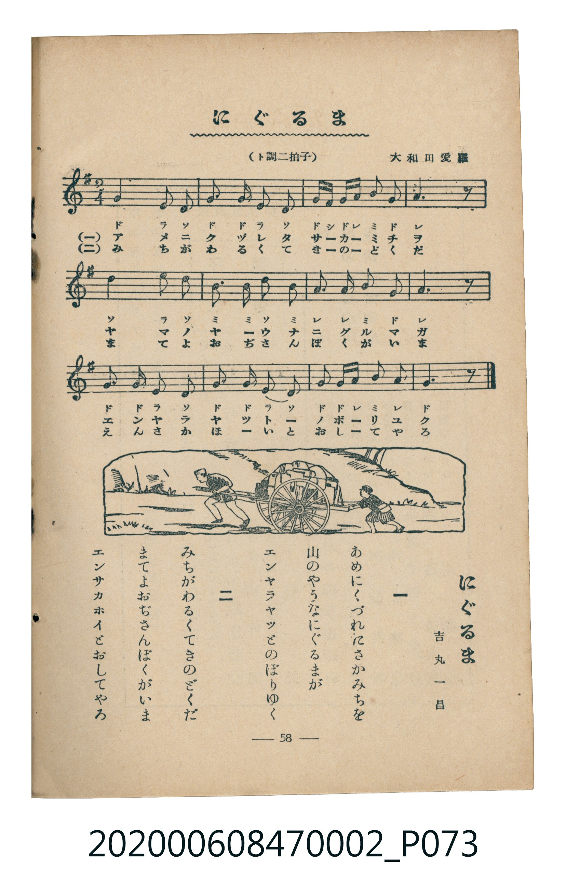

# にぐるま（人力車／運貨車）

> Re:Shoka 使用 AI 協助辨識與重建樂譜，可能會有錯誤。歡迎回報。

<audio controls src="niguruma.mp3"></audio>

- 詞：吉丸一昌
- 曲：大和田愛羅
- 臺灣教育會公認《新定兒童唱歌》尋常科第二學年用（2020.006.0847.0002）

## 說明

曲目說明
中文解釋：描寫車輛載人或載物行走的生活景象。

## 歌詞

```text
一
あめにくづれたさかみちを
山のやうなにぐるまが
エンヤラヤツとのぼりゆく

二
みちがわるくてきのどくだ
まてよおぢさんぼくがいま
エンサカホイとおしてやろ
```

## ABC

```abc
X:1
T:にぐるま（人力車／運貨車）
C:曲：大和田愛羅
M:2/4
L:1/16
Q:1/4=96
K:G
V:V1 name="Piano" snm="Pia"
[V:V1]
G4 E2 D2 | G2 G2 E2 D2 | G F G A B2 G2 | A6 z2 |
D4 E2 D2 | B2 B2 d2 B2 | A2 A2 B2 G2 | A6 z2 |
G2 G2 E2 D2 | G2 G2 E2 D2 | G2 G A B2 A2 | G6 z2 |
```

## TMD 檔案連結

- [主旋律 TMD 檔案](niguruma.tmd) [[在 TMD Studio 編輯](https://tmdlang.github.io/Tmd-TS/#tmd=s7IKdvYPcrWy4qpTUCpJTLdSSM7PyUlNLsnMz7MqzsjMK0nNjM_KTMmPL87Iz05Ugisry88pzU21Si9KTEmNN4o3MjAyiDcwMIs3sDAxBzIMjBBKi_NLi5JTrYqTM_Lzc-JLUitKkvLzsxHyBUX5Zal5iXlANQVFIBtTwIoQClLLMlNSQdKpKZkl-UWZiTlI7kgtKga7FWxJfElRYl5xclFmAcgDCFUlGalAx4IlC_KLgEZzaWkpPG5c_bhxwuOm7seN-97v6Xiya9fTrtkvdne939P_srH7xaYVYHangpYWl6KtgqUZl72tgjuXjZG-iR3I4Bftu543Ln42deaLpk3P5jQ_bV3zYlXv44auZ9M2PF0362nrpOerlz6dsvHZ2p7HDd1PN3Q_3bHj-fKJz9esebKr5-naHU93bnk-ZQXQXlDQ6QGDTg8UdECGgRHQUiUufS2FZ7M3PZ-97sWqVc9m9HEpKCg82bH22bT2F8sXv2zvfr9n1rP-_qfrVwMd-WLP7Bd7OoHuf9YxDch43rnyxcKeF1s3PJ_V8nzK_Gdbdj-buf7FxoWPG5q4tPTBTl85D6j_6YTOJzt2PNnR8GxGDziogPaBhJcsfzqp5_mUDc9aZj_f1woMK30tLqAqrseNTY-bGsGh1v-4cenjpp7HjfMfN0593AgMwf2PGxc-bprE9XTjxseN6x43tTxubHvcuAo5jB839nA9blrxuHnz4-Ylj5tXgkmguhUgDY17Hjd1PW4C6unn4gKGENA2sJGNPY-b-sH6gXYue9zYC1a8EsxdAFQENHXZ46aOx41djxsXgRzTNBlkFkga6Dyg6ftgdjZtfdy0-nHz7MdNS8B2AjVMB2tuedzUCwoYLt_EzDyrgMzEvHyHGoMahWpQmCvYGJpp2YFZNQqGCrpgaBYPJExBBEQMhFHFzOOBhJGCMVSyBsiGaAVBA5AI1EiwDnQzQdpA2BRKQ7SDMGEDsbsHlxjEiSCzEL5DmFjLxaVrpwAKFgUgrczFBQA)]
- [鋼琴伴奏 TMD 檔案](niguruma_piano.tmd) [[在 TMD Studio 編輯](https://tmdlang.github.io/Tmd-TS/#tmd=s7IKdvYPcrWy4uLS0lJ43Lj6ceOEx03djxv3vd_T8WTPlqdL-5_snvF-T6eClhaXoq2CpRmXva2CO5eNkb6JHVedgtKL9l3PGxc_mzrzRdOmZ3Oan7auebGq93FD17NpG56um_W0ddLz1UufTtn4bG3P44bupxu6n-7Y8Xz5xOdr1jzZ1fN07Y6nO7c8n7ICaJeRgZGBnoGBmZ6BhYk5kGFgBLRUCWzDynnv98x6OqHzyY4dT3Y0PJvRAxZ-NnsTSHjJ8qeTep5P2fCsZfbzfa1KXFy-iZl5VgGZiXn5QR4ONQY1CtVcCkBgY2imZQdm1SgYKuiCoVk8kDAFERAxEEYVM48HEkYKxlDJGiAbohUEDUAiUCPBOtDNBGkDYVMoDdEOwoQNxO4eXGIQJ4LMQvgOYWItcqj44AwVkIHRhrEgAxFM0sVN48E803gQF0qh-IwS82hqExIHxWgUGQgJD1hdOwVQ2CoAaWUuLgA)]

## 分析

```text
================================================================================
📊 TMD Song Profile: [ にぐるま（人力車／運貨車） ]
================================================================================
⏱  Duration:       0:15 (15.0s), 12 measures total
🎼 Key & Tempo:    首調基準 G, != 96.0 BPM, <2/4>
   - 分析範圍：      由實際發聲的音符與和弦推測調性；播放脈絡另行呈現
🎤 人聲音域:    D4 (MIDI 62) – D5 (MIDI 74) [跨度: 12 個半音 / 1.0 個八度, 難度: easy]
   - 最低音:  D4 in [Main #1 @ m.1, 0:00]
   - 最高音: D5 in [Main #1 @ m.6, 0:06]
   - 適合: soprano, mezzo-soprano, contralto, tenor, baritone, bass
🏛  結構:      Main (15.0s)
⚡ 編曲密度:        Peak 1 軌道同時演奏
🗝  調性診斷：       G 大調（純淨自然大調，未偵測到可信轉調）
   - 風格氣質:    純淨自然大調（陽光明朗、易唱易記，無明顯調外色彩）
   - 轉調歷程:    全曲維持單一推測調性（未偵測到可信轉調）
   - 核心骨幹音:  G, A, D, B, E
   - 調性數值:    G 大調 [相關度: 0.85, 穩定度: High, 自然音純度: 100.0%]
   - 候選調性 (K-S): G 大調 (0.85), D 大調 (0.68), E 小調 (0.59)
   - 五度圈歷程:   +1
   - 各段落調性細節:
     • [Main #1]: G 大調 (r: 0.85, 自然音純度: 100.0%)

  [ 五度圈游移軌跡 ]
               C  
         F           [G ]*
      Bb               D  
      Eb               A  
         Ab           E  
            Db       B  
               F# 
     (* = active key center)

  [ 十二半音累積音高分佈 ]
     C  :                            0.0%
     C# :                            0.0%
     D  : ████████████              17.8%
     D# :                            0.0%
     E  : ████████                  11.1%
     F  :                            0.0%
     F# : █                          1.1%
     G  : ████████████████████████  34.4%
     G# :                            0.0%
     A  : ███████████████           22.2%
     A# :                            0.0%
     B  : █████████                 13.3%
--------------------------------------------------------------------------------
Assignment 軌道音域：
  - Piano         : D4 – D5 (12 個半音 / 1.0 個八度, 40 個音符)
================================================================================
```


## 原書掃描頁




