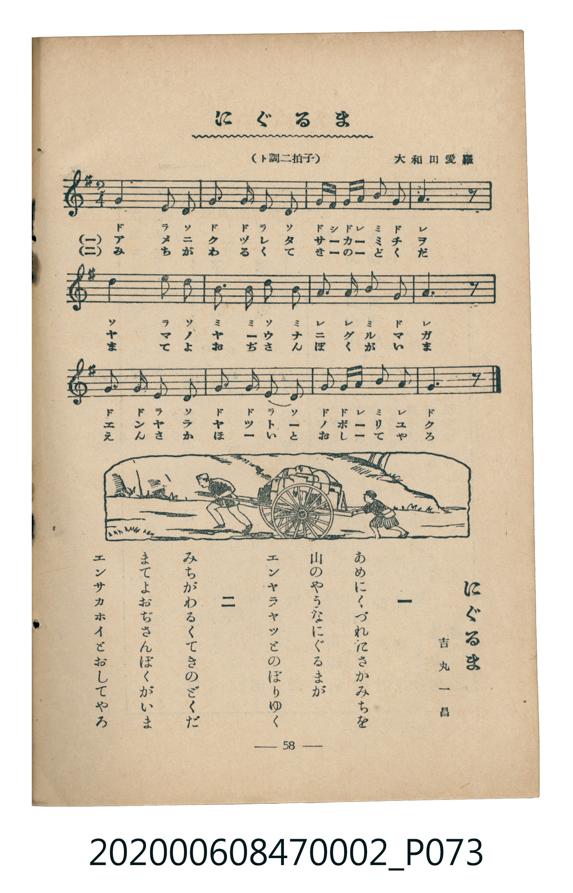

# にぐるま（人力車／運貨車）

> Re:Shōka 使用 AI 協助辨識與重建樂譜，可能會有錯誤。歡迎回報。

- **NEUTRINO 歌聲合成版**：<br><audio controls src="niguruma_neutrino.mp3"></audio>
- **鋼琴伴奏版**：<br><audio controls src="niguruma.mp3"></audio>


- 詞：吉丸一昌
- 曲：大和田愛羅
- 臺灣教育會公認《新定兒童唱歌》尋常科第二學年用（2020.006.0847.0002）

## 說明

曲目說明
中文解釋：描寫車輛載人或載物行走的生活景象。


## 歌詞

```text
一
あめにくづれたさかみちを
山のやうなにぐるまが
エンヤラヤツとのぼりゆく

二
みちがわるくてきのどくだ
まてよおぢさんぼくがいま
エンサカホイとおしてやろ
```

## ABC

```abc
X:1
T:にぐるま（人力車／運貨車）
C:曲：大和田愛羅
M:2/4
L:1/16
Q:1/4=96
K:G
V:V1 name="Piano" snm="Pia"
[V:V1]
G4 E2 D2 | G3 G E2 D2 | G F G A B2 G2 | A6 z2 |
w: 1.~あ め に | く づ れ た | さ _ か _ み ち | を
w: 2.~み ち が | わ る く て | き _ の _ ど く | だ
d4 e2 d2 | B3 B d2 B2 | A3 A B2 G2 | A6 z2 |
w: 1.~や ま の | や _ う な | に ぐ る ま | が
w: 2.~ま て よ | お ぢ さ ん | ぼ く が い | ま
G3 G E2 D2 | G3 G E3 D | G2 G A B2 A2 | G6 z2 |
w: 1.~エ ン ヤ ラ | ヤ ツ と _ | の ぼ _ り ゆ | く
w: 2.~エ ン サ カ | ホ _ イ と | お し _ て や | ろ
```

## TMD 檔案連結

- [主旋律 TMD 檔案](niguruma.tmd) [[在 TMD Studio 編輯](https://tmdlang.github.io/Tmd-TS/#tmd=s7IKdvYPcrWy4qpTUCpJTLdSSM7PyUlNLsnMz7MqzsjMK0nNjM_KTMmPL87Iz05Ugisry88pzU21Si9KTEmNN4o3MjAyiDcwMIs3sDAxBzIMjBBKi_NLi5JTrYqTM_Lzc-JLUitKkvLzsxHyBUX5Zal5iXlANQVFIBtTwIoQClLLMlNSQdKpKZkl-UWZiTlI7kgtKga7FWxJfElRYl5xclFmAcgDCFUlGalAx4IlC_KLkIwGmpaemWeVm5qZlYnFaVDpksRMoPdBQVCeGJ-bmJmXk5iXosTFpaWl8Lhx9ePGCY-buh837nu_p-PJrl1Pu2a_2N31fk__y8buF5tWgNmdClpaXIq2CpZmXPa2Cu5cNkb6JnYgW16073reuPjZ1JkvmjY9m9P8tHXNi1W9jxu6nk3b8HTdrKetk56vXvp0ysZna3seN3Q_3dD9dMeO58snPl-z5smunqdrdzzdueX5lBVAe0HhrwcMfz1Q-AMZBkZAS5W49LUUns3e9Hz2uherVj2b0celoKDwZMfaZ9PaXyxf_LK9-_2eWc_6-5-uXw105Is9s1_s6QS6_1nHNCDjeefKFwt7Xmzd8HxWy_Mp859t2f1s5voXGxc-bmji0tIHO33lPKD-pxM6n-zY8WRHw7MZPeBwA9oHEl6y_OmknudTNjxrmf18XyswrPS1uICquB43Nj1uagSHWv_jxqWPm3oeN85_3Dj1cSMwBPc_blz4uGkS19ONGx83rnvc1PK4se1x4yrkMH7c2MP1uGnF4-bNj5uXPG5eCSaB6laANDTuedzU9bgJqKefiwsYQkDbwEY29jxu6gfrB9q57HFjL1jxSjB3AVAR0NRlj5s6Hjd2PW5cBHJM02SQWSBpoPOApu-D2dm09XHT6sfNsx83LQHbCdQwHay55XFTLyhguHyBycMqIDMxL9-hxqCmGhTkCjaGZlp2YFaNgqGCLhiaxQMJUxABEzNEEzOPBxJGCsZgKZCQEVQrCBqARMBG-hjWAFNhE1QcGLggsnE1WAfQCxDRxqVAmR4waz5UZiqY1w0m94PJhRCZpklI9oAdA7HHCKQLpBJiIkg1MHygeqD2NHVD7QQGCtSeXjBvHZhcCSZB8iCZBVjtqVEwhQURKDTAakFhoAskQTwQGxYWRIZOUwvc1fvgrkEVbwOTq6AuA4UeiD8B7COYPpAMyL-4wgakBqIP5HdggoLq6YKKLoKFetNkqMweqEw_1GRgYoPKwMxCDxvsSQVJDCwKEYOlHlDIIBIetvBZAXFH82YgXgJmgWIKKAPmgfgtQDdBVEHcB4lPkPuBWQ5MgkIQkeKwhhCyPU1bwbqg6bR5NizsmqA2Am2DhR0wjyGFKjSEmkDpCtWeWi4uXTsFUAZUANLKXAA)]
- [鋼琴伴奏 TMD 檔案](niguruma_piano.tmd) [[在 TMD Studio 編輯](https://tmdlang.github.io/Tmd-TS/#tmd=s7IKdvYPcrWy4uLS0lJ43Lj6ceOEx03djxv3vd_T8WTPlqdL-5_snvF-T6eClhaXoq2CpRmXva2CO5eNkb6JHVedgtKL9l3PGxc_mzrzRdOmZ3Oan7auebGq93FD17NpG56um_W0ddLz1UufTtn4bG3P44bupxu6n-7Y8Xz5xOdr1jzZ1fN07Y6nO7c8n7ICaJeRgZGBnoGBmZ6BhYk5kGFgBLRUCWzDynnv98x6OqHzyY4dT3Y0PJvRAxZ-NnsTSHjJ8qeTep5P2fCsZfbzfa1KXFy-iZl5VgGZiXn5QR4ONQY11VwKQGBjaKZlB2bVKBgq6IKhWTyQMAURMDFDNDHzeCBhpGAMlgIJGUG1gqABSARspI9hDTDomqDij5saQWTjarCOx439ENHGpUCZHjBrPlRmKpjXDSb3g8mFEJmmSUj2gB0DsccIpAukEmIiSPXjRpCZID1Qe5q6oXY-blwGtacXzFsHJleCSZA8SGYBVntqFExhQQQKDbBaUBjoAkkQD8SGhQWRodPUAnf1PrhrUMXbwOQqqMtAoQfiTwD7CKYPJAPyL66wAamB6AP5_XFTB1RPF1R0ESzUmyZDZfZAZfqhJj9uBLkI2Sz0sMGeVJDEwKIQMVjqAYUMIuFhC58VEHc0bwbiJWAWKKaAMmAeiN8CdBNEFcR9kPgEuf9xE8h_j5tAIYhIcVhDCNmepq1gXdB02jwbFnZNUBuBtsHC7nHjdKRQhYZQEyhdodpTi5z_fHDlP5DaaMNYUPggmKSLm8aDeabxIC6UQgQrhebR1CYkDorRKDIQEmINMFx17RRAQRvtAxKGsY3AbGUuAA)]

## 分析

```text
================================================================================
📊 TMD Song Profile: [ にぐるま（人力車／運貨車） ]
================================================================================
⏱  Duration:       0:15 (15.0s), 12 measures total
🎼 Key & Tempo:    首調基準 G, != 96.0 BPM, <2/4>
   - 分析範圍：      由實際發聲的音符與和弦推測調性；播放脈絡另行呈現
🎤 人聲音域:    D4 (MIDI 62) – E5 (MIDI 76) [跨度: 14 個半音 / 1.2 個八度, 難度: moderate]
   - 最低音:  D4 in [Main #1 @ m.1, 0:00]
   - 最高音: E5 in [Main #1 @ m.5, 0:05]
   - 適合: soprano, mezzo-soprano, contralto, tenor, baritone, bass
🏛  結構:      Main (15.0s)
⚡ 編曲密度:        Peak 1 軌道同時演奏
🗝  調性診斷：       G 大調（純淨自然大調，未偵測到可信轉調）
   - 風格氣質:    純淨自然大調（陽光明朗、易唱易記，無明顯調外色彩）
   - 轉調歷程:    全曲維持單一推測調性（未偵測到可信轉調）
   - 核心骨幹音:  G, A, D, B, E
   - 調性數值:    G 大調 [相關度: 0.84, 穩定度: High, 自然音純度: 100.0%]
   - 候選調性 (K-S): G 大調 (0.84), D 大調 (0.66), E 小調 (0.61)
   - 五度圈歷程:   +1
   - 各段落調性細節:
     • [Main #1]: G 大調 (r: 0.84, 自然音純度: 100.0%)

  [ 五度圈游移軌跡 ]
               C  
         F           [G ]*
      Bb               D  
      Eb               A  
         Ab           E  
            Db       B  
               F# 
     (* = active key center)

  [ 十二半音累積音高分佈 ]
     C  :                            0.0%
     C# :                            0.0%
     D  : ████████████              16.7%
     D# :                            0.0%
     E  : █████████                 12.2%
     F  :                            0.0%
     F# : █                          1.1%
     G  : ████████████████████████  34.4%
     G# :                            0.0%
     A  : ███████████████           22.2%
     A# :                            0.0%
     B  : █████████                 13.3%
--------------------------------------------------------------------------------
Assignment 軌道音域：
  - Piano         : D4 – E5 (14 個半音 / 1.2 個八度, 40 個音符)
================================================================================
```


## 原書掃描頁




