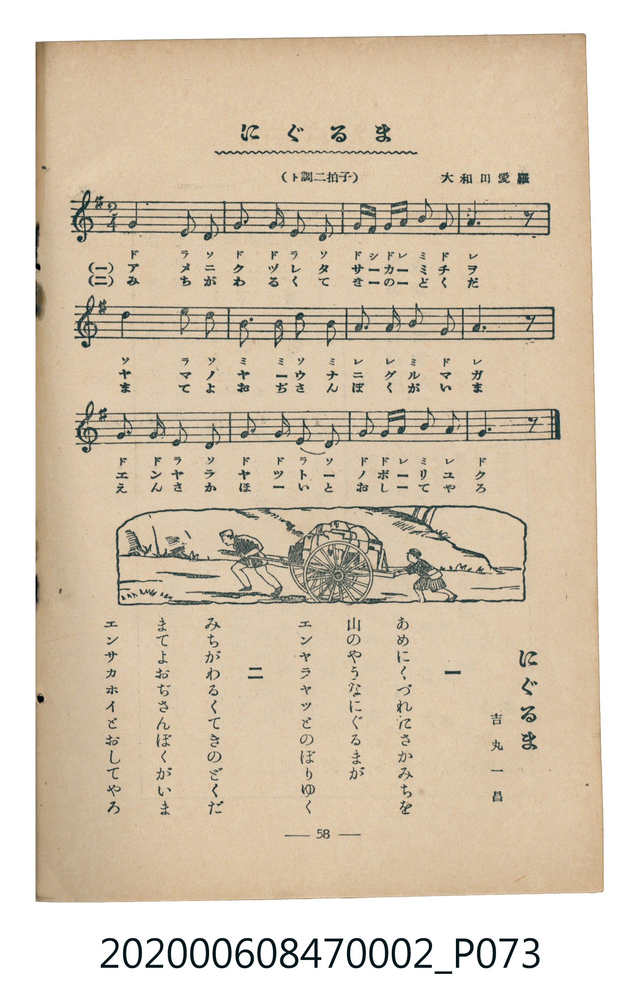

# にぐるま（人力車／運貨車）

> Re:Shōka 使用 AI 協助辨識與重建樂譜，可能會有錯誤。歡迎回報。

- **鋼琴伴奏版**：<br><audio controls src="niguruma.mp3"></audio>
- **NEUTRINO 歌聲合成版**：<br><audio controls src="niguruma_neutrino.mp3"></audio>

- 詞：吉丸一昌
- 曲：大和田愛羅
- 臺灣教育會公認《新定兒童唱歌》尋常科第二學年用（2020.006.0847.0002）

## 說明

曲目說明
中文解釋：描寫車輛載人或載物行走的生活景象。


## 歌詞

```text
一
あめにくづれたさかみちを
山のやうなにぐるまが
エンヤラヤツとのぼりゆく

二
みちがわるくてきのどくだ
まてよおぢさんぼくがいま
エンサカホイとおしてやろ
```

## ABC

<div class="abc-score" data-abc-src="niguruma.abc" aria-label="五線譜載入中"></div>

[下載 ABC 原始檔](niguruma.abc)

## TMD 檔案連結

- [主旋律 TMD 檔案](niguruma.tmd) [[在 TMD Studio 編輯](https://tmdlang.github.io/Tmd-TS/#tmd=s7IKdvYPcrWy4qpTUCpJTLdSSM7PyUlNLsnMz7MqzsjMK0nNjM_KTMmPL87Iz05Ugisry88pzU21Si9KTEmNN4o3MjAyiDcwMIs3sDAxBzIMjBBKi_NLi5JTrYqTM_Lzc-JLUitKkvLzsxHyBUX5Zal5iXlANQVFIBtTwIoQClLLMlNSQdKpKZkl-UWZiTlI7kgtKga7FWxJfElRYl5xclFmAcgDCFUlGalAx4IlC_KLkIwGmpaemWeVm5qZlYnFaVDpksRMoPdBQVCeGJ-bmJmXk5iXgqyqJCMfGBIFGZVWGZnFICcmJ-bEZyfmIQUY1IEFiempVgEG5sZKXFxaWgqPG1c_bpzwuKn7ceO-93s6nuza9bRr9ovdXe_39L9s7H6xaQWY3amgpcWlaKtgacZlb6vgzmVjpG9iBzL5Rfuu542Ln02d-aJp07M5zU9b17xY1fu4oevZtA1P18162jrp-eqlT6dsfLa253FD99MN3U937Hi-fOLzNWue7Op5unbH051bnk9ZAbQXFH16wOjTA0UfkGFgBLRUiUtfS-HZ7E3PZ697sWrVsxl9XAoKCk92rH02rf3F8sUv27vf75n1rL__6frVQEe-2DP7xZ5OoPufdUwDMp53rnyxsOfF1g3PZ7U8nzL_2Zbdz2auf7Fx4eOGJi4tfbDTV84D6n86ofPJjh1PdjQ8m9EDDiugfSDhJcufTup5PmXDs5bZz_e1AsNKX4sLqIrrcWPT46ZGcKj1P25c-rip53Hj_MeNUx83AkNw_-PGhY-bJnE93bjxceO6x00tjxvbHjeuQg7jx409XI-bVjxu3vy4ecnj5pVgEqhuBUhD457HTV2Pm4B6-rm4gCEEtA1sZGPP46Z-sH6gncseN_aCFa8EcxcAFQFNXfa4qeNxY9fjxkUgxzRNBpkFkgY6D2j6PpidTVsfN61-3Dz7cdMSsJ1ADdPBmlseN_WCAobLF5i6rAIyE_PyHWoMaqpBQa5gY2imZQdm1SgYKuiCoVk8kDAFETAxQzQx83ggYaRgDJYCCRlBtYKgAUgEbKSPYQ0wFTZBxYGBCyIbV4N1AL0AEW1cCpTpAbPmQ2WmgnndYHI_mFwIkWmahGQP2DEQe4xAukAqISaCVAPDB6oHak9TN9ROYKBA7ekF89aByZVgEiQPklmA1Z4aBVNYEIFCA6wWFAa6QBLEA7FhYUFk6DS1wF29D-4aVPE2MLkK6jJQ6IH4E8A-gukDyYD8iytsQGog-kB-ByYoqJ4uqOgiWKg3TYbK7IHK9ENNBiY2qAzMLPSwwZ5UkMTAohAxWOoBhQwi4WELnxUQdzRvBuIlYBYopoAyYB6I3wJ0E0QVxH2Q-AS5H5jlwCQoBBEpDmsIIdvTtBWsC5pOm2fDwq4JaiPQNljYAfMYUqhCQ6gJlK5Q7anl4tK1UwBlQAUgrcwFAA)]
- [鋼琴伴奏 TMD 檔案](niguruma_piano.tmd) [[在 TMD Studio 編輯](https://tmdlang.github.io/Tmd-TS/#tmd=s7IKdvYPcrWy4qpTUCpJTLdSyC8qychPL0osyKi0ysgsLskvykxOzInPTsxLVIIrKs4vLUpOjS9ITE-1CjAwN1bi4tLSUnjcuPpx44THTd2PG_e939PxZM-Wp0v7n-ye8X5Pp4KWFpeirYKlGZe9rYI7l42RvokdyLQX7bueNy5-NnXmi6ZNz-Y0P21d82JV7-OGrmfTNjxdN-tp66Tnq5c-nbLx2dqexw3dTzd0P92x4_nyic_XrHmyq-fp2h1Pd255PmUF0C4jAyMDPQMDMz0DCxNzIMPACGgp2L0vVs57v2fW0wmdT3bseLKj4dmMHrDws9mbQMJLlj-d1PN8yoZnLbOf72sFesM3MTPPKiAzMS8_yMOhxqCmmksBCGwMzbTswKwaBUMFXTA0iwcSpiACJmaIJmYeDySMFIzBUiAhI6hWEDQAiYCN9DGsAQZdE1T8cVMjiGxcDdbxuLEfItq4FCjTA2bNh8pMBfO6weR-MLkQItM0CckesGMg9hiBdIFUQkwEqX7cCDITpAdqT1M31M7Hjcug9vSCeevA5EowCZIHySzAak-NgiksiEChAVYLCgNdIAnigdiwsCAydJpa4K7eB3cNqngbmFwFdRko9ED8CWAfwfSBZED-xRU2IDUQfSC_P27qgOrpgoougoV602SozB6oTD_U5MeNIBchm4UeNtiTCpIYWBQiBks9oJBBJDxs4bMC4o7mzUC8BMwCxRRQBswD8VuAboKogrgPEp8g9z9uAvnvcRMoBBEpDmsIIdvTtBWsC5pOm2fDwq4JaiPQNljYPW6cjhSq0BBqAqUrVHtqkfOfD3L-s0Bkv3iFaMNYGEWYbxoPZJnGx0IIA0Q8EKuPYpOgDLh2uAgIg4wBelvXTgHk82gfoBCcbQRmK3MBAA)]

## 分析

```text
================================================================================
📊 TMD Song Profile: [ にぐるま（人力車／運貨車） ]
================================================================================
⏱  Duration:       0:15 (15.0s), 12 measures total
🎼 Key & Tempo:    首調基準 G, != 96.0 BPM, <2/4>
   - 分析範圍：      由實際發聲的音符與和弦推測調性；播放脈絡另行呈現
🎤 人聲音域:    D4 (MIDI 62) – E5 (MIDI 76) [跨度: 14 個半音 / 1.2 個八度, 難度: moderate]
   - 最低音:  D4 in [Main #1 @ m.1, 0:00]
   - 最高音: E5 in [Main #1 @ m.5, 0:05]
   - 適合: soprano, mezzo-soprano, contralto, tenor, baritone, bass
🏛  結構:      Main (15.0s)
⚡ 編曲密度:        Peak 1 軌道同時演奏
🗝  調性診斷：       G 大調（純淨自然大調，未偵測到可信轉調）
   - 風格氣質:    純淨自然大調（陽光明朗、易唱易記，無明顯調外色彩）
   - 轉調歷程:    全曲維持單一推測調性（未偵測到可信轉調）
   - 核心骨幹音:  G, A, D, B, E
   - 調性數值:    G 大調 [相關度: 0.84, 穩定度: High, 自然音純度: 100.0%]
   - 候選調性 (K-S): G 大調 (0.84), D 大調 (0.66), E 小調 (0.61)
   - 五度圈歷程:   +1
   - 各段落調性細節:
     • [Main #1]: G 大調 (r: 0.84, 自然音純度: 100.0%)

  [ 五度圈游移軌跡 ]
               C  
         F           [G ]*
      Bb               D  
      Eb               A  
         Ab           E  
            Db       B  
               F# 
     (* = active key center)

  [ 十二半音累積音高分佈 ]
     C  :                            0.0%
     C# :                            0.0%
     D  : ████████████              16.7%
     D# :                            0.0%
     E  : █████████                 12.2%
     F  :                            0.0%
     F# : █                          1.1%
     G  : ████████████████████████  34.4%
     G# :                            0.0%
     A  : ███████████████           22.2%
     A# :                            0.0%
     B  : █████████                 13.3%
--------------------------------------------------------------------------------
Assignment 軌道音域：
  - Piano         : D4 – E5 (14 個半音 / 1.2 個八度, 40 個音符)
================================================================================
```


## 原書掃描頁




