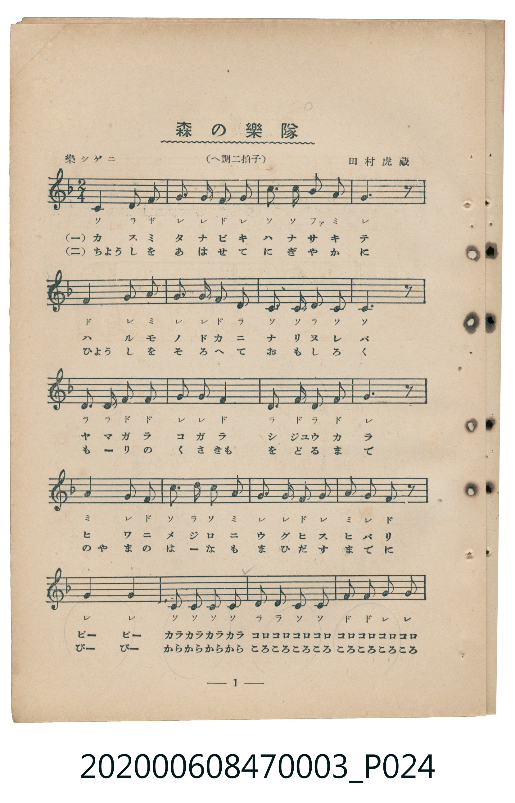
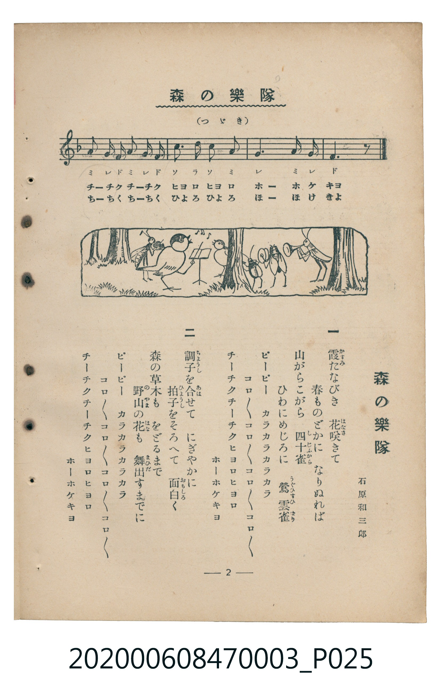

# 森の樂隊

> Re:Shōka 使用 AI 協助辨識與重建樂譜，可能會有錯誤。歡迎回報。

- **鋼琴伴奏版**：<br><audio controls src="mori_no_gakutai.mp3"></audio>
- **NEUTRINO 歌聲合成版**：<br><audio controls src="mori_no_gakutai_neutrino.mp3"></audio>

- 詞：石原和三郎
- 曲：田村虎藏
- 臺灣教育會公認《新定兒童唱歌》尋常科第三學年用（2020.006.0847.0003）

## 說明

原書資訊與歌詞全文（對應 P024.jpg – P025.jpg，書頁 pp. 1–2，第一學期第 1 首）：
調性與拍號：へ調二拍子（F 大調 2/4 拍），「樂シゲニ」


## 歌詞

```text
一
霞（かすみ）たなびき　花（はな）咲（さ）きて
春（はる）ものどかに　なりぬれば
山（やま）がらこがら　四十雀（しじふから）
ひわにめじろに　鶯（うぐひす）雲雀（ひばり）
ピーピー　カラカラカラカラ
コロ／＼コロ／＼コロ／＼コロ／＼
チーチクチーチクヒヨロヒヨロ
ホーホケキョ

二
調子（てうし）を合（あは）せて　にぎやかに
拍子（ひやうし）をそろへて　面白（おもしろ）く
森（もり）の草木（くさき）も　をどるまで
野山（のやま）の花（はな）も　舞出（まひだ）すまでに
ピーピー　カラカラカラカラ
コロ／＼コロ／＼コロ／＼コロ／＼
チーチクチーチクヒヨロヒヨロ
ホーホケキョ
```

## ABC

<div class="abc-score" data-abc-src="mori_no_gakutai.abc" aria-label="五線譜載入中"></div>

[下載 ABC 原始檔](mori_no_gakutai.abc)

## TMD 檔案連結

- [主旋律 TMD 檔案](mori_no_gakutai.tmd) [[在 TMD Studio 編輯](https://tmdlang.github.io/Tmd-TS/#tmd=s7IKdvYPcrWy4qpTUCpJTLdSSM7PyUlNLsnMz7MqzsjMK0nNjM_KTMmPL87Iz05Ugisry88pzU21Si9KTEmNN443MjAyiDcwMIs3sDAxBzIMjBFKi_NLi5JTrYqTM_Lzc-JLUitKkvLzsxHyBUX5Zal5iXlANQVFIBtTwIoQClLLMlNSQdKpKZkl-UWZiTlI7kgtKga7FWxJfElRYl5xclFmAcgDCFUlGalAx-YllpQWpaKLQt2Vk5mGJAW0JT0zzyo3NTMrE4uT84tKMvKBfi_IqLTKyCwGOSo5MSc-OzEPKYigTipITE-1CjAwMtEFEqZKXFpaCs8Wr3vcuO7ZiqaXs7oUtLS4FG0VDA0suOxtFdy4bIz0TexAZrxYOe_9nlnP529-2jf_6aSeJzs6Xzb3gU1_NnsTSGbKhmdzJ76Y2fdiej9Y-EX7rueNi59NnfmiadOzOc1PW9e8WNX7uKHr2bQNT9fNeto66fnqpU-nbHy2tudxQ_fTDd1Pd-x4vnzi8zVrgEY_Xbvj6c4tz6eseL-nAxSXesC41APFJZBhYPx-T6cSF5e-loIttQCXgoIC0F_PZu94sbn9xYquFx3tQHcBvfy0dcWzae1AVzzd0PusvVMBFHB6WQXpCo8aJoM4piDO-z09QJ0vFzQqFBToKRgCpYyAQmCfNAB98mzOfCBbwVDh5bJpQKcDwwpk3YtV-581LAdZ1N37YuZ8oOjjxh1AwSe7eoAiT9dOAFrqpvB0yXKgmAIwEhSAomDdwODqAcbV46btj5s2PW7uftzQywUyEGgZiHo5BxhPHY8bux83znzcuB-o5XHj_MeNqx43bn7cCAz_hhddG8EK1gMFgbJPJwFjD8idClbZ-7hxGciUZzOWQhU1dYMkmpqAKeRx40qwuauBpoBMbOp63LjmcVPP48YN4ADcCDa4qeVx4z6wYT2Pm4DkZCijoeHp7NlPextfzm4AGz39ceOMx41bQSY2Ab3VCTLiceOmx039IBuaGkHSTUD3gGx7uW09WE_b48YJIDWNM4EaXs7eBDMLKLIB6ByYKc1THjfvgZJApzatfty8EpMEK23a_Lh57fs9_e_37CGGDTG-EWx84-Om9ajsSY-bVwCVwhkQ1bPBKmY_btr4uAkotxwSW7t6oKkAEtXAcAd7bzo4tCc9ndABFgQGO9DnwFCcDVIACvbVjxv7wGEMighwVMFSCzjwgBIIUx43zgUH4Q6I5pdzFz2fuRessgsco9OBsmDT-8EGLV4Hjj9g0gKFJDDCX_R2PpsDyoNAFcAUAkwe0LQAClSg6cCABLpi3-PG5eCU194HTQLApIJIBevQEhxE_4uOeU_bd4HFgfqB8bcArBiYZEHGQb022CMSKEp52QMFClr6XFy-wJLbL989Mbu0JDHTKiAzMS_focagphpkk4KNoZmWHZiFrehTgJQ3Lxb2KGiYKDzd0P98fYMOvLzSxKIBaCHIsBoF03gFXTA0AzEMgbhGwQgsYATmgdhAVWARUwUTIGmMpAYCDUAiYPN8DGuA-bgbKg6MUjC5H6wDWBRBRVcB8WYwqxcqsx5JZiqKzDIke0AuhNpjBJYDpne4VdNBZNMkqLYmqOh6IJ4NZoEMAsmshsr0AVW3gFkg5yJkkK3CH-C7esgJcFCgQoIXNSghwQ2OBXisACmwAJiLFFfYAh0ShKAwAPkHmNGgvloH9e9KqE8h_gTJrIKq7wKy14BZPVCZDXgCHVrO4Aj3uVAze4HsHSjh3gWVaYLrgUVxP4nhvqOTnHAHByQ4gEHhjEjoIAyLE7gqQ8zsgDXUwSkI5Mt9QAwKPWB1BvXVZLA4QgxiPsTvIJkZQLwVzIKmP7gqLKEOjk1YbIH0gGIVFnbwLINQBtICihJoxEOSBNCREE3LSQtwYNVNToCDEjcsoUMCElKKmIFpzKQPKWlA4jAd6El8EzwQIN6GJuSmRkSQghMVIolDkimw4QDVDSmRYGZBEjokSNGTOagWg1kHDjhEmMNzGjgHIXIaSBVIdBMQL0CxDKIfFOwQpxFVukwhJ9BhaRVGQwsNNAKazhFlC1QUljNg-QIp8MH1MMzjyBxQBIAqYnBQ4GSAVIEqYLAYTgaRqhDRNKhchT8Tta7FjE9wD4JgJgJlDxiNOxNBoDGQh6hjQBAtE4GbOuDQagS6HVg9oguA1IBaPtAwXYvgwkMD3BhCsgIoANS6ERxQwLYRRCty8YKIr4GwvZaLS9dOAaV5pQAUUOYCAA)]
- [鋼琴伴奏 TMD 檔案](mori_no_gakutai_piano.tmd) [[在 TMD Studio 編輯](https://tmdlang.github.io/Tmd-TS/#tmd=s7IKdvYPcrWy4qpTUCpJTLdSyC8qychPL0osyKi0ysgsLskvykxOzInPTsxLVIIrKs4vLUpOjS9ITE-1CjAwMtEFEqZKXFpaCs8Wr3vcuO7ZiqaXs7re7-l42b3n-YQtT_Zsebq0_3lnx_s9nQpaWlyKtgqGBhZc9rYKblw2RvomdiCDX6yc937PrOfzNz_tm_90Us-THZ0vm_vAVj6bvQkkM2XDs7kTX8zsezG9Hyz8on3X88bFz6bOfNG06dmc5qeta16s6n3c0PVs2oan62Y9bZ30fPXSp1M2Plvb87ih--mG7qc7djxfPvH5mjVAo5-u3fF055bnU1YA3WhkYGSgZ2BgpmdgYWIOZBgYA52pxMXlC_S6X757YnZpSWKmVUBmYl5-kIdDjUFNNZcCENgYmmnZgVk1CqbxCrpgaAZiGAJxjYIRkARhEA9EA1WBlZgqmABJY7gaGDQAiYDN8zGsUXjc2A0Vf9w4E0zuB-t43DgfzFsFJjeDyV6ozHqo-lVAPBVFZhmSPSAXQu0xAss9bmyDWzUdRDZNgmprAouBjH3cOBtMggwCyayGqu8Dqm4Bs0DORcigW1UDDgYQBHkZ4XlYAIHDDRqOYAIsAGYhhS62YIJ4GuRqkAseN4HcDBJfB3bVSrjbIC4DyYCDrqkLLLYGzO6BymzAE0ybgB7FHVJzwTxQcD9u3IESUmB7wK6C6YFFSj-OkAJ7HZ6QMBMTCEJVwYMOoQpHOEFjaR-YBPn3cVMn1B2T0cQg5kNd2zgDTG6FhyPILJgqLOEE9ikkPiAhDIoHmG_hyRKhDKQFFIjQqIJEItiZIE3LcQQRKAHBEhPE65C8ZQamMZMXJP-BxGEi6MloE9zZEIdCE0tTI0QUGAyw6IUlI1BSeNw4AUyCdEPyKcwsSGKCBAJ6UloHiQ2IwZAYgYUSPDVDUyksNUNUQQxegGIZRAYUUBCnIQcTLD3AaOQMhiCQUxyyKCz1wQISKbiapzxu3gNzKjIHFGSrHzdD4hInA6Rq8-PmtWAxnAwiVSECdtC5CpbkDOE0roQKgrDkiSgrseTj5kaIt4AMoG3rMQVAaiY9bl4BDYW1CC7c_c2zkcMJXLA3bYR6bS1MK9bcPSC212Ktin2Qq2ITeE1sGK8QbRgLTulAlmk8iIkiZoCokWDCJkCGCaYehEq4AuxasBiJwxkIldich2INWI5IY8FioHDStVNACapoH6AMpqARWFCZCwA)]

## 分析

```text
================================================================================
📊 TMD Song Profile: [ 森の樂隊 ]
================================================================================
⏱  Duration:       0:26 (26.7s), 24 measures total
🎼 Key & Tempo:    首調基準 F, != 108.0 BPM, <2/4>
   - 分析範圍：      由實際發聲的音符與和弦推測調性；播放脈絡另行呈現
🎤 人聲音域:    C4 (MIDI 60) – D5 (MIDI 74) [跨度: 14 個半音 / 1.2 個八度, 難度: moderate]
   - 最低音:  C4 in [MoriNoGakutai #1 @ m.1, 0:00]
   - 最高音: D5 in [MoriNoGakutai #1 @ m.14, 0:14]
   - 適合: soprano, mezzo-soprano, contralto, tenor, baritone, bass
🏛  結構:      MoriNoGakutai (26.7s)
⚡ 編曲密度:        Peak 1 軌道同時演奏
🗝  調性診斷：       C 大調（純淨自然大調，未偵測到可信轉調）
   - 風格氣質:    純淨自然大調（陽光明朗、易唱易記，無明顯調外色彩）
   - 轉調歷程:    全曲維持單一推測調性（未偵測到可信轉調）
   - 核心骨幹音:  G, C, F, D, A
   - 調性數值:    C 大調 [相關度: 0.81, 穩定度: High, 自然音純度: 98.9%]
   - 候選調性 (K-S): C 大調 (0.81), F 大調 (0.68), G 大調 (0.60)
   - 五度圈歷程:   +0
   - 各段落調性細節:
     • [MoriNoGakutai #1]: C 大調 (r: 0.81, 自然音純度: 98.9%, 調外音: A#)

  [ 五度圈游移軌跡 ]
              [C ]*
         F            G  
      Bb               D  
      Eb               A  
         Ab           E  
            Db       B  
               F# 
     (* = active key center)

  [ 十二半音累積音高分佈 ]
     C  : █████████████████         23.1%
     C# :                            0.0%
     D  : █████████                 11.5%
     D# :                            0.0%
     E  :                            0.0%
     F  : ████████████████          21.4%
     F# :                            0.0%
     G  : ████████████████████████  32.4%
     G# :                            0.0%
     A  : ████████                  10.4%
     A# : █                          1.1%
     B  :                            0.0%
--------------------------------------------------------------------------------
Assignment 軌道音域：
  - Piano         : C4 – D5 (14 個半音 / 1.2 個八度, 78 個音符)
================================================================================
```


## 原書掃描頁






