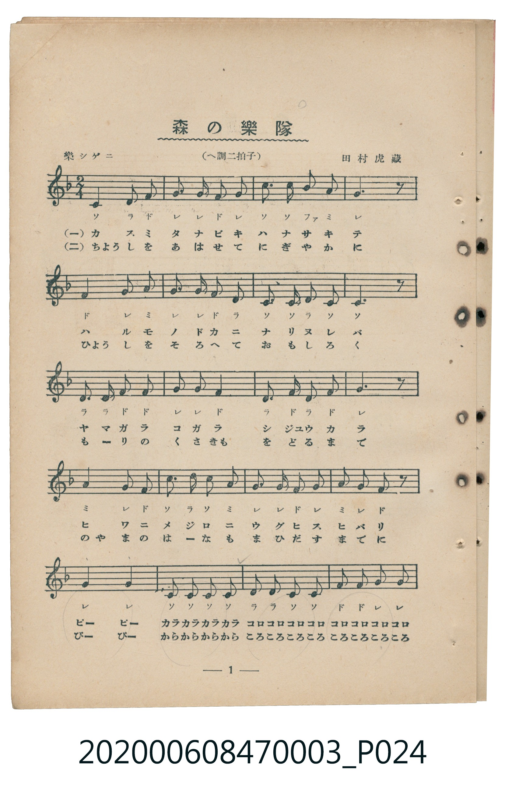
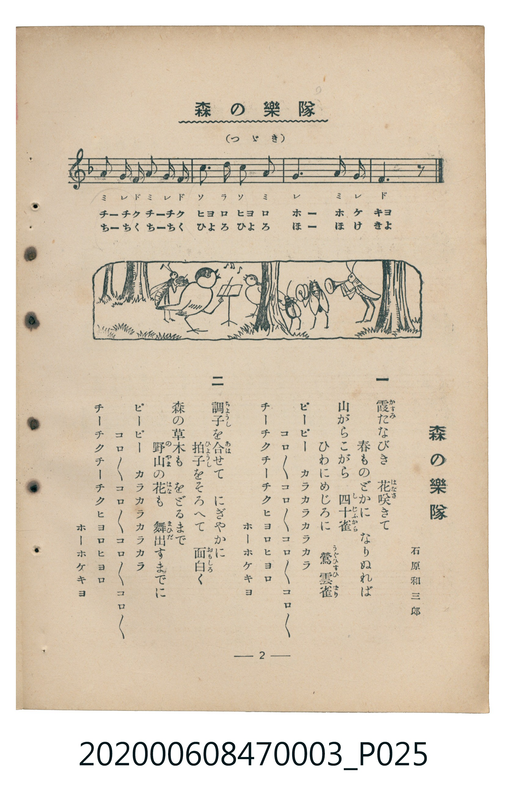

# 森の樂隊

> Re:Shōka 使用 AI 協助辨識與重建樂譜，可能會有錯誤。歡迎回報。

- **鋼琴伴奏版**：<br><audio controls src="mori_no_gakutai.mp3"></audio>
- **NEUTRINO 歌聲合成版**：<br><audio controls src="mori_no_gakutai_neutrino.mp3"></audio>

- 詞：石原和三郎
- 曲：田村虎藏
- 臺灣教育會公認《新定兒童唱歌》尋常科第三學年用（2020.006.0847.0003）

## 說明

原書資訊與歌詞全文（對應 P024.jpg – P025.jpg，書頁 pp. 1–2，第一學期第 1 首）：
調性與拍號：へ調二拍子（F 大調 2/4 拍），「樂シゲニ」


## 歌詞

```text
一
霞（かすみ）たなびき　花（はな）咲（さ）きて
春（はる）ものどかに　なりぬれば
山（やま）がらこがら　四十雀（しじふから）
ひわにめじろに　鶯（うぐひす）雲雀（ひばり）
ピーピー　カラカラカラカラ
コロ／＼コロ／＼コロ／＼コロ／＼
チーチクチーチクヒヨロヒヨロ
ホーホケキョ

二
調子（てうし）を合（あは）せて　にぎやかに
拍子（ひやうし）をそろへて　面白（おもしろ）く
森（もり）の草木（くさき）も　をどるまで
野山（のやま）の花（はな）も　舞出（まひだ）すまでに
ピーピー　カラカラカラカラ
コロ／＼コロ／＼コロ／＼コロ／＼
チーチクチーチクヒヨロヒヨロ
ホーホケキョ
```

## ABC

<div class="abc-score" data-abc-src="mori_no_gakutai.abc" aria-label="五線譜載入中"></div>

[下載 ABC 原始檔](mori_no_gakutai.abc)

## TMD 檔案連結

- [主旋律 TMD 檔案](mori_no_gakutai.tmd) [[在 TMD Studio 編輯](https://tmdlang.github.io/Tmd-TS/#tmd=s7IKdvYPcrWy4qpTUCpJTLdSSM7PyUlNLsnMz7MqzsjMK0nNjM_KTMmPL87Iz05Ugisry88pzU21Si9KTEmNN443MjAyiDcwMIs3sDAxBzIMjBFKi_NLi5JTrYqTM_Lzc-JLUitKkvLzsxHyBUX5Zal5iXlANQVFIBtTwIoQClLLMlNSQdKpKZkl-UWZiTlI7kgtKga7FWxJfElRYl5xclFmAcgDCFUlGalAx-YllpQWpaKLQt2Vk5mGJAW0JT0zzyo3NTMrE8nJWloKzxave9y47tmKppezuhS0tLgUbRUMDSy47G0V3LhsjPRN7EBmvFg57_2eWc_nb37aN__ppJ4nOzpfNveBTX82exNIZsqGZ3MnvpjZ92J6P1j4Rfuu542Ln02d-aJp07M5zU9b17xY1fu4oevZtA1P18162jrp-eqlT6dsfLa253FD99MN3U937Hi-fOLzNWuARj9du-Ppzi3Pp6x4v6cDFA96wHjQA8UDkGFg_H5PpxIXl76Wgi21AJeCggLQX89m73ixuf3Fiq4XHe1AdwG9_LR1xbNp7UBXPN3Q-6y9UyHAwMhEL6sgXeFRw2QQxxTEeb-nB6jz5YJGhYICPQVDoJQRUAjskwagT57NmQ9kKxgqvFw2Deh0YFiBrHuxav-zhuUgi7p7X8ycDxR93LgDKPhkVw9Q5OnaCUBL3RSeLlkOFFMARoICUBSsGxhcPcC4ety0_XHTpsfN3Y8berlABgItA1Ev5wDjqeNxY_fjxpmPG_cDtTxunP-4cdXjxs2PG4Hh3_CiayNYwXqgIFD26SRg7AG5U8Eqex83LgOZ8mzGUqiipm6QRFMTMIU8blwJNnc10BSQiU1djxvXPG7qedy4ARyAG8EGN7U8btwHNqzncROQnAxlNDQ8nT37aW_jy9kNYKOnP26c8bhxK8jEJqC3OkFGPG7c9LipH2RDUyNIugnoHpBtL7etB-tpe9w4AaSmcSZQw8vZm2BmAUU2AJ0DM6V5yuPmPVAS6NSm1Y-bV2KSYKVNmx83r32_p__9nj3EsCHGN4KNb3zctB6VPelx8wqgUjgDono2WMXsx00bHzcB5ZZDYmtXDzQVQKIaGO5g700Hh_akpxM6wILAYAf6HBiKs0EKQMG--nFjHziMQREBjipYagEHHlACYcrjxrngINwB0fxy7qLnM_eCVXaBY3Q6UBZsej_YoMXrwPEHTFqgkARG-IvezmdzQHkQqAKYQoDJA5oWQIEKNB0YkEBX7HvcuByc8tr7oEkAmFQQqWAdWoKD6H_RMe9p-y6wOFA_MP4WgBUDkyzIOKjXBntEAkUpL3ugQEFLn4vLF1hI--W7J2aXliRmWgVkJublO9QY1FSDbFKwMTTTsgOzsBV9CpDy5sXCHgUNE4WnG_qfr2_QgZdXmlg0AC0EGVajYBqvoAuGZiCGIRDXKBiBBYzAPBAbqAosYqpgAiSNkdRAoAFIBGyej2ENMB93Q8WBUQom94N1AIsiqOgqIN4MZvVCZdYjyUxFkVmGZA_IhVB7jMBywPQOt2o6iGyaBNXWBBVdD8SzwSyQQSCZ1VCZPqDqFjAL5FyEDLJV-AN8Vw85AQ4KVEjwogYlJLjBsQCPFSAFFgBzkeIKW6BDghAUBiD_ADMa1FfroP5dCfUpxJ8gmVVQ9V1A9howqwcqswFPoEPLGRzhPhdqZi-QvQMl3LugMk1wPbAo7icx3Hd0khPu4IAEBzAonBEJHYRhcQJXZYiZHbCGOjgFgXy5D4hBoQeszqC-mgwWR4hBzIf4HSQzA4i3glnQ9AdXhSXUwbEJiy2QHlCswsIOnmUQykBaQFECjXhIkgA6EqJpOWkBDqy6yQlwUOKGJXRIQEJKETMwjZn0ISUNSBymAz2Jb4IHAsTb0ITc1IgIUnCiQiRxSDIFNhyguiElEswsSEKHBCl6MgfVYjDrwAGHCHN4TgPnIEROA6kCiW4C4gUolkH0g4Id4jSiSpcp5AQ6LK3CaGihgUZA0zmibIGKwnIGLF8gBT64HoZ5HJkDigBQRQwOCpwMkCpQBQwWw8kgUhUimgaVq_Bnota1mPEJ7kEQzESg7AGjcWciCDQG8hB1DAiiZSJwUwccWo1AtwOrR3QBkBpQywcapmsRXHhogBtDSFYABYBaN4IDCtg2gmhFLl4Q8TUQttdycenaKaA0rxSAAspcAA)]
- [鋼琴伴奏 TMD 檔案](mori_no_gakutai_piano.tmd) [[在 TMD Studio 編輯](https://tmdlang.github.io/Tmd-TS/#tmd=s7IKdvYPcrWy4tLSUni2eN3jxnXPVjS9nNX1fk_Hy-49zydsebJny9Ol_c87O97v6VTQ0uJStFUwNLDgsrdVcOOyMdI3seOqU1B6sXLe-z2zns_f_LRv_tNJPU92dL5s7lMCyTybvQkkM2XDs7kTX8zsezG9Hyz8on3X88bFz6bOfNG06dmc5qeta16s6n3c0PVs2oan62Y9bZ30fPXSp1M2Plvb87ih--mG7qc7djxfPvH5mjVAo5-u3fF055bnU1YA3WhkYGSgZ2BgpmdgYWIOZBgYA52pxMXlm1-U6ZfvnphdWpKYaRWQmZiXH-ThUGNQU82lAAQ2hmZadmBWjYJpvIIuGJqBGIZAXKNgBCRBGMQD0UBVYCWmCiZA0hiuBgYNQCJg83wMaxQeN3ZDxR83zgST-8E6HjfOB_NWgcnNYLIXKrMeqn4VEE9FkVmGZA_IhVB7jMByjxvb4FZNB5FNk6DamsBiIGMfN84GkyCDQDKroer7gKpbwCyQcxEy6FbVgIMBBEFeRngeFkDgcIOGI5gAC4BZSKGLLZggnga5GuSCx00gN4PE14FdtRLuNojLQDLgoGvqAoutAbN7oDIb8ATTJqBHcYfUXDAPFNyPG3eghBTYHrCrYHpgkdKPI6TAXocnJMzEBIJQVfCgQ6jCEU7QWNoHJkH-fdzUCXXHZDQxiPlQ1zbOAJNb4eEIMgumCks4gX0KiQ9ICIPiAeZbeLJEKANpAQUiNKogkQh2JkjTchxBBEpAsMQE8Tokb5mBaczkBcl_IHGYCHoy2gR3NsSh0MTS1AgRBQYDLHphyQiUFB43TgCTIN2QfAozC5KYIIGAnpTWQWIDYjAkRmChBE_N0FQKS80QVRCDF6BYBpEBBRTEacjBBEsPMBo5gyEI5BSHLApLfbCARAqu5imPm_fAnIrMAQXZ6sfNkLjEyQCp2vy4eS1YDCeDSFWIgB10roIlOUM4jSuhgiAseSLKSiz5uLkR4i0gA2jbekwBkJpJj5tXQENhLYILd3_zbORwAhfsTRuhXlsL04o1dw-I7bVYq2If5KrYBF4TG8YrRBvGglM6kGUaD2KiiBkgaiSYsAmQYYKpB6ESrgC7FixG4nAGQiU256FYA5Yj0liwGCicdO0UUIIq2gcogyloBBZU5gIA)]

## 分析

```text
================================================================================
📊 TMD Song Profile: [ 森の樂隊 ]
================================================================================
⏱  Duration:       0:26 (26.7s), 24 measures total
🎼 Key & Tempo:    首調基準 F, != 108.0 BPM, <2/4>
   - 分析範圍：      由實際發聲的音符與和弦推測調性；播放脈絡另行呈現
🎤 人聲音域:    C4 (MIDI 60) – D5 (MIDI 74) [跨度: 14 個半音 / 1.2 個八度, 難度: moderate]
   - 最低音:  C4 in [MoriNoGakutai #1 @ m.1, 0:00]
   - 最高音: D5 in [MoriNoGakutai #1 @ m.14, 0:14]
   - 適合: soprano, mezzo-soprano, contralto, tenor, baritone, bass
🏛  結構:      MoriNoGakutai (26.7s)
⚡ 編曲密度:        Peak 1 軌道同時演奏
🗝  調性診斷：       C 大調（純淨自然大調，未偵測到可信轉調）
   - 風格氣質:    純淨自然大調（陽光明朗、易唱易記，無明顯調外色彩）
   - 轉調歷程:    全曲維持單一推測調性（未偵測到可信轉調）
   - 核心骨幹音:  G, C, F, D, A
   - 調性數值:    C 大調 [相關度: 0.81, 穩定度: High, 自然音純度: 98.9%]
   - 候選調性 (K-S): C 大調 (0.81), F 大調 (0.68), G 大調 (0.60)
   - 五度圈歷程:   +0
   - 各段落調性細節:
     • [MoriNoGakutai #1]: C 大調 (r: 0.81, 自然音純度: 98.9%, 調外音: A#)

  [ 五度圈游移軌跡 ]
              [C ]*
         F            G  
      Bb               D  
      Eb               A  
         Ab           E  
            Db       B  
               F# 
     (* = active key center)

  [ 十二半音累積音高分佈 ]
     C  : █████████████████         23.1%
     C# :                            0.0%
     D  : █████████                 11.5%
     D# :                            0.0%
     E  :                            0.0%
     F  : ████████████████          21.4%
     F# :                            0.0%
     G  : ████████████████████████  32.4%
     G# :                            0.0%
     A  : ████████                  10.4%
     A# : █                          1.1%
     B  :                            0.0%
--------------------------------------------------------------------------------
Assignment 軌道音域：
  - Piano         : C4 – D5 (14 個半音 / 1.2 個八度, 78 個音符)
================================================================================
```


## 原書掃描頁






