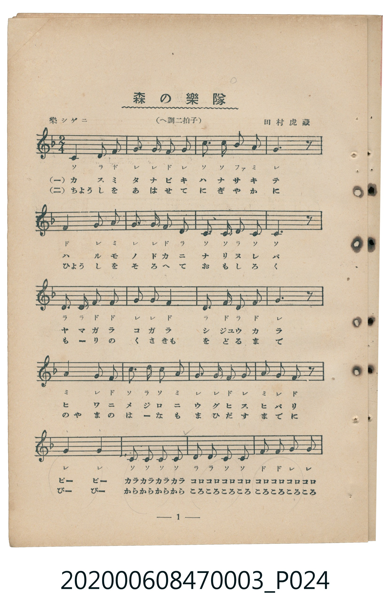
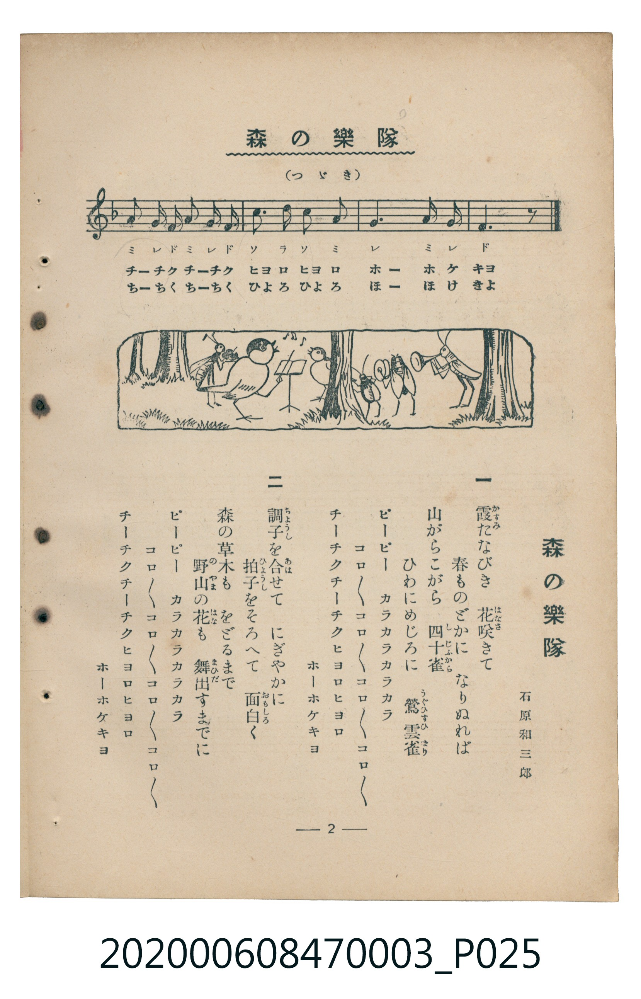

# 森の樂隊

<audio controls src="mori_no_gakutai.mp3"></audio>

- 詞：石原和三郎
- 曲：田村虎藏
- 臺灣教育會公認《新定兒童唱歌》尋常科第三學年用（2020.006.0847.0003）

## 說明

原書資訊與歌詞全文（對應 P024.jpg – P025.jpg，書頁 pp. 1–2，第一學期第 1 首）：
調性與拍號：へ調二拍子（F 大調 2/4 拍），「樂シゲニ」

## 歌詞

```text
一
霞（かすみ）たなびき　花（はな）咲（さ）きて
春（はる）ものどかに　なりぬれば
山（やま）がらこがら　四十雀（しじふから）
ひわにめじろに　鶯（うぐひす）雲雀（ひばり）
ピーピー　カラカラカラカラ
コロ／＼コロ／＼コロ／＼コロ／＼
チーチクチーチクヒヨロヒヨロ
ホーホケキョ

二
調子（てうし）を合（あは）せて　にぎやかに
拍子（ひやうし）をそろへて　面白（おもしろ）く
森（もり）の草木（くさき）も　をどるまで
野山（のやま）の花（はな）も　舞出（まひだ）すまでに
ピーピー　カラカラカラカラ
コロ／＼コロ／＼コロ／＼コロ／＼
チーチクチーチクヒヨロヒヨロ
ホーホケキョ
```

## ABC

```abc
X:1
T:森の樂隊
C:曲：田村虎藏
M:2/4
L:1/16
Q:1/4=108
K:F
V:V1 name="Piano" snm="Pia"
[V:V1]
C4 D2 F2 | G2 G2 F2 G2 | c3 c B2 A2 | G6 z2 |
F4 G2 A2 | G2 G2 F2 D2 | C2 C2 D2 C2 | C6 z2 |
D2 D2 F2 F2 | G2 G2 F4 | D2 F2 D2 F2 | G6 z2 |
A4 G2 F2 | c3 d c2 A2 | G2 G2 F2 G2 | A2 G2 F2 z2 |
G4 G4 | C2 C2 C2 C2 | D2 D2 C2 C2 | F2 F2 G2 G2 |
A2 G F A2 G F | c3 d c2 A2 | G4 A2 G2 | F6 z2 |
```

## TMD 檔案連結

- [主旋律 TMD 檔案](mori_no_gakutai.tmd) [[在 TMD Studio 編輯](https://tmdlang.github.io/Tmd-TS/#tmd=s7IKdvYPcrWy4tLSUni2eN3jxnXPVjS9nNWloKXFpWirYGhgwWVvq-DGZWOkb2LHVaeg9GLlvPd7Zj2fv_lp3_ynk3qe7Oh82dynBJJ5NnsTSGbKhmdzJ76Y2fdiej9Y-EX7rueNi59NnfmiadOzOc1PW9e8WNX7uKHr2bQNT9fNeto66fnqpU-nbHy2tudxQ_fTDd1Pd-x4vnzi8zVrgEY_Xbvj6c4tz6eseL-nw8jAyEDPwMBMz8DCxBzIMDB-v6dTiYtLX0vBllqAS0FBAeivZ7N3vNjc_mJF14uOdqC7gF5-2rri2bR2oCuebuh91t6pEGBgZKKXVZCu8KhhMohjCuK839MD1PlyQaNCQYGegiFQyggoBPZJA9Anz-bMB7IVDBVeLpsGdDowrEDWvVi1_1nDcpBF3b0vZs4Hij5u3AEUfLKrByjydO0EoKVuCk-XLAeKKQAjQQEoCtYNDK4eYFw9btr-uGnT4-buxw29XCADgZaBqJdzgPHU8bix-3HjzMeN-4FaHjfOf9y46nHj5seNwPBveNG1EaxgPVAQKPt0EjD2gNypYJW9jxuXgUx5NmMpVFFTN0iiqQmYQh43rgSbuxpoCsjEpq7HjWseN_U8btwADsCNYIObWh437gMb1vO4CUhOhjIaGp7Onv20t_Hl7Aaw0dMfN8543LgVZGIT0FudICMeN2563NQPsqGpESTdBHQPyLaX29aD9bQ9bpwAUtM4E6jh5exNMLOAIhuAzoGZ0jzlcfMeKAl0atPqx80rMUmw0qbNj5vXvt_T_37PHmLYEOMbwcY3Pm5aj8qe9Lh5BVApnAFRPRusYvbjpo2Pm4ByyyGxtasHmgogUQ0Md7D3poNDe9LTCR1gQWCwA30ODMXZIAWgYF_9uLEPHMagiABHFSy1gAMPKIEw5XHjXHAQ7oBofjl30fOZe8Equ8AxOh0oCza9H2zQ4nXg-AMmLVBIAiP8RW_nszmgPAhUAUwhwOQBTQugQAWaDgxIoCv2PW5cDk557X3QJABMKohUsA4twUH0v-iY97R9F1gcqB8YfwvAioFJFmQc1GuDPSKBopSXPVCgoKXPxeWbX5Tpl--emF1akphpFZCZmJfvUGNQo1ANskrBxtBMyw7Mwlb2KUAKnBcLexQ0TBSebuh_vr5BB15gaWLRALQRZFiNgmm8gi4YmoEYhkBco2AEJEEYxAPRQFVgJaYKJkDSGK4GBg1AIuCkjdt1u3rIcR3IBSAIsg1hL8xtYCdDvQAmwAJgFpLHiHXhjk5yXAi2Eh52mOEHglBVcCcjVJHgPmAJSo77QKEGC0GIvZC4NAPTmGEKiW-QOEyEqNidQo7bYCEAo5GjEkEghzGyKCy8Ya4nFH6tazHdCK7DCYafEdAeGI0r_EAQFmqIdIuI21ouLl07BZRMrgAUUObiAgA)]
- [鋼琴伴奏 TMD 檔案](mori_no_gakutai_piano.tmd) [[在 TMD Studio 編輯](https://tmdlang.github.io/Tmd-TS/#tmd=s7IKdvYPcrWy4tLSUni2eN3jxnXPVjS9nNX1fk_Hy-49zydsebJny9Ol_c87O97v6VTQ0uJStFUwNLDgsrdVcOOyMdI3seOqU1B6sXLe-z2zns_f_LRv_tNJPU92dL5s7lMCyTybvQkkM2XDs7kTX8zsezG9Hyz8on3X88bFz6bOfNG06dmc5qeta16s6n3c0PVs2oan62Y9bZ30fPXSp1M2Plvb87ih--mG7qc7djxfPvH5mjVAo5-u3fF055bnU1YA3WhkYGSgZ2BgpmdgYWIOZBgYA52pxMXlm1-U6ZfvnphdWpKYaRWQmZiXH-ThUGNQo1DNpQAENoZmWnZgVo2CabyCLhiagRiGQFyjYAQkQRjEA9FAVWAlpgomQNIYrgYGDUAiUPNAekAQJI9QCTMNbAnUUjABFgCzkJyCbiZYEdx9mG4EQagquCUIVdhMBLkM5kqISogPzcA0prshoQASh4kgmwazBUYjexBBIPsDWRTmJ5h9yG40AsrAaFxuBEGYyxDhj_BxLdYE4YOSIEzg6cEwXiHaMBbsBSDLNB7ERBEzQEQ1TNgEyDDB1INQCVeAXQsWI3E4A6ESm_NQrAHLEWksWAwUULp2CihhpYBNQJmLCwA)]

## 分析

```text
================================================================================
📊 TMD Song Profile: [ 森の樂隊 ]
================================================================================
⏱  Duration:       0:26 (26.7s), 24 measures total
🎼 Key & Tempo:    首調基準 F, != 108.0 BPM, <2/4>
   - 分析範圍：      由實際發聲的音符與和弦推測調性；播放脈絡另行呈現
🎤 人聲音域:    C4 (MIDI 60) – D5 (MIDI 74) [跨度: 14 個半音 / 1.2 個八度, 難度: moderate]
   - 最低音:  C4 in [MoriNoGakutai #1 @ m.1, 0:00]
   - 最高音: D5 in [MoriNoGakutai #1 @ m.14, 0:14]
   - 適合: soprano, mezzo-soprano, contralto, tenor, baritone, bass
🏛  結構:      MoriNoGakutai (26.7s)
⚡ 編曲密度:        Peak 1 軌道同時演奏
🗝  調性診斷：       C 大調（純淨自然大調，未偵測到可信轉調）
   - 風格氣質:    純淨自然大調（陽光明朗、易唱易記，無明顯調外色彩）
   - 轉調歷程:    全曲維持單一推測調性（未偵測到可信轉調）
   - 核心骨幹音:  G, C, F, D, A
   - 調性數值:    C 大調 [相關度: 0.81, 穩定度: Moderate, 自然音純度: 98.9%]
   - 候選調性 (K-S): C 大調 (0.81), F 大調 (0.69), G 大調 (0.58)
   - 五度圈歷程:   +0
   - 各段落調性細節:
     • [MoriNoGakutai #1]: C 大調 (r: 0.81, 自然音純度: 98.9%, 調外音: A#)

  [ 五度圈游移軌跡 ]
              [C ]*
         F            G  
      Bb               D  
      Eb               A  
         Ab           E  
            Db       B  
               F# 
     (* = active key center)

  [ 十二半音累積音高分佈 ]
     C  : █████████████████         23.1%
     C# :                            0.0%
     D  : ████████                  11.0%
     D# :                            0.0%
     E  :                            0.0%
     F  : █████████████████         22.0%
     F# :                            0.0%
     G  : ████████████████████████  31.9%
     G# :                            0.0%
     A  : ████████                  11.0%
     A# : █                          1.1%
     B  :                            0.0%
--------------------------------------------------------------------------------
Assignment 軌道音域：
  - Piano         : C4 – D5 (14 個半音 / 1.2 個八度, 78 個音符)
================================================================================
```


## 原書掃描頁






