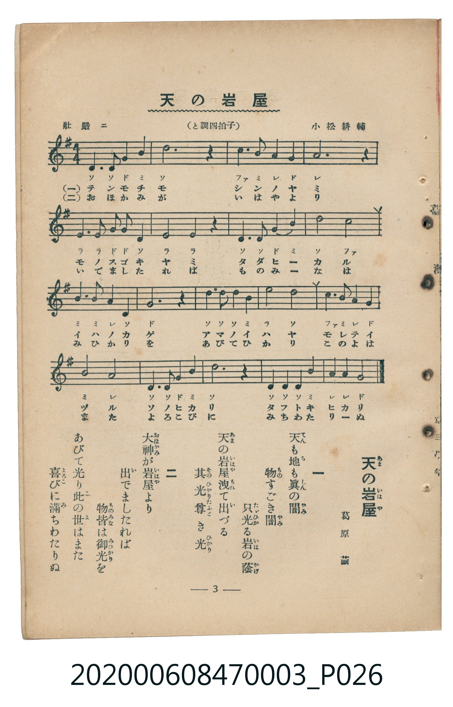

# 天の岩屋

> Re:Shoka 使用 AI 辨識樂譜，可能會有錯誤。歡迎回報。

<audio controls src="ama_no_iwaya.mp3"></audio>

- 詞：葛原しげる
- 曲：小松耕輔
- 臺灣教育會公認《新定兒童唱歌》尋常科第三學年用（2020.006.0847.0003）

## 說明

原書資訊與歌詞全文（對應 P026.jpg，書頁 p. 3，第一學期第 2 首）：
調性與拍號：と調四拍子（G 大調 4/4 拍），「壯嚴ニ」

## 歌詞

```text
一
天（てん）も地（ち）も眞（しん）の闇（やみ）
物（もの）すごき闇（やみ）
只光（たゞひか）る岩（いは）の蔭（かげ）
天（あま）の岩屋洩（いはやも）れて出（い）づる
其光（そのひかり）尊（たふと）き光（ひかり）

二
大神（おほかみ）が岩屋（いはや）より
出（い）でましたれば
物皆（ものみな）は御光（みひかり）を
あびて光（ひか）り此（こ）の世（よ）はまた
喜（よろこ）びに滿（み）ちわたりぬ
```

## ABC

```abc
X:1
T:天の岩屋
C:曲：小松耕輔
M:4/4
L:1/16
Q:1/4=80
K:G
V:V1 name="Piano" snm="Pia"
[V:V1]
D4 D4 G4 B4 | d12 z4 | c6 B2 A4 G4 | A12 z4 |
E4 E4 G3 G D4 | E4 E4 z4 D3 D | G4 B4 d8 | c8 B8 |
B6 B2 A4 D4 | G4 z4 D3 D D3 B | e8 d8 | c3 B A4 G8 |
B8 A8 | D6 D2 G4 B4 | d12 z4 | D3 D D4 B4 A3 A |
G12 z4 |
```

## TMD 檔案連結

- [主旋律 TMD 檔案](ama_no_iwaya.tmd) [[在 TMD Studio 編輯](https://tmdlang.github.io/Tmd-TS/#tmd=s7IKdvYPcrWy4qpTUCpJTLdSSM7PyUlNLsnMz7MqzsjMK0nNjM_KTMmPL87Iz05Ugisry88pzU21Si9KTEmNN443MjAyiDcwMIs3sDAxBzIMjBFKi_NLi5JTrYqTM_Lzc-JLUitKkvLzsxHyBUX5Zal5iXlANQVFIBtTwIoQClLLMlNSQdKpKZkl-UWZiTlI7kgtKga7FWxJfElRYl5xclFmAcgDCFUlGalAx6bl52Tn5BeloosXpeZkpoPVa2kpPF2y8nHjuqebVj7d2K2gpcWlaKtgYcBlb6vgzmVjom9iB9L7YuW893tmvZg4-2nf_MeN0x83Tnrc1A029dnsTUCZpxv6n83d96Jh6os9U8DCL9p3PW9c_GzqzBdNm57NaX7auubFqt7HDV3Ppm14um7W09ZJz1cvfTpl47O1PY8bup9u6H66Y8fz5ROfr1nzZEfn07U7nu7c8nzKivd7OkDBrAcMZj1QMAMZBsbv93QqcXHpaynYUgtwKSgoAP31bPaOF5vbX6zoetHRDnQX0MtPW1c8m9YOdMXTDb3P2jsVAgyMzPSyCtLf7-kBKn65oFGhQE8B6KAesLsbgO5-Nmc-kK1gpPBy2TSgQ4EhAzL8xar9zxqWg4zt7n0xcz5Q9HHjCqDg09mzgSJP104AWuEOjIflQDEFYJArAEXBuoGB0_N08fqns7Y8bu5-3NDLBTINaBPYxUtWArU9blz2uGkyUPHjpqanczaARRZCuM_nAOMMyJ0OVdC47uV0kGceN7U8btwPFAGZ8rwTbEpTE1AarGjm48Ypjxt7sSh92r_qaSvQUUAj5z9umve4cdPjxm6wVd3AxAMWB6peD7HqxZS1YJFuYFKB6Yc6GGjVPogiSJp7tgWhGWRhUxPY0B6g156274JIgdUvBdoENqh1G8whc4GmQBzyuKkLqOjpBiAJdmDjVmAYg7X1whQjlEHCcVcPxFnLny-FhFTX48bdYCeDvPy4sQfiPmTHgV0GDJYusE4U1y0HegucNYCBA3T7BmjoPp_VBg9goMGPG1eBVa9_um8hzF1AQYTTHjdNAukEB9NmUBAgOR4s3fVs7RKwCDRSn-wApjSgBR0Qc8GumA923rQ5EInHTb0w1UATVz_bDfQeyFqwyMLHTf1gNwM9vwakjfL8BAUKWvpcXI65iX75nuWJlYlWAZmJefkONQY1CtUgexRsDM207MAsbJlZAZKnXizsUdAwUQCWL8_XN-jAc6AmFg1A60CG1SiYxivogiGcYQiljaE0UA2UhQ4NYCqgZpkgyYF0G6GZWAMXwW0Sfj_u6iHHj2Ywr8EZEBcZIjyNTRHMUVBFQArmUfQgQg8g1KBAVglXQcCjOzrJ8SiyLcgRgORNmNMxPQdlGcN9aYbmZly-NMaIaCJ9CSzSwb40Jd-XIIieqJASNdyHGIkalvzR9MIgPEFiBhDCEIjFRhjJAqdhXLVcXLp2Coh8rgDkKXNxAQA)]
- [鋼琴伴奏 TMD 檔案](ama_no_iwaya_piano.tmd) [[在 TMD Studio 編輯](https://tmdlang.github.io/Tmd-TS/#tmd=s7IKdvYPcrWy4tLSUni6ZOXjxnVPN618urH7_Z6Ol917nk_Y8mTPlqdL-593drzf06mgpcWlaKtgYcBlb6vgzmVjom9ix1WnoPRi5bz3e2a9mDj7ad_8x43THzdOetzUrQSSeTZ7E1Dm6Yb-Z3P3vWiY-mLPFLDwi_ZdzxsXP5s680XTpmdzmp-2rnmxqvdxQ9ezaRuerpv1tHXS89VLn07Z-Gxtz-OG7qcbup_u2PF8-cTna9Y82dH5dO2Opzu3PJ-yAuhEIwMjAz0DAzM9AwsTcyDDwBjoSiUuLsfcRL98z_LEykSrgMzEvPwgD4cagxqFai4FILAxNNOyA7NqFEzjFXTBEM4whNLGUBqoBspChwYwFVCzTJDkQLqN0EysgYsQMskM5hg4A2KGIcKZ2BTBjIEqAlIwA9E9he4lVMcjq4SrgJqELI7sSSSHwSzDdA6UZYzwKJotuNxljBGY-NwFguhBjRTVcDdhRDUsUaDphUF4NGF6CWEIxGIjjKDHaRhXLWZ69UFJrybw5GoYrxBtGAujQO4AskzjY8EMA0RKBIqaEFZmBhI2i89FUokQMgArhvsCogBuEIYdONUBRSBGQfiEXEjQPFwq0f2IqhDZbkQggoICGPq6dgqICFDA4ClzcQEA)]

## 分析

```text
================================================================================
📊 TMD Song Profile: [ 天の岩屋 ]
================================================================================
⏱  Duration:       0:51 (51.0s), 17 measures total
🎼 Key & Tempo:    首調基準 G, != 80.0 BPM, <4/4>
   - 分析範圍：      由實際發聲的音符與和弦推測調性；播放脈絡另行呈現
🎤 人聲音域:    D4 (MIDI 62) – E5 (MIDI 76) [跨度: 14 個半音 / 1.2 個八度, 難度: moderate]
   - 最低音:  D4 in [AmaNoIwaya #1 @ m.1, 0:00]
   - 最高音: E5 in [AmaNoIwaya #1 @ m.11, 0:30]
   - 適合: soprano, mezzo-soprano, contralto, tenor, baritone, bass
🏛  結構:      AmaNoIwaya (51.0s)
⚡ 編曲密度:        Peak 1 軌道同時演奏
🗝  調性診斷：       G 調性不明確（純淨自然大調，未偵測到可信轉調）
   - 風格氣質:    純淨自然大調（陽光明朗、易唱易記，無明顯調外色彩）
   - 轉調歷程:    全曲維持單一推測調性（未偵測到可信轉調）
   - 核心骨幹音:  D, G, B, A, E
   - 調性數值:    G 調性不明確 [相關度: 0.83, 穩定度: Ambiguous, 自然音純度: 100.0%]
   - 候選調性 (K-S): G 大調 (0.83), D 大調 (0.81), B 小調 (0.65)
   - 五度圈歷程:   +1
   - 各段落調性細節:
     • [AmaNoIwaya #1]: G 調性不明確 (r: 0.83, 自然音純度: 100.0%)

  [ 五度圈游移軌跡 ]
               C  
         F           [G ]*
      Bb               D  
      Eb               A  
         Ab           E  
            Db       B  
               F# 
     (* = active key center)

  [ 十二半音累積音高分佈 ]
     C  : █████                      6.9%
     C# :                            0.0%
     D  : ████████████████████████  33.5%
     D# :                            0.0%
     E  : ███████                    9.7%
     F  :                            0.0%
     F# :                            0.0%
     G  : █████████████             17.7%
     G# :                            0.0%
     A  : ██████████                14.5%
     A# :                            0.0%
     B  : █████████████             17.7%
--------------------------------------------------------------------------------
Assignment 軌道音域：
  - Piano         : D4 – E5 (14 個半音 / 1.2 個八度, 53 個音符)
================================================================================
```


## 原書掃描頁




