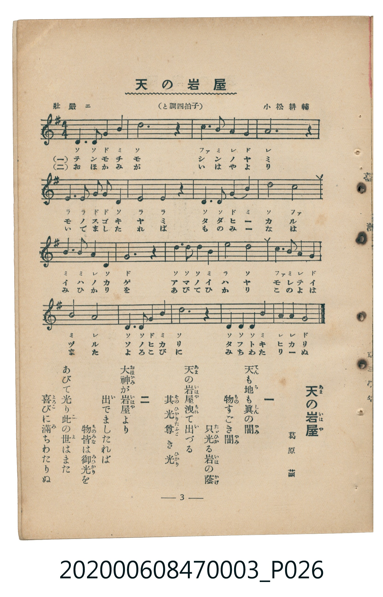

# 天の岩屋

> Re:Shōka 使用 AI 協助辨識與重建樂譜，可能會有錯誤。歡迎回報。

- **鋼琴伴奏版**：<br><audio controls src="ama_no_iwaya.mp3"></audio>
- **NEUTRINO 歌聲合成版**：<br><audio controls src="ama_no_iwaya_neutrino.mp3"></audio>

- 詞：葛原しげる
- 曲：小松耕輔
- 臺灣教育會公認《新定兒童唱歌》尋常科第三學年用（2020.006.0847.0003）

## 說明

原書資訊與歌詞全文（對應 P026.jpg，書頁 p. 3，第一學期第 2 首）：
調性與拍號：と調四拍子（G 大調 4/4 拍），「壯嚴ニ」


## 歌詞

```text
一
天（てん）も地（ち）も眞（しん）の闇（やみ）
物（もの）すごき闇（やみ）
只光（たゞひか）る岩（いは）の蔭（かげ）
天（あま）の岩屋洩（いはやも）れて出（い）づる
其光（そのひかり）尊（たふと）き光（ひかり）

二
大神（おほかみ）が岩屋（いはや）より
出（い）でましたれば
物皆（ものみな）は御光（みひかり）を
あびて光（ひか）り此（こ）の世（よ）はまた
喜（よろこ）びに滿（み）ちわたりぬ
```

## ABC

<div class="abc-score" data-abc-src="ama_no_iwaya.abc" aria-label="五線譜載入中"></div>

[下載 ABC 原始檔](ama_no_iwaya.abc)

## TMD 檔案連結

- [主旋律 TMD 檔案](ama_no_iwaya.tmd) [[在 TMD Studio 編輯](https://tmdlang.github.io/Tmd-TS/#tmd=s7IKdvYPcrWy4qpTUCpJTLdSSM7PyUlNLsnMz7MqzsjMK0nNjM_KTMmPL87Iz05Ugisry88pzU21Si9KTEmNN443MjAyiDcwMIs3sDAxBzIMjBFKi_NLi5JTrYqTM_Lzc-JLUitKkvLzsxHyBUX5Zal5iXlANQVFIBtTwIoQClLLMlNSQdKpKZkl-UWZiTlI7kgtKga7FWxJfElRYl5xclFmAcgDCFUlGalAx6bl52Tn5BeloosXpeZkpqOoB1qSnplnVZKYCfQ2yOvlifG5iZl5OYl5KciqSjLygSFQkFFplZFZDHJacmJOfHZiHlJAQR1WkJieahVgYGSmxKWlpfB0ycrHjeueblr5dGO3gpYWl6KtgoUBl72tgjuXjYm-iR1I94uV897vmfVi4uynffMfN05_3DjpcVM32NxnszcBZZ5u6H82d9-Lhqkv9kwBC79o3_W8cfGzqTNfNG16Nqf5aeuaF6t6Hzd0PZu24em6WU9bJz1fvfTplI3P1vY8buh-uqH76Y4dz5dPfL5mzZMdnU_X7ni6c8vzKSve7-kAxaUeMC71QHEJZBgYv9_TqcTFpa-lYEstwKWgoAD017PZO15sbn-xoutFRzvQXUAvP21d8WxaO9AVTzf0PmvvVAAFmV5WQfr7PT1AxS8XNCoU6CkAHdQDdncD0N3P5swHshWMFF4umwZ0KDBkQIa_WLX_WcNykLHdvS9mzgeKPm5cARR8Ons2UOTp2glAK9yB8bAcKKYADHIFoChYNzBwep4uXv901pbHzd2PG3q5QKYBbQK7eMlKoLbHjcseN00GKn7c1PR0zgawyEII9_kcYJwBudOhChrXvZwO8szjppbHjfuBIiBTnneCTWlqAkqDFc183DjlcWMvFqVP-1c9bQU6Cmjk_MdN8x43bnrc2A22qhuYeMDiQNXrIVa9mLIWLNINTCow_VAHA63aB1EESXPPtiA0gyxsagIb2gP02tP2XRApsPqlQJvABrVugzlkLtAUiEMeN3UBFT3dACTBDmzcCgxjsLZemGKEMkg47uqBOGv586WQkOp63Lgb7GSQlx839kDch-w4sMuAwdIF1oniuuVAb4GzBjBwgG7fAA3d57Pa4AEMNPhx4yqw6vVP9y2EuQsoiHDa46ZJIJ3gYNoMCgIkx4Olu56tXQIWgUbqkx3AlAa0oANiLtgV88HOmzYHIvG4qRemGmji6me7gd4DWQsWWfi4qR_sZqDn14C0UZ6foEBBS5-LyzE30S_fszyxMtEqIDMxL9-hxqCmGmSNgo2hmZYdmIUtLytAstSLhT0KGiYKwOLl-foGHXgG1MSiAWgbyLAaBdN4BV04BHMMoRxjKA1Ug6QEGRrAVIDN8jGsAUbEMiR5YFYCk00wfuNCuJkIUXQIcxDUVCOQqV3IpjbuBpPdcP5-hKmNPUSZWqNggiQH8qkRlA3zfQ1chBhfT0d2H8TXjevg_BYk98HcSoyvYfogvlyPYhYwpSJMbUIOH-ym4k87u3rISTtmyGkHzIGEniEiVSEpgjNgAQiDSAGJkiggQQgsZKG8KUDci-RpeFDAAxXZPfgDczmY3AflTQfi-UgmwxIRsGDCazK27APLNrBMg5rUQBCmAov_4a6A2L4ATG6C82FJHuRGGBsXRPI71lCFhRmwjEWYCk5k-E0lUAh1kpOQkEMEOTMiJSNYvkSH2HIjlnyDyI3Igdg4CYep2HIjcs6FRApSGQTPgaDgJs5U1HIVxIbxESWvGZoJ6CUxsq9RIxmUtJF9jVwGoUcyIiuhmQv2N6q5m8EkrJRHJE6QSvQkiVkuEUg-wCYeOPmYkZZ8CJfl6FkOvWzHWQSBiwJk_yKH41IM_6KHAHI4gmoFRDiCMyG8DEfECUglpFhCVo1cLCDMpX7tPRfTjTiKH8I1DqL4gfkSbEpTL9gsWGhAUhTM56uJMhXJ35gMhMdhkYyeHGAQW7kLbAnDWSvgLJCTYU7EDA5syRyz2EA0foBtSLgYcq2DbgqwiYlhbi0Xl66dAqKdqADkKXMBAA)]
- [鋼琴伴奏 TMD 檔案](ama_no_iwaya_piano.tmd) [[在 TMD Studio 編輯](https://tmdlang.github.io/Tmd-TS/#tmd=s7IKdvYPcrWy4qpTUCpJTLdSyC8qychPL0osyKi0ysgsLskvykxOzInPTsxLVIIrKs4vLUpOjS9ITE-1CjAwMlPi0tJSeLpk5ePGdU83rXy6sfv9no6X3XueT9jyZM-Wp0v7n3d2vN_TqaClxaVoq2BhwGVvq-DOZWOib2IHMvLFynnv98x6MXH20775jxunP26c9LipG2zZs9mbgDJPN_Q_m7vvRcPUF3umgIVftO963rj42dSZL5o2PZvT_LR1zYtVvY8bup5N2_B03aynrZOer176dMrGZ2t7Hjd0P93Q_XTHjufLJz5fs-bJjs6na3c83bnl-ZQVQCcaGRgZ6BkYmOkZWJiYAxkGxkBXKnFxOeYm-uV7lidWJloFZCbm5Qd5ONQY1FRzKQCBjaGZlh2Ypa-lYIsOFMCWNLxY2KOgYaIAdPjz9Q06CqAg0ssqSNfEokFLH2xYjYJpvIIuHII5hlCOMZQGqkFSggwNYCrAZvkY1ig8blyGJP-4aTKYbILxGxfCzUSIokOYg6CmGoFM7UI2tXE3mOyG8_cjTG3sIcrUGgUTJDmQT42gbJjva-AixPh6OrL7IL5uXAfntyC5D-ZWYnwN0wfx5XoUsx43dSBMbUIOH-ym4k87u3rISTtmyGkHzAGFHgjDUxWSIjgDFoAwiBSQKIkCEoSPG2dCeVOAuBfJ0_CggAcqsnvwB-ZyMLkPypsOxPORTIYloseNG_CajC37wLINLNOgJjUQhKnA4n-4KyC2LwCTm-B8WJIHuRHGxgWR_I41VGFh9rhxFcJUcCLDbyqBQqiTnISEHCLImREpGcHyJTrElhux5BtEbkQOxMZJOEzFlhuRcy4kUpDKIHgOBAU3caailqsgNoyPKHnN0ExAL4mRfY0ayaCkjexr5DIIPZIRWQnNXLC_Uc3dDCZhpTwicYJUoidJzHKJQPJ5Ons2OPmYkZZ8CJfl6FkOvWzHWQSBiwJk_yKH41IM_6KHAHI4gmoFRDiCMyG8DEfECUglpFhCVo1cLCDMpX7tPRfTjTiKH8I1DqL4gfkSbEpTL9gsWGhAUhTM56uJMhXJ35gMhMdhkYyeHGAQW7n7uHErnLUCzgI5GeZEzODAlswxiw1E4-dxUz9cDLnWQTflceMaDHNrMZuJPsjNRBPatBIN4xWiDWNhFDLfANGiAoqZIKkxjQeyTONjwQyQMto0QYCWmMXnItmLEAKlcJjr0H0Adx1MhCYVG9RwuGXYQw7dbWghSZsyEy22MFxKQsxjhCVCBMSFpltdOwVE0o32AUmgihiBRZS5AA)]

## 分析

```text
================================================================================
📊 TMD Song Profile: [ 天の岩屋 ]
================================================================================
⏱  Duration:       0:54 (54.0s), 18 measures total
🎼 Key & Tempo:    首調基準 G, != 80.0 BPM, <4/4>
   - 分析範圍：      由實際發聲的音符與和弦推測調性；播放脈絡另行呈現
🎤 人聲音域:    D4 (MIDI 62) – E5 (MIDI 76) [跨度: 14 個半音 / 1.2 個八度, 難度: moderate]
   - 最低音:  D4 in [AmaNoIwaya #1 @ m.1, 0:00]
   - 最高音: E5 in [AmaNoIwaya #1 @ m.12, 0:33]
   - 適合: soprano, mezzo-soprano, contralto, tenor, baritone, bass
🏛  結構:      AmaNoIwaya (54.0s)
⚡ 編曲密度:        Peak 1 軌道同時演奏
🗝  調性診斷：       D 調性不明確（流行色彩大調，未偵測到可信轉調）
   - 風格氣質:    流行大調（略帶和弦色彩音與裝飾副屬和弦）
   - 轉調歷程:    全曲維持單一推測調性（未偵測到可信轉調）
   - 核心骨幹音:  D, B, G, A, E
   - 調性數值:    D 調性不明確 [相關度: 0.82, 穩定度: Ambiguous, 自然音純度: 92.4%]
   - 候選調性 (K-S): D 大調 (0.82), G 大調 (0.79), B 小調 (0.66)
   - 五度圈歷程:   +2
   - 各段落調性細節:
     • [AmaNoIwaya #1]: D 調性不明確 (r: 0.82, 自然音純度: 92.4%, 調外音: C)

  [ 五度圈游移軌跡 ]
               C  
         F            G  
      Bb              [D ]*
      Eb               A  
         Ab           E  
            Db       B  
               F# 
     (* = active key center)

  [ 十二半音累積音高分佈 ]
     C  : █████                      7.6%
     C# :                            0.0%
     D  : ████████████████████████  34.8%
     D# :                            0.0%
     E  : ██████                     9.1%
     F  :                            0.0%
     F# :                            0.0%
     G  : ██████████                15.2%
     G# :                            0.0%
     A  : ██████████                15.2%
     A# :                            0.0%
     B  : █████████████             18.2%
--------------------------------------------------------------------------------
Assignment 軌道音域：
  - Piano         : D4 – E5 (14 個半音 / 1.2 個八度, 52 個音符)
================================================================================
```


## 原書掃描頁




