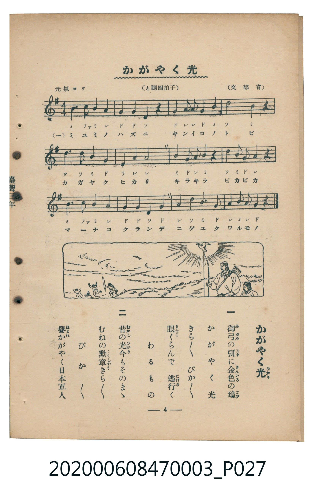

# かゞやく光

<audio controls src="kagayaku_hikari.mp3"></audio>

- 文部省唱歌
- 臺灣教育會公認《新定兒童唱歌》尋常科第三學年用（2020.006.0847.0003）

## 說明

原書資訊與歌詞全文（對應 P027.jpg，書頁 p. 4，第一學期第 3 首）：
調性與拍號：と調四拍子（G 大調 4/4 拍），「元氣ヨク」

## 歌詞

```text
一
御弓（みゆみ）の弭（はず）に金色（きんいろ）の鵄（とび）
かがやく光（ひかり）　きら／＼　ぴか／＼
眼（まなこ）くらんで　逃行（にげゆ）く　わるもの

二
昔（むかし）の光（ひかり）今（いま）もそのまゝ
むねの勳章（くんしやう）きら／＼　ぴか／＼
譽（ほまれ）かがやく日本軍人（にほんぐんじん）
```

## ABC

```abc
X:1
T:かゞやく光
M:4/4
L:1/16
Q:1/4=108
K:G
V:V1 name="Piano" snm="Pia"
[V:V1]
B4 c6 B2 A4 | G4 G4 D4 z4 | G4 A2 A2 G4 B4 | d8 B4 z4 |
d4 d4 B4 G4 | e4 A4 A8 | B2 G2 A4 B4 z4 | d2 B2 G4 A4 z4 |
B4 c6 B2 A4 | G4 G4 D4 G4 | A4 d4 B6 G2 | A2 B2 A4 G4 z4 |
```

## TMD 檔案連結

- [主旋律 TMD 檔案](kagayaku_hikari.tmd) [[在 TMD Studio 編輯](https://tmdlang.github.io/Tmd-TS/#tmd=s7IKdvYPcrWy4tLSUnjc2P24ad7jppbHjf1PWzsVtLS4FG0VDA0suOxtFdy5bEz0Tey46hSUnk1rf9m84vmcxqdTNj5b26MEEnvRvut54-JnU2e-aNr0bE7z09Y1L1b1Pm7oejZtw9N1s562Tnq-eilE-eOG7qcbup_u2PF8-cTna9Y82dH5dO2Opzu3PJ-y4v2eDiMDIwM9AwMzPQMLE3Mgw8D4_Z5OJS4ufS0FW2oBLgUFhad985_N3vFic_uLFV0vOtqB7nqxct7T1hVAvwFd8XRD77P2ToUAAyNzvayC9Pd7eoCKXy5oVCjQUzAB8sDubgC6-9mc-UC2grHCy2XTgA59v2cWyPAXq_Y_a1gOMra798XM-UDRx40rgIJPZ88GijxdOwFohbvC0yXLgWIKwFBVAIqCdQMDp-dpa_OzDYsfN6943LT-cUMvF8hAoGVgR-9b-HTPZKDmx437Hze1AUmgrseN657uWQsWXP-4cRZYZPXL9okvOjeBBXsfN01-3NjyuAlkBVDxy60tYPEVjxs3A0VA5oIivrEHHvFg6U3g1NAF0tPQADYFKN7_fs8eMHcLUBbCBel_PmcPWM--x42rHjcCHQi0px-oAWzzcqCGlw3NLxb2gNWsftw4Ceh2qBqgWU1AlUCbmoBOg_h1Vw-IejZjCkh9E9AyoOOmQz2K4bgnu4EkUATo9H0gNSBz5gJVghzTNBfsOZARa0Gauzc_X70ArBpoJdBl08E-hjgFr_9erN0L1rYbbCrQH0ANiBB7Nn3pszlrXuzufbJrF8yLu8EWTACTM4AkNKApT7tQoKClz8XlnZieWJmYXeqRmZ1YlGkVkJmYl-9QY1CjUA2yS8HGQssOzMCWdxQgSRgYKwoaJgpPN_Q_X9-gA0_wmlg0AG0EGVYDTOy6CiZArAtkGQHJGgVDIAnCpvFAwgAuZASEIBqkoUbBFKwFwgOrAcc2bsft6iHHcSBbQBhkC8juGgUzsEsgGARBHjAE8-AuAeoAiUHUEOO2HZ00CDiIc0ESMA-AxEAiEOUgeYjjarm4dO0UUKNfASiizMUFAA)]
- [鋼琴伴奏 TMD 檔案](kagayaku_hikari_piano.tmd) [[在 TMD Studio 編輯](https://tmdlang.github.io/Tmd-TS/#tmd=s7IKdvYPcrWy4tLSUnjc2P24ad7jppbHjf1PWzvf7-l42b3n-YQtT_Zsebq0_3lnx_s9nQpaWlyKtgqGBhZc9rYK7lw2Jvomdlx1CkrPprW_bF7xfE7j0ykbn63tUQKJvWjf9bxx8bOpM180bXo2p_lp65oXq3ofN3Q9m7bh6bpZT1snPV-9FKL8cUP30w3dT3fseL584vM1a57s6Hy6dsfTnVueT1kBdIaRgZGBnoGBmZ6BhYk5kGFgDHSJEheXd2J6YmVidqlHZnZiUaZVQGZiXn6Qh0ONQY1CNZcCENhYaNmBGTUKxgq6CiZArAtkGQHJGgVDIAnCpvFAwgAuZASEIBqkoUbBFKwFwgOrgRoHEgdhkDhIdY2CGVgvBIMgyEpDMA-uF6gDJAZRg2waAcdBLABJwKwEiYFEIMpB8hDjarEHig9KoJjAA8UwXiHaMFbBBEiZxsciBEzj44EGQrggCagw0ANACZgIUAGqMXBVIPOM4nMh5iCZjNCIZhERzsG0H7uLgCGga6eAGggKWEWUubgA)]

## 分析

```text
================================================================================
📊 TMD Song Profile: [ かゞやく光 ]
================================================================================
⏱  Duration:       0:26 (26.7s), 12 measures total
🎼 Key & Tempo:    首調基準 G, != 108.0 BPM, <4/4>
   - 分析範圍：      由實際發聲的音符與和弦推測調性；播放脈絡另行呈現
🎤 人聲音域:    D4 (MIDI 62) – E5 (MIDI 76) [跨度: 14 個半音 / 1.2 個八度, 難度: moderate]
   - 最低音:  D4 in [KagayakuHikari #1 @ m.2, 0:03]
   - 最高音: E5 in [KagayakuHikari #1 @ m.6, 0:11]
   - 適合: soprano, mezzo-soprano, contralto, tenor, baritone, bass
🏛  結構:      KagayakuHikari (26.7s)
⚡ 編曲密度:        Peak 1 軌道同時演奏
🗝  調性診斷：       G 大調（純淨自然大調，未偵測到可信轉調）
   - 風格氣質:    純淨自然大調（陽光明朗、易唱易記，無明顯調外色彩）
   - 轉調歷程:    全曲維持單一推測調性（未偵測到可信轉調）
   - 核心骨幹音:  G, A, B, D, C
   - 調性數值:    G 大調 [相關度: 0.81, 穩定度: High, 自然音純度: 100.0%]
   - 候選調性 (K-S): G 大調 (0.81), D 大調 (0.65), B 小調 (0.55)
   - 五度圈歷程:   +1
   - 各段落調性細節:
     • [KagayakuHikari #1]: G 大調 (r: 0.81, 自然音純度: 100.0%)

  [ 五度圈游移軌跡 ]
               C  
         F           [G ]*
      Bb               D  
      Eb               A  
         Ab           E  
            Db       B  
               F# 
     (* = active key center)

  [ 十二半音累積音高分佈 ]
     C  : ███████                    7.0%
     C# :                            0.0%
     D  : ████████████████          17.4%
     D# :                            0.0%
     E  : ██                         2.3%
     F  :                            0.0%
     F# :                            0.0%
     G  : ████████████████████████  25.6%
     G# :                            0.0%
     A  : ███████████████████████   24.4%
     A# :                            0.0%
     B  : ██████████████████████    23.3%
--------------------------------------------------------------------------------
Assignment 軌道音域：
  - Piano         : D4 – E5 (14 個半音 / 1.2 個八度, 45 個音符)
================================================================================
```


## 原書掃描頁




