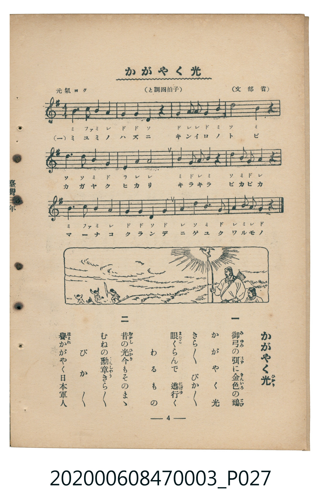

# かゞやく光

> Re:Shōka 使用 AI 協助辨識與重建樂譜，可能會有錯誤。歡迎回報。

- **鋼琴伴奏版**：<br><audio controls src="kagayaku_hikari.mp3"></audio>
- **NEUTRINO 歌聲合成版**：<br><audio controls src="kagayaku_hikari_neutrino.mp3"></audio>

- 文部省唱歌
- 臺灣教育會公認《新定兒童唱歌》尋常科第三學年用（2020.006.0847.0003）

## 說明

原書資訊與歌詞全文（對應 P027.jpg，書頁 p. 4，第一學期第 3 首）：
調性與拍號：と調四拍子（G 大調 4/4 拍），「元氣ヨク」


## 歌詞

```text
一
御弓（みゆみ）の弭（はず）に金色（きんいろ）の鵄（とび）
かがやく光（ひかり）　きら／＼　ぴか／＼
眼（まなこ）くらんで　逃行（にげゆ）く　わるもの

二
昔（むかし）の光（ひかり）今（いま）もそのまゝ
むねの勳章（くんしやう）きら／＼　ぴか／＼
譽（ほまれ）かがやく日本軍人（にほんぐんじん）
```

## ABC

<div class="abc-score" data-abc-src="kagayaku_hikari.abc" aria-label="五線譜載入中"></div>

[下載 ABC 原始檔](kagayaku_hikari.abc)

## TMD 檔案連結

- [主旋律 TMD 檔案](kagayaku_hikari.tmd) [[在 TMD Studio 編輯](https://tmdlang.github.io/Tmd-TS/#tmd=s7IKdvYPcrWy4qpTUCpJTLdSSM7PyUlNLsnMz7MqzsjMK0nNjM_KTMmPL87Iz05Ugisry88pzU21Si9KTEmNN443MjAyiDcwMIs3sDAxBzIMjBFKi_NLi5JTrYqTM_Lzc-JLUitKkvLzsxHyBUX5Zal5iXlANQVFIBtTwIoQClLLMlNSQdKpKZkl-UWZiTlI7kgtKga7FWxJfElRYl5xclFmAcgDCFUlGalAx-YllpQWpSJEgUalZ-ZZ5ebnJZUCvafEpaWl8Lix-3HTvMdNLY8b-5-2dipoaXEp2ioYGlhw2dsquHPZmOib2IEMeDat_WXziudzGp9O2fhsbQ_Y0Bftu543Ln42deaLpk3P5jQ_bV3zYlXv44auZ9M2PF0362nrpOerl0KUP27ofrqh--mOHc-XT3y-Zs2THZ1P1-54unPL8ykr3u_pAAWmHjAw9UCBCWQYGL_f06nExaWvpWBLLcCloKDwtG_-s9k7Xmxuf7Gi60VHO9BdL1bOe9q6Aug3oCuebuh91t6pEGBgZK6XVZD-fk8PUPHLBY0KBXoKJkAe2N0NQHc_mzMfyFYwVni5bBrQoe_3zAIZ_mLV_mcNy0HGdve-mDkfKPq4cQVQ8Ons2UCRp2snAK1wV3i6ZDlQTAEYqgpAUbBuYOD0PG1tfrZh8ePmFY-b1j9u6OUCGQi0DOzofQuf7pkM1Py4cf_jpjYgCdT1uHHd0z1rwYLrHzfOAousftk-8UXnJrBg7-OmyY8bWx43gawAKn65tQUsvuJx42agCMhcUMQ39sAjHiy9CZwaukB6GhrApgDF-9_v2QPmbgHKQrgg_c_n7AHr2fe4cdXjRqADgfb0AzWAbV4O1PCyofnFwh6wmtWPGycB3Q5VAzSrCagSaFMT0GkQv-7qAVHPZkwBqW8CWgZ03HSoRzEc92Q3kASKAJ2-D6QGZM5coEqQY5rmgj0HMmItSHP35uerF4BVA60Eumw62McQp-D134u1e8HadoNNBfoDqAERYs-mL302Z82L3b1Pdu2CeXE32IIJYHIGkIQGNOVpFwoUtPS5uLwT0xMrE7NLPTKzE4syrQIyE_PyHWoMaqpBVinYWGjZgRnYso4CJAUDI0VBw0Th6Yb-5-sbdODpXROLBqCFIMNqgGldFwhNwLQRENcoGAJJEDaNBxIGcCEjIATRIIU1CqZgbRAeWA3YOB_DGmDq2w-WAaYKKBsYWWA9wBQN5s0Ck6uBJMgGkDgoUYMFW4DaeqEagGkaKr0ZahkIgrVALDMCyjU1QCxr7Abi6SiWbYKKg5zShWRZC1h8H1C0CUjPRdGzD2oLhAWxC3-o7-ohJ9QhwWcKDj5QoNYomIEsA0UACIMgJGoMgXx4GIO1GYPFMEMd5FGQw3uAHoN4sR9HQEBMB4Y6WKQTzALRiCDaAg_SLVCduIJ9LTyyoLZBIxKUGcGMNoosJJDiO2mQ4iHRAZKAhDZIsSFUxBiaB9DDHpFsVoFJUBiAxEFhAvEoLFyWQ2VAqR9YdIJlIEEEUg0KP4geYFCAkycobNHCvnE3VD0oCffA4xYkA-YhxT7EHpgemBsmQPQDeSCZGTC3g2UhdtVycenaKaAWSApAEWUuAA)]
- [鋼琴伴奏 TMD 檔案](kagayaku_hikari_piano.tmd) [[在 TMD Studio 編輯](https://tmdlang.github.io/Tmd-TS/#tmd=s7IKdvYPcrWy4tLSUnjc2P24ad7jppbHjf1PWzvf7-l42b3n-YQtT_Zsebq0_3lnx_s9nQpaWlyKtgqGBhZc9rYK7lw2Jvomdlx1CkrPprW_bF7xfE7j0ykbn63tUQKJvWjf9bxx8bOpM180bXo2p_lp65oXq3ofN3Q9m7bh6bpZT1snPV-9FKL8cUP30w3dT3fseL584vM1a57s6Hy6dsfTnVueT1kBdIaRgZGBnoGBmZ6BhYk5kGFgDHSJEheXd2J6YmVidqlHZnZiUaZVQGZiXn6Qh0ONQU01lwIQ2Fho2YEZ-loKtuhAAWxPw4uFPQoaJgpPN_Q_X9-goxBgYGSul1WQrolFg5Y-2LAaBWMFXSA0AdNGQFyjYAgkQdg0HkgYwIWMgBBEgxTWKJiCtUF4YDVg43wMa4Ahvx8s87ipDcp-3LgOrOdx43owbxaYXA0kQTaAxHsfN00GC7YAtfVCNTxuXAGV3gy1DATBWiCWGQHlmhogljV2A_F0FMs2QcVBTulCsqwFLL4PKNoEpOei6NkHtQXCgtiFP9R39ZAT6pDgMwUHHyhQaxTMQJaBIgCEQRASNYZAPjyMwdqMwWKYoQ7yKMjhPUCPQbzYjyMgIKYDQx0s0glmgWhEEG2BB-kWqE5cwb4WHllQ26AROR3miDaKLCSQ4jtpkOIh0QGSgIQ2SLEhVMQYmgfQwx6RbFaBSVAYgMRBYQLxKCxclkNlQKn_ceMksAwkiECqQeEH0QMMCnDyBIUtWtg37oaqByXhHnjcgmTAPKTYh9gD0wNzwwSIfiAPJDMD5nawLMSuWuzlkQ9yeWQCLY-AwRevEG0Yq2ACpEzjYxECpvHxwJCCcEESUGFgMgZKwESAClCNgasCmWcUnwsxB8lkhEY0i4hwDqb92F0EDABdOwXUMIj2ASrFImoEFlXmAgA)]

## 分析

```text
================================================================================
📊 TMD Song Profile: [ かゞやく光 ]
================================================================================
⏱  Duration:       0:26 (26.7s), 12 measures total
🎼 Key & Tempo:    首調基準 G, != 108.0 BPM, <4/4>
   - 分析範圍：      由實際發聲的音符與和弦推測調性；播放脈絡另行呈現
🎤 人聲音域:    D4 (MIDI 62) – D5 (MIDI 74) [跨度: 12 個半音 / 1.0 個八度, 難度: easy]
   - 最低音:  D4 in [KagayakuHikari #1 @ m.2, 0:03]
   - 最高音: D5 in [KagayakuHikari #1 @ m.4, 0:06]
   - 適合: soprano, mezzo-soprano, contralto, tenor, baritone, bass
🏛  結構:      KagayakuHikari (26.7s)
⚡ 編曲密度:        Peak 1 軌道同時演奏
🗝  調性診斷：       G 大調（純淨自然大調，未偵測到可信轉調）
   - 風格氣質:    純淨自然大調（陽光明朗、易唱易記，無明顯調外色彩）
   - 轉調歷程:    全曲維持單一推測調性（未偵測到可信轉調）
   - 核心骨幹音:  B, G, A, D, C
   - 調性數值:    G 大調 [相關度: 0.76, 穩定度: Moderate, 自然音純度: 100.0%]
   - 候選調性 (K-S): G 大調 (0.76), B 小調 (0.66), D 大調 (0.65)
   - 五度圈歷程:   +1
   - 各段落調性細節:
     • [KagayakuHikari #1]: G 大調 (r: 0.76, 自然音純度: 100.0%)

  [ 五度圈游移軌跡 ]
               C  
         F           [G ]*
      Bb               D  
      Eb               A  
         Ab           E  
            Db       B  
               F# 
     (* = active key center)

  [ 十二半音累積音高分佈 ]
     C  : ██                         2.3%
     C# :                            0.0%
     D  : ███████████████           18.6%
     D# :                            0.0%
     E  : ██                         2.3%
     F  :                            0.0%
     F# :                            0.0%
     G  : ████████████████████      24.4%
     G# :                            0.0%
     A  : ███████████████████       23.3%
     A# :                            0.0%
     B  : ████████████████████████  29.1%
--------------------------------------------------------------------------------
Assignment 軌道音域：
  - Piano         : D4 – D5 (12 個半音 / 1.0 個八度, 45 個音符)
================================================================================
```


## 原書掃描頁




