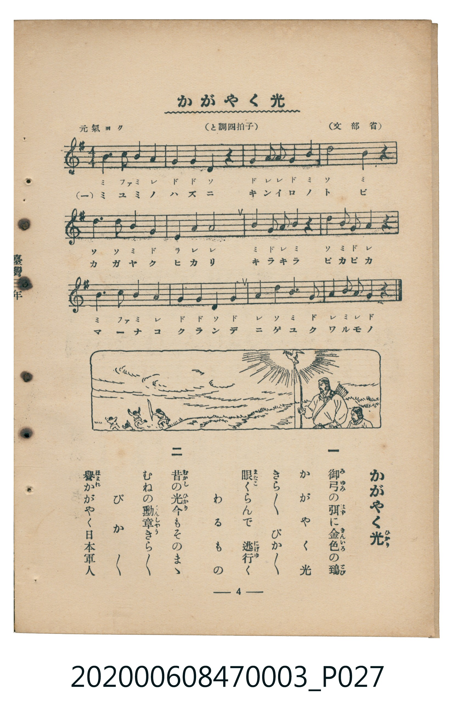

# かゞやく光

> Re:Shōka 使用 AI 協助辨識與重建樂譜，可能會有錯誤。歡迎回報。

- **鋼琴伴奏版**：<br><audio controls src="kagayaku_hikari.mp3"></audio>
- **NEUTRINO 歌聲合成版**：<br><audio controls src="kagayaku_hikari_neutrino.mp3"></audio>

- 文部省唱歌
- 臺灣教育會公認《新定兒童唱歌》尋常科第三學年用（2020.006.0847.0003）

## 說明

原書資訊與歌詞全文（對應 P027.jpg，書頁 p. 4，第一學期第 3 首）：
調性與拍號：と調四拍子（G 大調 4/4 拍），「元氣ヨク」


## 歌詞

```text
一
御弓（みゆみ）の弭（はず）に金色（きんいろ）の鵄（とび）
かがやく光（ひかり）　きら／＼　ぴか／＼
眼（まなこ）くらんで　逃行（にげゆ）く　わるもの

二
昔（むかし）の光（ひかり）今（いま）もそのまゝ
むねの勳章（くんしやう）きら／＼　ぴか／＼
譽（ほまれ）かがやく日本軍人（にほんぐんじん）
```

## ABC

<div class="abc-score" data-abc-src="kagayaku_hikari.abc" aria-label="五線譜載入中"></div>

[下載 ABC 原始檔](kagayaku_hikari.abc)

## TMD 檔案連結

- [主旋律 TMD 檔案](kagayaku_hikari.tmd) [[在 TMD Studio 編輯](https://tmdlang.github.io/Tmd-TS/#tmd=s7IKdvYPcrWy4qpTUCpJTLdSSM7PyUlNLsnMz7MqzsjMK0nNjM_KTMmPL87Iz05Ugisry88pzU21Si9KTEmNN443MjAyiDcwMIs3sDAxBzIMjBFKi_NLi5JTrYqTM_Lzc-JLUitKkvLzsxHyBUX5Zal5iXlANQVFIBtTwIoQClLLMlNSQdKpKZkl-UWZiTlI7kgtKga7FWxJfElRYl5xclFmAcgDCFUlGalAx-YllpQWpSJEgUalZ-ZZ5ebnJZUCvYcsUZKRD_RaQUalVUZmMcjO5MSc-OzEPKQQgNpYkJieahVgYGSuxKWlpfC4sftx07zHTS2PG_uftnYqaGlxKdoqGBpYcNnbKrhz2Zjom9iBTHg2rf1l84rncxqfTtn4bG0P2NQX7bueNy5-NnXmi6ZNz-Y0P21d82JV7-OGrmfTNjxdN-tp66Tnq5dClD9u6H66ofvpjh3Pl098vmbNkx2dT9fueLpzy_MpK97v6QDFhR4wLvRAcQFkGBi_39OpxMWlr6VgSy3ApaCg8LRv_rPZO15sbn-xoutFRzvQXS9WznvaugLoN6Arnm7ofdbeqQAKGb2sgvT3e3qAil8uaFQo0FMwAfLA7m4AuvvZnPlAtoKxwstl04AOfb9nFsjwF6v2P2tYDjK2u_fFzPlA0ceNK4CCT2fPBoo8XTsBaIW7wtMly4FiCsBQVQCKgnUDA6fnaWvzsw2LHzeveNy0_nFDLxfIQKBlYEfvW_h0z2Sg5seN-x83tQFJoK7Hjeue7lkLFlz_uHEWWGT1y_aJLzo3gQV7HzdNftzY8rgJZAVQ8cutLWDxFY8bNwNFQOaCIr6xBx7xYOlN4NTQBdLT0AA2BSje_37PHjB3C1AWwgXpfz5nD1jPvseNqx43Ah0ItKcfqAFs83KghpcNzS8W9oDVrH7cOAnodqgaoFlNQJVAm5qAToP4dVcPiHo2YwpIfRPQMqDjpkM9iuG4J7uBJFAE6PR9IDUgc-YCVYIc0zQX7DmQEWtBmrs3P1-9AKwaaCXQZdPBPoY4Ba__XqzdC9a2G2wq0B9ADYgQezZ96bM5a17s7n2yaxfMi7vBFkwAkzOAJDSgKU-7UKCgpc_F5Z2YnliZmF3qkZmdWJRpFZCZmJfvUGNQUw2ySsHGQssOzMCWdRQgKRgYKQoaJgpPN_Q_X9-gA0_vmlg0AC0EGVYDTOu6QGgCpo2AuEbBEEiCsGk8kDCACxkBIYgGKaxRMAVrg_DAasDG-RjWAFPffrAMMFVA2cDIAusBpmgwbxaYXA0kQTaAxEGJGizYAtTWC9UATNNQ6c1Qy0AQrAVimRFQrqkBYlljNxBPR7FsE1Qc5JQuJMtawOL7gKJNQHouip59UFsgLIhd-EN9Vw85oQ4JPlNw8IECtUbBDGQZKAJAGAQhUWMI5MPDGKzNGCyGGeogj4Ic3gP0GMSL_TgCAmI6MNTBIp1gFohGBNEWeJBugerEFexr4ZEFtQ0akaDMCGa0UWQhgRTfSYMUD4kOkAQktEGKDaEixtA8gB72iGSzCkyCwgAkDgoTiEdh4bIcKgNK_cCiEywDCSKQalD4QfQAgwKcPEFhixb2jbuh6kFJuAcetyAZMA8p9iH2wPTA3DABoh_IA8nMgLkdLAuxq5aLS9dOAbVAUgCKKHMBAA)]
- [鋼琴伴奏 TMD 檔案](kagayaku_hikari_piano.tmd) [[在 TMD Studio 編輯](https://tmdlang.github.io/Tmd-TS/#tmd=s7IKdvYPcrWy4qpTUCpJTLdSyC8qychPL0osyKi0ysgsLskvykxOzInPTsxLVIIrKs4vLUpOjS9ITE-1CjAwMlfi0tJSeNzY_bhp3uOmlseN_U9bO9_v6XjZvef5hC1P9mx5urT_eWfH-z2dClpaXIq2CoYGFlz2tgruXDYm-iZ2IGOfTWt_2bzi-ZzGp1M2PlvbA7bqRfuu542Ln02d-aJp07M5zU9b17xY1fu4oevZtA1P18162jrp-eqlEOWPG7qfbuh-umPH8-UTn69Z82RH59O1O57u3PJ8ygqgM4wMjAz0DAzM9AwsTMyBDANjoEuUuLi8E9MTKxOzSz0ysxOLMq0CMhPz8oM8HGoMaqq5FIDAxkLLDszQ11KwRQcKYHsaXizsUdAwUXi6of_5-gYdBVBg6GUVpGti0aClDzasRsFYQRcITcC0ERDXKBgCSRA2jQcSBnAhIyAE0SCFNQqmYG0QHlgN2DgfwxpgyO8HyzxuaoOyHzeuA-t53LgezJsFJlcDSZANIPHex02TwYItQG29UA2PG1dApTdDLQNBsBaIZUZAuaYGiGWN3UA8HcWyTVBxkFO6kCxrAYvvA4o2Aem5KHr2QW2BsCB24Q_1XT3khDok-EzBwQcK1BoFM5BloAgAYRCERI0hkA8PY7A2Y7AYZqiDPApyeA_QYxAv9uMICIjpwFAHi3SCWSAaEURb4EG6BaoTV7CvhUcW1DZoRE6HOaKNIgsJpPhOGqR4SHSAJCChDVJsCBUxhuYB9LBHJJtVYBIUBiBxUJhAPAoLl-VQGVDqf9w4CSwDCSKQalD4QfQAgwKcPEFhixb2jbuh6kFJuAcetyAZMA8p9iH2wPTA3DABoh_IA8nMgLkdLAuxqxZ7eeSDXB6ZQMsjYPDFK0QbxiqYACnT-FiEgGl8PDCkIFyQBFQYmIyBEjARoAJUY-CqQOYZxedCzEEyGaERzSIinINpP3YXAQNA104BNQyifYBKsYgagUWVuQA)]

## 分析

```text
================================================================================
📊 TMD Song Profile: [ かゞやく光 ]
================================================================================
⏱  Duration:       0:26 (26.7s), 12 measures total
🎼 Key & Tempo:    首調基準 G, != 108.0 BPM, <4/4>
   - 分析範圍：      由實際發聲的音符與和弦推測調性；播放脈絡另行呈現
🎤 人聲音域:    D4 (MIDI 62) – D5 (MIDI 74) [跨度: 12 個半音 / 1.0 個八度, 難度: easy]
   - 最低音:  D4 in [KagayakuHikari #1 @ m.2, 0:03]
   - 最高音: D5 in [KagayakuHikari #1 @ m.4, 0:06]
   - 適合: soprano, mezzo-soprano, contralto, tenor, baritone, bass
🏛  結構:      KagayakuHikari (26.7s)
⚡ 編曲密度:        Peak 1 軌道同時演奏
🗝  調性診斷：       G 大調（純淨自然大調，未偵測到可信轉調）
   - 風格氣質:    純淨自然大調（陽光明朗、易唱易記，無明顯調外色彩）
   - 轉調歷程:    全曲維持單一推測調性（未偵測到可信轉調）
   - 核心骨幹音:  B, G, A, D, C
   - 調性數值:    G 大調 [相關度: 0.76, 穩定度: Moderate, 自然音純度: 100.0%]
   - 候選調性 (K-S): G 大調 (0.76), B 小調 (0.66), D 大調 (0.65)
   - 五度圈歷程:   +1
   - 各段落調性細節:
     • [KagayakuHikari #1]: G 大調 (r: 0.76, 自然音純度: 100.0%)

  [ 五度圈游移軌跡 ]
               C  
         F           [G ]*
      Bb               D  
      Eb               A  
         Ab           E  
            Db       B  
               F# 
     (* = active key center)

  [ 十二半音累積音高分佈 ]
     C  : ██                         2.3%
     C# :                            0.0%
     D  : ███████████████           18.6%
     D# :                            0.0%
     E  : ██                         2.3%
     F  :                            0.0%
     F# :                            0.0%
     G  : ████████████████████      24.4%
     G# :                            0.0%
     A  : ███████████████████       23.3%
     A# :                            0.0%
     B  : ████████████████████████  29.1%
--------------------------------------------------------------------------------
Assignment 軌道音域：
  - Piano         : D4 – D5 (12 個半音 / 1.0 個八度, 45 個音符)
================================================================================
```


## 原書掃描頁




