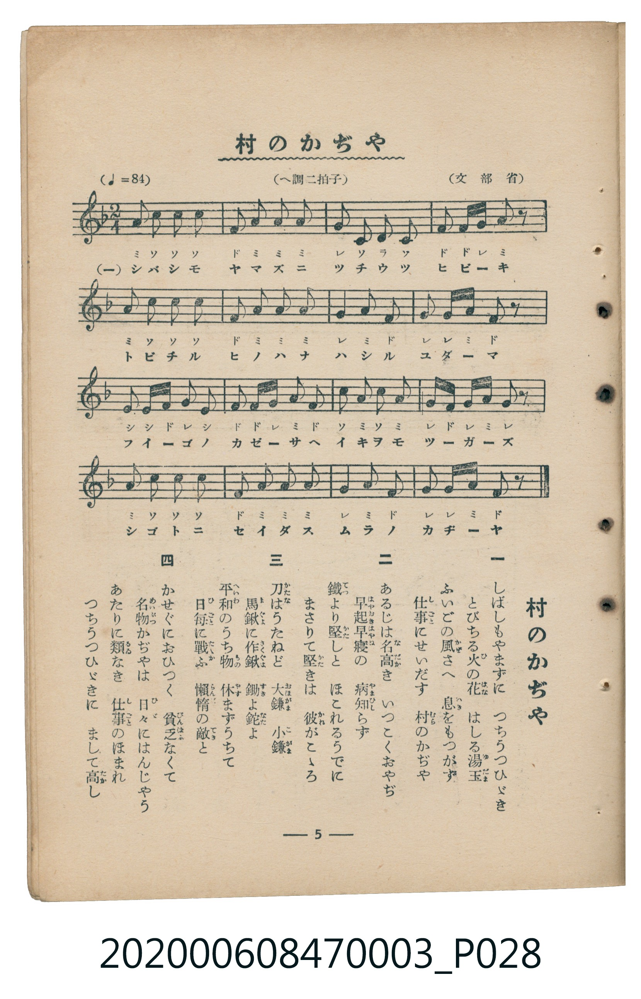

# 村のかぢや

> Re:Shōka 使用 AI 協助辨識與重建樂譜，可能會有錯誤。歡迎回報。

- **NEUTRINO 歌聲合成版**：<br><audio controls src="mura_no_kajiya_neutrino.mp3"></audio>
- **鋼琴伴奏版**：<br><audio controls src="mura_no_kajiya.mp3"></audio>


- 詞：中村秋香
- 曲：田村虎藏
- 文部省唱歌
- 臺灣教育會公認《新定兒童唱歌》尋常科第三學年用（2020.006.0847.0003）

## 說明

原書資訊與歌詞全文（對應 P028.jpg，書頁 p. 5，第一學期第 4 首）：
調性與拍號：へ調二拍子（F 大調 2/4 拍），速度 != 84


## 歌詞

```text
一
しばしもやまずに　つちうつひゞき
とびちる火（ひ）の花（はな）　はしる湯玉（ゆだま）
ふいごの風（かぜ）さへ　息（いき）をもつかず
仕事（しごと）にせいだす　村（むら）のかぢや

二
あるじは名高（なだか）き　いつこくおやぢ
早起（はやおき）早寢（はやね）の　病（やまひ）知らず
鐵（てつ）より堅（かた）しと　ほこれるうでに
まさりて堅（かた）きは　彼（かれ）がこゝろ

三
刀（かたな）はうたねど　大鎌（おほがま）　小鎌（こがま）
馬鍬（まぐは）に作鍬（さくぐは）　鋤（すき）よ鉈（なた）よ
平和（へいわ）のうち物（もの）　休（やす）まずうちて
日毎（ひごと）に戰（たゝか）ふ　懶惰（らんだ）の敵（てき）と

四
かせぐにおひつく　貧乏（びんばふ）なくて
名物（めいぶつ）かぢやは　日々（ひび）にはんじやう
あたりに類（るゐ）なき　仕事（しごと）のほまれ
つちうつひゞきに　まして高（たか）し
```

## ABC

```abc
X:1
T:村のかぢや
C:曲：田村虎藏
M:2/4
L:1/16
Q:1/4=84
K:F
V:V1 name="Piano" snm="Pia"
[V:V1]
A2 c2 c2 c2 | F2 A2 A2 A2 | G2 C2 D2 C2 | F2 F G A2 z2 |
w: 1.~し ば し も | や ま ず に | つ ち う つ | ひ び _ _
w: 2.~あ る じ は | な だ か き | い つ こ く | お や _ _
w: 3.~か た な は | う た ね ど | お ほ が ま | こ が _ _
w: 4.~か せ ぐ に | お ひ つ く | び ん ば ふ | な く _ _
A2 c2 c2 c2 | F2 A2 A2 A2 | G4 A2 G2 | G2 G A F2 z2 |
w: 1.~と び ち る | ひ の は な | は し る | ゆ だ _ _
w: 2.~は や お き | は や ね の | や ま ひ | し ら _ _
w: 3.~ま ぐ は に | さ く ぐ は | す き よ | な た _ _
w: 4.~め い ぶ つ | か ぢ や は | ひ び に | は ん _ じや
E2 E F G2 E2 | F2 F G A2 F2 | c2 A2 c2 A2 | G F G A G2 z2 |
w: 1.~ふ い _ _ の | か ぜ _ _ へ | い き を も | つ _ _ か _
w: 2.~て つ _ _ り | か た _ _ と | ほ こ れ る | う _ _ で _
w: 3.~へ い _ _ の | う ち _ _ の | や す ま ず | う _ _ ち _
w: 4.~あ た _ _ に | る ゐ _ _ き | し ご と の | ほ _ _ ま _
A2 c2 c2 c2 | F2 A2 A2 A2 | G4 A2 G2 | G2 G A F2 z2 |
w: 1.~し ご と に | せ い だ す | む ら の | か ぢ _ _
w: 2.~ま さ り て | か た き は | か れ が | こ こ _ _
w: 3.~ひ ご と に | た た か ふ | ら ん _ | て き _ _
w: 4.~つ ち う つ | ひ び き に | ま し て | た か _ _
```

## TMD 檔案連結

- [主旋律 TMD 檔案](mura_no_kajiya.tmd) [[在 TMD Studio 編輯](https://tmdlang.github.io/Tmd-TS/#tmd=s7IKdvYPcrWy4qpTUCpJTLdSSM7PyUlNLsnMz7MqzsjMK0nNjM_KTMmPL87Iz05Ugisry88pzU21Si9KTEmNN443MjAyiDcwMIs3sDAxBzIMjBFKi_NLi5JTrYqTM_Lzc-JLUitKkvLzsxHyBUX5Zal5iXlANQVFIBtTwIoQClLLMlNSQdKpKZkl-UWZiTlI7kgtKga7FWxJfElRYl5xclFmAcgDCFUlGalAx5bnFyFZCzQoPTPPKjc_L6kU6DlMidTMrEwk52ppKTybO_Fx47rHjd2PGxc9bmpR0NLiUrRVsDDhsrdVcOOyMdI3sQOZ8mxa-8vmFc_nND6dsvHZ2h6wyS9Wznu_Z9aTHWuBZjxf3v1y2Uyw8LPZm4DCz6dsAAq_mNn3Yno_RHX7rueNi59NnfmiadOzOc1PW9e8WNX7uKHr2bQNT9fNeto66fnqpRDDHzd0P93Q_XTHjufLJz5fs-bJjs6na3c83bnl-ZQV7_d0gKJFDxgteqBoATIMjN_v6VTi4tLXUrClFuBSUFB42jf_2ewdLza3v1jR9aKjHeguoH-ftq4AhgTQFU839D5r71QIMDCy0MsqSH-_pweo-OWCRoUCPQVTIA_s7gagu5_NmQ9kK5govFw2DehQYMiADH-xav-zhuUgY7t7X8ycDxR93LgDKPhkVw9Q5OnaCUAr3BSeLlkOFFMAxoECUBSsu-dlw_ynu5YpQOIIZBTQGhD1uHH648YNILKpCRiPjxv3PW4EGrr6cUPD48YljxsXPm5sAzM2PW6a97ixF6JnxePGzSC5pu7njauBdgKlgdYAE8SLro1g7vrHjatAIiBTgGyg6d3Pdq5_3gd0SsfjJqCJC4A2ARVAjNv6uBFo8xSg_peLQHEFTlZzwCZOBXoQaMqzxvVgcaAykIceN00CuRfkLqBKcNA82T31ya5usCKgj4BmAQ0C6l_9uHE2WBvQwpkgg-ZOBDuh4XET0C0gJ8PTMCRYdvVA3AQMDaD4DKDzn07ofbl6BtjkVWBzgLYANQITIdBzQJOBjpj8uLH_cWMXOAAXgfQ_m77yxdbt0KAAiXZBHA4Uf7p-EZL4WqgjGhqeT28FuwwSB6DwfD5_KdCVUP-9nLAVrG0Z0EJwCACVdj1dANYD8gEwMQCVAr2-Auyu3SBHNfWAPQEM7uXAkID4C2j2VKBOoEEYmntBjmpoeLp3D1S8qQcs3gM2a-7jpl5oygFH29OOBrh2aGyDohpoGZC79nHjSpBRS5a_7AMaAlQGtBHoJqBRoGgHSW3oh0kBQw8qDvbosjUve9eAJYBunQA0FBKRT_bOgYkDEwUwuGFSDQ0vu4FBAhSfCUsdHS87O2ARBvZbUwfYyTs3P50EsXMHKOqa-mFJAOjqhc87V4IjAJiu1kHMfbIHkliAUTITrBKSOUCKgeEHieelz9b3QXIAcqp71rEBLDgfFG7QBLMVlPzatz1rBksBI7YJ6PEFEBc8mwqPXbAPGleAg_rp7NmQWAMGMjAZA30MTM_AkATaBUx1_UADX2xa_mQn0BtAvZvBBgLzMtAooAlArwMDCexKYAqGea4RnGS3QRMRLOlDIh7omccNkDQBtGAzLP8AEyrQ3BlgZW2wzAHyGdAhq18uBBbmQHOBiQVY-ECsBeUMHNkRGNTAVLAPmLIgBmEpYWCFDzCsgTqXwbIeMFFBgnE6SCflZTUUKGjpc3H5lhYl-uV7J2ZlViZaBWQm5uU71BjUVIMsUrAxNNOyA7Ow1RQKkAL7xcIeBQ0TBWCafr6-QQdevGti0QC0D2RYjYKxgq6CKRKuUTAEkiBRGK5RMALJxQMJMxABZkGUGQKlQEoMQCJgA30Ma0CFOZAPTANgEsxuagLrAVXRILF9YHIWmFwNkWlcAuYtBJNtYBIkApLZBOZtBpIgulcBbD_ENiOQPMhsYNSDZWeAyfVQnavAvAVgEiLfC5WBuANi52Qw2Q-V6QKbBpIHiS5Cts0YJA8xZz6YhJgPsw3iaojMWjC5EtnMxt1gsgceAiAZiN0gMYgokm0mCNtmg8kJKOEFMRMSNhB_wHwACilgZkGKg60o4QFSB6KXQW3Dn6x29dAyWYEgiAdiQ0RAKQqkFj1NrQC7Gew3SCoBxzgifayDxwXEnyAZEA_iV0gqhOpogsQUKF1ghDo4RYFNgaZVSDjD0g2yDCSOQfbCUjbMPFjMwPNCUydUbhZGeoKohsQtxPWwGJ4Kjy1keZDMTLhdIHcBqxWoOCR-QSkQIoqWmpoawfIQ128Dk7A8Bklni5B8B7ML5A-IXZCwh7kOEhKQVAYqlYFUG1EJakcnOQnKHGQ0kAAVOWAGehkEYteA0xos7cFSGUQFSBt6mgLlC0h4gOgpiNiEhsccqMxUIN4BlYGEDiTcJ4FJaNkGDkuQHEQvSkyDU9UyeIhDYgdYdaHYBo03YIqBpHaQDKTMAIdyE7jkgKd6UBoGyS2Hxgp6ugK5F-63pn4kv0FSPygPQVyPmoYhqQu5jEa2DVI-w0oORDkFLoPhKa8LkU4g5XITKP2CVKyChh2ilpgCJiG5G-ZCkK_hbgD6m4hkBWyjDI5yCtNXsBwDKcUhYQypk0AhDQqjBqgNkHICPRWCciUkX6KnKEgcgcsJcFqCpDH0WgqcVuH5GSQDMQ9SE4FIRE0EIkFyKLUsOD1BSlls_oLYAiEh9kLrG2ipByknYH5eB9YDyQsgl0HMQ09PxLQGYD6DuQMUGkilPTwsEC6DyEHsquXi0rVTQG5zKQD5ylwA)]
- [鋼琴伴奏 TMD 檔案](mura_no_kajiya_piano.tmd) [[在 TMD Studio 編輯](https://tmdlang.github.io/Tmd-TS/#tmd=s7IKdvYPcrWy4tLSUng2d-LjxnWPG7sfNy563NTyfk_Hy-49zydsebJny9Ol_c87O97v6VTQ0uJStFWwMOGyt1Vw47Ix0jex46pTUHo2rf1l84rncxqfTtn4bG2PEkjsxcp57_fMerJjLdDg58u7Xy6bCRZ-NnsTUPj5lA1A4Rcz-15M74eobt_1vHHxs6kzXzRtejan-Wnrmhereh83dD2btuHpullPWyc9X70UYvjjhu6nG7qf7tjxfPnE52vWPNnR-XTtjqc7tzyfsgLoZiMDIwM9AwMzPQMLE3Mgw8AY6GwlLi7f0qJEv3zvxKzMykSrgMzEvPwgD4cag5pqLgUgsDE007IDs2oUjBV0FUyRcI2CIZAEicJwjYIRSC4eSJiBCDALoswQKAVSYgASARvoY1ij8LhxOpD_uHEDmASzm5rAeoABDRbbByZngcnVEJnGJWDeQjDZBiZBIiCZTWDeZiAJonsVwPZDbDMCyYPMftzUDZadASbXQ3WuAvMWgEmIfC9UBuIOiJ2TwWQ_VKYLbBpIHiS6CNk2Y5A8xJz5YBJiPsw2iKshMmvB5EpkMxt3g8keeAiAZCB2g8Qgoki2mSBsmw0mJ6CEF8RMSNhA_AHzASikHjdBTIbEwVaU8ACpA9HLkGwjPiGAIIgHYkNEQGkApBY9FawA2wJ2DSRewXGEiNF18NCDuAwkA-JBXAdJN1AdTZCwBcUkRjiB0wDYFGjqgoQMLKaRZSCxArIXlhZh5sHCEp56mzqhcrMwUgBENSQ2IK6HxclUePgiy4NkZsLtArnrcVMHVBwSI6A0AxFFi_-mRrA8xPXbwCQsV0BSxiIk38HsAvkDYhck7GGug4QEJF3MAGkCJVnkJGAO4gAJULYGM9DzOYhdA04dsNQCSxcQFSBt6KkAlPYgPgDRUxDhD_XBHKjMVCDeAZWB-AcSUpPAJLT8APseJAfRixI34HSwDB5GkPB83ARKDaj5FpK6IOkTJAPJl-BwaQLnTng6BaU6kNxyaDiipwSQe-F-a-pH8hskvYJSPcT1qKkOkh6Qy0Fk2yBlIHLuhJQF4HIOnla6EDELKfuaQCkOpGIVNOwQJfEUMAnJjzAXgnwNdwPQ37QtCzDdAUuVkLINEiqQkhoUNiBfNUBtgORF9HQDSvmQtI-eBiChCs6L4NiHpAr0shucuuB5BiQDMQ9SPoNIRPkMIkFyKHUPOAVASjJs_oLYAiEh9kJLYWjJAsmLMD-vA-uBpF6QyyDmoacAYupImM9g7gCFBlKJCg8LhMsgchC7arG1HXyQ2w4m8KaDYbxCtGEsMsM0HsgyjYeKGcDTE_EqUcWxaCLNUKB3dO0UkH0U7QNUiiFmhEXMGIuYCVhMmQsA)]

## 分析

```text
================================================================================
📊 TMD Song Profile: [ 村のかぢや ]
================================================================================
⏱  Duration:       0:22 (22.9s), 16 measures total
🎼 Key & Tempo:    首調基準 F, != 84.0 BPM, <2/4>
   - 分析範圍：      由實際發聲的音符與和弦推測調性；播放脈絡另行呈現
🎤 人聲音域:    C4 (MIDI 60) – C5 (MIDI 72) [跨度: 12 個半音 / 1.0 個八度, 難度: easy]
   - 最低音:  C4 in [MuraNoKajiya #1 @ m.3, 0:03]
   - 最高音: C5 in [MuraNoKajiya #1 @ m.1, 0:00]
   - 適合: soprano, mezzo-soprano, contralto, tenor, baritone, bass
🏛  結構:      MuraNoKajiya (22.9s)
⚡ 編曲密度:        Peak 1 軌道同時演奏
🗝  調性診斷：       A 小調（純淨自然小調，未偵測到可信轉調）
   - 風格氣質:    純淨自然小調（陰鬱抒情、旋律集中，無明顯調外色彩）
   - 轉調歷程:    全曲維持單一推測調性（未偵測到可信轉調）
   - 核心骨幹音:  A, G, C, F, E
   - 調性數值:    A 小調 [相關度: 0.77, 穩定度: Moderate, 自然音純度: 100.0%]
   - 候選調性 (K-S): A 小調 (0.77), C 大調 (0.71), F 大調 (0.65)
   - 五度圈歷程:   +3
   - 各段落調性細節:
     • [MuraNoKajiya #1]: A 小調 (r: 0.77, 自然音純度: 100.0%)

  [ 五度圈游移軌跡 ]
               C  
         F            G  
      Bb               D  
      Eb              [A ]*
         Ab           E  
            Db       B  
               F# 
     (* = active key center)

  [ 十二半音累積音高分佈 ]
     C  : ████████████████          21.7%
     C# :                            0.0%
     D  : █                          1.7%
     D# :                            0.0%
     E  : ███                        4.2%
     F  : ████████████              16.7%
     F# :                            0.0%
     G  : █████████████████         23.3%
     G# :                            0.0%
     A  : ████████████████████████  32.5%
     A# :                            0.0%
     B  :                            0.0%
--------------------------------------------------------------------------------
Assignment 軌道音域：
  - Piano         : C4 – C5 (12 個半音 / 1.0 個八度, 65 個音符)
================================================================================
```


## 原書掃描頁




