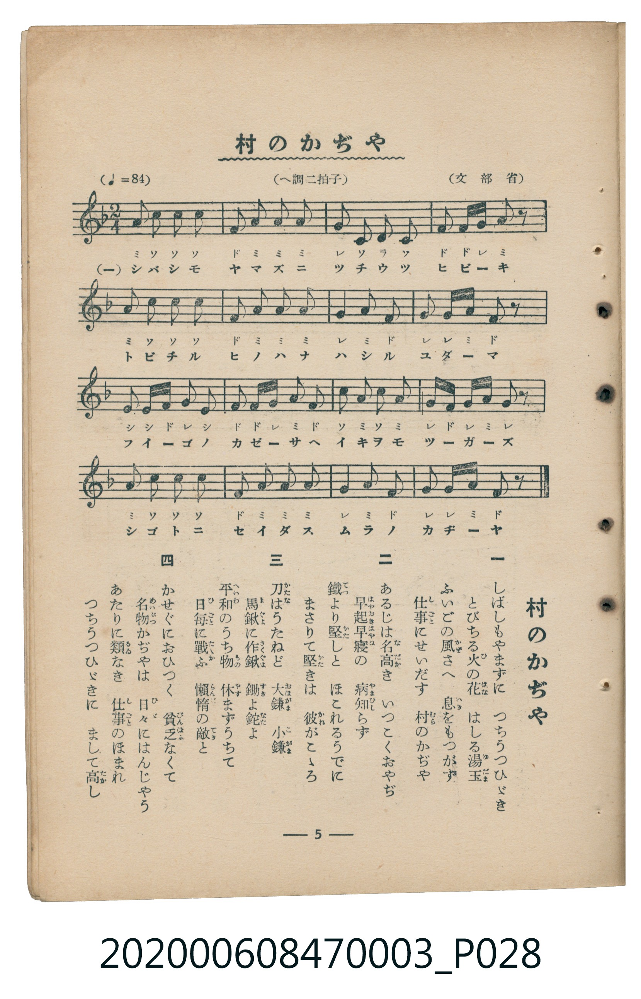

# 村のかぢや

> Re:Shoka 使用 AI 協助辨識與重建樂譜，可能會有錯誤。歡迎回報。

<audio controls src="mura_no_kajiya.mp3"></audio>

- 詞：中村秋香
- 曲：田村虎藏
- 文部省唱歌
- 臺灣教育會公認《新定兒童唱歌》尋常科第三學年用（2020.006.0847.0003）

## 說明

原書資訊與歌詞全文（對應 P028.jpg，書頁 p. 5，第一學期第 4 首）：
調性與拍號：へ調二拍子（F 大調 2/4 拍），速度 != 84

## 跨冊／重複收錄參照

> 同曲（《公學校唱歌》與《新定兒童唱歌》第三學年共用教材）

- **[同曲]** 《公學校唱歌》第三學年（昭和10年／1935）：[**〈村のかぢや（村之鍛冶屋）〉**](../../../kogakko_shoka/grade_3/3_muranokajiya/index.md)（`F` / `2/4` — [原始 TMD](../../../kogakko_shoka/grade_3/3_muranokajiya/muranokajiya.tmd)）
- 總表：[跨冊重複與同名歌曲總索引](../../../duplicate_songs.md)

## 歌詞

```text
一
しばしもやまずに　つちうつひゞき
とびちる火（ひ）の花（はな）　はしる湯玉（ゆだま）
ふいごの風（かぜ）さへ　息（いき）をもつかず
仕事（しごと）にせいだす　村（むら）のかぢや

二
あるじは名高（なだか）き　いつこくおやぢ
早起（はやおき）早寢（はやね）の　病（やまひ）知らず
鐵（てつ）より堅（かた）しと　ほこれるうでに
まさりて堅（かた）きは　彼（かれ）がこゝろ

三
刀（かたな）はうたねど　大鎌（おほがま）　小鎌（こがま）
馬鍬（まぐは）に作鍬（さくぐは）　鋤（すき）よ鉈（なた）よ
平和（へいわ）のうち物（もの）　休（やす）まずうちて
日毎（ひごと）に戰（たゝか）ふ　懶惰（らんだ）の敵（てき）と

四
かせぐにおひつく　貧乏（びんばふ）なくて
名物（めいぶつ）かぢやは　日々（ひび）にはんじやう
あたりに類（るゐ）なき　仕事（しごと）のほまれ
つちうつひゞきに　まして高（たか）し
```

## ABC

```abc
X:1
T:村のかぢや
C:曲：田村虎藏
M:2/4
L:1/16
Q:1/4=84
K:F
V:V1 name="Piano" snm="Pia"
[V:V1]
A2 c2 c2 c2 | F2 A2 A2 A2 | G2 C2 D2 C2 | F2 F G A2 z2 |
A2 c2 c2 c2 | F2 A2 A2 A2 | G4 A2 G2 | G2 G A F2 z2 |
E2 E F G2 E2 | F2 F G A2 F2 | c2 A2 c2 A2 | G F G A G2 z2 |
A2 c2 c2 c2 | F2 A2 A2 A2 | G4 A2 G2 | G2 G A F2 z2 |
```

## TMD 檔案連結

- [主旋律 TMD 檔案](mura_no_kajiya.tmd) [[在 TMD Studio 編輯](https://tmdlang.github.io/Tmd-TS/#tmd=s7IKdvYPcrWy4qpTUCpJTLdSSM7PyUlNLsnMz7MqzsjMK0nNjM_KTMmPL87Iz05Ugisry88pzU21Si9KTEmNN443MjAyiDcwMIs3sDAxBzIMjBFKi_NLi5JTrYqTM_Lzc-JLUitKkvLzsxHyBUX5Zal5iXlANQVFIBtTwIoQClLLMlNSQdKpKZkl-UWZiTlI7kgtKga7FWxJfElRYl5xclFmAcgDCFUlGalAx5bnFwGt1dJSeDZ34uPGdY8bux83Lnrc1KKgpcWlaKtgYcJlb6vgxmVjpG9iB9L6bFr7y-YVz-c0Pp2y8dnaHrBxL1bOe79n1pMda4FmPF_e_XLZTLDws9mbgMLPp2wACr-Y2fdiej9Edfuu542Ln02d-aJp07M5zU9b17xY1fu4oevZtA1P18162jrp-eqlEMMfN3Q_3dD9dMeO58snPl-z5smOzqdrdzzdueX5lBXv93SAglcPGLx6oOAFMgyM3-_pVOLi0tdSsKUW4FJQUHjaN__Z7B0vNre_WNH1oqMd6C6gf5-2rgCGBNAVTzf0PmvvVAgwMLLQyypIf7-nB6j45YJGhQI9BVMgD-zuBqC7n82ZD2QrmCi8XDYN6FBgyIAMf7Fq_7OG5SBju3tfzJwPFH3cuAMo-GRXD1Dk6doJQCvcFJ4uWQ4UUwDGgQJQFKy752XD_Ke7lilA4ghkFNAaEPW4cfrjxg0gsqkJGI-PG_c9bgQauvpxQ8PjxiWPGxc-bmwDMzY9bpr3uLEXomfF48bNILmm7ueNq4F2AqWB1gATxIuujWDu-seNq0AiIFOAbKDp3c92rn_eB3RKx-MmoIkLgDYBFUCM2_q4EWjzFKD-l4tAcQVOVnPAJk4FehBoyrPG9WBxoDKQhx43TQK5F-QuoEpw0DzZPfXJrm6wIqCPgGYBDQLqX_24cTZYG9DCmSCD5k4EO6HhcRPQLSAnw9MwJFh29UDcBAwNoPgMoPOfTuh9uXoG2ORVYHOAtgA1AhMh0HNAk4GOmPy4sf9xYxc4ABeB9D-bvvLF1u3QoACJdkEcDhR_un4RkvhaqCMaGp5PbwW7DBIHoPB8Pn8p0JVQ_72csBWsbRnQQnAIAJV2PV0A1gPyATAxAJUCvb4C7K7dIEc19YA9AQzu5cCQgPgLaPZUoE6gQRiae0GOamh4uncPVLypByzeAzZr7uOmXmjKAUfb044GuHZobIOiGmgZkLv2ceNKkFFLlr_sAxoCVAa0EegmoFGgaAdJbeiHSQFDDyoO9uiyNS9714AlgG6dADQUEpFP9s6BiQMTBTC4YVINDS-7gUECFJ8JSx0dLzs7YBEG9ltTB9jJOzc_nQSxcwco6pr6YUkA6OqFzztXgiMAmK7WQcx9sgeSWIBRMhOsEpI5QIqB4QeJ56XP1vdBcgByqnvWsQEsOB8UbtAEsxWU_Nq3PWsGSwEjtgno8QUQFzybCo9dsA8aV4CD-uns2ZBYAwYyMBkDfQxMz8CQBNoFTHX9QANfbFr-ZCfQG0C9m8EGAvMy0CigCUCvAwMJ7EpgCoZ5rhGcZLdBExEs6UMiHuiZxw2QNAG0YDMs_wATKtDcGWBlbbDMAfIZ0CGrXy4EFuZAc4GJBVj4QKwF5Qwc2REY1MBUsA-YsiAGYSlhYIUPMKyBOpfBsh4wUUGCcTpIJ-VlNRQoaOlzcfmWFiX65XsnZmVWJloFZCbm5TvUGNQoVINsUrAxNNOyA7OwVRUKkBL7xcIeBQ0TBWCifr6-QQdevmti0QC0EGRYjYKxgq6CKRKuUTAEkiBRGK5RMALJxQMJMxABZkGUGQKlQEoMQCLgtILbebt6aOk8EATxQGyICMhlILXEuG1HJzluMwcFBJAAhQKYgR4sIHYN2Nkwb8AcDFEB0kaE84D5byCDrpaLS9dOATl1KgD5ylxcAA)]
- [鋼琴伴奏 TMD 檔案](mura_no_kajiya_piano.tmd) [[在 TMD Studio 編輯](https://tmdlang.github.io/Tmd-TS/#tmd=s7IKdvYPcrWy4tLSUng2d-LjxnWPG7sfNy563NTyfk_Hy-49zydsebJny9Ol_c87O97v6VTQ0uJStFWwMOGyt1Vw47Ix0jex46pTUHo2rf1l84rncxqfTtn4bG2PEkjsxcp57_fMerJjLdDg58u7Xy6bCRZ-NnsTUPj5lA1A4Rcz-15M74eobt_1vHHxs6kzXzRtejan-Wnrmhereh83dD2btuHpullPWyc9X70UYvjjhu6nG7qf7tjxfPnE52vWPNnR-XTtjqc7tzyfsgLoZiMDIwM9AwMzPQMLE3Mgw8AY6GwlLi7f0qJEv3zvxKzMykSrgMzEvPwgD4cagxqFai4FILAxNNOyA7NqFIwVdBVMkXCNgiGQBInCcI2CEUguHkiYgQgwC6LMECgFUmIAEiHRQBAE8UBsiAjILJBaZNPMQZYBCZBNYAa61SB2DdgimMUwKyAqQNpo4bxabKHsgxLKJvBANoxXiDaMRWaYxgNZpvFQMQO484hXiSqORRNphgL9o2ungOwlBSx8ZS4uAA)]

## 分析

```text
================================================================================
📊 TMD Song Profile: [ 村のかぢや ]
================================================================================
⏱  Duration:       0:22 (22.9s), 16 measures total
🎼 Key & Tempo:    首調基準 F, != 84.0 BPM, <2/4>
   - 分析範圍：      由實際發聲的音符與和弦推測調性；播放脈絡另行呈現
🎤 人聲音域:    C4 (MIDI 60) – C5 (MIDI 72) [跨度: 12 個半音 / 1.0 個八度, 難度: easy]
   - 最低音:  C4 in [MuraNoKajiya #1 @ m.3, 0:03]
   - 最高音: C5 in [MuraNoKajiya #1 @ m.1, 0:00]
   - 適合: soprano, mezzo-soprano, contralto, tenor, baritone, bass
🏛  結構:      MuraNoKajiya (22.9s)
⚡ 編曲密度:        Peak 1 軌道同時演奏
🗝  調性診斷：       A 小調（純淨自然小調，未偵測到可信轉調）
   - 風格氣質:    純淨自然小調（陰鬱抒情、旋律集中，無明顯調外色彩）
   - 轉調歷程:    全曲維持單一推測調性（未偵測到可信轉調）
   - 核心骨幹音:  A, G, C, F, E
   - 調性數值:    A 小調 [相關度: 0.77, 穩定度: Moderate, 自然音純度: 100.0%]
   - 候選調性 (K-S): A 小調 (0.77), C 大調 (0.71), F 大調 (0.65)
   - 五度圈歷程:   +3
   - 各段落調性細節:
     • [MuraNoKajiya #1]: A 小調 (r: 0.77, 自然音純度: 100.0%)

  [ 五度圈游移軌跡 ]
               C  
         F            G  
      Bb               D  
      Eb              [A ]*
         Ab           E  
            Db       B  
               F# 
     (* = active key center)

  [ 十二半音累積音高分佈 ]
     C  : ████████████████          21.7%
     C# :                            0.0%
     D  : █                          1.7%
     D# :                            0.0%
     E  : ███                        4.2%
     F  : ████████████              16.7%
     F# :                            0.0%
     G  : █████████████████         23.3%
     G# :                            0.0%
     A  : ████████████████████████  32.5%
     A# :                            0.0%
     B  :                            0.0%
--------------------------------------------------------------------------------
Assignment 軌道音域：
  - Piano         : C4 – C5 (12 個半音 / 1.0 個八度, 65 個音符)
================================================================================
```


## 原書掃描頁




