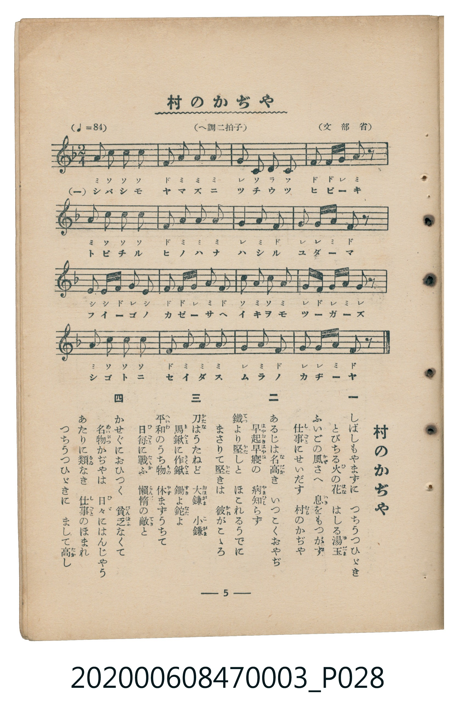

# 村のかぢや

> Re:Shōka 使用 AI 協助辨識與重建樂譜，可能會有錯誤。歡迎回報。

- **鋼琴伴奏版**：<br><audio controls src="mura_no_kajiya.mp3"></audio>
- **NEUTRINO 歌聲合成版**：<br><audio controls src="mura_no_kajiya_neutrino.mp3"></audio>

- 詞：中村秋香
- 曲：田村虎藏
- 文部省唱歌
- 臺灣教育會公認《新定兒童唱歌》尋常科第三學年用（2020.006.0847.0003）

## 說明

原書資訊與歌詞全文（對應 P028.jpg，書頁 p. 5，第一學期第 4 首）：
調性與拍號：へ調二拍子（F 大調 2/4 拍），速度 != 84


## 歌詞

```text
一
しばしもやまずに　つちうつひゞき
とびちる火（ひ）の花（はな）　はしる湯玉（ゆだま）
ふいごの風（かぜ）さへ　息（いき）をもつかず
仕事（しごと）にせいだす　村（むら）のかぢや

二
あるじは名高（なだか）き　いつこくおやぢ
早起（はやおき）早寢（はやね）の　病（やまひ）知らず
鐵（てつ）より堅（かた）しと　ほこれるうでに
まさりて堅（かた）きは　彼（かれ）がこゝろ

三
刀（かたな）はうたねど　大鎌（おほがま）　小鎌（こがま）
馬鍬（まぐは）に作鍬（さくぐは）　鋤（すき）よ鉈（なた）よ
平和（へいわ）のうち物（もの）　休（やす）まずうちて
日毎（ひごと）に戰（たゝか）ふ　懶惰（らんだ）の敵（てき）と

四
かせぐにおひつく　貧乏（びんばふ）なくて
名物（めいぶつ）かぢやは　日々（ひび）にはんじやう
あたりに類（るゐ）なき　仕事（しごと）のほまれ
つちうつひゞきに　まして高（たか）し
```

## ABC

<div class="abc-score" data-abc-src="mura_no_kajiya.abc" aria-label="五線譜載入中"></div>

[下載 ABC 原始檔](mura_no_kajiya.abc)

## TMD 檔案連結

- [主旋律 TMD 檔案](mura_no_kajiya.tmd) [[在 TMD Studio 編輯](https://tmdlang.github.io/Tmd-TS/#tmd=s7IKdvYPcrWy4qpTUCpJTLdSSM7PyUlNLsnMz7MqzsjMK0nNjM_KTMmPL87Iz05Ugisry88pzU21Si9KTEmNN443MjAyiDcwMIs3sDAxBzIMjBFKi_NLi5JTrYqTM_Lzc-JLUitKkvLzsxHyBUX5Zal5iXlANQVFIBtTwIoQClLLMlNSQdKpKZkl-UWZiTlI7kgtKga7FWxJfElRYl5xclFmAcgDCFUlGalAx5bnFyFZCzQoPTPPKjc_L6kU6DlMidTMrEwszs0vKsnIB_q7IKPSKiOzGOSg5MSc-OzEPKTggTqnIDE91SrAwMhCiUtLS-HZ3ImPG9c9bux-3LjocVOLgpYWl6KtgoUJl72tghuXjZG-iR3IgGfT2l82r3g-p_HplI3P1vaADX2xct77PbOe7FgLNOP58u6Xy2aChZ_N3gQUfj5lA1D4xcy-F9P7Iarbdz1vXPxs6swXTZuezWl-2rrmxarexw1dz6ZteLpu1tPWSc9XL4UY_rih--mG7qc7djxfPvH5mjVPdnQ-Xbvj6c4tz6eseL-nAxSresBY1QPFKpBhYPx-T6cSF5e-loIttQCXgoLC0775z2bveLG5_cWKrhcd7UB3Af37tHUFMCSArni6ofdZe6cCKBj1sgrS3-_pASp-uaBRoUBPwRTIA7u7AejuZ3PmA9kKJgovl00DOhQYMiDDX6za_6xhOcjY7t4XM-cDRR837gAKPtnVAxR5unYC0Ao3hadLlgPFFIBxoAAUBevuedkw_-muZQqQOAIZBbQGRD1unP64cQOIbGoCxuPjxn2PG4GGrn7c0PC4ccnjxoWPG9vAjE2Pm-Y9buyF6FnxuHEzSK6p-3njaqCdQGmgNcAE8aJrI5i7_nHjKpAIyBQgG2h697Od65_3AZ3S8bgJaOICoE1ABRDjtj5uBNo8Baj_5SJQXIGT1RywiVOBHgSa8qxxPVgcqAzkocdNk0DuBbkLqBIcNE92T32yqxusCOgjoFlAg4D6Vz9unA3WBrRwJsiguRPBTmh43AR0C8jJ8DQMCZZdPRA3AUMDKD4D6PynE3pfrp4BNnkV2BygLUCNwEQI9BzQZKAjJj9u7H_c2AUOwEUg_c-mr3yxdTs0KECiXRCHA8Wfrl-EJL4W6oiGhufTW8Eug8QBKDyfz18KdCXUfy8nbAVrWwa0EBwCQKVdTxeA9YB8AEwMQKVAr68Au2s3yFFNPWBPAIN7OTAkIP4Cmj0VqBNoEIbmXpCjGhqe7t0DFW_qAYv3gM2a-7ipF5pywNH2tKMBrh0a26CoBloG5K593LgSZNSS5S_7gIYAlQFtBLoJaBQo2kFSG_phUsDQg4qDPbpszcveNWAJoFsnAA2FROSTvXNg4sBEAQxumFRDw8tuYJAAxWfCUkfHy84OWISB_dbUAXbyzs1PJ0Hs3AGKuqZ-WBIAunrh886V4AgApqt1EHOf7IEkFmCUzASrhGQOkGJg-EHieemz9X2QHICc6p51bAALzgeFGzTBbAUlv_Ztz5rBUsCIbQJ6fAHEBc-mwmMX7IPGFeCgfjp7NiTWgIEMTMZAHwPTMzAkgXYBU10_0MAXm5Y_2Qn0BlDvZrCBwLwMNApoAtDrwEACuxKYgmGeawQn2W3QRARL-pCIB3rmcQMkTQAt2AzLP8CECjR3BlhZGyxzgHwGdMjqlwuBhTnQXGBiARY-EGtBOQNHdgQGNTAV7AOmLIhBWEoYWOEDDGugzmWwrAdMVJBgnA7SSXlZDQUKWvpcXL6lRYl--d6JWZmViVYBmYl5-Q41BjXVIIsUbAzNtOzALGw1hQKkwH6xsEdBw0QBmKafr2_QgRfvmlg0AO0DGVajYKygq2CKhGsUDIEkSBSGaxSMQHLxQMIMRIBZEGWGQCmQEgOQCNhAH8MaUGEO5APTAJgEs5uawHpAVTRIbB-YnAUmV0NkGpeAeQvBZBuYBImAZDaBeZuBJIjuVQDbD7HNCCQPMhsY9WDZGWByPVTnKjBvAZiEyPdCZSDugNg5GUz2Q2W6wKaB5EGii5BtMwbJQ8yZDyYh5sNsg7gaIrMWTK5ENrNxN5jsgYcASAZiN0gMIopkmwnCttlgcgJKeEHMhIQNxB8wH4BCCphZkOJgK0p4gNSB6GVQ2_Anq109tExWIAjigdgQEVCKAqlFT1MrwG4G-w2SSsAxjkgf6-BxAfEnSAbEg_gVkgqhOpogMQVKFxihDk5RYFOgaRUSzrB0gywDiWOQvbCUDTMPFjPwvNDUCZWbhZGeIKohcQtxPSyGp8JjC1keJDMTbhfIXcBqBSoOiV9QCoSIoqWmpkawPMT128AkLI9B0tkiJN_B7AL5A2IXJOxhroOEBCSVgUplINVGVILa0UlOgjIHGQ0kQEUOmIFeBoHYNeC0Bkt7sFQGUQHShp6mQPkCEh4gegoiNqHhMQcqMxWId0BlIKEDCfdJYBJatoHDEiQH0YsS0-BUtQwe4pDYAVZdKLZB4w2YYiCpHSQDKTPAodwELjngqR6UhkFyy6Gxgp6uQO6F-62pH8lvkNQPykMQ16OmYUjqQi6jkW2DlM-wkgNRToHLYHjK60KkE0i53ARKvyAVq6Bhh6glpoBJSO6GuRDka7gbgP4mIlkB2yiDo5zC9BUsx0BKcUgYQ-okUEiDwqgBagOknEBPhaBcCcmX6CkKEkfgcgKcliBpDL2WAqdVeH4GyUDMg9REIBJRE4FIkBxKLQtOT5BSFpu_ILZASIi90PoGWupBygmYn9eB9UDyAshlEPPQ0xMxrQGYz2DuAIUGUmkPDwuEyyByELtqubh07RSQ21wKQL4yFwA)]
- [鋼琴伴奏 TMD 檔案](mura_no_kajiya_piano.tmd) [[在 TMD Studio 編輯](https://tmdlang.github.io/Tmd-TS/#tmd=s7IKdvYPcrWy4qpTUCpJTLdSyC8qychPL0osyKi0ysgsLskvykxOzInPTsxLVIIrKs4vLUpOjS9ITE-1CjAwslDi0tJSeDZ34uPGdY8bux83Lnrc1PJ-T8fL7j3PJ2x5smfL06X9zzs73u_pVNDS4lK0VbAw4bK3VXDjsjHSN7EDmfpsWvvL5hXP5zQ-nbLx2doesE0vVs57v2fWkx1rgQY_X979ctlMsPCz2ZuAws-nbAAKv5jZ92J6P0R1-67njYufTZ35omnTsznNT1vXvFjV-7ih69m0DU_XzXraOun56qUQwx83dD_d0P10x47nyyc-X7PmyY7Op2t3PN255fmUFUA3GxkYGegZGJjpGViYmAMZBsZAZytxcfmWFiX65XsnZmVWJloFZCbm5Qd5ONQY1FRzKQCBjaGZlh2YVaNgrKCrYIqEaxQMgSRIFIZrFIxAcvFAwgxEgFkQZYZAKZASA5AI2EAfwxqFx43TgfzHjRvAJJjd1ATWAwxosNg-MDkLTK6GyDQuAfMWgsk2MAkSAclsAvM2A0kQ3asAth9imxFIHmT246ZusOwMMLkeqnMVmLcATELke6EyEHdA7JwMJvuhMl1g00DyEPOQbDMGyUPMmQ8mIebDbIO4GiKzFkyuRDazcTeY7IGHAEgGYjdIDCKKZJsJwrbZYHICSnhBzISEDcQfMB-AQupxE8RkSBxsRQkPkDoQvQzJNuITAgiCeCA2RASUBkBq0VPBCrAtYNdA4hUcR4gYXQcPPYjLQDIgHsR1kHQD1dEECVtQTGKEEzgNgE2Bpi5IyMBiGlkGEisge2FpEWYeLCzhqbepEyo3CyMFQFRDYgPielicTIWHL7I8SGYm3C6Qux43dUDFITECSjMQUbT4b2oEy0Ncvw1MwnIFUnqH-g5mF8gfELsgYQ9zHSQkIOliBkgTKMkiJwFzEAdIgLI1mIGez0HsGnDqgKUWWLqAqABpQ08FoLQH8QGInoIIf6gP5kBlpgLxDqgMxD-QkJoEJqHlB9j3IDmIXpS4AaeDZfAwgoTn4yZQakDNt5DUBUmfIBlIvgSHSxM4d8LTKSjVgeSWQ8MRPSWA3Av3W1M_kt8g6RWU6iGuR011kPSAXA4i2wYpA5FzJ6QsAJdz8LTShYhZaNkHC-NV0LBDlMRTwCQkP8JcCPI13A1Af9O2LMB0ByxVQso2SKhASmpQ2IB81QC1AZIX0dMNKOVD0j56GoCEKjgvgmMfkirQy25w6oLnGZAMxDxI-QwiEeUziATJodQ94BQAKcmw-QtiC4SE2AsthaElCyQvwvy8DqwHknpBLoOYh54CiKkjYT6DuQMUGkglKjwsEC6DyEHsqsXWdvBBbjuYwJsOhvEK0YaxyAzTeCDLNB4qZgBPT8SrRBXHook0Q4He0bVTQPZRtA9QKYaYERYxYyxiJmAxZS4A)]

## 分析

```text
================================================================================
📊 TMD Song Profile: [ 村のかぢや ]
================================================================================
⏱  Duration:       0:22 (22.9s), 16 measures total
🎼 Key & Tempo:    首調基準 F, != 84.0 BPM, <2/4>
   - 分析範圍：      由實際發聲的音符與和弦推測調性；播放脈絡另行呈現
🎤 人聲音域:    C4 (MIDI 60) – C5 (MIDI 72) [跨度: 12 個半音 / 1.0 個八度, 難度: easy]
   - 最低音:  C4 in [MuraNoKajiya #1 @ m.3, 0:03]
   - 最高音: C5 in [MuraNoKajiya #1 @ m.1, 0:00]
   - 適合: soprano, mezzo-soprano, contralto, tenor, baritone, bass
🏛  結構:      MuraNoKajiya (22.9s)
⚡ 編曲密度:        Peak 1 軌道同時演奏
🗝  調性診斷：       A 小調（純淨自然小調，未偵測到可信轉調）
   - 風格氣質:    純淨自然小調（陰鬱抒情、旋律集中，無明顯調外色彩）
   - 轉調歷程:    全曲維持單一推測調性（未偵測到可信轉調）
   - 核心骨幹音:  A, G, C, F, E
   - 調性數值:    A 小調 [相關度: 0.77, 穩定度: Moderate, 自然音純度: 100.0%]
   - 候選調性 (K-S): A 小調 (0.77), C 大調 (0.71), F 大調 (0.65)
   - 五度圈歷程:   +3
   - 各段落調性細節:
     • [MuraNoKajiya #1]: A 小調 (r: 0.77, 自然音純度: 100.0%)

  [ 五度圈游移軌跡 ]
               C  
         F            G  
      Bb               D  
      Eb              [A ]*
         Ab           E  
            Db       B  
               F# 
     (* = active key center)

  [ 十二半音累積音高分佈 ]
     C  : ████████████████          21.7%
     C# :                            0.0%
     D  : █                          1.7%
     D# :                            0.0%
     E  : ███                        4.2%
     F  : ████████████              16.7%
     F# :                            0.0%
     G  : █████████████████         23.3%
     G# :                            0.0%
     A  : ████████████████████████  32.5%
     A# :                            0.0%
     B  :                            0.0%
--------------------------------------------------------------------------------
Assignment 軌道音域：
  - Piano         : C4 – C5 (12 個半音 / 1.0 個八度, 65 個音符)
================================================================================
```


## 原書掃描頁




