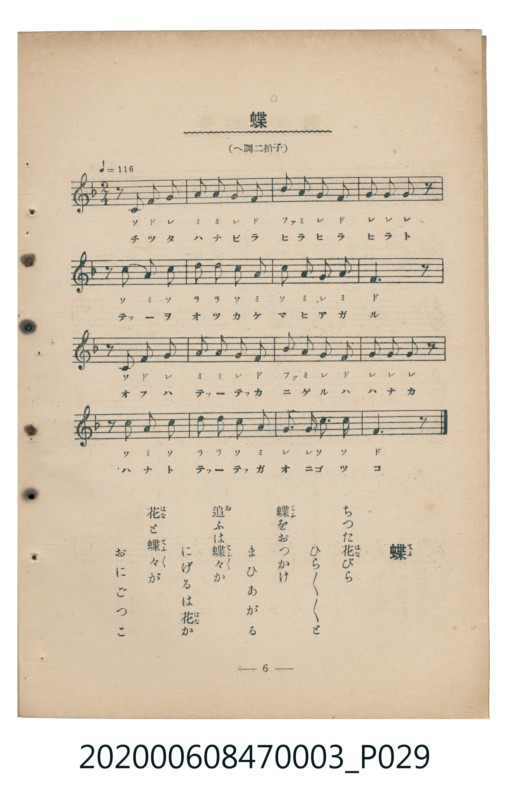

# 蝶

> Re:Shōka 使用 AI 協助辨識與重建樂譜，可能會有錯誤。歡迎[回報](https://github.com/TMDLang/reshoka/issues)。

- **鋼琴伴奏版**：<br><audio controls src="cho.mp3"></audio>
- **NEUTRINO 歌聲合成版**：<br><audio controls src="cho_neutrino.mp3"></audio>

- 臺灣教育會公認《新定兒童唱歌》尋常科第三學年用（2020.006.0847.0003）

## 說明

原書資訊與歌詞全文（對應 P029.jpg，書頁 p. 6，第一學期第 5 首）：
調性與拍號：へ調二拍子（F 大調 2/4 拍），速度 != 116


## 歌詞

```text
ちつた花（はな）びら　ひら／＼／＼と
蝶（てふ）をおつかけ　まひあがる
追（お）ふは蝶々（てふ／＼）か　にげるは花（はな）か
花（はな）と蝶々（てふ／＼）が　おにごつこ
```

## ABC

<div class="abc-score" data-abc-src="cho.abc" aria-label="五線譜載入中"></div>

[下載 ABC 原始檔](cho.abc)

## TMD 檔案連結

- [主旋律 TMD 檔案](cho.tmd) [[在 TMD Studio 編輯](https://tmdlang.github.io/Tmd-TS/#tmd=s7IKdvYPcrWy4qpTUCpJTLdSSM7PyUlNLsnMz7MqzsjMK0nNjM_KTMmPL87Iz05Ugisry88pzU21Si9KTEmNN443MjAyiDcwMIs3sDAxBzIMjBFKi_NLi5JTrYqTM_Lzc-JLUitKkvLzsxHyBUX5Zal5iXlANQVFIBtTwIoQClLLMlNSQdKpKZkl-UWZiTlI7kgtKga7FWxJfElRYl5xclFmAcgDCFUlGalAxybmZeYi6wUalZ6ZZ5Wbn5dUCvQeskRJRj7QawUZlVYZmcUgO5MTc-KzE_OQQgBqY0FieqpVgIGRpRKXlpbCi7nbFLS0uBRtFQwNzbjsbRXcuGyM9E3sQLpetO963rj42dSZL5o2PZvT_LR1zYtVvY8bup5N2_B03aynrZOer176dMrGZ2t7Hjd0P93Q_XTHjufLJz5fs-bJjs6na3c83bnl-ZQV7_d0gMJaDxjWeqCwBjIMjN_v6VTi4tLXUrClFuBSUFB42jf_2ewdLza3v1jR9aKjHeiuFyvnPW1d8WxaO9AVTzf0PmvvVAD5XC-rIP39nh6g4pcLGhUK9BTMgDywuxuA7n42Zz6QrWCq8HLZNKBD3--ZBTL8xar9zxqWg4zt7n0xcz5Q9HHjDqDgk109QJGnaycArXBTeLpkOVBMARiCCkBRsO6elw3zn-5apgANYpBZjxsXPm5c8rhx_ouujUBtjxvXP25cBVT8uHHz46bOxw0Njxs3ARnv9_S_37MHQj5uXAF2xdxtYA3LHjduBWlomvS4sQtsVvfjxolgnftAmhubHjf2PG7qBuvZvxespwtsw1agbUBTHje0IhkEsQco2w02YvXjxklAzSCV6A6EmIguugK3icC0ATQR6EagoVPALp0MMoLyGIcCBS19Li7njHyrgMzEvHyHGoOaapD5CjaGZlp2YBa2ZKYAie0XC3sUNEwUnm7of76-QQeeNjSxaABaAzKsRsFAQVfBNB5IGAKxERDXKBgDSRAG8UCiNQomGCIgFgyDjKgBG-dTowAyCpggwOQSMDkfrAEYvGDeKjC5GUQ2dUJlNsF5yGx0mRVAEmR6DTjR4Q6HXT1khwPUmyC6RsEMSIIwTLQGzgJ5GiICCgwYxBIMoMQDlQWmbaifupDCphtMToTK7EOEQGMTmOyByDSB1MEgMWGwo3PwpAWIf0HhAEkDIJ8iBwyMAwkNkOxqMA8UXhCfI_QhpyGQDBFh8XT2bFqlB5inQSIgkmB6QHY-KDnjDgpoxEMDDxIgU6CKloBlJiNZBQmGWi4uXTsFYOGhAKSUuQA)]
- [鋼琴伴奏 TMD 檔案](cho_piano.tmd) [[在 TMD Studio 編輯](https://tmdlang.github.io/Tmd-TS/#tmd=s7IKdvYPcrWy4qpTUCpJTLdSyC8qychPL0osyKi0ysgsLskvykxOzInPTsxLVIIrKs4vLUpOjS9ITE-1CjAwslTi0tJSeDF32_s9HS-79zyfsOXJni1Pl_Y_7-x4v6dTQUuLS9FWwdDQjMveVsGNy8ZI38QOZNSL9l3PGxc_mzrzRdOmZ3Oan7auebGq93FD17NpG56um_W0ddLz1UufTtn4bG3P44bupxu6n-7Y8Xz5xOdr1jzZ0fl07Y6nO7c8n7ICaKWRgZGBnoGBmZ6BhYk5kGFgDLRViYvLOSPfKiAzMS8_yMOhxqCmmksBCGwMzbTswKwaBQMFXQXTeCBhCMRGQFyjYAwkQRjEA4nWKJhgiIBYMAwyogZsnE-NAsiox40LweQSMDkfrOFx43owbxWY3AwimzqhMpvgPGQ2uswKIAkyHWIV1OVQh4HoGgUzIAnCMNEaOAvkTIgIyPkwiMXhyx43boXKPm6aBHVFF5JvusHkRKjMPoSbG5vAZA9EpgmkDgYxXE318Ia4EORySDiD3IbsFRgH4n6Q7GowD-RDiFsR-pDjCSRDapjDnAkSAZEEwxzZQlAk43Y8NHCh3oV4YQpU0RKwzGQkqyAOr0XKBD7ImcAEngcM4xWiDWORGSZAhgmIYRofD3QyzPvY5aNN46GasaikhpFAL-jaKQB9oQCklLkA)]

## 分析

```text
================================================================================
📊 TMD Song Profile: [ 蝶 ]
================================================================================
⏱  Duration:       0:16 (16.6s), 16 measures total
🎼 Key & Tempo:    首調基準 F, != 116.0 BPM, <2/4>
   - 分析範圍：      由實際發聲的音符與和弦推測調性；播放脈絡另行呈現
🎤 人聲音域:    C4 (MIDI 60) – D5 (MIDI 74) [跨度: 14 個半音 / 1.2 個八度, 難度: moderate]
   - 最低音:  C4 in [Cho #1 @ m.1, 0:00]
   - 最高音: D5 in [Cho #1 @ m.6, 0:05]
   - 適合: soprano, mezzo-soprano, contralto, tenor, baritone, bass
🏛  結構:      Cho (16.6s)
⚡ 編曲密度:        Peak 1 軌道同時演奏
🗝  調性診斷：       F 調性不明確（純淨自然大調，未偵測到可信轉調）
   - 風格氣質:    純淨自然大調（陽光明朗、易唱易記，無明顯調外色彩）
   - 轉調歷程:    全曲維持單一推測調性（未偵測到可信轉調）
   - 核心骨幹音:  G, F, A, C, D
   - 調性數值:    F 調性不明確 [相關度: 0.76, 穩定度: Ambiguous, 自然音純度: 100.0%]
   - 候選調性 (K-S): F 大調 (0.76), C 大調 (0.74), A 小調 (0.56)
   - 五度圈歷程:   -1
   - 各段落調性細節:
     • [Cho #1]: F 調性不明確 (r: 0.76, 自然音純度: 100.0%)

  [ 五度圈游移軌跡 ]
               C  
        [F ]*          G  
      Bb               D  
      Eb               A  
         Ab           E  
            Db       B  
               F# 
     (* = active key center)

  [ 十二半音累積音高分佈 ]
     C  : ██████████████████        19.6%
     C# :                            0.0%
     D  : ██████                     7.1%
     D# :                            0.0%
     E  :                            0.0%
     F  : ███████████████████       21.4%
     F# :                            0.0%
     G  : ████████████████████████  26.8%
     G# :                            0.0%
     A  : ███████████████████       21.4%
     A# : ███                        3.6%
     B  :                            0.0%
--------------------------------------------------------------------------------
Assignment 軌道音域：
  - Piano         : C4 – D5 (14 個半音 / 1.2 個八度, 52 個音符)
================================================================================
```


## 原書掃描頁




