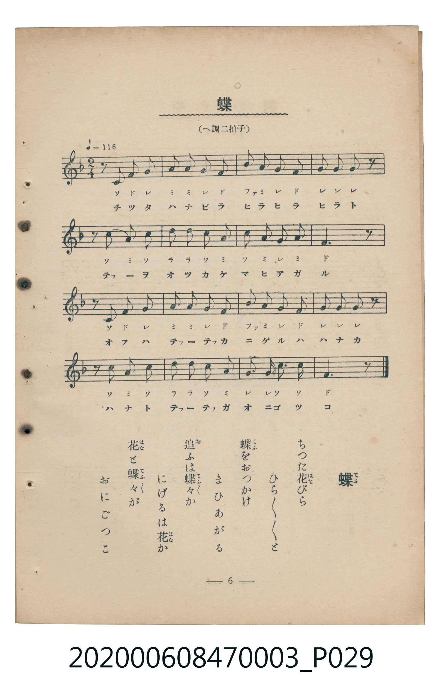

# 蝶

> Re:Shōka 使用 AI 協助辨識與重建樂譜，可能會有錯誤。歡迎回報。

- **鋼琴伴奏版**：<br><audio controls src="cho.mp3"></audio>
- **NEUTRINO 歌聲合成版**：<br><audio controls src="cho_neutrino.mp3"></audio>

- 臺灣教育會公認《新定兒童唱歌》尋常科第三學年用（2020.006.0847.0003）

## 說明

原書資訊與歌詞全文（對應 P029.jpg，書頁 p. 6，第一學期第 5 首）：
調性與拍號：へ調二拍子（F 大調 2/4 拍），速度 != 116


## 歌詞

```text
ちつた花（はな）びら　ひら／＼／＼と
蝶（てふ）をおつかけ　まひあがる
追（お）ふは蝶々（てふ／＼）か　にげるは花（はな）か
花（はな）と蝶々（てふ／＼）が　おにごつこ
```

## ABC

```abc
X:1
T:蝶
M:2/4
L:1/16
Q:1/4=116
K:F
V:V1 name="Piano" snm="Pia"
[V:V1]
z2 C2 F2 G2 | A2 A2 G2 F2 | B2 A2 G2 F2 | G2 G2 G2 z2 |
w: ち つ た | は な び ら | ひ ら ひ ら | ひ ら と
z2 c2 A2 c2 | d2 d2 c2 A2 | c2 A2 G2 A2 | F6 z2 |
w: てふ _ を | お つ か け | ま ひ あ が | る
z2 C2 F2 G2 | A2 A2 G2 F2 | B2 A2 G2 F2 | G2 G2 G2 z2 |
w: お ふ は | てふ _ てふ か | に げ る は | は な か
z2 c2 A2 c2 | d2 d2 c2 A2 | G2 G2 c3 c | F6 z2 |
w: は な と | てふ _ てふ が | お に ご つ | こ
```

## TMD 檔案連結

- [主旋律 TMD 檔案](cho.tmd) [[在 TMD Studio 編輯](https://tmdlang.github.io/Tmd-TS/#tmd=s7IKdvYPcrWy4qpTUCpJTLdSSM7PyUlNLsnMz7MqzsjMK0nNjM_KTMmPL87Iz05Ugisry88pzU21Si9KTEmNN443MjAyiDcwMIs3sDAxBzIMjBFKi_NLi5JTrYqTM_Lzc-JLUitKkvLzsxHyBUX5Zal5iXlANQVFIBtTwIoQClLLMlNSQdKpKZkl-UWZiTlI7kgtKga7FWxJfElRYl5xclFmAcgDCFUlGalAxybmZeYi6wUalZ6ZZ5Wbn5dUCvSeEpeWlsKLudsUtLS4FG0VDA3NuOxtFdy4bIz0TexAml6073reuPjZ1JkvmjY9m9P8tHXNi1W9jxu6nk3b8HTdrKetk56vXvp0ysZna3seN3Q_3dD9dMeO58snPl-z5smOzqdrdzzdueX5lBXv93SAAksPGFh6oMACMgyM3-_pVOLi0tdSsKUW4FJQUHjaN__Z7B0vNre_WNH1oqMd6K4XK-c9bV3xbFo70BVPN_Q-a-9UCDAwstTLKkh_v6cHqPjlgkaFAj0FMyAP7O4GoLufzZkPZCuYKrxcNg3o0Pd7ZoEMf7Fq_7OG5SBju3tfzJwPFH3cuAMo-GRXD1Dk6doJQCvcFJ4uWQ4UUwCGoAJQFKy752XD_Ke7lilAgxhk1uPGhY8blzxunP-iayNQ2-PG9Y8bVwEVP27c_Lip83FDw-PGTUDG-z397_fsgZCPG1eAXTF3G1jDsseNW0EamiY9buwCm9X9uHEiWOc-kObGpseNPY-busF69u8F6-kC27AVaBvQlMcNrUgGQewBynaDjVj9uHESUDNIJboDISaii67AbSIwbQBNBLoRaOgUsEsng4ygPMahQEFLn4vLOSPfKiAzMS_focagphpkvoKNoZmWHZiFLZkpQGL7xcIeBQ0Thacb-p-vb9CBpw1NLBqA1oAMq1EwUNBVMI0HEoZAbATENQrGQBKEQTyQaI2CCYYIiAXDICNqwMb51CiAjAImCDC5BEzOB2sABi-YtwpMbgaRTZ1QmU1wHjIbXWYFkASZXgNOdLjDYVcP2eEA9SaIrlEwA5IgDBOtgbNAnoaIgAIDBrEEAyjxQGWBaRvqpy6ksOkGkxOhMvsQIdDYBCZ7IDJNIHUwSEwY7OgcPGkB4l9QOEDSAMinyAED40BCAyS7GswDhRfE5wh9yGkIJENEWDydPZtW6QHmaZAIiCSYHpCdD0rOuIMCGvHQwIMEyBSooiVgmclIVkGCoZaLS9dOAVh4KAApZS4A)]
- [鋼琴伴奏 TMD 檔案](cho_piano.tmd) [[在 TMD Studio 編輯](https://tmdlang.github.io/Tmd-TS/#tmd=s7IKdvYPcrWy4tLSUngxd9v7PR0vu_c8n7DlyZ4tT5f2P-_seL-nU0FLi0vRVsHQ0IzL3lbBjcvGSN_EjqtOQelF-67njYufTZ35omnTsznNT1vXvFjV-7ih69m0DU_XzXraOun56qVPp2x8trbncUP30w3dT3fseL584vM1a57s6Hy6dsfTnVueT1kBtNLIwMhAz8DATM_AwsQcyDAwBtqqxMXlnJFvFZCZmJcf5OFQY1BTzaUABDaGZlp2YFaNgoGCroJpPJAwBGIjIK5RMAaSIAzigURrFEwwREAsGAYZUQM2zqdGAWTU48aFYHIJmJwP1vC4cT2YtwpMbgaRTZ1QmU1wHjIbXWYFkASZDrEK6nKow0B0jYIZkARhmGgNnAVyJkQE5HwYxOLwZY8bt0JlHzdNgrqiC8k33WByIlRmH8LNjU1gsgci0wRSB4MYrqZ6eENcCHI5JJxBbkP2CowDcT9IdjWYB_IhxK0IfcjxBJIhNcxhzgSJgEiCYY5sISiScTseGrhQ70K8MAWqaAlYZjKSVRCH1yJlAh_kTGACzwOG8QrRhrHIDBMgwwTEMI2PBzoZ5n3s8tGm8VDNWFRSw0igF3TtFIC-UABSylwA)]

## 分析

```text
================================================================================
📊 TMD Song Profile: [ 蝶 ]
================================================================================
⏱  Duration:       0:16 (16.6s), 16 measures total
🎼 Key & Tempo:    首調基準 F, != 116.0 BPM, <2/4>
   - 分析範圍：      由實際發聲的音符與和弦推測調性；播放脈絡另行呈現
🎤 人聲音域:    C4 (MIDI 60) – D5 (MIDI 74) [跨度: 14 個半音 / 1.2 個八度, 難度: moderate]
   - 最低音:  C4 in [Cho #1 @ m.1, 0:00]
   - 最高音: D5 in [Cho #1 @ m.6, 0:05]
   - 適合: soprano, mezzo-soprano, contralto, tenor, baritone, bass
🏛  結構:      Cho (16.6s)
⚡ 編曲密度:        Peak 1 軌道同時演奏
🗝  調性診斷：       F 調性不明確（純淨自然大調，未偵測到可信轉調）
   - 風格氣質:    純淨自然大調（陽光明朗、易唱易記，無明顯調外色彩）
   - 轉調歷程:    全曲維持單一推測調性（未偵測到可信轉調）
   - 核心骨幹音:  G, F, A, C, D
   - 調性數值:    F 調性不明確 [相關度: 0.76, 穩定度: Ambiguous, 自然音純度: 100.0%]
   - 候選調性 (K-S): F 大調 (0.76), C 大調 (0.74), A 小調 (0.56)
   - 五度圈歷程:   -1
   - 各段落調性細節:
     • [Cho #1]: F 調性不明確 (r: 0.76, 自然音純度: 100.0%)

  [ 五度圈游移軌跡 ]
               C  
        [F ]*          G  
      Bb               D  
      Eb               A  
         Ab           E  
            Db       B  
               F# 
     (* = active key center)

  [ 十二半音累積音高分佈 ]
     C  : ██████████████████        19.6%
     C# :                            0.0%
     D  : ██████                     7.1%
     D# :                            0.0%
     E  :                            0.0%
     F  : ███████████████████       21.4%
     F# :                            0.0%
     G  : ████████████████████████  26.8%
     G# :                            0.0%
     A  : ███████████████████       21.4%
     A# : ███                        3.6%
     B  :                            0.0%
--------------------------------------------------------------------------------
Assignment 軌道音域：
  - Piano         : C4 – D5 (14 個半音 / 1.2 個八度, 52 個音符)
================================================================================
```


## 原書掃描頁




