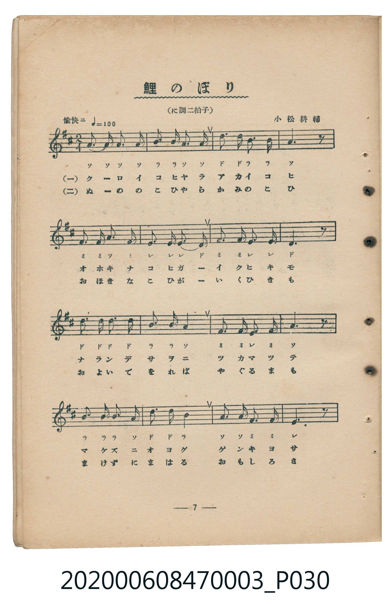
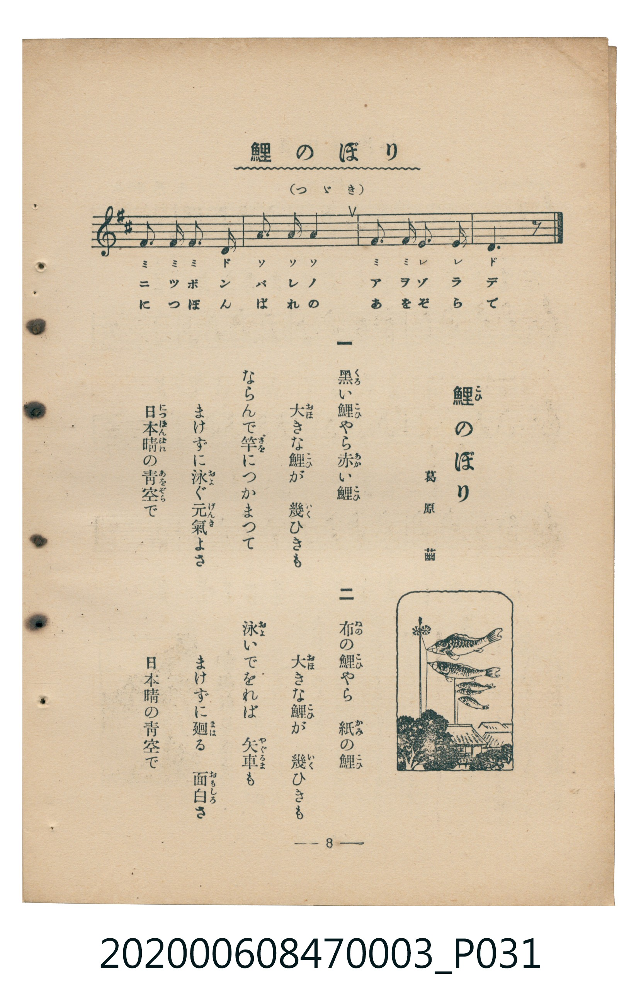

# 鯉のぼり

<audio controls src="koinobori.mp3"></audio>

- 詞：葛原しげる
- 曲：小松耕輔
- 臺灣教育會公認《新定兒童唱歌》尋常科第三學年用（2020.006.0847.0003）

## 說明

原書資訊與歌詞全文（對應 P030.jpg – P031.jpg，書頁 pp. 7–8，第一學期第 6 首）：
調性與拍號：に調二拍子（D 大調 2/4 拍），「愉快ニ」，速度 != 100

## 歌詞

```text
一
黒（くろ）い鯉（こひ）やら赤（あか）い鯉（こひ）
大（おほ）きな鯉（こひ）が　幾（いく）ひきも
ならんで竿（さを）につかまつて
まけずに泳（およ）ぐ元氣（げんき）よさ
日本晴（につぽんばれ）の青空（あをぞら）で

二
布（ぬの）の鯉（こひ）やら　紙（かみ）の鯉（こひ）
大（おほ）きな鯉（こひ）が　幾（いく）ひきも
泳（およ）いでをれば　矢車（やぐるま）も
まけずに廻（まは）る　面白（おもしろ）さ
日本晴（につぽんばれ）の青空（あをぞら）で
```

## ABC

```abc
X:1
T:鯉のぼり
C:曲：小松耕輔
M:2/4
L:1/16
Q:1/4=100
K:D
V:V1 name="Piano" snm="Pia"
[V:V1]
A3 A A2 A2 | B2 B A A4 | d3 d B2 B2 | A6 z2 |
F2 F A F4 | E2 E E D4 | F2 F E E4 | D6 z2 |
d3 d d2 d2 | B2 B2 A4 | F2 F E F4 | A6 z2 |
B2 B B A4 | d3 d B4 | A2 A F F4 | E6 z2 |
F2 F F D4 | A2 A2 A4 | F2 F E E4 | D6 z2 |
```

## TMD 檔案連結

- [主旋律 TMD 檔案](koinobori.tmd) [[在 TMD Studio 編輯](https://tmdlang.github.io/Tmd-TS/#tmd=s7IKdvYPcrWy4qpTUCpJTLdSSM7PyUlNLsnMz7MqzsjMK0nNjM_KTMmPL87Iz05Ugisry88pzU21Si9KTEmNN443MjAyiDcwMIs3sDAxBzIMjBFKi_NLi5JTrYqTM_Lzc-JLUitKkvLzsxHyBUX5Zal5iXlANQVFIBtTwIoQClLLMlNSQdKpKZkl-UWZiTlI7kgtKga7FWxJfElRYl5xclFmAcgDCFUlGalAxybmZeaC9GppKbxc3_m4cd3jxj2Pm7oUtLS4FG0VDA0MuOxtFVy4bIz0TexAWl-snPd-z6wXE2c_7Zv_uHH648ZJj5u6wYY-m70JKPN0Q_-zufteNEx9sWcKWPhF-67njYufTZ35omnTsznNT1vXvFjV-7ih69m0DU_XzXraOun56qVPp2x8trbncUP30w3dT3fseL584vM1a57s6Hy6dsfTnVueT1nxfk8HKDT1gKGpBwpNIMPA-P2eTiUuLn0tBVtqAS4FBQWgv57N3vFic_uLFV0vOtqB7gJ6-WnrimfT2oGueLqh91l7p0KAgbGBXlZBusKjhskgjiGI835PD1DnywWNCgUFegrmQCkLoBDYJw1AnzybMx_IVjBTeLlsGtDpwLACWfdi1f5nDctBFnX3vpg5Hyj6uHE1UPDJrh6gyNO1E4CWuig8XbIcKKYAjAQFoChYNzC4ep61dD7dv_pxc_fjBqBgz8uG-U93LVOAxhvIdKDNIOrl7klAYx439j9uAml-3NgCjGuwyOTHjcBY63zc1PK4qfPF1iVgwabHjd1YlYHDZ8lysFDX48bdYEW9jxtXoRvXCHRdw9Od-8CCLUCLwYKbQIqbmkCmAPUALXzcBNSw_Pnq_WB1Ux83AZ0JVLf6ceMSoBMeN-4DM5ZBNAA5Ex83goLn2ebNUCc0dYA1THja2vxsw2KwIDA9Ag0Fe7MJZChI87PpS5_NWfNs5hawCojxe8HqNjxu6gEbse7l3EnPV-6C-r9p0uPGeUAHgqWWQ4JyVw_Y-zuawWrWALVANWILSqD3n2-ZCRYH-gPoPywqqReaGAECVLQc5ImmHpAXgW6Zv-jF7i6QGqDrGicAsywwPMGOhcYGInCf7gY6BGgWUGQ9WAUwcTW8nLvo-cy9MDuA6WM6LCVRJXyBRlCeeaFAQUufi8s7PzMvPwlYLFoFZCbm5TvUGNQoVIOsUbAxNNOyA7OwFRwKkNz6YmGPgoaJArAse76-QQee2zWxaADaBjKsRsFUQRcITcE0CNcAc7ouEENEQLBGwTAOzABSEDmQGEwWBA1AIuDUhtt1u3rIcZ0x0GRjoF0gGuIWIyBpBISGcBGIGpAY3L0kum1HJzluQ4QKmAUmYKEHCUtU9yH8QGLYPZ09mxz3QVwCikns8YhwCyh8UUOYpJidguk6cMVCRMwaI8UjLAVihhy-mK3l4tK1U4BnHAUgR5mLCwA)]
- [鋼琴伴奏 TMD 檔案](koinobori_piano.tmd) [[在 TMD Studio 編輯](https://tmdlang.github.io/Tmd-TS/#tmd=s7IKdvYPcrWy4tLSUni5vvNx47rHjXseN3W939PxsnvP8wlbnuzZ8nRp__POjvd7OhW0tLgUbRUMDQy47G0VXLhsjPRN7LjqFJRerJz3fs-sFxNnP-2b_7hx-uPGSY-bupVAMs9mbwLKPN3Q_2zuvhcNU1_smQIWftG-63nj4mdTZ75o2vRsTvPT1jUvVvU-buh6Nm3D03WznrZOer566dMpG5-t7Xnc0P10Q_fTHTueL5_4fM2aJzs6n67d8XTnludTVgDdaGRgZKBnYGCmZ2BhYg5kGBgDnanExeWdn5mXn5RflGkVkJmYlx_k4VBjUKNQzaUABDaGZlp2YFaNgqmCLhCagmkQrlEwA5JmUBEQrFEwjAMzgBREDiQGkwVBA5AI1DxjINsYKAuiIbqNgKQREBrCRSBqQGJwG3CYhrAZzAITMBdC3ItqIsJWXO6D6AX5D7vvELpBfkD1BW7_GiP5DhaSmK7D599ajCjzQYkyE3iMGcYrRBvGAhkmyAwTEMM0Ph5oHDzwYPIgYSSWaTyICZTFohRuJopmhEJMO3EoRLUcYiWq7WBpkL917RTgXldA5yhzcQEA)]

## 分析

```text
================================================================================
📊 TMD Song Profile: [ 鯉のぼり ]
================================================================================
⏱  Duration:       0:24 (24.0s), 20 measures total
🎼 Key & Tempo:    首調基準 D, != 100.0 BPM, <2/4>
   - 分析範圍：      由實際發聲的音符與和弦推測調性；播放脈絡另行呈現
🎤 人聲音域:    D4 (MIDI 62) – D5 (MIDI 74) [跨度: 12 個半音 / 1.0 個八度, 難度: easy]
   - 最低音:  D4 in [Koinobori #1 @ m.6, 0:06]
   - 最高音: D5 in [Koinobori #1 @ m.3, 0:02]
   - 適合: soprano, mezzo-soprano, contralto, tenor, baritone, bass
🏛  結構:      Koinobori (24.0s)
⚡ 編曲密度:        Peak 1 軌道同時演奏
🗝  調性診斷：       D 大調（純淨自然大調，未偵測到可信轉調）
   - 風格氣質:    純淨自然大調（陽光明朗、易唱易記，無明顯調外色彩）
   - 轉調歷程:    全曲維持單一推測調性（未偵測到可信轉調）
   - 核心骨幹音:  A, D, F#, E, B
   - 調性數值:    D 大調 [相關度: 0.86, 穩定度: Moderate, 自然音純度: 100.0%]
   - 候選調性 (K-S): D 大調 (0.86), A 大調 (0.79), F# 小調 (0.67)
   - 五度圈歷程:   +2
   - 各段落調性細節:
     • [Koinobori #1]: D 大調 (r: 0.86, 自然音純度: 100.0%)

  [ 五度圈游移軌跡 ]
               C  
         F            G  
      Bb              [D ]*
      Eb               A  
         Ab           E  
            Db       B  
               F# 
     (* = active key center)

  [ 十二半音累積音高分佈 ]
     C  :                            0.0%
     C# :                            0.0%
     D  : ███████████████████       24.0%
     D# :                            0.0%
     E  : ███████████               14.0%
     F  :                            0.0%
     F# : ███████████████           19.3%
     G  :                            0.0%
     G# :                            0.0%
     A  : ████████████████████████  30.0%
     A# :                            0.0%
     B  : ██████████                12.7%
--------------------------------------------------------------------------------
Assignment 軌道音域：
  - Piano         : D4 – D5 (12 個半音 / 1.0 個八度, 62 個音符)
================================================================================
```


## 原書掃描頁






