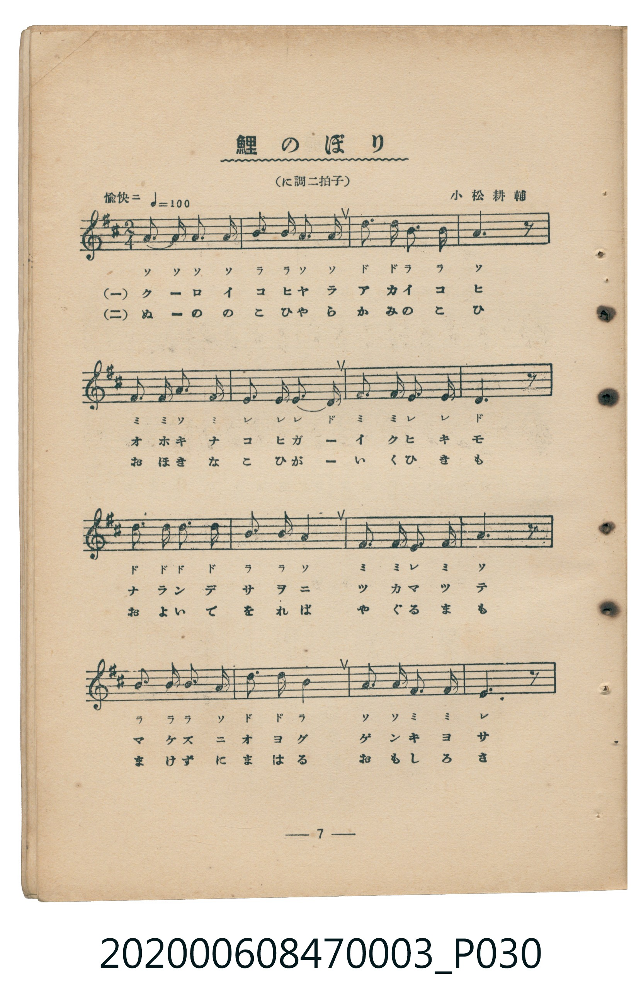
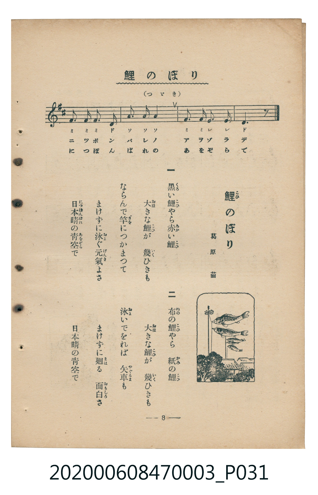

# 鯉のぼり

> Re:Shōka 使用 AI 協助辨識與重建樂譜，可能會有錯誤。歡迎回報。

- **鋼琴伴奏版**：<br><audio controls src="koinobori.mp3"></audio>
- **NEUTRINO 歌聲合成版**：<br><audio controls src="koinobori_neutrino.mp3"></audio>

- 詞：葛原しげる
- 曲：小松耕輔
- 臺灣教育會公認《新定兒童唱歌》尋常科第三學年用（2020.006.0847.0003）

## 說明

原書資訊與歌詞全文（對應 P030.jpg – P031.jpg，書頁 pp. 7–8，第一學期第 6 首）：
調性與拍號：に調二拍子（D 大調 2/4 拍），「愉快ニ」，速度 != 100


## 歌詞

```text
一
黒（くろ）い鯉（こひ）やら赤（あか）い鯉（こひ）
大（おほ）きな鯉（こひ）が　幾（いく）ひきも
ならんで竿（さを）につかまつて
まけずに泳（およ）ぐ元氣（げんき）よさ
日本晴（につぽんばれ）の青空（あをぞら）で

二
布（ぬの）の鯉（こひ）やら　紙（かみ）の鯉（こひ）
大（おほ）きな鯉（こひ）が　幾（いく）ひきも
泳（およ）いでをれば　矢車（やぐるま）も
まけずに廻（まは）る　面白（おもしろ）さ
日本晴（につぽんばれ）の青空（あをぞら）で
```

## ABC

<div class="abc-score" data-abc-src="koinobori.abc" aria-label="五線譜載入中"></div>

[下載 ABC 原始檔](koinobori.abc)

## TMD 檔案連結

- [主旋律 TMD 檔案](koinobori.tmd) [[在 TMD Studio 編輯](https://tmdlang.github.io/Tmd-TS/#tmd=s7IKdvYPcrWy4qpTUCpJTLdSSM7PyUlNLsnMz7MqzsjMK0nNjM_KTMmPL87Iz05Ugisry88pzU21Si9KTEmNN443MjAyiDcwMIs3sDAxBzIMjBFKi_NLi5JTrYqTM_Lzc-JLUitKkvLzsxHyBUX5Zal5iXlANQVFIBtTwIoQClLLMlNSQdKpKZkl-UWZiTlI7kgtKga7FWxJfElRYl5xclFmAcgDCFUlGalAxybmZeYi6wUalZ6ZZ1WSmAn0HMiD5YnxuYmZeTmJeSlKXFpaCi_Xdz5uXPe4cc_jpi4FLS0uRVsFQwMDLntbBRcuGyN9EzuQUS9Wznu_Z9aLibOf9s1_3Dj9ceOkx03dYEuezd4ElHm6of_Z3H0vGqa-2DMFLPyifdfzxsXPps580bTp2Zzmp61rXqzqfdzQ9WzahqfrZj1tnfR89dKnUzY-W9vzuKH76Ybupzt2PF8-8fmaNU92dD5du-Ppzi3Pp6x4v6cDFOZ6wDDXA4U5kGFg_H5PpxIXl76Wgi21AJeCggLQX89m73ixuf3Fiq4XHe1AdwG9_LR1xbNp7UBXPN3Q-6y9UyHAwNhAL6sgXeFRw2QQxxDEeb-nB6jz5YJGhYICPQVzoJQFUAjskwagT57NmQ9kK5gpvFw2Deh0YFiBrHuxav-zhuUgi7p7X8ycDxR93LgaKPhkVw9Q5OnaCUBLXRSeLlkOFFMARoICUBSsGxhcPc9aOp_uX_24uftxA1Cw52XD_Ke7lilA4w1kOtBmEPVy9ySgMY8b-x83gTQ_bmwBxjVYZPLjRmCsdT5uannc1Pli6xKwYNPjxm6sysDhs2Q5WKjrceNusKLex42r0I1rBLqu4enOfWDBFqDFYMFNIMVNTSBTgHqAFj5uAmpY_nz1frC6qY-bgM4Eqlv9uHEJ0AmPG_eBGcsgGoCciY8bQcHzbPNmqBOaOsAaJjxtbX62YTFYEJgegYaCvdkEMhSk-dn0pc_mrHk2cwtYBcT4vWB1Gx439YCNWPdy7qTnK3dB_d806XHjPKADwVLLIUG5qwfs_R3NYDVrgFqgGrEFJdD7z7fMBIsD_QH0HxaV1AtNjAABKloO8kRTD8iLQLfMX_RidxdIDdB1jROAWRYYnmDHQmMDEbhPdwMdAjQLKLIerAKYuBpezl30fOZemB3A9DEdlpKoEr5AIyjPvFCgoKXPxeWdn5mXnwQs8awCMhPz8h1qDGqqQbYo2BiaadmBWdjKDQVIZn2xsEdBw0QBWJQ9X9-gA8_smlg0AC0DGVajYKqgC4SmYBqEa4AZHSRiBpepUTCMAzOBFEwOpg8CDUD6wOb5GNYAI6UfKg4MaxDZ2AI2F5guIKKNm4AyIDGQik6wTBNUphuqGsSeDJbZhGRPPMIeI5DcGpg9jevgJH57uqEy-6Gq8dmDP7R39ZAT2sZg842hoWcMFDECs4ygtCGSGpgMMPzxhHUX1Be7gRgU2iD2KvRQaOyB6gaJw8K3H-5rkE6gTBMkFrCHNW3tIZCyO8kJa0SqBbPABHrqBomghjcoTvCl7VUQnwDTE7CcAPtpOdS_U6Eyk4Ds1UjhsATqd1Da3gdlLwHLLCMc3k0d0JCE2wM0HyLTAxTbgLAHltIbJwDZsHS-j5zwfjp7NjnhDQtZCI2t3AC5E1aqwEIdlgOwhzYsvCYC8SwoezU47JDDZwJSaMNCZzIinQLVIOIHe2jjtgcmsx4eqhB7YPY3AdnToWxw6sZiD4GSZApmaIPbZUSVJBAaVG4gl-QQV5JWkkDSLChtAitBeCiCZCCpDJLiIKUmJAygpTY4xc-DsiHlLCit4gpr2tpTy8Wla6cAr0cVgBxlLgA)]
- [鋼琴伴奏 TMD 檔案](koinobori_piano.tmd) [[在 TMD Studio 編輯](https://tmdlang.github.io/Tmd-TS/#tmd=s7IKdvYPcrWy4tLSUni5vvNx47rHjXseN3W939PxsnvP8wlbnuzZ8nRp__POjvd7OhW0tLgUbRUMDQy47G0VXLhsjPRN7LjqFJRerJz3fs-sFxNnP-2b_7hx-uPGSY-bupVAMs9mbwLKPN3Q_2zuvhcNU1_smQIWftG-63nj4mdTZ75o2vRsTvPT1jUvVvU-buh6Nm3D03WznrZOer566dMpG5-t7Xnc0P10Q_fTHTueL5_4fM2aJzs6n67d8XTnludTVgDdaGRgZKBnYGCmZ2BhYg5kGBgDnanExeWdn5mXn5RflGkVkJmYlx_k4VBjUFPNpQAENoZmWnZglr6Wgi06UADb0fBiYY-ChokC0N3P1zfoKAQYGBvoZRWka2LRoKUPNqxGwVRBFwhNwTQI1yiYgUXM4DI1CoZxYCaQgsnB9EGgAUgf2DwfwxqFx439UPHHTb0gsrEFbO7jxskQ0cZNQBmQGEhFJ1imCSrTDVUNYk8Gy2xCsiceYY8RSG4NzJ7GdXASvz3dUJn9UNX47MEf2rt6yAltY7D5xtDQMwaKGIFZRlDaEEkNTAYY_njCugvqi91ADAptEHsVeig09kB1g8Rh4dsP9zVIJ1CmCRIL2MOatvYQSNmd5IQ1ItWCWWACPXWDRFDDGxQn-NL2KohPgOnpcRPI548bl0P9OxUqMwnIXo0UDkugfgel7X1Q9hKwzDLC4d3UAQ1JuD1A8yEyPUCxDQh7YCm9cQKQDUvn-8gJ76ezZ5MT3rCQhdDYyg2QO2GlCizUYTkAe2jDwmsiEM-CsleDww45fCYghTYsdCYj0ilQDSJ-sIc2bntgMuvhoQqxB2Z_E5A9HcoGp24s9hAoSaZghrYh0SUJhAaVG8glOcSVpJUkkDQLSpuPG_fCQxEkA0llkBQHKTUhYQAttcEpfh6UDSlnQWkVV1jT1p5ajGrUB7kaNYHWosCgiFeINowFMkyQGSYghml8PDB0IG5GUggSRmKZxoOYQFksSuFmomhGKMS0E4dCVMshVqLaDpYGeVvXTgHu82gfoCiqgBFYQJkLAA)]

## 分析

```text
================================================================================
📊 TMD Song Profile: [ 鯉のぼり ]
================================================================================
⏱  Duration:       0:24 (24.0s), 20 measures total
🎼 Key & Tempo:    首調基準 D, != 100.0 BPM, <2/4>
   - 分析範圍：      由實際發聲的音符與和弦推測調性；播放脈絡另行呈現
🎤 人聲音域:    D4 (MIDI 62) – D5 (MIDI 74) [跨度: 12 個半音 / 1.0 個八度, 難度: easy]
   - 最低音:  D4 in [Koinobori #1 @ m.6, 0:07]
   - 最高音: D5 in [Koinobori #1 @ m.3, 0:02]
   - 適合: soprano, mezzo-soprano, contralto, tenor, baritone, bass
🏛  結構:      Koinobori (24.0s)
⚡ 編曲密度:        Peak 1 軌道同時演奏
🗝  調性診斷：       D 調性不明確（純淨自然大調，未偵測到可信轉調）
   - 風格氣質:    純淨自然大調（陽光明朗、易唱易記，無明顯調外色彩）
   - 轉調歷程:    全曲維持單一推測調性（未偵測到可信轉調）
   - 核心骨幹音:  A, D, F#, E, B
   - 調性數值:    D 調性不明確 [相關度: 0.81, 穩定度: Ambiguous, 自然音純度: 100.0%]
   - 候選調性 (K-S): D 大調 (0.81), A 大調 (0.81), F# 小調 (0.67)
   - 五度圈歷程:   +2
   - 各段落調性細節:
     • [Koinobori #1]: D 調性不明確 (r: 0.81, 自然音純度: 100.0%)

  [ 五度圈游移軌跡 ]
               C  
         F            G  
      Bb              [D ]*
      Eb               A  
         Ab           E  
            Db       B  
               F# 
     (* = active key center)

  [ 十二半音累積音高分佈 ]
     C  :                            0.0%
     C# :                            0.0%
     D  : ████████████████          20.0%
     D# :                            0.0%
     E  : █████████████             16.0%
     F  :                            0.0%
     F# : ████████████████          19.3%
     G  :                            0.0%
     G# :                            0.0%
     A  : ████████████████████████  29.3%
     A# :                            0.0%
     B  : █████████████             15.3%
--------------------------------------------------------------------------------
Assignment 軌道音域：
  - Piano         : D4 – D5 (12 個半音 / 1.0 個八度, 62 個音符)
================================================================================
```


## 原書掃描頁






