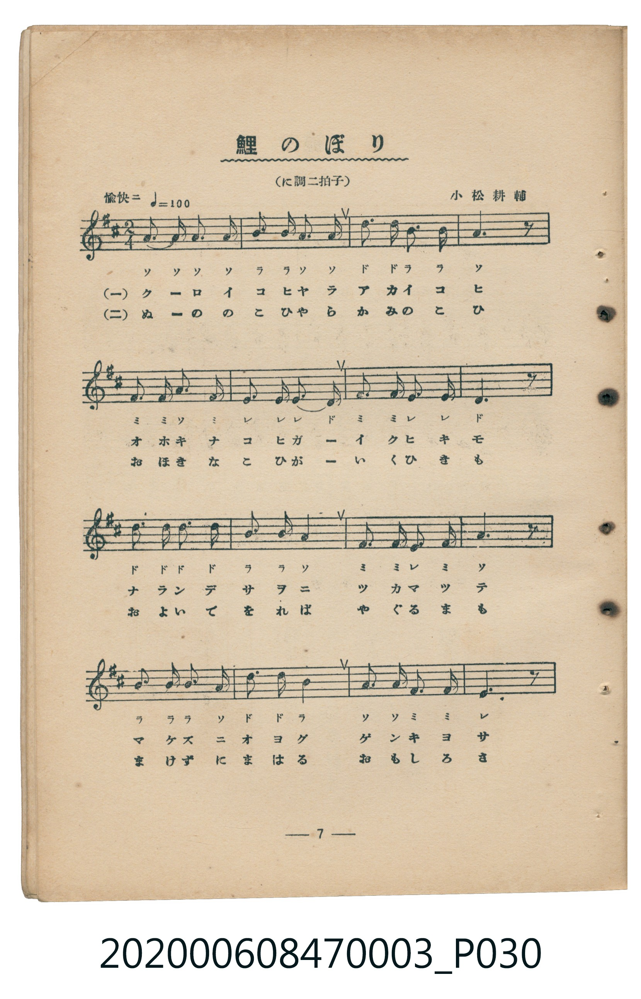
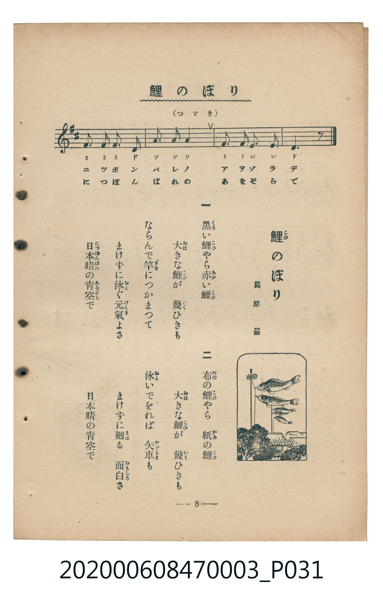

# 鯉のぼり

> Re:Shōka 使用 AI 協助辨識與重建樂譜，可能會有錯誤。歡迎回報。

- **鋼琴伴奏版**：<br><audio controls src="koinobori.mp3"></audio>
- **NEUTRINO 歌聲合成版**：<br><audio controls src="koinobori_neutrino.mp3"></audio>

- 詞：葛原しげる
- 曲：小松耕輔
- 臺灣教育會公認《新定兒童唱歌》尋常科第三學年用（2020.006.0847.0003）

## 說明

原書資訊與歌詞全文（對應 P030.jpg – P031.jpg，書頁 pp. 7–8，第一學期第 6 首）：
調性與拍號：に調二拍子（D 大調 2/4 拍），「愉快ニ」，速度 != 100


## 歌詞

```text
一
黒（くろ）い鯉（こひ）やら赤（あか）い鯉（こひ）
大（おほ）きな鯉（こひ）が　幾（いく）ひきも
ならんで竿（さを）につかまつて
まけずに泳（およ）ぐ元氣（げんき）よさ
日本晴（につぽんばれ）の青空（あをぞら）で

二
布（ぬの）の鯉（こひ）やら　紙（かみ）の鯉（こひ）
大（おほ）きな鯉（こひ）が　幾（いく）ひきも
泳（およ）いでをれば　矢車（やぐるま）も
まけずに廻（まは）る　面白（おもしろ）さ
日本晴（につぽんばれ）の青空（あをぞら）で
```

## ABC

<div class="abc-score" data-abc-src="koinobori.abc" aria-label="五線譜載入中"></div>

[下載 ABC 原始檔](koinobori.abc)

## TMD 檔案連結

- [主旋律 TMD 檔案](koinobori.tmd) [[在 TMD Studio 編輯](https://tmdlang.github.io/Tmd-TS/#tmd=s7IKdvYPcrWy4qpTUCpJTLdSSM7PyUlNLsnMz7MqzsjMK0nNjM_KTMmPL87Iz05Ugisry88pzU21Si9KTEmNN443MjAyiDcwMIs3sDAxBzIMjBFKi_NLi5JTrYqTM_Lzc-JLUitKkvLzsxHyBUX5Zal5iXlANQVFIBtTwIoQClLLMlNSQdKpKZkl-UWZiTlI7kgtKga7FWxJfElRYl5xclFmAcgDCFUlGalAxybmZeYi6wUalZ6ZZ1WSmAn0HMiD5YnxuYmZeTmJeSnIqkoy8oH-LMiotMrILAY5IDkxJz47MQ8pOKDWFySmp1oFGBgb6AIJQyUuLS2Fl-s7Hzeue9y453FTl4KWFpeirYKhgQGXva2CC5eNkb6JHciMFyvnvd8z68XE2U_75j9unP64cdLjpm6w6c9mbwLKPN3Q_2zuvhcNU1_smQIWftG-63nj4mdTZ75o2vRsTvPT1jUvVvU-buh6Nm3D03WznrZOer566dMpG5-t7Xnc0P10Q_fTHTueL5_4fM2aJzs6n67d8XTnludTVrzf0wGKNz1gvOmB4g3IMDB-v6dTiYtLX0vBllqAS0FBAeivZ7N3vNjc_mJF14uOdqC7gF5-2rri2bR2oCuebuh91t6pAAo4vayCdIVHDZNBHEMQ5_2eHqDOlwsaFQoK9BTMgVIWQCGwTxqAPnk2Zz6QrWCm8HLZNKDTgWEFsu7Fqv3PGpaDLOrufTFzPlD0ceNqoOCTXT1AkadrJwAtdVF4umQ5UEwBGAkKQFGwbmBw9Txr6Xy6f_Xj5u7HDUDBnpcN85_uWqYAjTeQ6UCbQdTL3ZOAxjxu7H_cBNL8uLEFGNdgkcmPG4Gx1vm4qeVxU-eLrUvAgk2PG7uxKgOHz5LlYKGux427wYp6HzeuQjeuEei6hqc794EFW4AWgwU3gRQ3NYFMAeoBWvi4Cahh-fPV-8Hqpj5uAjoTqG7148YlQCc8btwHZiyDaAByJj5uBAXPs82boU5o6gBrmPC0tfnZhsVgQWB6BBoK9mYTyFCQ5mfTlz6bs-bZzC1gFRDj94LVbXjc1AM2Yt3LuZOer9wF9X_TpMeN84AOBEsthwTlrh6w93c0g9WsAWqBasQWlEDvP98yEywO9AfQf1hUUi80MQIEqGg5yBNNPSAvAt0yf9GL3V0gNUDXNU4AZllgeIIdC40NROA-3Q10CNAsoMh6sApg4mp4OXfR85l7YXYA08d0WEqiSvgCjaA880KBgpY-F5d3fmZefhKw_LMKyEzMy3eoMaipBtmiYGNopmUHZmErNxQgmfXFwh4FDRMFYFH2fH2DDjyza2LRALQMZFiNgqmCLhCagmkQrgFmdJCIGVymRsEwDswEUjA5mD4INADpA5vnY1gDjJR-qDgwrEFkYwvYXGC6gIg2bgLKgMRAKjrBMk1QmW6oahB7MlhmE5I98Qh7jEBya2D2NK6Dk_jt6YbK7IeqxmcP_tDe1UNOaBuDzTeGhp4xUMQIzDKC0oZIamAywPDHE9ZdUF_sBmJQaIPYq9BDobEHqhskDgvffrivQTqBMk2QWMAe1rS1h0DK7iQnrBGpFswCE-ipGySCGt6gOMGXtldBfAJMT8ByAuyn5VD_ToXKTAKyVyOFwxKo30Fpex-UvQQss4xweDd1QEMSbg_QfIhMD1BsA8IeWEpvnABkw9L5PnLC--ns2eSENyxkITS2cgPkTlipAgt1WA7AHtqw8JoIxLOg7NXgsEMOnwlIoQ0LncmIdApUg4gf7KGN2x6YzHp4qELsgdnfBGRPh7LBqRuLPQRKkimYoQ1ulxFVkkBoULmBXJJDXElaSQJJs6C0CawE4aEIkoGkMkiKg5SakDCAltrgFD8PyoaUs6C0iiusaWtPLReXrp0CvB5VAHKUuQA)]
- [鋼琴伴奏 TMD 檔案](koinobori_piano.tmd) [[在 TMD Studio 編輯](https://tmdlang.github.io/Tmd-TS/#tmd=s7IKdvYPcrWy4qpTUCpJTLdSyC8qychPL0osyKi0ysgsLskvykxOzInPTsxLVIIrKs4vLUpOjS9ITE-1CjAwNtAFEoZKXFpaCi_Xdz5uXPe4cc_jpq73ezpedu95PmHLkz1bni7tf97Z8X5Pp4KWFpeirYKhgQGXva2CC5eNkb6JHcjgFyvnvd8z68XE2U_75j9unP64cdLjpm6wlc9mbwLKPN3Q_2zuvhcNU1_smQIWftG-63nj4mdTZ75o2vRsTvPT1jUvVvU-buh6Nm3D03WznrZOer566dMpG5-t7Xnc0P10Q_fTHTueL5_4fM2aJzs6n67d8XTnludTVgDdaGRgZKBnYGCmZ2BhYg5kGBgDnanExeWdn5mXnwT0v1VAZmJefpCHQ41BTTWXAhDYGJpp2YFZ-loKtuhAAWxHw4uFPQoaJgpAdz9f36CjAAonvayCdE0sGrT0wYbVKJgq6AKhKZgG4RoFM7CIGVymRsEwDswEUjA5mD4INADpA5vnY1ij8LixHyr-uKkXRDa2gM193DgZItq4CSgDEgOp6ATLNEFluqGqQezJYJlNSPbEI-wxAsmtgdnTuA5O4renGyqzH6oanz34Q3tXDzmhbQw23xgaesZAESMwywhKGyKpgckAwx9PWHdBfbEbiEGhDWKvQg-Fxh6obpA4LHz74b4G6QTKNEFiAXtY09YeAim7k5ywRqRaMAtMoKdukAhqeIPiBF_aXgXxCTA9PW4C-fxx43Kof6dCZSYB2auRwmEJ1O-gtL0Pyl4ClllGOLybOqAhCbcHaD5EpgcotgFhDyylN04AsmHpfB854f109mxywhsWshAaW7kBciesVIGFOiwHYA9tWHhNBOJZUPZqcNghh88EpNCGhc5kRDoFqkHED_bQxm0PTGY9PFQh9sDsbwKyp0PZ4NSNxR4CJckUzNA2JLokgdCgcgO5JIe4krSSBJJmQWnzceNeeCiCZCCpDJLiIKUmJAygpTY4xc-DsiHlLCit4gpr2tpTi1GN-iBXoybQWhQYFPEK0YaxQIYJMsMExDCNjweGDsTNSApBwkgs03gQEyiLRSncTBTNCIWYduJQiGo5xEpU28HSIG_r2inAfR7tAxRFFTACCyhzAQA)]

## 分析

```text
================================================================================
📊 TMD Song Profile: [ 鯉のぼり ]
================================================================================
⏱  Duration:       0:24 (24.0s), 20 measures total
🎼 Key & Tempo:    首調基準 D, != 100.0 BPM, <2/4>
   - 分析範圍：      由實際發聲的音符與和弦推測調性；播放脈絡另行呈現
🎤 人聲音域:    D4 (MIDI 62) – D5 (MIDI 74) [跨度: 12 個半音 / 1.0 個八度, 難度: easy]
   - 最低音:  D4 in [Koinobori #1 @ m.6, 0:07]
   - 最高音: D5 in [Koinobori #1 @ m.3, 0:02]
   - 適合: soprano, mezzo-soprano, contralto, tenor, baritone, bass
🏛  結構:      Koinobori (24.0s)
⚡ 編曲密度:        Peak 1 軌道同時演奏
🗝  調性診斷：       D 調性不明確（純淨自然大調，未偵測到可信轉調）
   - 風格氣質:    純淨自然大調（陽光明朗、易唱易記，無明顯調外色彩）
   - 轉調歷程:    全曲維持單一推測調性（未偵測到可信轉調）
   - 核心骨幹音:  A, D, F#, E, B
   - 調性數值:    D 調性不明確 [相關度: 0.81, 穩定度: Ambiguous, 自然音純度: 100.0%]
   - 候選調性 (K-S): D 大調 (0.81), A 大調 (0.81), F# 小調 (0.67)
   - 五度圈歷程:   +2
   - 各段落調性細節:
     • [Koinobori #1]: D 調性不明確 (r: 0.81, 自然音純度: 100.0%)

  [ 五度圈游移軌跡 ]
               C  
         F            G  
      Bb              [D ]*
      Eb               A  
         Ab           E  
            Db       B  
               F# 
     (* = active key center)

  [ 十二半音累積音高分佈 ]
     C  :                            0.0%
     C# :                            0.0%
     D  : ████████████████          20.0%
     D# :                            0.0%
     E  : █████████████             16.0%
     F  :                            0.0%
     F# : ████████████████          19.3%
     G  :                            0.0%
     G# :                            0.0%
     A  : ████████████████████████  29.3%
     A# :                            0.0%
     B  : █████████████             15.3%
--------------------------------------------------------------------------------
Assignment 軌道音域：
  - Piano         : D4 – D5 (12 個半音 / 1.0 個八度, 62 個音符)
================================================================================
```


## 原書掃描頁






