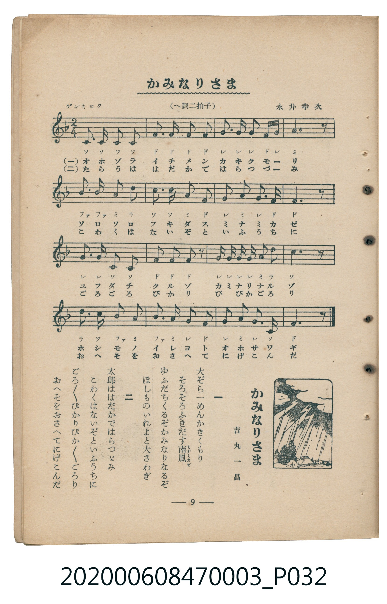

# かみなりさま

> Re:Shōka 使用 AI 協助辨識與重建樂譜，可能會有錯誤。歡迎回報。

- **NEUTRINO 歌聲合成版**：<br><audio controls src="kaminarisama_neutrino.mp3"></audio>
- **鋼琴伴奏版**：<br><audio controls src="kaminarisama.mp3"></audio>


- 詞：吉丸一昌
- 曲：永井幸次
- 臺灣教育會公認《新定兒童唱歌》尋常科第三學年用（2020.006.0847.0003）

## 說明

原書資訊與歌詞全文（對應 P032.jpg，書頁 p. 9，第一學期第 7 首）：
調性與拍號：へ調二拍子（F 大調 2/4 拍），「ゲンキヨク」


## 歌詞

```text
一
大ぞら一めんかきくもり
そろそろふきだす南風（ミナミカゼ）
ゆふだちくるぞかみなりなるぞ
ほしものいれよと大さわぎ

二
太郎ははだかではらつゞみ
こわくはないぞといふうちに
ごろ／＼ぴかりぴか／＼ごろり
おへそをおさへてにげこんだ
```

## ABC

```abc
X:1
T:かみなりさま
C:曲：永井幸次
M:2/4
L:1/16
Q:1/4=112
K:F
V:V1 name="Piano" snm="Pia"
[V:V1]
C2 C2 C2 C2 | F3 F F2 F2 | G3 G G2 F G | A6 z2 |
w: 1.~お ほ ぞ ら | い ち め ん | か き く も _ | り
w: 2.~た ら う は | は だ か で | は ら つ づ _ | み
B2 B2 A2 d2 | c2 c2 A2 F2 | G3 A G2 F2 | F6 z2 |
w: 1.~そ ろ そ ろ | ふ き だ す | み な み か | ぜ
w: 2.~こ わ く は | な い ぞ と | い ふ う ち | に
G3 G C2 C2 | F2 F2 F2 z2 | G G G G A2 d2 | c6 z2 |
w: 1.~ゆ ふ だ ち | く る ぞ | か み な り な る | ぞ
w: 2.~ご ろ ご ろ | ぴ か り | ぴ か ぴ か ご ろ | り
d3 c B2 A2 | B3 A G2 F2 | G2 A2 G3 C | F6 z2 |
w: 1.~ほ し も の | い れ よ と | お ほ さ わ | ぎ
w: 2.~お へ そ を | お さ へ て | に げ こ ん | だ
```

## TMD 檔案連結

- [主旋律 TMD 檔案](kaminarisama.tmd) [[在 TMD Studio 編輯](https://tmdlang.github.io/Tmd-TS/#tmd=s7IKdvYPcrWy4qpTUCpJTLdSSM7PyUlNLsnMz7MqzsjMK0nNjM_KTMmPL87Iz05Ugisry88pzU21Si9KTEmNN443MjAyiDcwMIs3sDAxBzIMjBFKi_NLi5JTrYqTM_Lzc-JLUitKkvLzsxHyBUX5Zal5iXlANQVFIBtTwIoQClLLMlNSQdKpKZkl-UWZiTlI7kgtKga7FWxJfElRYl5xclFmAcgDCFUlGalAx5anJgIZRUpcWloKjxu7Hzfuf9y46nFT1-PGqY8b9yloaXEp2ioYGhpx2dsquHHZGOmb2IFMeLFy3vs9s55O6HyyY8eTHQ3PZvSADX42exNQ-NmGHU92TX26c8ezNQvBwi_adz1vXPxs6swXTZuezWl-2rrmxarexw1dz6ZteLpu1tPWSc9XL306ZeOztT2PG7qfbuh-umPH8-UTn69Z82RH59O1O57u3PJ8yor3ezpAIaoHDFE9UIgCGQbG7_d0KnFx6Wsp2FILcCkoKDztm_9s9o4Xm9tfrOh60dEOdBfQv09bVzyb1g50xdMNvc_aOxUCDIyN9LIK0t_v6QEqfrmgUaFAT8ESyAO7uwHo7mdz5gPZCuYKL5dNAzoUGDIgw1-s2v-sYTnI2O7eFzPnA0UfN-4ACj7Z1QMUebp2AtAKN4WnS5YDxRSA4a0AFAXrBgZOz-OmTY-bNz9uWvu4ecXjpvWPG3q5QGYC7QO7e8nyx43zHjcBY6XhcVPj46bJ4CjtfdzY_7ipCRirIEWPG-c-bgIKQcitYOkFjxtnPu2d_nIRKJQfN89_3NwFIptWP27aA7QbrK2pDawaqHQh2DygwfNQUwyQBAlCLNn9uHE6yNLGdY8bWx43AV3e8bhxBdiFUx839T9u7IO4fFcPxOWrXjb3PW5cD0ZAO4AGAVWuB_rlceOSx01Am_ZDzJ0M1gxEQHWrQEaDXLECzAC6DuhGoOtWQ5ROAfrw_Z7-93v2PG7cAjIS5EgQAyYIUgAPFaDcDnCoTAKzgckfyF0GNOxxI1AEaC0wMBeAlFKexqBAQUufi8s7MTczL7EoszgxN9EqIDMxL9-hxqCmGmSRgo2hmZYdmIUthStAEtqLhT0KGiYKTzf0P1_foANPlppYNADtAxlWo2Aar6CLTtQoGAJJXSAJokG4RsEILGIEpg2BZI2CMVgEAg1AasAm-hjWgEIQyAdGPJicByKbOsGmACMHrB4YN0CxRrDMZKhMN1SmF4j7wTJNEJkmkGkwCHYfxCYjkK75cNOBUQ4m10PNA9Eg_gKo2cBkhCoD1AVMUWCZpVCZ_Rg24Q_zXT3khLkJ0GQQBoWgGdhmU1DQQ0WQw9sYGt6IOMEe3nPB_ukF-wXBBslshYYpJCRA5EwUvwKzDpQNCSWQzBw84Q2KLWC-A6uHkLDwXgXmgeIXGueNK6AysDjfCo-jhVCZ1SSG945OcsIblnbRUzgMg0MTnLZBEDVWcIR4E8gfMD9BwhXmJ0jahaQ4UDhA7AOFLiicweENTNHQ8AKrA8mCVOIK8ykQu4BxCmEjYncLPN4guQRm1xaofTAaRReW_IQ31J_Onk1OqIPCEJSqYSkdku5R0zSIBZKDxBAwavAnc1CBAvLwdGjhAKxSoB6GJrGmHiDuAMvAEh9yUTQVqqofLNOHJ8ghQQQs-OEZahKSeRCzQLIg1jKoDCgxA2sIMAnKJpDCDSQDSiCoNtVycenaKSCX-ApAvjIXAA)]
- [鋼琴伴奏 TMD 檔案](kaminarisama_piano.tmd) [[在 TMD Studio 編輯](https://tmdlang.github.io/Tmd-TS/#tmd=s7IKdvYPcrWy4tLSUnjc2P24cf_jxlWPm7oeN0593Ljv_Z6Ol917nk_Y8mTPlqdL-593drzf06mgpcWlaKtgaGjEZW-r4MZlY6RvYsdVp6D0YuW893tmPZ3Q-WTHjic7Gp7N6FECCT-bvQko_GzDjie7pj7duePZmoVg4Rftu543Ln42deaLpk3P5jQ_bV3zYlXv44auZ9M2PF0362nrpOerlz6dsvHZ2p7HDd1PN3Q_3bHj-fKJz9esebKj8-naHU93bnk-ZQXQgUYGRgZ6BgZmegYWJuZAhoEx0I1KXFzeibmZeYlFmcWJuYlWAZmJeflBHg41BjXVXApAYGNopmUHZtUomMYr6KITNQqGQFIXSIJoEK5RMAKLGIFpQyBZo2AMFoFAA5AasIk-hjXAsOwC8h837gaT80BkUyfYlMeNLWD1jxsXAsUawTKToTLdUJleIO4HyzRBZJpApsEg2H0Qm4xAuubDTX_c2AYm10PNA9Eg_gKo2Y8bl6PKAHU9blwCllkKldmP1aYaBRMgG4RBfjYDqzUFBRZUBDmEjKEhhAhF7CE0F-yCXrDtCDZIZis0FCBuB5EzUVwHTKNQNsRfIJk5eEIIFL6Pm8AhCglXeAitAvNAMQKNpcYVUBlYLG2Fh-pCqMxqHCEESx_oqQiGwf4Hpx8QRA1HHGHUBLIZ5gpISMBcAUkfkFgFuRxiHyg8QCEDDiFgqoH6EKwOJAtSiSuUpkDsAsYChI2Ijy3wkIakRJhdW6D2wWgUXTjSbA3Y16CUA0tNkLSFmm5ALJAcJEyBgYk_KYGyGciJ06FZ5nHjOqgTodHY1APEHWAZWAQjZ9CpUFX9YJk-PIEE8dTjxh3wRDsJyTyIWSBZEGsZVAaUYB43gtRBkiIky4NkQFGKalMttpLLB7nkMkEquOIVok3jY0GBA2QZghioYgaI7AsUNiFKJYY4YTONgAyj-FxMU8E2gfyka6eA7K1oH6AEhpgRWEyZCwA)]

## 分析

```text
================================================================================
📊 TMD Song Profile: [ かみなりさま ]
================================================================================
⏱  Duration:       0:17 (17.1s), 16 measures total
🎼 Key & Tempo:    首調基準 F, != 112.0 BPM, <2/4>
   - 分析範圍：      由實際發聲的音符與和弦推測調性；播放脈絡另行呈現
🎤 人聲音域:    C4 (MIDI 60) – D5 (MIDI 74) [跨度: 14 個半音 / 1.2 個八度, 難度: moderate]
   - 最低音:  C4 in [Kaminarisama #1 @ m.1, 0:00]
   - 最高音: D5 in [Kaminarisama #1 @ m.5, 0:05]
   - 適合: soprano, mezzo-soprano, contralto, tenor, baritone, bass
🏛  結構:      Kaminarisama (17.1s)
⚡ 編曲密度:        Peak 1 軌道同時演奏
🗝  調性診斷：       F 大調（純淨自然大調，未偵測到可信轉調）
   - 風格氣質:    純淨自然大調（陽光明朗、易唱易記，無明顯調外色彩）
   - 轉調歷程:    全曲維持單一推測調性（未偵測到可信轉調）
   - 核心骨幹音:  F, G, C, A, A#
   - 調性數值:    F 大調 [相關度: 0.88, 穩定度: High, 自然音純度: 100.0%]
   - 候選調性 (K-S): F 大調 (0.88), C 大調 (0.71), D 小調 (0.49)
   - 五度圈歷程:   -1
   - 各段落調性細節:
     • [Kaminarisama #1]: F 大調 (r: 0.88, 自然音純度: 100.0%)

  [ 五度圈游移軌跡 ]
               C  
        [F ]*          G  
      Bb               D  
      Eb               A  
         Ab           E  
            Db       B  
               F# 
     (* = active key center)

  [ 十二半音累積音高分佈 ]
     C  : █████████████████         20.3%
     C# :                            0.0%
     D  : █████                      5.9%
     D# :                            0.0%
     E  :                            0.0%
     F  : ████████████████████████  28.0%
     F# :                            0.0%
     G  : ████████████████████      22.9%
     G# :                            0.0%
     A  : █████████████             15.3%
     A# : ███████                    7.6%
     B  :                            0.0%
--------------------------------------------------------------------------------
Assignment 軌道音域：
  - Piano         : C4 – D5 (14 個半音 / 1.2 個八度, 54 個音符)
================================================================================
```


## 原書掃描頁




