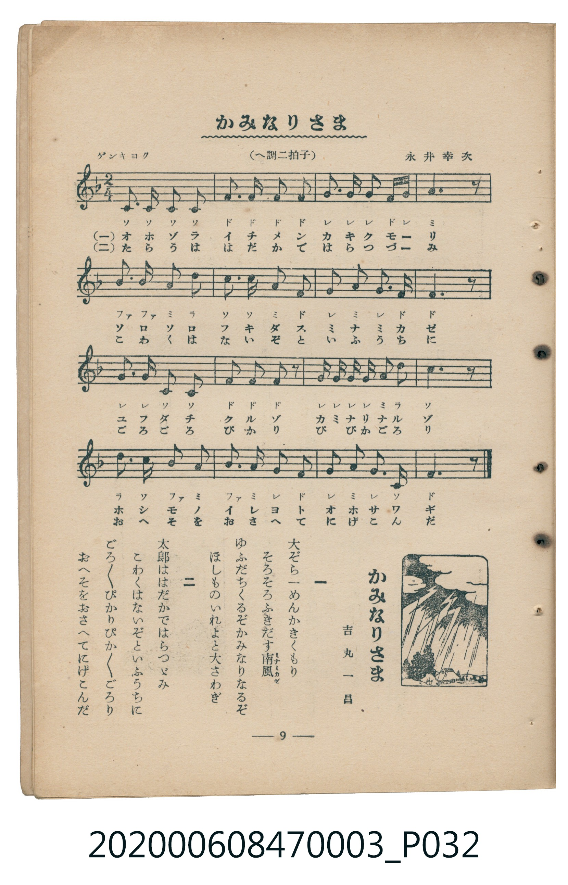

# かみなりさま

> Re:Shōka 使用 AI 協助辨識與重建樂譜，可能會有錯誤。歡迎回報。

- **鋼琴伴奏版**：<br><audio controls src="kaminarisama.mp3"></audio>
- **NEUTRINO 歌聲合成版**：<br><audio controls src="kaminarisama_neutrino.mp3"></audio>

- 詞：吉丸一昌
- 曲：永井幸次
- 臺灣教育會公認《新定兒童唱歌》尋常科第三學年用（2020.006.0847.0003）

## 說明

原書資訊與歌詞全文（對應 P032.jpg，書頁 p. 9，第一學期第 7 首）：
調性與拍號：へ調二拍子（F 大調 2/4 拍），「ゲンキヨク」


## 歌詞

```text
一
大ぞら一めんかきくもり
そろそろふきだす南風（ミナミカゼ）
ゆふだちくるぞかみなりなるぞ
ほしものいれよと大さわぎ

二
太郎ははだかではらつゞみ
こわくはないぞといふうちに
ごろ／＼ぴかりぴか／＼ごろり
おへそをおさへてにげこんだ
```

## ABC

<div class="abc-score" data-abc-src="kaminarisama.abc" aria-label="五線譜載入中"></div>

[下載 ABC 原始檔](kaminarisama.abc)

## TMD 檔案連結

- [主旋律 TMD 檔案](kaminarisama.tmd) [[在 TMD Studio 編輯](https://tmdlang.github.io/Tmd-TS/#tmd=s7IKdvYPcrWy4qpTUCpJTLdSSM7PyUlNLsnMz7MqzsjMK0nNjM_KTMmPL87Iz05Ugisry88pzU21Si9KTEmNN443MjAyiDcwMIs3sDAxBzIMjBFKi_NLi5JTrYqTM_Lzc-JLUitKkvLzsxHyBUX5Zal5iXlANQVFIBtTwIoQClLLMlNSQdKpKZkl-UWZiTlI7kgtKga7FWxJfElRYl5xclFmAcgDCFUlGalAx5anJgIZRQhhoFnpmXlWJYmZQN-BfFieGJ-bmJmXk5iXgqyqJCMf6NGCjEqrjMxikAuSE3PisxPzkMIDan9BYnqqVYCBsZESl5aWwuPG7seN-x83rnrc1PW4cerjxn0KWlpcirYKhoZGXPa2Cm5cNkb6JnYgQ16snPd-z6ynEzqf7NjxZEfDsxk9YLOfzd4EFH62YceTXVOf7tzxbM1CsPCL9l3PGxc_mzrzRdOmZ3Oan7auebGq93FD17NpG56um_W0ddLz1UufTtn4bG3P44bupxu6n-7Y8Xz5xOdr1jzZ0fl07Y6nO7c8n7Li_Z4OULTpAaNNDxRtQIaB8fs9nUpcXPpaCrbUAlwKCgpP--Y_m73jxeb2Fyu6XnS0A90F9O_T1hXPprUDXfF0Q--z9k4FULDpZRWkv9_TA1T8ckGjQoGegiWQB3Z3A9Ddz-bMB7IVzBVeLpsGdCgwZECGv1i1_1nDcpCx3b0vZs4Hij5u3AEUfLKrByjydO0EoBVuCk-XLAeKKQDDWwEoCtYNDJyex02bHjdvfty09nHzisdN6x839HKBzATaB3b3kuWPG-c9bgLGSsPjpsbHTZPBUdr7uLH_cVMTMFZBih43zn3cBBSCkFvB0gseN8582jv95SJQKD9unv-4uQtENq1-3LQHaDdYW1MbWDVQ6UKweUCD56GmGCAJEoRYsvtx43SQpY3rHje2PG4CurzjceMKsAunPm7qf9zYB3H5rh6Iy1e9bO573LgejIB2AA0CqlwP9MvjxiWPm4A27YeYOxmsGYiA6laBjAa5YgWYAXQd0I1A162GKJ0C9OH7Pf3v9-x53LgFZCTIkSAGTBCkAB4qQLkd4FCZBGYDkz-Quwxo2ONGoAjQWmBgLgAppTyNQYGClj4Xl3dibmZeYlFmcWJuolVAZmJevkONQU01yCIFG0MzLTswC1sKV4AktBcLexQ0TBSebuh_vr5BB54sNbFoANoHMqxGwTReQRedqFEwBJK6QBJEg3CNghFYxAhMGwLJGgVjsAgEGoDUgE30MawBhSCQD4x4MDkPRDZ1gk0BRg5YPTBugGKNYJnJUJluqEwvEPeDZZogMk0g02AQ7D6ITUYgXfPhpgOjHEyuh5oHokH8BVCzgckIVQaoC5iiwDJLoTL7MWzCH-a7esgJcxOgySAMCkEzsM2moKCHiiCHtzE0vBFxgj2854L90wv2C4INktkKDVNISIDImSh-BWYdKBsSSiCZOXjCGxRbwHwHVg8hYeG9CswDxS80zhtXQGVgcb4VHkcLoTKrSQzvHZ3khDcs7aKncBgGhyY4bYMgaqzgCPEmkD9gfoKEK8xPkLQLSXGgcIDYBwpdUDiDwxuYoqHhBVYHkgWpxBXmUyB2AeMUwkbE7hZ4vEFyCcyuLVD7YDSKLiz5CW-oP509m5xQB4UhKFXDUjok3aOmaRALJAeJIWDU4E_moAIF5OHp0MIBWKVAPQxNYk09QNwBloElPuSiaCpUVT9Ypg9PkEOCCFjwwzPUJCTzIGaBZEGsZVAZUGIG1hBgEpRNIIUbSAaUQFBtquXi0rVTQC7xFYB8ZS4A)]
- [鋼琴伴奏 TMD 檔案](kaminarisama_piano.tmd) [[在 TMD Studio 編輯](https://tmdlang.github.io/Tmd-TS/#tmd=s7IKdvYPcrWy4qpTUCpJTLdSyC8qychPL0osyKi0ysgsLskvykxOzInPTsxLVIIrKs4vLUpOjS9ITE-1CjAwNlLi0tJSeNzY_bhx_-PGVY-buh43Tn3cuO_9no6X3XueT9jyZM-Wp0v7n3d2vN_TqaClxaVoq2BoaMRlb6vgxmVjpG9iBzL5xcp57_fMejqh88mOHU92NDyb0QO28NnsTUDhZxt2PNk19enOHc_WLAQLv2jf9bxx8bOpM180bXo2p_lp65oXq3ofN3Q9m7bh6bpZT1snPV-99OmUjc_W9jxu6H66ofvpjh3Pl098vmbNkx2dT9fueLpzy_MpK4AONDIwMtAzMDDTM7AwMQcyDIyBblTi4vJOzM3MSyzKLE7MTbQKyEzMyw_ycKgxqKnmUgACG0MzLTswq0bBNF5BF52oUTAEkrpAEkSDcI2CEVjECEwbAskaBWOwCAQagNSATfQxrAGGZReQ_7hxN5icByKbOsGmPG5sAat_3LgQKNYIlpkMlemGyvQCcT9Ypgki0wQyDQbB7oPYZATSNR9u-uPGNjC5HmoeiAbxF0DNfty4HFUGqOtx4xKwzFKozH6sNtUomADZIAzysxlYrSkosKAiyCFkDA0hRChiD6G5YBf0gm1HsEEyW6GhAHE7iJyJ4jpgGoWyIf4CyczBE0Kg8H3cBA5RSLjCQ2gVmAeKEWgsNa6AysBiaSs8VBdCZVbjCCFY-kBPRTAM9j84_YAgajjiCKMmkM0wV0BCAuYKSPqAxCrI5RD7QOEBChlwCAFTDdSHYHUgWZBKXKE0BWIXMBYgbER8bIGHNCQlwuzaArUPRqPowpFma8C-BqUcWGqCpC3UdANigeQgYQoMTPxJCZTNQE6cDs0yjxvXQZ0IjcamHiDuAMvAIhg5g06FquoHy_ThCSSIpx437oAn2klI5kHMAsmCWMugMqAE87gRpA6SFCFZHiQDilJUm2qxlVw-yCWXCVLBFa8QbRofCwocIMsQxEAVM0BkX6CwCVEqMcQJm2kEZBjF52KaCrYJ5CddOwVkb0X7ACUwxIzAYspcAA)]

## 分析

```text
================================================================================
📊 TMD Song Profile: [ かみなりさま ]
================================================================================
⏱  Duration:       0:17 (17.1s), 16 measures total
🎼 Key & Tempo:    首調基準 F, != 112.0 BPM, <2/4>
   - 分析範圍：      由實際發聲的音符與和弦推測調性；播放脈絡另行呈現
🎤 人聲音域:    C4 (MIDI 60) – D5 (MIDI 74) [跨度: 14 個半音 / 1.2 個八度, 難度: moderate]
   - 最低音:  C4 in [Kaminarisama #1 @ m.1, 0:00]
   - 最高音: D5 in [Kaminarisama #1 @ m.5, 0:05]
   - 適合: soprano, mezzo-soprano, contralto, tenor, baritone, bass
🏛  結構:      Kaminarisama (17.1s)
⚡ 編曲密度:        Peak 1 軌道同時演奏
🗝  調性診斷：       F 大調（純淨自然大調，未偵測到可信轉調）
   - 風格氣質:    純淨自然大調（陽光明朗、易唱易記，無明顯調外色彩）
   - 轉調歷程:    全曲維持單一推測調性（未偵測到可信轉調）
   - 核心骨幹音:  F, G, C, A, A#
   - 調性數值:    F 大調 [相關度: 0.88, 穩定度: High, 自然音純度: 100.0%]
   - 候選調性 (K-S): F 大調 (0.88), C 大調 (0.71), D 小調 (0.49)
   - 五度圈歷程:   -1
   - 各段落調性細節:
     • [Kaminarisama #1]: F 大調 (r: 0.88, 自然音純度: 100.0%)

  [ 五度圈游移軌跡 ]
               C  
        [F ]*          G  
      Bb               D  
      Eb               A  
         Ab           E  
            Db       B  
               F# 
     (* = active key center)

  [ 十二半音累積音高分佈 ]
     C  : █████████████████         20.3%
     C# :                            0.0%
     D  : █████                      5.9%
     D# :                            0.0%
     E  :                            0.0%
     F  : ████████████████████████  28.0%
     F# :                            0.0%
     G  : ████████████████████      22.9%
     G# :                            0.0%
     A  : █████████████             15.3%
     A# : ███████                    7.6%
     B  :                            0.0%
--------------------------------------------------------------------------------
Assignment 軌道音域：
  - Piano         : C4 – D5 (14 個半音 / 1.2 個八度, 54 個音符)
================================================================================
```


## 原書掃描頁




