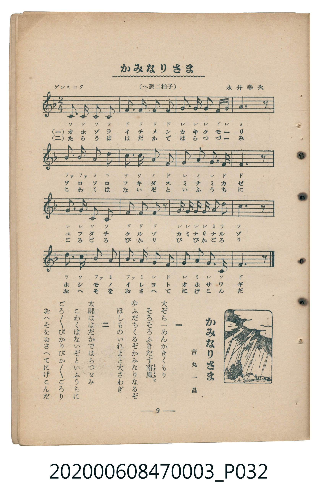

# かみなりさま

<audio controls src="kaminarisama.mp3"></audio>

- 詞：吉丸一昌
- 曲：永井幸次
- 臺灣教育會公認《新定兒童唱歌》尋常科第三學年用（2020.006.0847.0003）

- note

原書資訊與歌詞全文（對應 P032.jpg，書頁 p. 9，第一學期第 7 首）：
調性與拍號：へ調二拍子（F 大調 2/4 拍），「ゲンキヨク」

## 歌詞

```text
一
大ぞら一めんかきくもり
そろそろふきだす南風（ミナミカゼ）
ゆふだちくるぞかみなりなるぞ
ほしものいれよと大さわぎ

二
太郎ははだかではらつゞみ
こわくはないぞといふうちに
ごろ／＼ぴかりぴか／＼ごろり
おへそをおさへてにげこんだ
```

## 原書掃描頁



## 調性分析

```text
================================================================================
📊 TMD Song Profile: [ かみなりさま ]
================================================================================
⏱  Duration:       0:17 (17.1s), 16 measures total
🎼 Key & Tempo:    首調基準 F, != 112.0 BPM, <2/4>
   - 分析範圍：      由實際發聲的音符與和弦推測調性；播放脈絡另行呈現
🎤 人聲音域:    C4 (MIDI 60) – D5 (MIDI 74) [跨度: 14 個半音 / 1.2 個八度, 難度: moderate]
   - 最低音:  C4 in [Kaminarisama #1 @ m.1, 0:00]
   - 最高音: D5 in [Kaminarisama #1 @ m.5, 0:05]
   - 適合: soprano, mezzo-soprano, contralto, tenor, baritone, bass
🏛  結構:      Kaminarisama (17.1s)
⚡ 編曲密度:        Peak 1 軌道同時演奏
🗝  調性診斷：       F 大調（純淨自然大調，未偵測到可信轉調）
   - 風格氣質:    純淨自然大調（陽光明朗、易唱易記，無明顯調外色彩）
   - 轉調歷程:    全曲維持單一推測調性（未偵測到可信轉調）
   - 核心骨幹音:  F, G, C, A, A#
   - 調性數值:    F 大調 [相關度: 0.88, 穩定度: High, 自然音純度: 100.0%]
   - 候選調性 (K-S): F 大調 (0.88), C 大調 (0.71), D 小調 (0.49)
   - 五度圈歷程:   -1
   - 各段落調性細節:
     • [Kaminarisama #1]: F 大調 (r: 0.88, 自然音純度: 100.0%)

  [ 五度圈游移軌跡 ]
               C  
        [F ]*          G  
      Bb               D  
      Eb               A  
         Ab           E  
            Db       B  
               F# 
     (* = active key center)

  [ 十二半音累積音高分佈 ]
     C  : █████████████████         20.3%
     C# :                            0.0%
     D  : █████                      5.9%
     D# :                            0.0%
     E  :                            0.0%
     F  : ████████████████████████  28.0%
     F# :                            0.0%
     G  : ████████████████████      22.9%
     G# :                            0.0%
     A  : █████████████             15.3%
     A# : ███████                    7.6%
     B  :                            0.0%
--------------------------------------------------------------------------------
Assignment 軌道音域：
  - Piano         : C4 – D5 (14 個半音 / 1.2 個八度, 54 個音符)
================================================================================
```

## ABC

```abc
X:1
T:かみなりさま
C:曲：永井幸次
M:2/4
L:1/16
Q:1/4=112
K:F

V:V1 name="Piano" snm="Pia"

[V:V1]
c2 c2 c2 c2 | f3 f f2 f2 | g3 g g2 f g | a6 z2 |
b2 b2 a2 d2 | c2 c2 a2 f2 | g3 a g2 f2 | f6 z2 |
g3 g c2 c2 | f2 f2 f2 z2 | g g g g a2 d2 | c6 z2 |
d3 c b2 a2 | b3 a g2 f2 | g2 a2 g3 c | f6 z2 |
```

- [主旋律 TMD 檔案](kaminarisama.tmd)
- [鋼琴伴奏 TMD 檔案](kaminarisama_piano.tmd)
