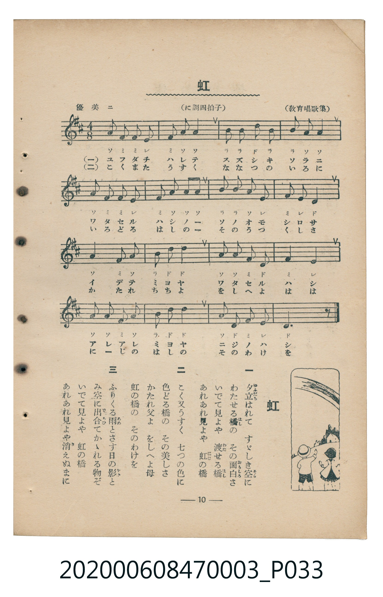

# 虹

<audio controls src="niji.mp3"></audio>

- 教育唱歌集
- 臺灣教育會公認《新定兒童唱歌》尋常科第三學年用（2020.006.0847.0003）

- note

原書資訊與歌詞全文（對應 P033.jpg，書頁 p. 10，第一學期第 8 首）：
調性與拍號：に調四拍子（D 大調 4/8 拍，此處記為 4/4 拍），「優美ニ」

## 歌詞

```text
一
夕立（ゆふだち）はれて　すゞしき空（そら）に
わたせる橋（はし）の　その面白（おもしろ）さ
いでて見よや　渡（わた）せる橋（はし）
あれあれ見よや　虹（にじ）の橋（はし）

二
こく又うすく　七つの色（いろ）に
色どる橋（はし）の　その美（うつく）しさ
かたれ父よ　をしへよ母
虹の橋の　そのわけを

三
ふりくる雨（あめ）とさす日（ひ）の影（かげ）と
み空に出合（であ）ひてかゝれる物（もの）ぞ
いでて見よや　虹の橋
あれあれ見よや消（き）えぬまに
```

## 原書掃描頁



## 調性分析

```text
================================================================================
📊 TMD Song Profile: [ 虹 ]
================================================================================
⏱  Duration:       0:41 (41.7s), 16 measures total
🎼 Key & Tempo:    首調基準 D, != 92.0 BPM, <4/4>
   - 分析範圍：      由實際發聲的音符與和弦推測調性；播放脈絡另行呈現
🎤 人聲音域:    D4 (MIDI 62) – D5 (MIDI 74) [跨度: 12 個半音 / 1.0 個八度, 難度: easy]
   - 最低音:  D4 in [Niji1 #1 @ m.8, 0:19]
   - 最高音: D5 in [Niji1 #1 @ m.3, 0:06]
   - 適合: soprano, mezzo-soprano, contralto, tenor, baritone, bass
🏛  結構:      Niji1 (41.7s)
⚡ 編曲密度:        Peak 1 軌道同時演奏
🗝  調性診斷：       D 大調（純淨自然大調，未偵測到可信轉調）
   - 風格氣質:    純淨自然大調（陽光明朗、易唱易記，無明顯調外色彩）
   - 轉調歷程:    全曲維持單一推測調性（未偵測到可信轉調）
   - 核心骨幹音:  A, D, F#, B, E
   - 調性數值:    D 大調 [相關度: 0.84, 穩定度: Moderate, 自然音純度: 100.0%]
   - 候選調性 (K-S): D 大調 (0.84), A 大調 (0.78), F# 小調 (0.71)
   - 五度圈歷程:   +2
   - 各段落調性細節:
     • [Niji1 #1]: D 大調 (r: 0.84, 自然音純度: 100.0%)

  [ 五度圈游移軌跡 ]
               C  
         F            G  
      Bb              [D ]*
      Eb               A  
         Ab           E  
            Db       B  
               F# 
     (* = active key center)

  [ 十二半音累積音高分佈 ]
     C  :                            0.0%
     C# :                            0.0%
     D  : ████████████████          22.2%
     D# :                            0.0%
     E  : ████████                  11.1%
     F  :                            0.0%
     F# : ███████████████           20.6%
     G  :                            0.0%
     G# :                            0.0%
     A  : ████████████████████████  33.3%
     A# :                            0.0%
     B  : █████████                 12.7%
--------------------------------------------------------------------------------
Assignment 軌道音域：
  - Piano         : D4 – D5 (12 個半音 / 1.0 個八度, 53 個音符)
================================================================================
```

## ABC

```abc
X:1
T:虹
C:TMD (Chen, Chih-Han / aguai)
M:4/4
L:1/16
Q:1/4=92
K:D

V:V1 name="Piano" snm="Pia"

[V:V1]
a4 f4 f4 e4 | f4 a4 a8 | b6 b2 d4 b4 | b4 a4 a8 |
a4 f4 f4 e4 | f4 a4 a4 a4 | b4 b4 a4 e4 | f4 e4 d8 |
a8 f4 a4 | b4 d4 d8 | a4 a4 f4 d4 | f8 e8 |
a4 a4 f4 a4 | b4 d4 d8 | a4 d4 f4 e4 | d12 z4 |
```

- [主旋律 TMD 檔案](niji.tmd)
- [鋼琴伴奏 TMD 檔案](niji_piano.tmd)
