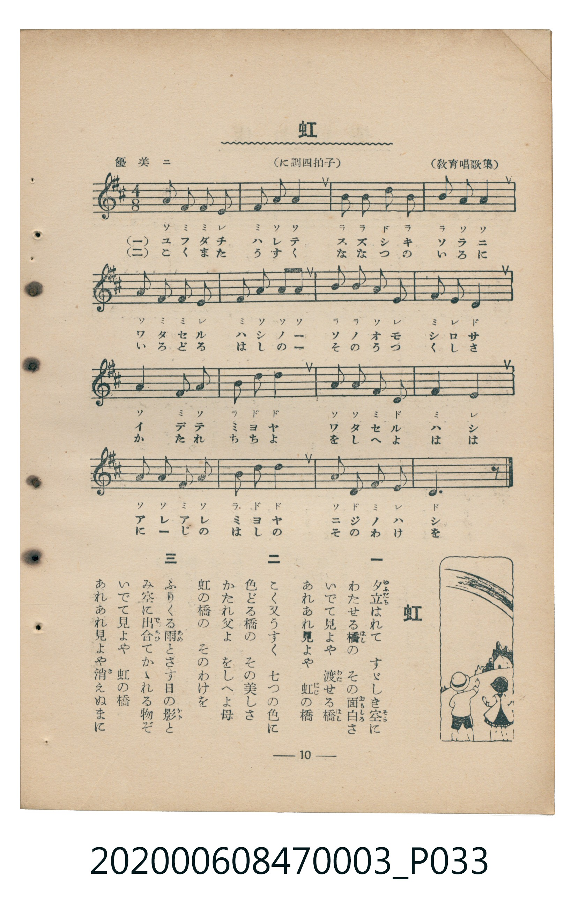

# 虹

> Re:Shōka 使用 AI 協助辨識與重建樂譜，可能會有錯誤。歡迎回報。

- **鋼琴伴奏版**：<br><audio controls src="niji.mp3"></audio>
- **NEUTRINO 歌聲合成版**：<br><audio controls src="niji_neutrino.mp3"></audio>

- 教育唱歌集
- 臺灣教育會公認《新定兒童唱歌》尋常科第三學年用（2020.006.0847.0003）

## 說明

原書資訊與歌詞全文（對應 P033.jpg，書頁 p. 10，第一學期第 8 首）：
調性與拍號：に調四拍子（D 大調 4/8 拍，此處記為 4/4 拍），「優美ニ」


## 歌詞

```text
一
夕立（ゆふだち）はれて　すゞしき空（そら）に
わたせる橋（はし）の　その面白（おもしろ）さ
いでて見よや　渡（わた）せる橋（はし）
あれあれ見よや　虹（にじ）の橋（はし）

二
こく又うすく　七つの色（いろ）に
色どる橋（はし）の　その美（うつく）しさ
かたれ父よ　をしへよ母
虹の橋の　そのわけを

三
ふりくる雨（あめ）とさす日（ひ）の影（かげ）と
み空に出合（であ）ひてかゝれる物（もの）ぞ
いでて見よや　虹の橋
あれあれ見よや消（き）えぬまに
```

## ABC

<div class="abc-score" data-abc-src="niji.abc" aria-label="五線譜載入中"></div>

[下載 ABC 原始檔](niji.abc)

## TMD 檔案連結

- [主旋律 TMD 檔案](niji.tmd) [[在 TMD Studio 編輯](https://tmdlang.github.io/Tmd-TS/#tmd=s7IKdvYPcrWy4qpTUCpJTLdSSM7PyUlNLsnMz7MqzsjMK0nNjM_KTMmPL87Iz05Ugisry88pzU21Si9KTEmNN443MjAyiDcwMIs3sDAxBzIMjBFKi_NLi5JTrYqTM_Lzc-JLUitKkvLzsxHyBUX5Zal5iXlANQVFIBtTwIoQClLLMlNSQdKpKZkl-UWZiTlI7kgtKga7FWxJfElRYl5xclFmAcgDCFUlGalAx-YllpQWpSJEgUalZ-ZZ5aZmZmUiuUtLS-HFzJ0KWlpcirYKlkZc9rYKLlw2JvoWdiCdz6bOfNG06emUjc_W9ryc3QY27UX7rueNiyEyz-Y0P21d82JV7-OGrmfTNjxdN-tp66Tnq5dCdDxu6H66ofvpjh3Pl098vmbNkx2dT9fueLpzy_MpK97v6QCFoh4wFPVAoQhkGBi_39OpxMWlr6VgSy3ApaCg8LRv_rPZO15sbn-xoutFRzvQXS9WznvauuLZtHagK55u6H3W3qkQYGBsrJdVkP5-Tw9Q8csFjQoFegqGBkAu2OENQIc_mzMfyFawUHi5bBrQpe_3zAKZ_mLV_mcNy0Hmdve-mDkfKPq4cTVQ8Ons2UCRp2snAO1wUXi6ZDlQTAEYrApAUZAla5e8mDn1xYoZz5t2AYVNIMJAQ4GB1vO0ZdXzfX2Pm7sfN_RygSwBOgDskyVTn6_uBhr4uKntcePWx40LHjcuBOp63Lj-cVPP48ZljxsaHjfOfNw073Hj9MeNvc9X7gIpbpz7uAloMlDZapApj5v6HzfOf9w4-3FT97OVYOOA-hung1WsAxsxF8h4OXfR85l7wbJdj5uaQCY2gZz4uHEq2JTGlseNy4F2vljW_bgJ6KIWoM5nO4DOAbJBFoCVYrEDorkJ7GAQiawfmBLBSlc_bpwBcQ66ZnBo7OqBGDL5cWP_036gLDA0ZgLZQBOe7Gh-3LgEqPFF5yawxhaYq8F-B4o-blyJ3-PAoAdLAQ0FGtQPlgWGJtTX3aCwa-p53rEN5GqgnqZJYOkdQO6z9b1gS2buhLgc2VRwoEwEqoZGKDQctj5u6gK5vKn75WxQpgCHSSPYzhVAO4H-ejZ9KVgc6B2QM5_u3QjmAg2fBFEGMWg_MLKBnnzavuvphA6wCmDkNIFVAL28DKShCZgOeoA2Pe9cCY4lYJyuAyuYhzNC4V7BGWvPtkFsgwQykLHmceM-aGhTnn-hQEFLn4vLD1hwGVoFZCbm5TvUGNRUg2xQsLHQsgMzsJUaCpC8-2Jhj4KGicLTDf3P1zfowLO6JhYNQHtAhtUomCoYA6ERkGUMZJsq6AJZZkBoGAckQEyoIFi5j2ENMFe1gaITiBcA8UKgGmDiAor2AOllYO3AuATiWUA8HYh7wSJzgSo6gfRqhFlGIPHJQNwPxPuAeD5YJch0kP5-qFmroHgJEK8Di7QAzepFNcsYJA50U1MXxLymbrDKJiCrEUivgJo1FWr2JrhZ3UA8CaYCnGJxB_CuHmoEsCk0gE2hYkYKhmjhCwqP-UA8G-4PYPiCw3Id1B_A0ASygeUVUEUTWAQoCw6TqWjhCwurlQTNAoX7ErAIyH6QCiSzwOG7HyUeQSLLIWEMDs9l8PAEYlBqgNgHdB_E_HlEhPCOTvJCWBcctqBwBSZbIAL5DBTSxsCwBYWxLjCUUcIYGC66UPdD3A30W1MHEIPEccUBSMd0tPDtBosCVQJ9DOIvhGCgWRBzQGkLFJY7wGIIc0AkctgScA84rQPrCni6RXYN3jAFVs_khSko9DDDFMiAJGZQotVVMEAJVFB2AxUDEBq7N2CeAHkBknBB5sSjBCqmZ7EmWXAkTYQGM4op4CAl7BpQxgDyG9cA8T54MEPMqeXi0rVTABfFCkCGMhcA)]
- [鋼琴伴奏 TMD 檔案](niji_piano.tmd) [[在 TMD Studio 編輯](https://tmdlang.github.io/Tmd-TS/#tmd=s7IKdvYPcrWy4tLSUngxc-f7PR0vu_c8n7DlyZ4tT5f2P-_seL-nU0FLi0vRVsHSiMveVsGFy8ZE38KOq05B6dnUmS-aNj2dsvHZ2p6Xs9uUQGIv2nc9b1wMkXk2p_lp65oXq3ofN3Q9m7bh6bpZT1snPV-9FKLjcUP30w3dT3fseL584vM1a57s6Hy6dsfTnVueT1kBdIWRgZGBnoGBmZ6BhYk5kGFgDHSIEheXX2ZWpqFVQGZiXn6Qh0ONQU01lwIQ2Fho2YEZNQqmCsZAaARkGQPZpgq6QJYZEBrGAQkQEyoIVu5jWKPwuKlN4XHjViBeAMQLgWoeN64HivYA6WVg7Y8bZwLxLCCeDsS9YJG5QBWdQHo1wiwjkPhkIO4H4n1APB-sEmQ6SH8_1KxVULwEiNeBRVqAZvWimmUMEge6qakLYl5TN1hlE5DVCKRXQM2aCjV7E9ysbiCeBFOBI0hMoUFiChUzUjBECxGQD-YD8Wy4zcAQAft-HdRmoP-B7MeNQPc1NYFFgLJgX0xFCxGY71YSNAsUUkvAIiD7QSqQzAKHyH6UkAeJLIeECjgElsFDAIhB8QexD-g-iPnzUMJEFxwaoJAAJg0gArkFFDbGwNAAhYouMFxQQgXoE12ojRCbgK5p6gBikDiuUAPpmI4WIt1gUaBKoBtB_IUQDDQLYg4o_kC-3wEWQ5gDIpFDg4B7wOnpceMMeNpAdw3Mv5ihAGRAEgwoYegqGKAEAygRgjIHhMZuMcxakKWQxAEyJx4lGDCdhzVZgIN1IjRgUEwBBwJh14ASH5DfuAaI98EDBmJOLUqR4oO9SDGMV4g2jFUwjQfSpvGxCBEoVaNgAmSYxMIoLDpINQlJBZwJU4NqFrpOOB9dHm4OLlcRMgmrq0FJAxiIunYK4HCM9gEKIzhGyBxjMEeZCwA)]

## 分析

```text
================================================================================
📊 TMD Song Profile: [ 虹 ]
================================================================================
⏱  Duration:       0:20 (20.9s), 16 measures total
🎼 Key & Tempo:    首調基準 D, != 92.0 BPM, <4/8>
   - 分析範圍：      由實際發聲的音符與和弦推測調性；播放脈絡另行呈現
🎤 人聲音域:    D4 (MIDI 62) – D5 (MIDI 74) [跨度: 12 個半音 / 1.0 個八度, 難度: easy]
   - 最低音:  D4 in [Niji1 #1 @ m.8, 0:09]
   - 最高音: D5 in [Niji1 #1 @ m.3, 0:03]
   - 適合: soprano, mezzo-soprano, contralto, tenor, baritone, bass
🏛  結構:      Niji1 (20.9s)
⚡ 編曲密度:        Peak 1 軌道同時演奏
🗝  調性診斷：       D 大調（純淨自然大調，未偵測到可信轉調）
   - 風格氣質:    純淨自然大調（陽光明朗、易唱易記，無明顯調外色彩）
   - 轉調歷程:    全曲維持單一推測調性（未偵測到可信轉調）
   - 核心骨幹音:  A, D, F#, B, E
   - 調性數值:    D 大調 [相關度: 0.84, 穩定度: Moderate, 自然音純度: 100.0%]
   - 候選調性 (K-S): D 大調 (0.84), A 大調 (0.78), F# 小調 (0.71)
   - 五度圈歷程:   +2
   - 各段落調性細節:
     • [Niji1 #1]: D 大調 (r: 0.84, 自然音純度: 100.0%)

  [ 五度圈游移軌跡 ]
               C  
         F            G  
      Bb              [D ]*
      Eb               A  
         Ab           E  
            Db       B  
               F# 
     (* = active key center)

  [ 十二半音累積音高分佈 ]
     C  :                            0.0%
     C# :                            0.0%
     D  : ████████████████          22.2%
     D# :                            0.0%
     E  : ████████                  11.1%
     F  :                            0.0%
     F# : ███████████████           20.6%
     G  :                            0.0%
     G# :                            0.0%
     A  : ████████████████████████  33.3%
     A# :                            0.0%
     B  : █████████                 12.7%
--------------------------------------------------------------------------------
Assignment 軌道音域：
  - Piano         : D4 – D5 (12 個半音 / 1.0 個八度, 53 個音符)
================================================================================
```


## 原書掃描頁




