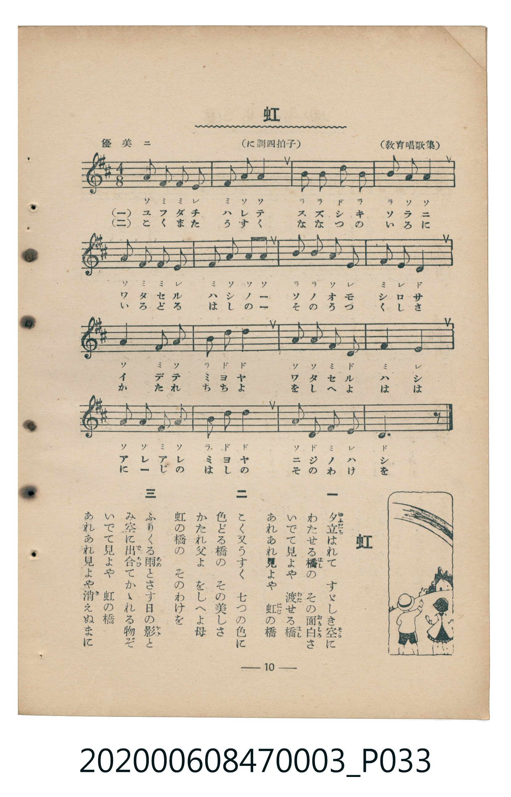

# 虹

> Re:Shōka 使用 AI 協助辨識與重建樂譜，可能會有錯誤。歡迎[回報](https://github.com/TMDLang/reshoka/issues)。

- **鋼琴伴奏版**：<br><audio controls src="niji.mp3"></audio>
- **NEUTRINO 歌聲合成版**：<br><audio controls src="niji_neutrino.mp3"></audio>

- 教育唱歌集
- 臺灣教育會公認《新定兒童唱歌》尋常科第三學年用（2020.006.0847.0003）

## 說明

原書資訊與歌詞全文（對應 P033.jpg，書頁 p. 10，第一學期第 8 首）：
調性與拍號：に調四拍子（D 大調 4/8 拍，此處記為 4/4 拍），「優美ニ」


## 歌詞

```text
一
夕立（ゆふだち）はれて　すゞしき空（そら）に
わたせる橋（はし）の　その面白（おもしろ）さ
いでて見よや　渡（わた）せる橋（はし）
あれあれ見よや　虹（にじ）の橋（はし）

二
こく又うすく　七つの色（いろ）に
色どる橋（はし）の　その美（うつく）しさ
かたれ父よ　をしへよ母
虹の橋の　そのわけを

三
ふりくる雨（あめ）とさす日（ひ）の影（かげ）と
み空に出合（であ）ひてかゝれる物（もの）ぞ
いでて見よや　虹の橋
あれあれ見よや消（き）えぬまに
```

## ABC

<div class="abc-score" data-abc-src="niji.abc" aria-label="五線譜載入中"></div>

[下載 ABC 原始檔](niji.abc)

## TMD 檔案連結

- [主旋律 TMD 檔案](niji.tmd) [[在 TMD Studio 編輯](https://tmdlang.github.io/Tmd-TS/#tmd=s7IKdvYPcrWy4qpTUCpJTLdSSM7PyUlNLsnMz7MqzsjMK0nNjM_KTMmPL87Iz05Ugisry88pzU21Si9KTEmNN443MjAyiDcwMIs3sDAxBzIMjBFKi_NLi5JTrYqTM_Lzc-JLUitKkvLzsxHyBUX5Zal5iXlANQVFIBtTwIoQClLLMlNSQdKpKZkl-UWZiTlI7kgtKga7FWxJfElRYl5xclFmAcgDCFUlGalAx-YllpQWpSJEgUalZ-ZZ5aZmZmVicVd-UUlGPtCDBRmVVhmZxSCbkxNz4rMT85DCAWpvQWJ6qlWAgTHQ21paCi9m7lTQ0uJStFWwNOKyt1Vw4bIx0bewA2l6NnXmi6ZNT6dsfLa25-XsNrBBL9p3PW9cDJF5Nqf5aeuaF6t6Hzd0PZu24em6WU9bJz1fvRSi43FD99MN3U937Hi-fOLzNWue7Oh8unbH051bnk9Z8X5PBygS9ICRoAeKBCDDwPj9nk4lLi59LQVbagEuBQWFp33zn83e8WJz-4sVXS862oHuerFy3tPWFc-mtQNd8XRD77P2TgVQYOhlFaS_39MDVPxyQaNCgZ6CoQGQC3Z4A9Dhz-bMB7IVLBReLpsGdOn7PbNApr9Ytf9Zw3KQud29L2bOB4o-blwNFHw6ezZQ5OnaCUA7XBSeLlkOFFMABqsCUBRkydolL2ZOfbFixvOmXUBhE4gw0FBgoPU8bVn1fF_f4-buxw29XCBLgA4A-2TJ1Oeru4EGPm5qe9y49XHjgseNC4G6Hjeuf9zU87hx2eOGhseNMx83zXvcOP1xY-_zlbtAihvnPm4CmgxUthpkyuOm_seN8x83zn7c1P1sJdg4oP7G6WAV68BGzAUyXs5d9HzmXrBs1-OmJpCJTSAnPm6cCjalseVx43KgnS-WdT9uArqoBajz2Q6gc4BskAVgpVjsgGhuAjsYRCLrB6ZEsNLVjxtnQJyDrhkcGrt6IIZMftzY_7QfKAsMjZlANtCEJzuaHzcuAWp80bkJrLEF5mqw34GijxtX4vc4MOjBUkBDgQb1g2WBoQn1dTco7Jp6nndsA7kaqKdpElh6B5D7bH0v2JKZOyEuRzYVHCgTgaqhEQoNh62Pm7pALm_qfjkblCnAYdIItnMF0E6gv55NXwoWB3oH5MynezeCuUDDJ0GUQQzaD4xsoCeftu96OqEDrAIYOU1gFUAvLwNpaAKmgx6gTc87V4JjCRin68AK5uGMULhXcMbas20Q2yCBDGSsedy4DxralOdfKFDQ0ufi8gOWe4ZWAZmJefkONQY11SAbFGwstOzADGylhgIk775Y2KOgYaLwdEP_8_UNOvCsrolFA9AekGE1CqYKxkBoBGQZA9mmCrpAlhkQGsYBCRATKghW7mNYA8xVbaDoBOIFQLwQqAaYuICiPUB6GVg7MC6BeBYQTwfiXrDIXKCKTiC9GmGWEUh8MhD3A_E-IJ4PVgkyHaS_H2rWKiheAsTrwCItQLN6Uc0yBokD3dTUBTGvqRussgnIagTSK6BmTYWavQluVjcQT4KpAKdY3AG8q4caAWwKDWBTqJiRgiFa-ILCYz4Qz4b7Axi-4LBcB_UHMDSBbGB5BVTRBBYByoLDZCpa-MLCaiVBs0DhvgQsArIfpALJLHD47keJR5DIckgYg8NzGTw8gRiUGiD2Ad0HMX8eESG8o5O8ENYFhy0oXIHJFohAPgOFtDEwbEFhrAsMZZQwBoaLLtT9EHcD_dbUAcQgcVxxANIxHS18u8GiQJVAH4P4CyEYaBbEHFDaAoXlDrAYwhwQiRy2BNwDTuvAugKebpFdgzdMgdUzeWEKCj3MMAUyIIkZlGh1FQxQAhWU3UDFAITG7g2YJ0BegCRckDnxKIGK6VmsSRYcSROhwYxiCjhICbsGlDGA_MY1QLwPHswQc2q5uHTtFMBFsQKQocwFAA)]
- [鋼琴伴奏 TMD 檔案](niji_piano.tmd) [[在 TMD Studio 編輯](https://tmdlang.github.io/Tmd-TS/#tmd=s7IKdvYPcrWy4qpTUCpJTLdSyC8qychPL0osyKi0ysgsLskvykxOzInPTsxLVIIrKs4vLUpOjS9ITE-1CjAwNlbi0tJSeDFz5_s9HS-79zyfsOXJni1Pl_Y_7-x4v6dTQUuLS9FWwdKIy95WwYXLxkTfwg5k0rOpM180bXo6ZeOztT0vZ7eBTX_Rvut542KIzLM5zU9b17xY1fu4oevZtA1P18162jrp-eqlEB2PG7qfbuh-umPH8-UTn69Z82RH59O1O57u3PJ8ygqgK4wMjAz0DAzM9AwsTMyBDANjoEOUuLj8MrMyDa0CMhPz8oM8HGoMaqq5FIDAxkLLDsyoUTBVMAZCIyDLGMg2VdAFssyA0DAOSICYUEGwch_DGoXHTW0Kjxu3AvECIF4IVPO4cT1QtAdILwNrf9w4E4hnAfF0IO4Fi8wFqugE0qsRZhmBxCcDcT8Q7wPi-WCVINNB-vuhZq2C4iVAvA4s0gI0qxfVLGOQONBNTV0Q85q6wSqbgKxGIL0CatZUqNmb4GZ1A_EkmAocQWIKDRJTqJiRgiFaiIB8MB-IZ8NtBoYI2PfroDYD_Q9kP24Euq-pCSwClAX7YipaiMB8t5KgWaCQWgIWAdkPUoFkFjhE9qOEPEhkOSRUwCGwDB4CQAyKP4h9QPdBzJ-HEia64NAAhQQwaQARyC2gsDEGhgYoVHSB4YISKkCf6EJthNgEdE1TBxCDxHGFGkjHdLQQ6QaLAlUC3QjiL4RgoFkQc0DxB_L9DrAYwhwQiRwaBNwDTk-PG2fA0wa6a2D-xQwFIAOSYEAJQ1fBACUYQIkQlDkgNHaLYdaCLIUkDpA58SjBgOk8rMkCHKwToQGDYgo4EAi7BpT4gPzGNUC8Dx4wEHNqUYoUH-xFimG8QrRhrIJpPJA2jY9FiECpGgUTIMMkFkZh0UGqSUgq4EyYGlSz0HXC-ejycHNwuYqQSVhdDUoawEDUtVMAh2O0D1AYwTFC5hiDOcpcAA)]

## 分析

```text
================================================================================
📊 TMD Song Profile: [ 虹 ]
================================================================================
⏱  Duration:       0:20 (20.9s), 16 measures total
🎼 Key & Tempo:    首調基準 D, != 92.0 BPM, <4/8>
   - 分析範圍：      由實際發聲的音符與和弦推測調性；播放脈絡另行呈現
🎤 人聲音域:    D4 (MIDI 62) – D5 (MIDI 74) [跨度: 12 個半音 / 1.0 個八度, 難度: easy]
   - 最低音:  D4 in [Niji1 #1 @ m.8, 0:09]
   - 最高音: D5 in [Niji1 #1 @ m.3, 0:03]
   - 適合: soprano, mezzo-soprano, contralto, tenor, baritone, bass
🏛  結構:      Niji1 (20.9s)
⚡ 編曲密度:        Peak 1 軌道同時演奏
🗝  調性診斷：       D 大調（純淨自然大調，未偵測到可信轉調）
   - 風格氣質:    純淨自然大調（陽光明朗、易唱易記，無明顯調外色彩）
   - 轉調歷程:    全曲維持單一推測調性（未偵測到可信轉調）
   - 核心骨幹音:  A, D, F#, B, E
   - 調性數值:    D 大調 [相關度: 0.84, 穩定度: Moderate, 自然音純度: 100.0%]
   - 候選調性 (K-S): D 大調 (0.84), A 大調 (0.78), F# 小調 (0.71)
   - 五度圈歷程:   +2
   - 各段落調性細節:
     • [Niji1 #1]: D 大調 (r: 0.84, 自然音純度: 100.0%)

  [ 五度圈游移軌跡 ]
               C  
         F            G  
      Bb              [D ]*
      Eb               A  
         Ab           E  
            Db       B  
               F# 
     (* = active key center)

  [ 十二半音累積音高分佈 ]
     C  :                            0.0%
     C# :                            0.0%
     D  : ████████████████          22.2%
     D# :                            0.0%
     E  : ████████                  11.1%
     F  :                            0.0%
     F# : ███████████████           20.6%
     G  :                            0.0%
     G# :                            0.0%
     A  : ████████████████████████  33.3%
     A# :                            0.0%
     B  : █████████                 12.7%
--------------------------------------------------------------------------------
Assignment 軌道音域：
  - Piano         : D4 – D5 (12 個半音 / 1.0 個八度, 53 個音符)
================================================================================
```


## 原書掃描頁




