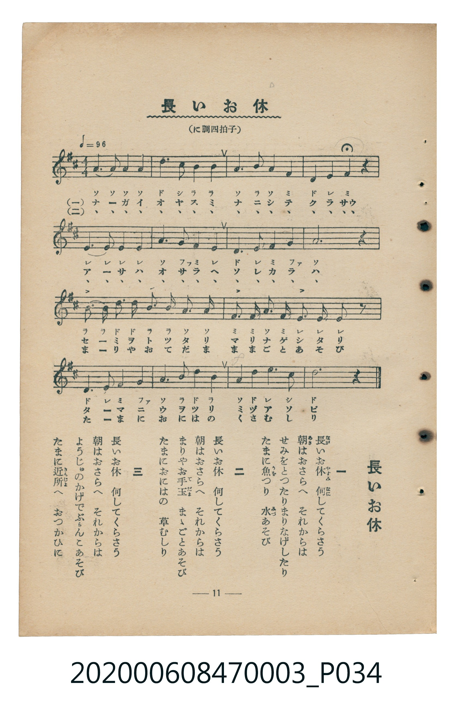

# 長いお休

> Re:Shōka 使用 AI 協助辨識與重建樂譜，可能會有錯誤。歡迎回報。

- **鋼琴伴奏版**：<br><audio controls src="nagai_oyasumi.mp3"></audio>
- **NEUTRINO 歌聲合成版**：<br><audio controls src="nagai_oyasumi_neutrino.mp3"></audio>

- 臺灣教育會公認《新定兒童唱歌》尋常科第三學年用（2020.006.0847.0003）

## 說明

原書資訊與歌詞全文（對應 P034.jpg，書頁 p. 11，第一學期第 9 首）：
調性與拍號：に調四拍子（D 大調 4/4 拍），速度 != 96


## 歌詞

```text
一
長（なが）いお休（やすみ）　何（なに）してくらさう
朝（あさ）はおさらへ　それからは
せみをとつたりまりなげしたり
たまに魚（うを）つり　水（みづ）あそび

二
長いお休　何してくらさう
朝はおさらへ　それからは
まりやお手玉（てだま）　まゝごとあそび
たまにおにはの　草むしり

三
長いお休　何してくらさう
朝はおさらへ　それからは
ようじゅのかげでぶらんこあそび
たまに近所（きんじょ）へ　おつかひに
```

## ABC

<div class="abc-score" data-abc-src="nagai_oyasumi.abc" aria-label="五線譜載入中"></div>

[下載 ABC 原始檔](nagai_oyasumi.abc)

## TMD 檔案連結

- [主旋律 TMD 檔案](nagai_oyasumi.tmd) [[在 TMD Studio 編輯](https://tmdlang.github.io/Tmd-TS/#tmd=s7IKdvYPcrWy4qpTUCpJTLdSSM7PyUlNLsnMz7MqzsjMK0nNjM_KTMmPL87Iz05Ugisry88pzU21Si9KTEmNN443MjAyiDcwMIs3sDAxBzIMjBFKi_NLi5JTrYqTM_Lzc-JLUitKkvLzsxHyBUX5Zal5iXlANQVFIBtTwIoQClLLMlNSQdKpKZkl-UWZiTlI7kgtKga7FWxJfElRYl5xclFmAcgDCFUlGalAx0JdkJOZloqQApqXnplnVZKYWZ6YF5-flpaZjGJBflFJRj7QmwUZlVYZmcUg-5MTc-KzE_OQQgNqe0FieqpVgIGxiRKXlpbCy6nbHze2PG7serJnooKWFpeirYKlGZe9rYILl42JvokdSPeL9l3PGxc_mzrzRdOmZ3Oan7auebGq93FD17NpG56um_W0ddLz1UufTtn4bG3P44bupxu6n-7Y8Xz5xOdr1jzZ0fl07Y6nO7c8n7Li_Z4OUPjrAcNfDxT-QIaB8fs9nUpcXPpaCrbUAlwKCgpP--Y_m73jxeb2Fyu6XnS0A931YuW8p60rnk1rB7ri6YbeZ-2dCqAQ0MsqSH-_pweo-OWCRoUCPQVDQyAX7PAGoMOfzZkPZCtYKrxcNg3o0vd7ZoFMf7Fq_7OG5SBzu3tfzJwPFH3cuBoo-HT2bKDI07UTgHa4KDxdshwopgAMQgWgKFh3z8uG-U93LVOABDHIKKA1IAoYB0A9jxtXPW7sAaqExwdIsAnInvm4cT9IvKHhyd6pMJWrwSqnP25c9rix_3ETkD31cWMbyLhnc-aCFTUBhcCK1gONA0mDFO0AmvK4ce7jpp7Hjd1gkfUgPY8bZwMtedw06XHjiseNSx43zn_cBNSzD0wCbQOKA60CCUJUzwfJNa5-uXYW2Ko2oE6wVUtAGhoanm3YAhbf_7hxKVgc6Ja5jxs3Q3y9qwfqa7hPIV7D6R0ivQB2LSjAup51dj_vAwY50AlA8xYApSDhB1YDNG4K2JswRyH7CGwPkARauA6o4UVv5-MmoLbpIJ9DoqyTJo5vAodi44zHTa0gm4FyoDBf_rhxG0hR0-THjUCEzcEv9k981tkA9movWB3QCGAyh1sFtBkYnUDjNgEVg3RSnsegQEFLn4vLLzE9MdO_MrG4NDfTKiAzMS_focagphpkkYKNhZYdmIEtgytAstmLhT0KGiYKTzf0P1_foAPPlZpYNACtAxlWo2CqoAuEpmAahGsUDOPAQuYKZkAShGGKzMC0MUQRkDSC8gxAImDjfAxrgIG5CqxaF8jqAZMtYB3A0IOINrUA2TPBMvuhMhAdwDAF4ulg1jKoTD9YRydYDJQOgIx4hHVG9LXOmG7W4Y_pXT3kxDQoukCRBqJBGBatJuBIhIiAohXEBomYIKmBQPSIboIHxVQwuR41KICiMM_tgMrMhQZSD5DdDfc8SAakFwbRY5gO9oCjlrb2QLKxoRnBfNxJTuyCMiooi0JzL5CCicByeA04VkFZFiJijJIiDIAQOW5nw8MClIxBPpsEZK-Aii0B4vlQ8S6wf_fBeYgED9IBSvAg9nywHCgs4lHiFqIPohORgWAhvgyIF0DZ-5DtAdLAmgfKXgGPO1CMAAt1VHtAcdvUAZVvA2JgqQ7KaiDuOmjEwZy7HOockFXboA7qBOLJUDWTcVpFXCkNbNiQE7u48iU0vpFLaaCAEawEhxfm2PMvJAYhoQkpoCAehwYOOMaXwOMGJANNC41LUYIBJAMKCFz5F5c9sFgGFYyg_AKKDkTBCMtxDVD2dJAMNJVg2APOv7js6YX6BxR5wLgHJQVEFoY5ApSkYSlhE1gGpB3VqlouLl07BeRqWgHIV-YCAA)]
- [鋼琴伴奏 TMD 檔案](nagai_oyasumi_piano.tmd) [[在 TMD Studio 編輯](https://tmdlang.github.io/Tmd-TS/#tmd=s7IKdvYPcrWy4qpTUCpJTLdSyC8qychPL0osyKi0ysgsLskvykxOzInPTsxLVIIrKs4vLUpOjS9ITE-1CjAwNlHi0tJSeDl1--PGlseNXU_2THy_p-Nl957nE7Y82bPl6dL-550d7_d0KmhpcSnaKliacdnbKrhw2Zjom9iBjHzRvut54-JnU2e-aNr0bE7z09Y1L1b1Pm7oejZtw9N1s562Tnq-eunTKRufre153ND9dEP30x07ni-f-HzNmic7Op-u3fF055bnU1YAbTQyMDLQMzAw0zOwMDEHMgyMgZYqcXH5JaYnZvpXJhaX5mZaBWQm5uUHeTjUGNRUcykAgY2Flh2Yoa-lYIsOFMC2NLxY2KOgYaLwdEP_8_UNOgogL-tlFaRrYtGgpQ82rEbBVEEXCE3BNAjXKBjGgYXMFcyAJAjDFJmBaWOIIiBpBOUZgETAxvkY1ig8blwFVq0LZPWAyRawDmCIQ0SbWoDsmWCZ_VAZiI7HjauBeDqYtQwq0w_W0QkWm_q4sQ3IiEdYZ0Rf64zpZh3-mN7VQ05Mg6ILFGkgGoRh0WoCjkSICChaQWyQiAmSGghEj-gmeFBMBZPrUYMCKArz3A6ozFxoIPUA2d1wz4NkQHphED2G6WAPOGppaw8kGxuaEczHneTELiijgrIoNPcCKZgILIfXgGMVlGUhIsYoKcIACJHjdjY8LEDJGOSzSUD2CqjYEiCeDxXvAvt3H5yHSPAgHaAED2LPB8uBwiIeJW4h-iA6ERkIFuLLgHgBlL0P2R4g_bhxCpS9Ah53oBh53LgZ1R5Q3DZ1QOXbgHjG4yZQVgNx10EjDubc5VDngKzaBnVQJxBPhqqZjNMq4krpp7NnkxO7uPIlNL4RpTSYawQrweGFOfb8C4lBSGhCCiiIx6GBA47xJfC4AcmA0sLjxllgEhEMIBlQQODKv7jsgcUyqGAE5RdQdCAVjJBc2NQAVTUdJANNJdjzLy57eqH-AUUeMO5BSQGRhUEGQr0JTwmbwDIg7ahW1WKrpX2Qa2kTaPwDQz5eIdowFkbVKJgAGSaxMApT3jQeyDKNB4vAsiKSKJyBqhKiF8qAm42iC2YYktugCtH1I-wg5Bm8FkKdidADcgEw6HTtFJBDL9oHKIshZoRFzBgspswFAA)]

## 分析

```text
================================================================================
📊 TMD Song Profile: [ 長いお休 ]
================================================================================
⏱  Duration:       0:35 (35.0s), 14 measures total
🎼 Key & Tempo:    首調基準 D, != 96.0 BPM, <4/4>
   - 分析範圍：      由實際發聲的音符與和弦推測調性；播放脈絡另行呈現
🎤 人聲音域:    D4 (MIDI 62) – E5 (MIDI 76) [跨度: 14 個半音 / 1.2 個八度, 難度: moderate]
   - 最低音:  D4 in [NagaiOyasumi #1 @ m.4, 0:07]
   - 最高音: E5 in [NagaiOyasumi #1 @ m.13, 0:31]
   - 適合: soprano, mezzo-soprano, contralto, tenor, baritone, bass
🏛  結構:      NagaiOyasumi (35.0s)
⚡ 編曲密度:        Peak 1 軌道同時演奏
🗝  調性診斷：       A 調性不明確（純淨自然大調，未偵測到可信轉調）
   - 風格氣質:    純淨自然大調（陽光明朗、易唱易記，無明顯調外色彩）
   - 轉調歷程:    全曲維持單一推測調性（未偵測到可信轉調）
   - 核心骨幹音:  A, D, E, F#, B
   - 調性數值:    A 調性不明確 [相關度: 0.87, 穩定度: Ambiguous, 自然音純度: 95.2%]
   - 候選調性 (K-S): A 大調 (0.87), D 大調 (0.84), A 小調 (0.56)
   - 五度圈歷程:   +3
   - 各段落調性細節:
     • [NagaiOyasumi #1]: A 調性不明確 (r: 0.87, 自然音純度: 95.2%, 調外音: G)

  [ 五度圈游移軌跡 ]
               C  
         F            G  
      Bb               D  
      Eb              [A ]*
         Ab           E  
            Db       B  
               F# 
     (* = active key center)

  [ 十二半音累積音高分佈 ]
     C  :                            0.0%
     C# : ██                         1.9%
     D  : █████████████████         21.0%
     D# :                            0.0%
     E  : ███████████████           19.0%
     F  :                            0.0%
     F# : ██████████                11.9%
     G  : ████                       4.8%
     G# :                            0.0%
     A  : ████████████████████████  30.0%
     A# :                            0.0%
     B  : █████████                 11.4%
--------------------------------------------------------------------------------
Assignment 軌道音域：
  - Piano         : D4 – E5 (14 個半音 / 1.2 個八度, 56 個音符)
================================================================================
```


## 原書掃描頁




