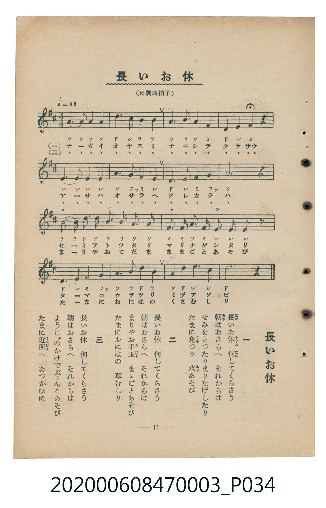

# 長いお休

<audio controls src="nagai_oyasumi.mp3"></audio>

- 臺灣教育會公認《新定兒童唱歌》尋常科第三學年用（2020.006.0847.0003）

## 說明

原書資訊與歌詞全文（對應 P034.jpg，書頁 p. 11，第一學期第 9 首）：
調性與拍號：に調四拍子（D 大調 4/4 拍），速度 != 96

## 跨冊／重複收錄參照

> 同曲（《公學校唱歌》與《新定兒童唱歌》第三學年共用教材）

- **[同曲]** 《公學校唱歌》第三學年（昭和10年／1935）：[**〈ながいお休（長假）〉**](../../../kogakko_shoka/grade_3/5_nagaioyasumi/index.md)（`D` / `4/4` — [原始 TMD](../../../kogakko_shoka/grade_3/5_nagaioyasumi/nagaioyasumi.tmd)）
- 總表：[跨冊重複與同名歌曲總索引](../../../duplicate_songs.md)

## 歌詞

```text
一
長（なが）いお休（やすみ）　何（なに）してくらさう
朝（あさ）はおさらへ　それからは
せみをとつたりまりなげしたり
たまに魚（うを）つり　水（みづ）あそび

二
長いお休　何してくらさう
朝はおさらへ　それからは
まりやお手玉（てだま）　まゝごとあそび
たまにおにはの　草むしり

三
長いお休　何してくらさう
朝はおさらへ　それからは
ようじゅのかげでぶらんこあそび
たまに近所（きんじょ）へ　おつかひに
```

## ABC

```abc
X:1
T:長いお休
M:4/4
L:1/16
Q:1/4=96
K:D
V:V1 name="Piano" snm="Pia"
[V:V1]
A6 A2 A4 A4 | d6 c2 B4 B4 | A6 B2 A4 F4 | D4 E4 F4 z4 |
E6 E2 E4 E4 | A6 G2 F4 E4 | D6 E2 F4 G4 | A12 z4 |
B6 B2 d4 d4 | B4 B4 A4 A4 | F6 F2 A4 F4 | E12 E2 z2 |
D4 E4 F4 G4 | A4 B4 d4 B4 | A4 D4 E4 C4 | D12 z4 |
```

## TMD 檔案連結

- [主旋律 TMD 檔案](nagai_oyasumi.tmd) [[在 TMD Studio 編輯](https://tmdlang.github.io/Tmd-TS/#tmd=s7IKdvYPcrWy4tLSUng5dfvjxpbHjV1P9kxU0NLiUrRVsDTjsrdVcOGyMdE3seOqU1B60b7reePiZ1Nnvmja9GxO89PWNS9W9T5u6Ho2bcPTdbOetk56vnrp0ykbn63tedzQ_XRD99MdO54vn_h8zZonOzqfrt3xdOeW51NWvN_TYWRgZKBnYGCmZ2BhYg5kGBi_39OpxMWlr6VgSy3ApaCg8LRv_rPZO15sbn-xoutFRzvQXS9WznvauuLZtHagK55u6H3W3qkQYGBsopdVkP5-Tw9Q8csFjQoFegqGhkAu2OENQIc_mzMfyFawVHi5bBrQpe_3zAKZ_mLV_mcNy0Hmdve-mDkfKPq4cTVQ8Ons2UCRp2snAO1wUXi6ZDlQTAEYhApAUbDunpcN85_uWqYACWKQUUBrQBQwDoB6HjeuetzYA1QJjw-QYBOQPfNx436QeEPDk71TYSpXg1VOf9y47HFj_-MmIHvq48Y2kHHP5swFK2oCCoEVrQcaB5IGKdoBNOVx49zHTT2PG7vBIutBeh43zgZa8rhp0uPGFY8blzxunP-4CahnH5gE2gYUB1oFEoSong-Sa1z9cu0ssFVtQJ1gq5aANDQ0PNuwBSy-_3HjUrA40C1zHzduhvh6Vw_U13CfQryG0ztEegHsWlCAdT3r7H7eBwxyoBOA5i0ASkHCD6wGaNwUsDdhjkL2EdgeIAm0cB1Qw4vezsdNQG3TQT6HRFknTRzfBA7FxhmPm1pBNgPlQGG-_HHjNpCipsmPG4EIm4Nf7J_4rLMB7NVesDqgEcBkDrcKaDMwOoHGbQIqBumkPI9BgYKWPheXX2J6YqZ_ZWJxaW6mVUBmYl6-Q41BjUI1yCYFGwstOzADWw5XgOSzFwt7FDRMFJ5u6H--vkEHni01sWgA2gcyrEbBVEEXCE3BNAjXKBjGgYXMFcyAJAjDFJmBaWOIIiBpBOUZgETAMYrbcbt6yHEcyAaQPSAahGEuMQHbCxEBuQTEBomYIKmBQGLctqOTHLeBQgYUJuDgAhMQMRBGBCbIVaBQQoQcxE8QaAR0HwHXAYtCclyHHD-IUAG5DexURLTCFJrHI4UmctjVcnHp2ikgp00FIF-ZiwsA)]
- [鋼琴伴奏 TMD 檔案](nagai_oyasumi_piano.tmd) [[在 TMD Studio 編輯](https://tmdlang.github.io/Tmd-TS/#tmd=s7IKdvYPcrWy4tLSUng5dfvjxpbHjV1P9kx8v6fjZfee5xO2PNmz5enS_uedHe_3dCpoaXEp2ipYmnHZ2yq4cNmY6JvYcdUpKL1o3_W8cfGzqTNfNG16Nqf5aeuaF6t6Hzd0PZu24em6WU9bJz1fvfTplI3P1vY8buh-uqH76Y4dz5dPfL5mzZMdnU_X7ni6c8vzKSuANhoZGBnoGRiY6RlYmJgDGQbGQEuVuLj8EtMTM_0rE4tLczOtAjIT8_KDPBxqDGoUqrkUgMDGQssOzKhRMFXQBUJTMA3CNQqGcWAhcwUzIAnCMEVmYNoYoghIGkF5BiARqHEgMZAMiAZhmF4TsEqICEgviA0SMUFSA4HIpoFsB9kLdhKYgIiBMMLBIHNALkG4DuIKCDQCmggzD9nVCJtBpoENR3gWptA8HsnFyO6rxRbGPihhbAIPY8N4hWjDWBhVo2ACZJjEwihMedN4IMs0HiyCcDxcFM5AVQnRC2XAzUbRhTAM3QlQBroxmE5CNQZdGV7boW5G6AGZAwxIXTsF5LBUwMJX5uICAA)]

## 分析

```text
================================================================================
📊 TMD Song Profile: [ 長いお休 ]
================================================================================
⏱  Duration:       0:40 (40.0s), 16 measures total
🎼 Key & Tempo:    首調基準 D, != 96.0 BPM, <4/4>
   - 分析範圍：      由實際發聲的音符與和弦推測調性；播放脈絡另行呈現
🎤 人聲音域:    C#4 (MIDI 61) – D5 (MIDI 74) [跨度: 13 個半音 / 1.1 個八度, 難度: moderate]
   - 最低音:  C#4 in [NagaiOyasumi #1 @ m.15, 0:36]
   - 最高音: D5 in [NagaiOyasumi #1 @ m.2, 0:02]
   - 適合: soprano, mezzo-soprano, contralto, tenor, baritone, bass
🏛  結構:      NagaiOyasumi (40.0s)
⚡ 編曲密度:        Peak 1 軌道同時演奏
🗝  調性診斷：       A 調性不明確（純淨自然大調，未偵測到可信轉調）
   - 風格氣質:    純淨自然大調（陽光明朗、易唱易記，無明顯調外色彩）
   - 轉調歷程:    全曲維持單一推測調性（未偵測到可信轉調）
   - 核心骨幹音:  A, D, E, B, F#
   - 調性數值:    A 調性不明確 [相關度: 0.86, 穩定度: Ambiguous, 自然音純度: 95.9%]
   - 候選調性 (K-S): A 大調 (0.86), D 大調 (0.83), F# 小調 (0.56)
   - 五度圈歷程:   +3
   - 各段落調性細節:
     • [NagaiOyasumi #1]: A 調性不明確 (r: 0.86, 自然音純度: 95.9%, 調外音: G)

  [ 五度圈游移軌跡 ]
               C  
         F            G  
      Bb               D  
      Eb              [A ]*
         Ab           E  
            Db       B  
               F# 
     (* = active key center)

  [ 十二半音累積音高分佈 ]
     C  :                            0.0%
     C# : ██                         2.5%
     D  : ██████████████████        19.8%
     D# :                            0.0%
     E  : ██████████████████        19.8%
     F  :                            0.0%
     F# : ████████████              13.2%
     G  : ████                       4.1%
     G# :                            0.0%
     A  : ████████████████████████  26.4%
     A# :                            0.0%
     B  : █████████████             14.0%
--------------------------------------------------------------------------------
Assignment 軌道音域：
  - Piano         : C#4 – D5 (13 個半音 / 1.1 個八度, 55 個音符)
================================================================================
```


## 原書掃描頁




