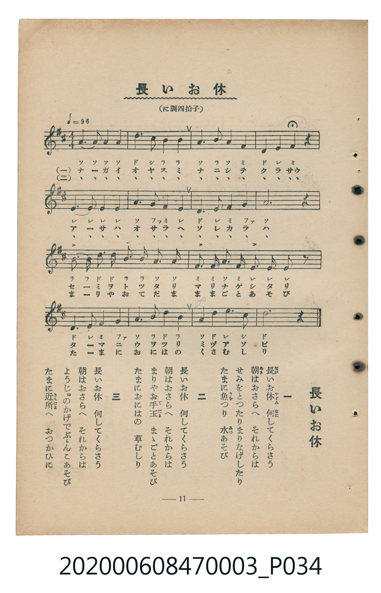

# 長いお休

> Re:Shōka 使用 AI 協助辨識與重建樂譜，可能會有錯誤。歡迎回報。

<audio controls src="nagai_oyasumi.mp3"></audio>

- 臺灣教育會公認《新定兒童唱歌》尋常科第三學年用（2020.006.0847.0003）

## 說明

原書資訊與歌詞全文（對應 P034.jpg，書頁 p. 11，第一學期第 9 首）：
調性與拍號：に調四拍子（D 大調 4/4 拍），速度 != 96

## 跨冊／重複收錄參照

> 同曲（《公學校唱歌》與《新定兒童唱歌》第三學年共用教材）

- **[同曲]** 《公學校唱歌》第三學年（昭和10年／1935）：[**〈ながいお休（長假）〉**](../../../kogakko_shoka/grade_3/5_nagaioyasumi/index.md)（`D` / `4/4` — [原始 TMD](../../../kogakko_shoka/grade_3/5_nagaioyasumi/nagaioyasumi.tmd)）
- 總表：[跨冊重複與同名歌曲總索引](../../../duplicate_songs.md)

## 歌詞

```text
一
長（なが）いお休（やすみ）　何（なに）してくらさう
朝（あさ）はおさらへ　それからは
せみをとつたりまりなげしたり
たまに魚（うを）つり　水（みづ）あそび

二
長いお休　何してくらさう
朝はおさらへ　それからは
まりやお手玉（てだま）　まゝごとあそび
たまにおにはの　草むしり

三
長いお休　何してくらさう
朝はおさらへ　それからは
ようじゅのかげでぶらんこあそび
たまに近所（きんじょ）へ　おつかひに
```

## ABC

```abc
X:1
T:長いお休
M:4/4
L:1/16
Q:1/4=96
K:D
V:V1 name="Piano" snm="Pia"
[V:V1]
A6 A2 A4 A4 | d6 c2 B4 B4 | A6 B2 A4 F4 | D4 E4 F4 z4 |
E6 E2 E4 E4 | A6 G2 F4 E4 | D6 E2 F4 G4 | A12 z4 |
B3 B d3 d B3 B A3 A | F3 F A3 F E3 E E2 z z | D6 E2 F4 G4 | A6 B2 d4 B4 |
A6 d2 e6 c2 | d12 z4 |
```

## TMD 檔案連結

- [主旋律 TMD 檔案](nagai_oyasumi.tmd) [[在 TMD Studio 編輯](https://tmdlang.github.io/Tmd-TS/#tmd=s7IKdvYPcrWy4qpTUCpJTLdSSM7PyUlNLsnMz7MqzsjMK0nNjM_KTMmPL87Iz05Ugisry88pzU21Si9KTEmNN443MjAyiDcwMIs3sDAxBzIMjBFKi_NLi5JTrYqTM_Lzc-JLUitKkvLzsxHyBUX5Zal5iXlANQVFIBtTwIoQClLLMlNSQdKpKZkl-UWZiTlI7kgtKga7FWxJfElRYl5xclFmAcgDCFUlGalAx0JdkJOZlqrEpaWl8HLq9seNLY8bu57smaigpcWlaKtgacZlb6vgwmVjom9iB9L-on3X88bFz6bOfNG06dmc5qeta16s6n3c0PVs2oan62Y9bZ30fPXSp1M2Plvb87ih--mG7qc7djxfPvH5mjVPdnQ-Xbvj6c4tz6eseL-nAxRAesAA0gMFEJBhYPx-T6cSF5e-loIttQCXgoLC0775z2bveLG5_cWKrhcd7UB3vVg572nrimfT2oGueLqh91l7p0KAgbGJXlZB-vs9PUDFLxc0KhToKRgaArlghzcAHf5sznwgW8FS4eWyaUCXvt8zC2T6i1X7nzUsB5nb3fti5nyg6OPG1UDBp7NnA0Werp0AtMNF4emS5UAxBWAQKgBFwbp7XjbMf7prmQIkiEFGAa0BUcA4AOp53LjqcWMPUCU8PkCCTUD2zMeN-0HiDQ1P9k6FqVwNVjn9ceOyx439j5uA7KmPG9tAxj2bMxesqAkoBFa0HmgcSBqkaAfQlMeNcx839Txu7AaLrAfpedw4G2jJ46ZJjxtXPG5c8rhx_uMmoJ59YBJoG1AcaBVIEKJ6PkiucfXLtbPAVrUBdYKtWgLS0NDwbMMWsPj-x41LweJAt8x93LgZ4utdPVBfw30K8RpO7xDpBbBrQQHW9ayz-3kfMMiBTgCatwAoBQk_sBqgcVPA3oQ5CtlHYHuAJNDCdUANL3o7HzcBtU0H-RwSZZ00cXwTOBQbZzxuagXZDJQDhfnyx43bQIqaJj9uBCJsDn6xf-KzzgawV3vB6oBGAJM53CqgzcDoBBq3CagYpJPyPAYFClr6XFx-iemJmf6VicWluZlWAZmJefkONQY1CtUgmxRsLLTswAxsOVwBks9eLOxR0DBReLqh__n6Bh14ttTEogFoH8iwGgVTBV0gNAXTIFyjYBgHFjJXMAOSIAxTZAamjSGKgKQRlGcAEgHHKG7H7eohx3EgG0D2gGgQhrnEBGwvRATkEhAbJGKCpAYCkdxmY2hGMAg7yXElKIxAoQMNOCAFE4EFbg3YdaDQgogYo_jMAAhhbiQUy8CSkRwn4gokqKORYxkoYARLAfDEgByYtVxcunYKyIlVAchX5uICAA)]
- [鋼琴伴奏 TMD 檔案](nagai_oyasumi_piano.tmd) [[在 TMD Studio 編輯](https://tmdlang.github.io/Tmd-TS/#tmd=s7IKdvYPcrWy4tLSUng5dfvjxpbHjV1P9kx8v6fjZfee5xO2PNmz5enS_uedHe_3dCpoaXEp2ipYmnHZ2yq4cNmY6JvYcdUpKL1o3_W8cfGzqTNfNG16Nqf5aeuaF6t6Hzd0PZu24em6WU9bJz1fvfTplI3P1vY8buh-uqH76Y4dz5dPfL5mzZMdnU_X7ni6c8vzKSuANhoZGBnoGRiY6RlYmJgDGQbGQEuVuLj8EtMTM_0rE4tLczOtAjIT8_KDPBxqDGoUqrkUgMDGQssOzNDXUrBFBwpgaxpeLOxR0DBReLqh__n6Bh2FAANjE72sgnRNLBq09MGG1SiYKugCoSmYBuEaBcM4sJC5ghmQBGGYIjMwbQxRBCSNoDwDkAgXfsft6iHHcSAbQPaAaBCGucQEbC9EBOQSEBskYoKkBgKR3GZjaEYwCDvJcSUojEChAw04IAUTgQVuDdh1oNCCiBij-MwACGFuJBTLT2fPJseJuAIJ6mhELIO5RrAUAE8MyIFZiy2t-qCkVROoL4D64xWiDWNhVI2CCZBhEgujMOVN44Es03iwCChUoIkUJgpnoKqE6IUy4Gaj6IIZhuQ2qEJ0_Qg7CHkGr4VQZyL0gFwADDtdOwXk4CPEVwDylbm4AA)]

## 分析

```text
================================================================================
📊 TMD Song Profile: [ 長いお休 ]
================================================================================
⏱  Duration:       0:35 (35.0s), 14 measures total
🎼 Key & Tempo:    首調基準 D, != 96.0 BPM, <4/4>
   - 分析範圍：      由實際發聲的音符與和弦推測調性；播放脈絡另行呈現
🎤 人聲音域:    D4 (MIDI 62) – E5 (MIDI 76) [跨度: 14 個半音 / 1.2 個八度, 難度: moderate]
   - 最低音:  D4 in [NagaiOyasumi #1 @ m.4, 0:07]
   - 最高音: E5 in [NagaiOyasumi #1 @ m.13, 0:31]
   - 適合: soprano, mezzo-soprano, contralto, tenor, baritone, bass
🏛  結構:      NagaiOyasumi (35.0s)
⚡ 編曲密度:        Peak 1 軌道同時演奏
🗝  調性診斷：       A 調性不明確（純淨自然大調，未偵測到可信轉調）
   - 風格氣質:    純淨自然大調（陽光明朗、易唱易記，無明顯調外色彩）
   - 轉調歷程:    全曲維持單一推測調性（未偵測到可信轉調）
   - 核心骨幹音:  A, D, E, F#, B
   - 調性數值:    A 調性不明確 [相關度: 0.87, 穩定度: Ambiguous, 自然音純度: 95.2%]
   - 候選調性 (K-S): A 大調 (0.87), D 大調 (0.84), A 小調 (0.56)
   - 五度圈歷程:   +3
   - 各段落調性細節:
     • [NagaiOyasumi #1]: A 調性不明確 (r: 0.87, 自然音純度: 95.2%, 調外音: G)

  [ 五度圈游移軌跡 ]
               C  
         F            G  
      Bb               D  
      Eb              [A ]*
         Ab           E  
            Db       B  
               F# 
     (* = active key center)

  [ 十二半音累積音高分佈 ]
     C  :                            0.0%
     C# : ██                         1.9%
     D  : █████████████████         21.0%
     D# :                            0.0%
     E  : ███████████████           19.0%
     F  :                            0.0%
     F# : ██████████                11.9%
     G  : ████                       4.8%
     G# :                            0.0%
     A  : ████████████████████████  30.0%
     A# :                            0.0%
     B  : █████████                 11.4%
--------------------------------------------------------------------------------
Assignment 軌道音域：
  - Piano         : D4 – E5 (14 個半音 / 1.2 個八度, 56 個音符)
================================================================================
```


## 原書掃描頁




