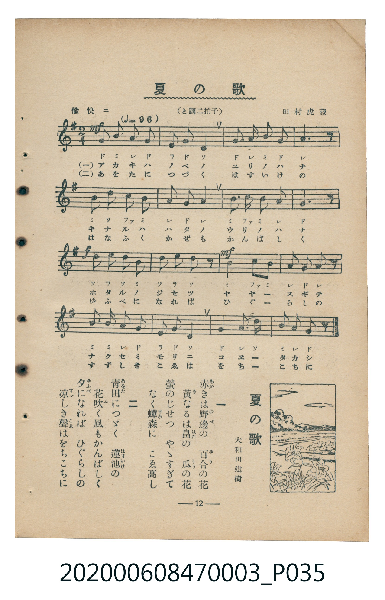

# 夏の歌

> Re:Shōka 使用 AI 協助辨識與重建樂譜，可能會有錯誤。歡迎回報。

- **NEUTRINO 歌聲合成版**：<br><audio controls src="natsu_no_uta_neutrino.mp3"></audio>
- **鋼琴伴奏版**：<br><audio controls src="natsu_no_uta.mp3"></audio>


- 詞：大和田建樹
- 曲：田村虎藏
- 臺灣教育會公認《新定兒童唱歌》尋常科第三學年用（2020.006.0847.0003）

## 說明

原書資訊與歌詞全文（對應 P035.jpg，書頁 p. 12，第一學期第 10 首）：
調性與拍號：と調二拍子（G 大調 2/4 拍），「愉快ニ」，速度 != 96


## 歌詞

```text
一
赤（あか）きは野邊（のべ）の　百合（ゆり）の花（はな）
黃（き）なるは畠（はた）の　瓜（うり）の花（はな）
螢（ほたる）のじせつ　やゝすぎて
なく蟬森（せみもり）に　こゑ高（たか）し

二
青田（あをた）につゞく　蓮池（はすいけ）の
花吹（はなふ）く風（かぜ）もかんばしく
夕（ゆふべ）になれば　ひぐらしの
涼（すゞ）しき聲（こゑ）はをちこちに
```

## ABC

```abc
X:1
T:夏の歌
C:曲：田村虎藏
M:2/4
L:1/16
Q:1/4=96
K:G
V:V1 name="Piano" snm="Pia"
[V:V1]
!mf! G2 B2 A2 G2 | E2 G2 D4 | G2 A2 B2 G2 | A6 z2 |
w: 1.~あ か き は | の べ の | ゆ り の は | な
w: 2.~あ を た に | つ づ く | は す い け | の
B2 d2 c2 B2 | A2 G2 A4 | B3 c B2 A2 | G6 z2 |
w: 1.~き な る は | は た の | う り の は | な
w: 2.~は な ふ く | か ぜ も | か ん ば し | く
!f! d2 e2 d2 B2 | d2 e2 d2 z2 | !mf! B4 c2 B2 | A2 G2 A2 z2 |
w: 1.~ほ た る の | じ せ つ | や や _ | す ぎ て
w: 2.~ゆ ふ べ に | な れ ば | ひ ぐ _ | ら し の
B2 B2 A2 G2 | E2 G2 D4 | G4 A2 D2 | B2 A2 G2 z2 |
w: 1.~な く せ み | も り に | こ ゑ _ | た か し
w: 2.~す ず し き | こ ゑ は | を ち _ | こ ち に
```

## TMD 檔案連結

- [主旋律 TMD 檔案](natsu_no_uta.tmd) [[在 TMD Studio 編輯](https://tmdlang.github.io/Tmd-TS/#tmd=s7IKdvYPcrWy4qpTUCpJTLdSSM7PyUlNLsnMz7MqzsjMK0nNjM_KTMmPL87Iz05Ugisry88pzU21Si9KTEmNN443MjAyiDcwMIs3sDAxBzIMjBFKi_NLi5JTrYqTM_Lzc-JLUitKkvLzsxHyBUX5Zal5iXlANQVFIBtTwIoQClLLMlNSQdKpKZkl-UWZiTlI7kgtKga7FWxJfElRYl5xclFmAcgDCFUlGalAxxanJhbn5xUTFAZakZ6ZZ5WbmpmVieReLS2Fp0v6Hzeue7a2R0FLi0vRVsHSjMveVsGdy8ZI38QOpP_Fynnv98x6umT500k9z6dseLp717MVO8EmP5u9CSgDFHs2d-KLmX0vpveDhV-073reuPjZ1JkvmjY9m9P8tHXNi1W9jxu6nk3b8HTdrKetk56vXvp0ykaglY8bup9u6H66Y8fz5ROfr1nzZEfn07U7nu7c8nzKivd7OkARoAeMAD1QBAAZBsbv93QqcXHpaynYUgtwKSgoPO2b_2z2jheb21-s6HrR0Q50F9DLT1tXPJvWDnTF0w29z9o7FQIMjE31sgrS3-_pASp-uaBRoUBPwdAIyAU7vAHo8Gdz5gPZCoYGCi-XTQM6FRg2IONfrNr_rGE5yODu3hcz5wNFHzeuAAo-2dUDFHm6dgLQEndgNCwHiikAA10BKArWDQyenmctnU_3r37c3P24ASjY87Jh_tNdyxQg0QQyHGgz2I6tS4CmPG5setzYDdT7uLH3ceP6l-19L5u6wOLrHjfuBIuve9zQ8HzmvqcTOkDiTW2PQQpA4i-6NoJVrn_cuAooAjL05e5msBDINUDRx03dQOnnUxfA1AG9AjNx8hywIF7jXsxbBBbaDdQJNAuquXHG48bZjxuXAE153NTyuGnu48aZjxv7HjcuA-kBWdvY_2L-mmeL14E1A5Xuf9zUBLNnNUhb4-THTRNfrp4BVjAfFgLTIeGzqwfslbmTgMkUGkRNk2BuXw2yuGke0AqgOS8mr3u2Ee45oCNaHjdOhLgS7PyujU8nAAMR6qnHjVvBcv0vF4HSKtDWx43AQOgEOQ7Ibpr8uHED0BFABeAktmQqNLwbt8KiAmg5MEx7QOpAntj0uHHC4yaQw6EWPtu2B2zwTKALIT4CRsWLRmCWAwqCvAwWXA_2zkKQCIhcDdJJebaAAgUtfS4uv8SS4lK__NCSRKuAzMS8fIcag5pqkDUKNoZmWnZgFrYsqQDJGC8W9ihomCg83dD_fH2DDjwfaWLRALQNZFiNQnVuWq2CoYKugjEQGwExiF2jYBYPZZqCGCBYA-aCVIBUQlSBeDBoABIBG-pjWANMTU1APjB6wGQvmFwP1gMMcjBvJ5gEsSGmA2MMJNLUBRdH6FiFZA_IPVB7jOD2NE0Cq58PJldDdS0B85aCyX6EPWBTgXENJlvA5EQkl6Hagz_Id_WQE-Sg8DMFYhNoWELCERa6EFeCxEEqYLECCX1cYQ0JX1AoAXM7SshB_AoJF6SwbgSFNSS0SQlriGlgexq3wsMVJAOxdQ7YTFCMwOwBiYPEJgPZG8BqpkNlYDFCbFjv6CQreQNTNyiszaBhDglvZBFwWEKyASTQcUUMeqDvRgQtNNBBAQmSmQHmzQaToEQI9h5QFSixQYIDxgKphiTEPjC5DDPQIdkCGtyQTANL4JAI7wGLgQIXak_jJpg9jRMQ9jR1woMf4lIiAv3p7NnkJnDiihMQBKkCC0M0wjShBzck1YFSDSxo90M9BikBIOUGKGhgATsZHtyg_A0TheQFSISBAgM9jUOiYxZSYIFyF8w8iFmQnAALWFDZAwnuhWi2Q0QgroLYU8vFpWungCjnFYA8ZS4A)]
- [鋼琴伴奏 TMD 檔案](natsu_no_uta_piano.tmd) [[在 TMD Studio 編輯](https://tmdlang.github.io/Tmd-TS/#tmd=s7IKdvYPcrWy4tLSUni6pP9x47pna3ve7-l42b3n-YQtT_Zsebq0_3lnx_s9nQpaWlyKtgqWZlz2tgruXDZG-iZ2XHUKSi9Wznu_Z9bTJcufTup5PmXD0927nq3YqQSSeTZ7E1AGKPZs7sQXM_teTO8HC79o3_W8cfGzqTNfNG16Nqf5aeuaF6t6Hzd0PZu24em6WU9bJz1fvfTplI1Adzxu6H66ofvpjh3Pl098vmbNkx2dT9fueLpzy_MpK4BONDIwMtAzMDDTM7AwMQcyDIyBrlTi4vJLLCku9csPLUm0CshMzMsP8nCoMaip5lIAAhtDMy07MEtfS8EWHSiALWl4sbBHQcNE4emG_ufrG3QUAgyMTfWyCtI1sWjQ0gcbVqNQnZtWq2CooKtgDMRGQAxi1yiYxUOZpiAGCNaAuSAVIJUQVSAeDBqARMCG-hjWKDxubALyHzd2g8leMLkerAcYU2DeTjAJYkNMf9zUBhJp6oKLI3SsQrIH5B6oPUZwe5omgdXPB5OrobqWgHlLwWQ_wh6wqY8bZ4LJFjA5EcllqPbgD_JdPeQEOSj8TIHYBBqWkHCEhS7ElSBxkApYrEBCH1dYQ8IXFEqPmyAhDgs5iF8h4YIU1o2gsIaENilhDTENbE_jVni4gmQgts4BmwmKEZg9IHGQ2GQgewNYzXSoDCxGiA3rHZ1kJW9g6gaFtRk0zCHhjSwCDktINoAEOq6IQQ_03YighQY6KCBBMjPAvNlgEpQIwd4DqgIlNkhwwFgg1ZCE2Acml2EGOiRbQIMbkmlgCRwS4T1gMVDgQu1p3ASzp3ECwp6mTnjwQ1xKRKA_nT2b3AROXHECgiBVYGGIRpgm9OCGpDpQqoEF7X6oxyAlAKTcAAUNLGAnw4MblL9hopC8AIkwUGCgp3FIdMxCCixQ7oKZBzELkhNgAQsqeyDBvRDNdogIxFUQe2oxi3kf5GLeBFrKA4MnXiHaMBbIMIEx4CKm8fHA4IE4Gk042jQephTOwqIUIgrmm-AxEcVqhMkgIZBPdO0UEJ6J9gEKo4kYgUWUuQA)]

## 分析

```text
================================================================================
📊 TMD Song Profile: [ 夏の歌 ]
================================================================================
⏱  Duration:       0:20 (20.0s), 16 measures total
🎼 Key & Tempo:    首調基準 G, != 96.0 BPM, <2/4>
   - 分析範圍：      由實際發聲的音符與和弦推測調性；播放脈絡另行呈現
🎤 人聲音域:    D4 (MIDI 62) – E5 (MIDI 76) [跨度: 14 個半音 / 1.2 個八度, 難度: moderate]
   - 最低音:  D4 in [NatsuNoUta #1 @ m.2, 0:01]
   - 最高音: E5 in [NatsuNoUta #1 @ m.9, 0:10]
   - 適合: soprano, mezzo-soprano, contralto, tenor, baritone, bass
🏛  結構:      NatsuNoUta (20.0s)
⚡ 編曲密度:        Peak 1 軌道同時演奏
🗝  調性診斷：       G 大調（純淨自然大調，未偵測到可信轉調）
   - 風格氣質:    純淨自然大調（陽光明朗、易唱易記，無明顯調外色彩）
   - 轉調歷程:    全曲維持單一推測調性（未偵測到可信轉調）
   - 核心骨幹音:  G, A, B, D, E
   - 調性數值:    G 大調 [相關度: 0.81, 穩定度: High, 自然音純度: 100.0%]
   - 候選調性 (K-S): G 大調 (0.81), D 大調 (0.67), B 小調 (0.57)
   - 五度圈歷程:   +1
   - 各段落調性細節:
     • [NatsuNoUta #1]: G 大調 (r: 0.81, 自然音純度: 100.0%)

  [ 五度圈游移軌跡 ]
               C  
         F           [G ]*
      Bb               D  
      Eb               A  
         Ab           E  
            Db       B  
               F# 
     (* = active key center)

  [ 十二半音累積音高分佈 ]
     C  : ████                       4.2%
     C# :                            0.0%
     D  : ████████████████          16.9%
     D# :                            0.0%
     E  : ██████                     6.8%
     F  :                            0.0%
     F# :                            0.0%
     G  : ████████████████████████  25.4%
     G# :                            0.0%
     A  : ██████████████████████    23.7%
     A# :                            0.0%
     B  : ██████████████████████    22.9%
--------------------------------------------------------------------------------
Assignment 軌道音域：
  - Piano         : D4 – E5 (14 個半音 / 1.2 個八度, 50 個音符)
================================================================================
```


## 原書掃描頁




