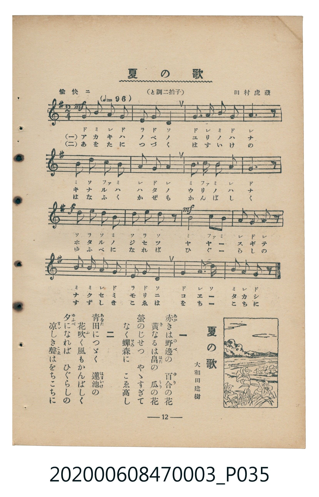

# 夏の歌

<audio controls src="natsu_no_uta.mp3"></audio>

- 詞：大和田建樹
- 曲：田村虎藏
- 臺灣教育會公認《新定兒童唱歌》尋常科第三學年用（2020.006.0847.0003）

## 說明

原書資訊與歌詞全文（對應 P035.jpg，書頁 p. 12，第一學期第 10 首）：
調性與拍號：と調二拍子（G 大調 2/4 拍），「愉快ニ」，速度 != 96

## 歌詞

```text
一
赤（あか）きは野邊（のべ）の　百合（ゆり）の花（はな）
黃（き）なるは畠（はた）の　瓜（うり）の花（はな）
螢（ほたる）のじせつ　やゝすぎて
なく蟬森（せみもり）に　こゑ高（たか）し

二
青田（あをた）につゞく　蓮池（はすいけ）の
花吹（はなふ）く風（かぜ）もかんばしく
夕（ゆふべ）になれば　ひぐらしの
涼（すゞ）しき聲（こゑ）はをちこちに
```

## ABC

```abc
X:1
T:夏の歌
C:曲：田村虎藏
M:2/4
L:1/16
Q:1/4=96
K:G
V:V1 name="Piano" snm="Pia"
[V:V1]
G2 B2 A2 G2 | E2 G2 D4 | G2 A2 B2 G2 | A6 z2 |
B2 d2 c2 B2 | A2 G2 A4 | B3 c B2 A2 | G6 z2 |
d2 e2 d2 B2 | d2 e2 d2 z2 | B4 c2 B2 | A2 G2 A2 z2 |
B2 B2 A2 G2 | E2 G2 D4 | G4 A2 D2 | B2 A2 G2 z2 |
```

## TMD 檔案連結

- [主旋律 TMD 檔案](natsu_no_uta.tmd) [[在 TMD Studio 編輯](https://tmdlang.github.io/Tmd-TS/#tmd=s7IKdvYPcrWy4tLSUni6pP9x47pna3sUtLS4FG0VLM247G0V3LlsjPRN7LjqFJRerJz3fs-sp0uWP53U83zKhqe7dz1bsVMJJPNs9iagDFDs2dyJL2b2vZjeDxZ-0b7reePiZ1Nnvmja9GxO89PWNS9W9T5u6Ho2bcPTdbOetk56vnrp0ykbgVY-buh-uqH76Y4dz5dPfL5mzZMdnU_X7ni6c8vzKSve7-kwMjAy0DMwMNMzsDAxBzIMjN_v6VTi4tLXUrClFuBSUFB42jf_2ewdLza3v1jR9aKjHeguoJeftq54Nq0d6IqnG3qftXcqBBgYm-plFaS_39MDVPxyQaNCgZ6CoRGQC3Z4A9Dhz-bMB7IVDA0UXi6bBnQqMGxAxr9Ytf9Zw3KQwd29L2bOB4o-blwBFHyyqwco8nTtBKAl7sBoWA4UUwAGugJQFKwbGDw9z1o6n-5f_bi5-3EDULDnZcP8p7uWKUCiCWQ40GawHVuXAE153Nj0uLEbqPdxY-_jxvUv2_teNnWBxdc9btwJFl_3uKHh-cx9Tyd0gMSb2h6DFIDEX3RtBKtc_7hxFVAEZOjL3c1gIZBrgKKPm7qB0s-nLoCpA3oFZuLkOWBBvMa9mLcILLQbqBNoFlRz44zHjbMfNy4BmvK4qeVx09zHjTMfN_Y9blwG0gOytrH_xfw1zxavA2sGKt3_uKkJZs9qkLbGyY-bJr5cPQOsYD4sBKZDwmdXD9grcycBkyk0iJomwdy-GmRx0zygFUBzXkxe92wj3HNAR7Q8bpwIcSXY-V0bn04ABiLUU48bt4Ll-l8uAqVVoK2PG4GB0AlyHJDdNPlx4wagI4AKwElsyVRoeDduhUUF0HJgmPaA1IE8selx44THTSCHQy18tm0P2OCZQBdCfASMiheNwCwHFAR5GSy4HuydhSARELkapJPybAEFClr6XFx-iSXFpX75oSWJVgGZiXn5DjUGNQrVIHsUbAzNtOzALGx5UgGSM14s7FHQMFF4uqH_-foGHXhG0sSiAWgdyLAaBUMFXQVjIDYCYhC7RsEsHso0BTFAEKIKpAKkEqIKxINBA5AIOBHgdt2uHnJcB7LPFIhNoHZD7IW5BuI2kDhIBcwXENeS4rYdneS4DeQuM6j7IG5DFgHbC3UbLvcT4bans2eTG27ExSoIglSBhSEaYZogzqvl4tK1U0AkTQUgT5mLCwA)]
- [鋼琴伴奏 TMD 檔案](natsu_no_uta_piano.tmd) [[在 TMD Studio 編輯](https://tmdlang.github.io/Tmd-TS/#tmd=s7IKdvYPcrWy4tLSUni6pP9x47pna3ve7-l42b3n-YQtT_Zsebq0_3lnx_s9nQpaWlyKtgqWZlz2tgruXDZG-iZ2XHUKSi9Wznu_Z9bTJcufTup5PmXD0927nq3YqQSSeTZ7E1AGKPZs7sQXM_teTO8HC79o3_W8cfGzqTNfNG16Nqf5aeuaF6t6Hzd0PZu24em6WU9bJz1fvfTplI1Adzxu6H66ofvpjh3Pl098vmbNkx2dT9fueLpzy_MpK4BONDIwMtAzMDDTM7AwMQcyDIyBrlTi4vJLLCku9csPLUm0CshMzMsP8nCoMahRqOZSAAIbQzMtOzCrRsFQQVfBGIiNgBjErlEwi4cyTUEMEISoAqkAqYSoAvFg0AAkAjUPpMIUiE2gqiEqYfohpoHEQSpg9kLMx2YayCQzqIkQ05BFwCqhpuGyEd1txPkVBEGqwMIQjTBNEANrMYPYByWITRAhHK8QbRgLZJjAGHAR0_h4oHkw56EIR5vGw5TCWViUQkTBfBM8JqJYjTAZJATyiq6dAsI3Chg8ZS4uAA)]

## 分析

```text
================================================================================
📊 TMD Song Profile: [ 夏の歌 ]
================================================================================
⏱  Duration:       0:20 (20.0s), 16 measures total
🎼 Key & Tempo:    首調基準 G, != 96.0 BPM, <2/4>
   - 分析範圍：      由實際發聲的音符與和弦推測調性；播放脈絡另行呈現
🎤 人聲音域:    D4 (MIDI 62) – E5 (MIDI 76) [跨度: 14 個半音 / 1.2 個八度, 難度: moderate]
   - 最低音:  D4 in [NatsuNoUta #1 @ m.2, 0:01]
   - 最高音: E5 in [NatsuNoUta #1 @ m.9, 0:10]
   - 適合: soprano, mezzo-soprano, contralto, tenor, baritone, bass
🏛  結構:      NatsuNoUta (20.0s)
⚡ 編曲密度:        Peak 1 軌道同時演奏
🗝  調性診斷：       G 大調（純淨自然大調，未偵測到可信轉調）
   - 風格氣質:    純淨自然大調（陽光明朗、易唱易記，無明顯調外色彩）
   - 轉調歷程:    全曲維持單一推測調性（未偵測到可信轉調）
   - 核心骨幹音:  G, A, B, D, E
   - 調性數值:    G 大調 [相關度: 0.81, 穩定度: High, 自然音純度: 100.0%]
   - 候選調性 (K-S): G 大調 (0.81), D 大調 (0.67), B 小調 (0.57)
   - 五度圈歷程:   +1
   - 各段落調性細節:
     • [NatsuNoUta #1]: G 大調 (r: 0.81, 自然音純度: 100.0%)

  [ 五度圈游移軌跡 ]
               C  
         F           [G ]*
      Bb               D  
      Eb               A  
         Ab           E  
            Db       B  
               F# 
     (* = active key center)

  [ 十二半音累積音高分佈 ]
     C  : ████                       4.2%
     C# :                            0.0%
     D  : ████████████████          16.9%
     D# :                            0.0%
     E  : ██████                     6.8%
     F  :                            0.0%
     F# :                            0.0%
     G  : ████████████████████████  25.4%
     G# :                            0.0%
     A  : ██████████████████████    23.7%
     A# :                            0.0%
     B  : ██████████████████████    22.9%
--------------------------------------------------------------------------------
Assignment 軌道音域：
  - Piano         : D4 – E5 (14 個半音 / 1.2 個八度, 50 個音符)
================================================================================
```


## 原書掃描頁




