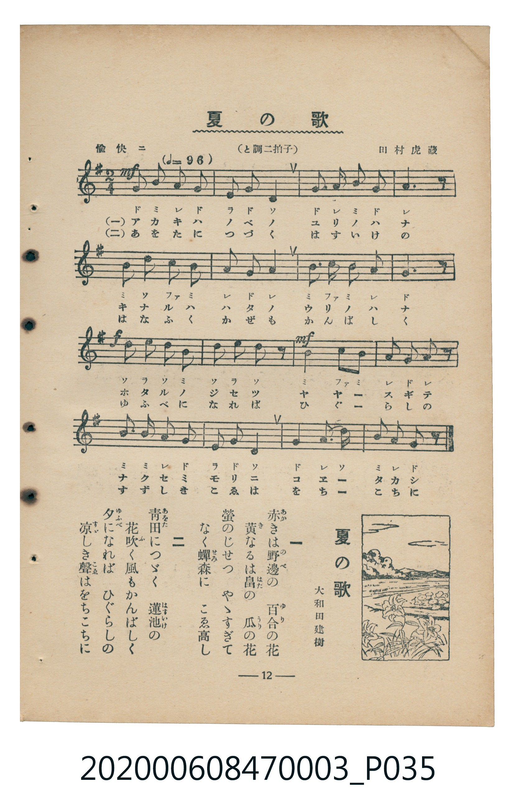

# 夏の歌

> Re:Shōka 使用 AI 協助辨識與重建樂譜，可能會有錯誤。歡迎[回報](https://github.com/TMDLang/reshoka/issues)。

- **鋼琴伴奏版**：<br><audio controls src="natsu_no_uta.mp3"></audio>
- **NEUTRINO 歌聲合成版**：<br><audio controls src="natsu_no_uta_neutrino.mp3"></audio>

- 詞：大和田建樹
- 曲：田村虎藏
- 臺灣教育會公認《新定兒童唱歌》尋常科第三學年用（2020.006.0847.0003）

## 說明

原書資訊與歌詞全文（對應 P035.jpg，書頁 p. 12，第一學期第 10 首）：
調性與拍號：と調二拍子（G 大調 2/4 拍），「愉快ニ」，速度 != 96


## 歌詞

```text
一
赤（あか）きは野邊（のべ）の　百合（ゆり）の花（はな）
黃（き）なるは畠（はた）の　瓜（うり）の花（はな）
螢（ほたる）のじせつ　やゝすぎて
なく蟬森（せみもり）に　こゑ高（たか）し

二
青田（あをた）につゞく　蓮池（はすいけ）の
花吹（はなふ）く風（かぜ）もかんばしく
夕（ゆふべ）になれば　ひぐらしの
涼（すゞ）しき聲（こゑ）はをちこちに
```

## ABC

<div class="abc-score" data-abc-src="natsu_no_uta.abc" aria-label="五線譜載入中"></div>

[下載 ABC 原始檔](natsu_no_uta.abc)

## TMD 檔案連結

- [主旋律 TMD 檔案](natsu_no_uta.tmd) [[在 TMD Studio 編輯](https://tmdlang.github.io/Tmd-TS/#tmd=s7IKdvYPcrWy4qpTUCpJTLdSSM7PyUlNLsnMz7MqzsjMK0nNjM_KTMmPL87Iz05Ugisry88pzU21Si9KTEmNN443MjAyiDcwMIs3sDAxBzIMjBFKi_NLi5JTrYqTM_Lzc-JLUitKkvLzsxHyBUX5Zal5iXlANQVFIBtTwIoQClLLMlNSQdKpKZkl-UWZiTlI7kgtKga7FWxJfElRYl5xclFmAcgDCFUlGalAxxanJhbn5xUTFAZakZ6ZZ5WbmpmVicW9-UUlGflAjxdkVFplZBaDXJScmBOfnZiHFD5Q9xQkpqdaBRgYmypxaWkpPF3S_7hx3bO1PQpaWlyKtgqWZlz2tgruXDZG-iZ2IK0vVs57v2fW0yXLn07qeT5lw9Pdu56t2Ak29NnsTUAZoNizuRNfzOx7Mb0fLPyifdfzxsXPps580bTp2Zzmp61rXqzqfdzQ9WzahqfrZj1tnfR89dKnUzYCrXzc0P10Q_fTHTueL5_4fM2aJzs6n67d8XTnludTVrzf0wGKPz1g_OmB4g_IMDB-v6dTiYtLX0vBllqAS0FB4Wnf_Gezd7zY3P5iRdeLjnagu4Beftq64tm0dqArnm7ofdbeqQAKL72sgvT3e3qAil8uaFQo0FMwNAJywQ5vADr82Zz5QLaCoYHCy2XTgE4Fhg3I-Ber9j9rWA4yuLv3xcz5QNHHjSuAgk929QBFnq6dALTEHRgNy4FiCsBAVwCKgnUDg6fnWUvn0_2rHzd3P24ACva8bJj_dNcyBUg0gQwH2gy2Y-sSoCmPG5seN3YD9T5u7H3cuP5le9_Lpi6w-LrHjTvB4useNzQ8n7nv6YQOkHhT22OQApD4i66NYJXrHzeuAoqADH25uxksBHINUPRxUzdQ-vnUBTB1QK_ATJw8ByyI17gX8xaBhXYDdQLNgmpunPG4cfbjxiVAUx43tTxumvu4cebjxr7HjctAekDWNva_mL_m2eJ1YM1ApfsfNzXB7FkN0tY4-XHTxJerZ4AVzIeFwHRI-OzqAXtl7iRgMoUGUdMkmNtXgyxumge0AmjOi8nrnm2Eew7oiJbHjRMhrgQ7v2vj0wnAQIR66nHjVrBc_8tFoLQKtPVxIzAQOkGOA7KbJj9u3AB0BFABOIktmQoN78atsKgAWg4M0x6QOpAnNj1unPC4CeRwqIXPtu0BGzwT6EKIj4BR8aIRmOWAgiAvgwXXg72zECQCIleDdFKeLaBAQUufi8svsaS41C8_tCTRKiAzMS_focagphpkjYKNoZmWHZiFLUsqQDLGi4U9ChomCk839D9f36ADz0eaWDQAbQMZVqNQnZtWq2CooKtgDMRGQAxi1yiYxUOZpiAGCNaAuSAVIJUQVSAeDBqARMCG-hjWAFNTE5APjB4w2Qsm14P1AIMczNsJJkFsiOnAGAOJNHXBxRE6ViHZA3IP1B4juD1Nk8Dq54PJ1VBdS8C8pWCyH2EP2FRgXIPJFjA5EcllqPbgD_JdPeQEOSj8TIHYBBqWkHCEhS7ElSBxkApYrEBCH1dYQ8IXFErA3I4SchC_QsIFKawbQWENCW1SwhpiGtiexq3wcAXJQGydAzYTFCMwe0DiILHJQPYGsJrpUBlYjBAb1js6yUrewNQNCmszaJhDwhtZBByWkGwACXRcEYMe6LsRQQsNdFBAgmRmgHmzwSQoEYK9B1QFSmyQ4ICxQKohCbEPTC7DDHRItoAGNyTTwBI4JMJ7wGKgwIXa07gJZk_jBIQ9TZ3w4Ie4lIhAfzp7NrkJnLjiBARBqsDCEI0wTejBDUl1oFQDC9r9UI9BSgBIuQEKGljAToYHNyh_w0QheQESYaDAQE_jkOiYhRRYoNwFMw9iFiQnwAIWVPZAgnshmu0QEYirIPbUcnHp2ikgynkFIE-ZCwA)]
- [鋼琴伴奏 TMD 檔案](natsu_no_uta_piano.tmd) [[在 TMD Studio 編輯](https://tmdlang.github.io/Tmd-TS/#tmd=s7IKdvYPcrWy4qpTUCpJTLdSyC8qychPL0osyKi0ysgsLskvykxOzInPTsxLVIIrKs4vLUpOjS9ITE-1CjAwNlXi0tJSeLqk_3Hjumdre97v6XjZvef5hC1P9mx5urT_eWfH-z2dClpaXIq2CpZmXPa2Cu5cNkb6JnYg816snPd-z6ynS5Y_ndTzfMqGp7t3PVuxE2zTs9mbgDJAsWdzJ76Y2fdiej9Y-EX7rueNi59NnfmiadOzOc1PW9e8WNX7uKHr2bQNT9fNeto66fnqpU-nbAS643FD99MN3U937Hi-fOLzNWue7Oh8unbH051bnk9ZAXSikYGRgZ6BgZmegYWJOZBhYAx0pRIXl19iSXGpX35oSaJVQGZiXn6Qh0ONQU01lwIQ2BiaadmBWfpaCrboQAFsScOLhT0KGiYKTzf0P1_foKMACh-9rIJ0TSwatPTBhtUoVOem1SoYKugqGAOxERCD2DUKZvFQpimIAYI1YC5IBUglRBWIB4MGIBGwoT6GNQqPG5uA_MeN3WCyF0yuB-sBxhSYtxNMgtgQ0x83tYFEmrrg4ggdq5DsAbkHao8R3J6mSWD188HkaqiuJWDeLDDZj7AHbOrjxplgsgVMTkRyGao9-IN8Vw85QQ4KP1MgNoGGJSQcYaELcSVIHKQCFiuQ0McV1pDwBYXS4yZIiMNCDuJXSLgghXUjKKwhoU1KWENMA9vTuBUeriAZiK1zwGaCYgRmD0gcJDYZyN4AVjMdKgOLEWLDekcnWckbmLpBYW0GDXNIeCOLgMMSkg0ggY4rYtADfTciaKGBDgpIkMwMMG82mAQlQrD3gKpAiQ0SHDAWSDUkIfaByWWYgQ7JFtDghmQaWAKHRHgPWAwUuFB7GjfB7GmcgLCnqRMe_BCXEhHoT2fPJjeBE1ecgCBIFVgYohGmCT24IakOlGpgQbsf6jFICQApN0BBAwvYyfBg6EASheQFSISBAgM9jUOiA1JqQAILlLtg5kHMguQEWMCCyh6IPQvRbIeIQFwFsacWs5j3QS7mTaClPDB44hWiDWOBDBMYAy5iGh8PDB6Io9GEo03jYUrhLCxKIaJgvgkeE1GsRpgMEgL5RNdOAeGZaB-gMJqIEVhEmQsA)]

## 分析

```text
================================================================================
📊 TMD Song Profile: [ 夏の歌 ]
================================================================================
⏱  Duration:       0:20 (20.0s), 16 measures total
🎼 Key & Tempo:    首調基準 G, != 96.0 BPM, <2/4>
   - 分析範圍：      由實際發聲的音符與和弦推測調性；播放脈絡另行呈現
🎤 人聲音域:    D4 (MIDI 62) – E5 (MIDI 76) [跨度: 14 個半音 / 1.2 個八度, 難度: moderate]
   - 最低音:  D4 in [NatsuNoUta #1 @ m.2, 0:01]
   - 最高音: E5 in [NatsuNoUta #1 @ m.9, 0:10]
   - 適合: soprano, mezzo-soprano, contralto, tenor, baritone, bass
🏛  結構:      NatsuNoUta (20.0s)
⚡ 編曲密度:        Peak 1 軌道同時演奏
🗝  調性診斷：       G 大調（純淨自然大調，未偵測到可信轉調）
   - 風格氣質:    純淨自然大調（陽光明朗、易唱易記，無明顯調外色彩）
   - 轉調歷程:    全曲維持單一推測調性（未偵測到可信轉調）
   - 核心骨幹音:  G, A, B, D, E
   - 調性數值:    G 大調 [相關度: 0.81, 穩定度: High, 自然音純度: 100.0%]
   - 候選調性 (K-S): G 大調 (0.81), D 大調 (0.67), B 小調 (0.57)
   - 五度圈歷程:   +1
   - 各段落調性細節:
     • [NatsuNoUta #1]: G 大調 (r: 0.81, 自然音純度: 100.0%)

  [ 五度圈游移軌跡 ]
               C  
         F           [G ]*
      Bb               D  
      Eb               A  
         Ab           E  
            Db       B  
               F# 
     (* = active key center)

  [ 十二半音累積音高分佈 ]
     C  : ████                       4.2%
     C# :                            0.0%
     D  : ████████████████          16.9%
     D# :                            0.0%
     E  : ██████                     6.8%
     F  :                            0.0%
     F# :                            0.0%
     G  : ████████████████████████  25.4%
     G# :                            0.0%
     A  : ██████████████████████    23.7%
     A# :                            0.0%
     B  : ██████████████████████    22.9%
--------------------------------------------------------------------------------
Assignment 軌道音域：
  - Piano         : D4 – E5 (14 個半音 / 1.2 個八度, 50 個音符)
================================================================================
```


## 原書掃描頁




