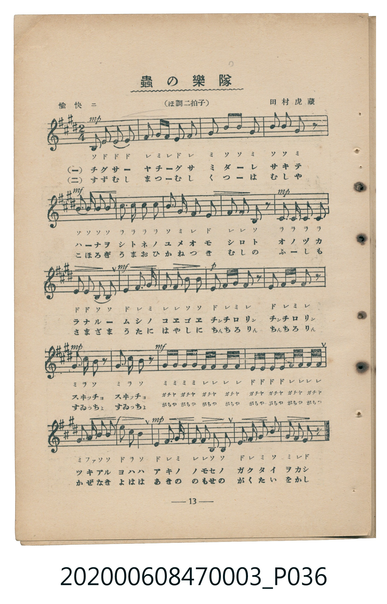
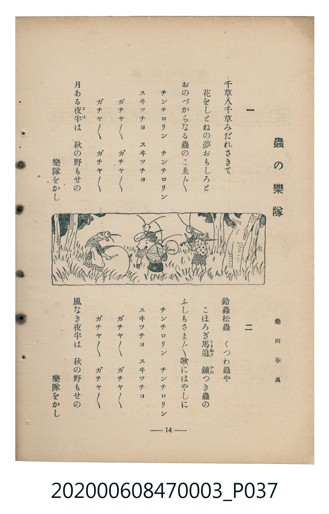

# 蟲の樂隊（蟲之樂隊）

> Re:Shōka 使用 AI 協助辨識與重建樂譜，可能會有錯誤。歡迎回報。

- **鋼琴伴奏版**：<br><audio controls src="mushi_no_gakutai.mp3"></audio>
- **NEUTRINO 歌聲合成版**：<br><audio controls src="mushi_no_gakutai_neutrino.mp3"></audio>

- 臺灣教育會公認『新定兒童唱歌』尋常科第三學年用（第二學期・第1首）
- 國立臺灣歷史博物館典藏（典藏號：2020.006.0847.0003）

## 說明


- 出處：臺灣教育會公認、臺北新高堂發行《新定兒童唱歌》尋常科第三學年用（昭和6年／1931年），
第二學期第 1 首〈蟲の樂隊〉（蟲之樂隊），原書第 13–14 頁（掃描檔 P036.jpg–P037.jpg）。
- 詞曲：桑田春風 作詞／田村虎藏 作曲。
- 調性與拍號：ホ調（E 大調），2/4 拍，速度標示「愉快ニ」（設定為 != 108）。
- 背景與曲風：描寫秋夜原野上百花盛開，鈴蟲、松蟲、轡蟲（くつわ蟲）、蟋蟀、馬追蟲、鐘叩蟲（鐘つき蟲）
組成熱鬧的秋蟲樂隊，穿插「チンチロリン」「スヰツチヨ」「ガチヤガチヤ」等擬聲詞，生動活潑。
- 版本說明：本檔案為原書單聲部五線譜（附移動 Do 階名片假名）之忠實數位化版本。

### 編曲說明（鋼琴伴奏版）：

1. 前奏 (Intro, 4 小節)：引用「チンチロリン」與結尾「秋の野もせの樂隊をかし」的清脆動機揭開秋夜序幕。
2. 主歌伴奏 (MushiNoGakutai, 24 小節 × 2 段)：右手演奏包含擬聲詞十六分音符連奏的生動旋律；
左手以輕巧的八分音符分解和弦與斷奏呼應秋蟲合奏。


## 歌詞

```text
一　千草八千草みだれさきて
花をしとねの夢おもしろと
おのづからなる蟲のこゑごゑ
チンチロリン　チンチロリン
スヰツチヨ　スヰツチヨ
ガチヤガチヤガチヤガチヤ　ガチヤガチヤガチヤガチヤ
月ある夜半（よは）は　秋の野もせの
樂隊をかし

二　鈴蟲松蟲　くつわ蟲や
こほろぎ馬追（うまおひ）　鐘（かね）つき蟲の
ふしもさまざま　歌にはやしに
チンチロリン　チンチロリン
スヰツチヨ　スヰツチヨ
ガチヤガチヤガチヤガチヤ　ガチヤガチヤガチヤガチヤ
風なき夜半は　秋の野もせの
樂隊をかし
```

## ABC

<div class="abc-score" data-abc-src="mushi_no_gakutai.abc" aria-label="五線譜載入中"></div>

[下載 ABC 原始檔](mushi_no_gakutai.abc)

## TMD 檔案連結

- [主旋律 TMD 檔案](mushi_no_gakutai.tmd) [[在 TMD Studio 編輯](https://tmdlang.github.io/Tmd-TS/#tmd=s7IKdvYPcrWy4qpTUCpJTLdSSM7PyUlNLsnMz7MqzsjMK0nNjM_KTMmPL87Iz05Ugisry88pzU21Si9KTEmNN443MjAyiDcwMIs3sDAxBzIMjBFKi_NLi5JTrYqTM_Lzc-JLUitKkvLzsxHyBUX5Zal5iXlANQVFIBtTwIoQClLLMlNSQdKpKZkl-UWZiTlI7kgtKga7FWxJfElRYl5xclFmAcgDCFUlGalAxybmZeYi64WIQt2Vk5mWipAC2pKemWeVm5qZlYnFyVDpksRMYLCAgqY8MT43MTMvJzEvBVlVSUY-MIQKMiqtMjKLQU5PTsyJz07MQwpIqMMLEtNTrQIMjM10gYS5EpeWlsKL-ZseN657tqLp5ayu93s6gNwnO7th3E4FLS0uRVsFQwMLLntbBVcuGyN9EzuQqS_adz1vXPxs6swXTZuezWl-2rrmxarexw19z6ZteLpu1tPWSc9XL306ZeOztT2PG_qfbuh-umPH8-UTn69Z82RH59O1O57u3PJ8ygqgfSCRXT1AkWdz5j9u3g3kGr5cNg1oM9jtT-d0P1_dDbVr7fan_Zue9s563rny5ZIVT1t3vJjeDzQBwngxc_77PbNACUQPmED0QAkEyDAwBpvEpa-lYEstwKWgoPC4YcKz2Zuez173YtWqZzP6HjdMBIs2737avuvFzKlAl-AIn0ag-NOe6cBQerl6xtMFTc9n7nmxEBhEXdjCrRtPuD2bsfbppB4zIP_9nn5DS2NDMKvz_Z4ekEsUFJDDFchWMFQABuvjBlD8wqP7cQNQPXqMA0142jf_2ewdYF3GjxomG5oovFzQCLKzr_lZf_-zVVMUQElIL6sgHSgLSkggJlDr44YmaDC8WDkPGD7AYHi2cOLzKRuezVj6ctEKhSd75wAlgO4FCc2d-GJmHzDiQKJAtUh6V-1_1rD8RUf7s-5eSKw-bp4NFAQ6wFXh6ZLlYCbImcCkqABUA2S9bJj_dNeyZytmPl-y63FDz7OWzqf7Vz9u7n7cAJTteLFiLTBonzftUoCkZFSXNvc8m7keZNvsTUA3gpzc3_90_erny7ufLpkDDImX7X1PdnQ9n7nvRdfG57Nnv5zWDbKwYwsoIBsan83dB2G82LsQyADa9rix_3HjksdN_WAu0KbGF_O7X8xvADJeLlvzYv9eiPqXE2Y87V8J0QJkg7Q09kK0QCNwa8uzjgnP2za-XLP8-awWoHuAsrBY6nm-cv-z_klAvz5ubnzcvBlMrn3cvArEbgCms57HTTsfN2943NwClloBE1wD5gKdB2M09D5f2_ls8poXjZvAcdPzfMr8p91Tn23Z_WzvREQwPe_seDYHmIRBqR0URnPWAJPBs4UdwFCFpJan09YBjXjZvOLJrinPt896sXYOyGMzge7eDTROwSVf4eWsvqcTep93tj9tbAcygB4FJrun-xc8Xb_s2dQdT_b2Pu2ZBrEGZC00l0EMB-YGoOOetq54Nq0dGFVPdqwFMVbNe7F2PTDrgcqADb3P2jtxJEuwWU92AGOg4Wlv84vezqetqyGMx437HzcueNzU87hxKjD4HzcuAykFRvTjpkmPG6c_blzxuHEtMLs8XbLocWPX46YmkGATUN0KsPOAQo3rHjcufdzY_bgJaNiqx02gSAILTn7cNPFx4xQgCQlBzFhqwBQEK0WPuAY0EYgijIjEErVAnYSVgYx7NgeYbJuArgcl-V5QNfC4CSiyHpR-G4FB3ABMfUBfAbMCOAxmA9lgbZBSBBRWQOnpICFQdgPHCzCRQML4xYQ1QPL5zr3Pt8yG558nu5cCQ_nZnK3A9PNiyVJQ-t7XBwzlp0tmvdy159mczhfbFr_fM_tF-6rnLdtebt7ycv5-oBpg2ALT2LO1S15s3f50754XE_YCjcIWtI0YgQgUQfc4qKCbswKYnoG-BxbGz_pmA62ABUAP0MfPpi9F5P9ZLRDfQlwILCmALgSmU3jy2gUsrxsgxQKsTGhALgoeN7VA0szkx427wWmoD1IcgIuMtseN-8DJCVJkNABLBLA4MFjXgiMBWjpAA_5x41ZwSgTGBTDdAnVOA5ENDaBao3E1KMqaWsDpd_UQSHzAsARlncZeSNhTkODQSmVgSQErlXswy2CgLFIZ3AMs_oEVy9MJLU_39APJZyuA6a8HWGiA6-5JkBoZzn2yZ8vTpcC2B6WJ73nLQqDvyUx2QM9T3piBAgUtfS4u31JgU9wv3z0xuxTY5LQKyEzMy3eoMaipBldINhZadmAGtrYUuLkBDJ11WxU0TBSebuh_vr5BB14cg2SBDRBgQ0cTi1ag1VBjgSZYgVIrMIVtAOKtQPYehRoguQQiCuTBZECi84G4ASLavAYkAtLRtBbIawOah2Tsrh6gsY0zgXgWUAFQS-N0kPLGfUAMMhpkLEK0HyHauB5sLEQOmKcQxtYomMYDvQSCNQpGChrGCkaaqhq6mkC-EVDEWMEUCI1BysC0gUINWJuPIciGhUA8AYinKuiCzW9R0AAJAnXDxEGq9gPxAqAKYPUE5k8F4l4gXqYQDzPNCCSOzV9A85aAzcPwF8i8fjRfgczDH7W7esBRa4o9ao2IjlqgG8DR1QXEm8Cu2A4uoDqAGOi35j5wxC4DYmAYNa0C0ougqoAZDKwOFPQgGZCuPiBuBfJWY0b2ZCDeDZQCBRjY0EZQmoBEOdDyRrDljd1ADDQWFN3AoEUKlMZ1EIsat4ItAiUFUFA1IaIfGBa6QGgKinVgQIOiGShoBhY0gwqaASFcpTFU0AiaZIxAKQiYLoCa4iG64mHa4kEIkWCAkbkerAKcQICB0jQJpA3kJJAosDUCEgf5Yx1YvKkNIt7UCBIH-hbobpBfQD4AhccKUISD9HdB9a8DqVsKDg9EwgLKT4bK7wYlJFhIAsWh5jfug5oPDk2geDdUfC1IHFuYQu3divANJFQJJb8dnfiSnzHRyW8lNOmthpcsC8D1GSh59UGT1mYgXgHEW8A0SA2oiIcWQKA0CCrlcYpjJERQrgUlumlgGpEQgYVX42poIlsPzoWQQFoNFln4uAmUgkGZABjuTcAqbzJOcXiSBBVGwDQFRCC2roKGEUrCgyY6cEI1BEmCJUAJEpQKMUQQ5VVTJzTZgeIXEqFAwxHJD5h8QG4DOqxpIpCeAqbhrgUXbUDngtIQ2L0g5-GRQyrZsIUd2Ob5UJtXQ2zGEX4k24w3ET6dPRtf9WZCbCJs2glMK8DWQTMkBS0Hhyg2MUhLYTEeBrHKsFWFTRMeNy6GhEY7OFiwiQFbk0A2sCmJk0GsMkS5aYxSRJpCikAcgmAIFQQmTzCEp2YNSPVriEMeqfgEBi84vYAbZcAYBzfLoIURXjloYw3R4sXGAlpNtEoamYpUaA9_vxJoqUwB51Iz7LnUlOiqAliegJqSTYtAtQWotAfWCeDmSz-0nlgErjlABT-05gA3RxYBxYDtDkhDpmkNEIMKJ2BTrmkJWM0mIAtY-4CbPRjZEtQcmQPEoM4QWD-wWQQq3IAYUlE0gasOUE0Ma5-sA6pqAtKzwWxwZgRiUFMPVMGAsyewtQAxejrCTniWM0FpvxjGAVssoOYKOHeB5GHZCaQa3moB1zAYCkAGAJvBwCyJXHtAWqLg0hpU2AK9AKpHUD0Htg8khaRuHaSuwfAgUF0PVF0_SB02byLXIkjNkjnQ5hNG4NLC_louLl07BdQuFdhRQFFlLgA)]
- [鋼琴伴奏 TMD 檔案](mushi_no_gakutai_piano.tmd) [[在 TMD Studio 編輯](https://tmdlang.github.io/Tmd-TS/#tmd=s7IKdvYPcrWy4qpTUCpJTLdSyC8qychPL0osyKi0ysgsLskvykxOzInPTsxLVIIrKs4vLUpOjS9ITE-1CjAwNtMFEuZKXFpaCi_mb3rcuO7ZiqaXs7re7-kAcp_s7IZwHzfvftm95_mELU_2bHm6tP95Z8f7PZ0KWlpcirYKhgYWXPa2Cq5cNkb6JnYge16073reuPjZ1JkvmjY9m9P8tHXNi1W9jxv6nk3b8HTdrKetk56vXvp0ysZna3seN_Q_3dD9dMeO58snPl-z5smOzqdrdzzdueX5lBVAF4BEdvUARZ7NmQ90AZBr-HLZNKDNYN88ndP9fHU31K6125_2b3raO-t558qXS1Y8bd3xYno_0AQI48XM-e_3zDIyMDLQMzAw0zOwMDEHMgyMwSZx6Wsp2FILcCkoKDxumPBs9qbns9e9WLXq2Yy-xw0TwaLNu5-273oxcyrQJTjCpxEo_rRnOjCUXq6e8XRB0_OZe14sBAZRF7Zw68YTbs9mrH06qccMyH-_p9_Q0tgQzOp8v6cH5BIFBeRwBbIVDBWAwfq4ARTj8ATwuAGoHiUNQEx42jf_2ewdYF3GjxomG5oovFzQCLKzr_lZf_-zVVMUQIlKL6sgHSgLSlogJlDr44YmaDC8WDkPGD7AYHi2cOLzKRuezVj6ctEKhSd75wAlgO4FCc2d-GJmHzDiQKJAtUh6V-1_1rD8RUf7s-5eSKw-bp4NFAQ6wFXh6ZLlYCbImcCkqABUA2S9bJj_dNeyZytmPl-y63FDz7OWzqf7Vz9u7n7cAJTtgKRfFPc9374CaCck8oAqMNM90FZIOBrqKTzt7AWKK2h45pUU5esomCg83dD_fH2DJlDN0z1TgdEBtPJxc-Pj5s1gcu3j5lUgdkMv0A_Pt054umEfUMHz5d3AcH_Z3ve4qelx42xEHDRNetwIlJoOVP98VsuzHa0vWtqedk99tnL-s_61L6d1AzU-XTLn6a7-pzunQj2goGCkp_Bkx25gIoG4WUHDt7Q4I9Mv3z0xu7QkMVNHwQjmSoXD0xWMFJ6t2wp2bv_mZ53dz_ZMAep52tP6dMLqZ5PXvGjcBIyVp72NT1vXPu1oezl_8_M1y142LAaFxayW51Pmg1wzvfvpvu73e2ZDrAeCp9uXAY16snvpiz1Tn25fDlT5tHU1XDuQ8WL5YmACfbpnGSgmp20H2Thxz7P2TqB_gCnu6YQOoAjUP5TnSShQ0NLn4gJHk1VAZmJefpCHQ41BTTXY0TYWWnZgRg0wL2gYKRhrqmroagLDxgAoYqxgFq9gGg9mGwLFjBVMwaJGQB5QjKsWxVgfHMbGK0QbxsKMARoYbZYL5yIko01jEXwQhlqAGoV4PICtMAPn9x0NwHhW0IBFvQ48m4JkgT4BljSaWLQCAw1qLNAEK2D2aFR43LQBiLcC2XuAbn3cvAQiCuTBZECi84G4ASLavAYkAtLRtBbIawOah2Tsrh6gsY0zgXgWUAFQS-N0kPLGfUAMMhpkLEK0HyHauB5sLETucVMLwtgaUFAagmENMJo0gHEFiVBQ9IGizhQIjUHKwDQojEHafAxBNiwE4glAPFVBF2x-i4IGSBCoGyYOUrUfiBcAVTxu6gHzpwJxLxAvU4iHmWYEEsfmL6B5S8DmYfgLZF4_mq9A5uGP2l094Kg1xR61RkRHLdAN4OjqAuJNYFdsB5eIHUAM9FtzHzhilwExMIyaVgHpRVBVwIINrA4U9CAZkK4-IG4F8lZjRvZkIN4NlAIFGNjQRlCagEQ50PJGsOWN3UAMNBYU3cCgRQqUxnUQixq3gi0CJQVQUDUhoh8YFrpAaAqKdWBAg6IZKGgGFjSDCpoBIVwlOMODczwkyRjBsqYGMKuCdcXDtMWDECLBACNzPVgFOIEAA6VpEkgbyEkg0ceNK0DiIH-sA4s3tUHEmxpB4kDfAt0N8gvIB6DwWAGKcJD-Lqj-dSB1S8HhgUhYQPnJUPndoIQEC0mgONT8xn1Q88GhCRTvhoqvBYljC1OovVsRvoGEKqHkt6MTX_IzJjr5rYQmvdXwkmUBKH7ByasPmrQ2A_EKIN4CpkFqQFUrtAACpUFQ7YpTHCMhgnItKNFNA9OIhAgsvBpXQxPZenAuhATSarDIwsdNoBQMygTAcG8CVtOTcYrDkySoMAKmKSACsXVBtQxywoMmOnBCxayCMEQQ5VVTJzTZgeIXEqFAwxHJD5h8QG4DOqxpIpCeAqbhrgUXbUDngtIQ2L0g5-GRQyrZsIUd2Ob5UJtXQ2zGEX4k24w3ET6dPRtf9WZCbCJs2glMKxseNzdDUtBycIhiE1sDZi_GwyBWGbaqsGnC48bFkNBoBwcLNrEeMLsFD4NYZYhy0xiliDSFFIE4BMEQKghMnmAIT80akOrXEIc8UvEJDF5wegEFcQswxkGhAisE8cpBAhBYkuFjAa0mWiWNTEUqtIe_Xwm0VKaAc6kZ9lxqSnRVASxPQE3JpkWg2gJU2gPrBHDzpR9aTywC1xyggh9ac4CbI4uAYsB2B6Qh07QGiEGFE7Ap17QErGYTkAWsfcDNHoxsCWqOzAHiVbCaE9gsAhVuQAypKJrAVQeoJoa1T9YBVTUB6dlgNjgzAjGoqQeqYMDZE9hagBg9HWEnPMuZoLRfDOOALRZQcwWcu0DysOwEUg1vtYBrGAwFqF0WpMYLqNEJKq1BhS3QC6B6BNVzYPtAUkjq1kHqGgwPAtX1QNX1g9Rh8yZyLYLULJkDbT5hBC4t7MfRo8LadyO2R4Un4aL08IAUuH8C6uqh9_jg8mg9QJLa_yQ5xATIMImFUXB5WAcV2aWgYh9NOWktQ5IchiPEjDBDDLUHTTC40JsKeF2F1lEnrt8O45NWGJITbVBhUkIL1wiDrp0CeBRDAchAzRvRPkBVWESNwKLKXAA)]

## 分析

```text
================================================================================
📊 TMD Song Profile: [ 蟲の樂隊（蟲之樂隊） ]
================================================================================
⏱  Duration:       0:26 (26.7s), 24 measures total
🎼 Key & Tempo:    首調基準 E, != 108.0 BPM, <2/4>
   - 分析範圍：      由實際發聲的音符與和弦推測調性；播放脈絡另行呈現
🎤 人聲音域:    B3 (MIDI 59) – E5 (MIDI 76) [跨度: 17 個半音 / 1.4 個八度, 難度: challenging]
   - 最低音:  B3 in [MushiNoGakutai #1 @ m.1, 0:00]
   - 最高音: E5 in [MushiNoGakutai #1 @ m.20, 0:21]
   - 適合: soprano, mezzo-soprano, contralto, tenor, baritone, bass
🏛  結構:      MushiNoGakutai (26.7s)
⚡ 編曲密度:        Peak 1 軌道同時演奏
🗝  調性診斷：       B 大調（純淨自然大調，未偵測到可信轉調）
   - 風格氣質:    純淨自然大調（陽光明朗、易唱易記，無明顯調外色彩）
   - 轉調歷程:    全曲維持單一推測調性（未偵測到可信轉調）
   - 核心骨幹音:  B, F#, E, G#, C#
   - 調性數值:    B 大調 [相關度: 0.84, 穩定度: Moderate, 自然音純度: 99.4%]
   - 候選調性 (K-S): B 大調 (0.84), E 大調 (0.79), G# 小調 (0.61)
   - 五度圈歷程:   +5
   - 各段落調性細節:
     • [MushiNoGakutai #1]: B 大調 (r: 0.84, 自然音純度: 99.4%, 調外音: A)

  [ 五度圈游移軌跡 ]
               C  
         F            G  
      Bb               D  
      Eb               A  
         Ab           E  
            Db      [B ]*
               F# 
     (* = active key center)

  [ 十二半音累積音高分佈 ]
     C  :                            0.0%
     C# : ██████████                11.2%
     D  :                            0.0%
     D# :                            0.0%
     E  : ██████████████████        20.2%
     F  :                            0.0%
     F# : ████████████████████      22.5%
     G  :                            0.0%
     G# : ████████████████          18.0%
     A  :                            0.6%
     A# :                            0.0%
     B  : ████████████████████████  27.5%
--------------------------------------------------------------------------------
Assignment 軌道音域：
  - Piano         : B3 – E5 (17 個半音 / 1.4 個八度, 97 個音符)
================================================================================
```


## 原書掃描頁






