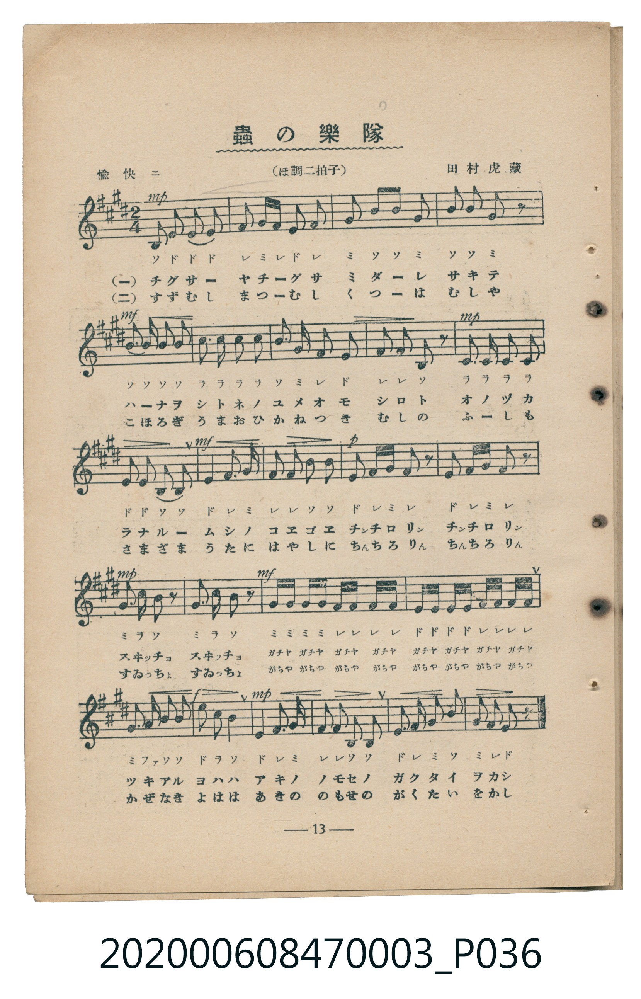
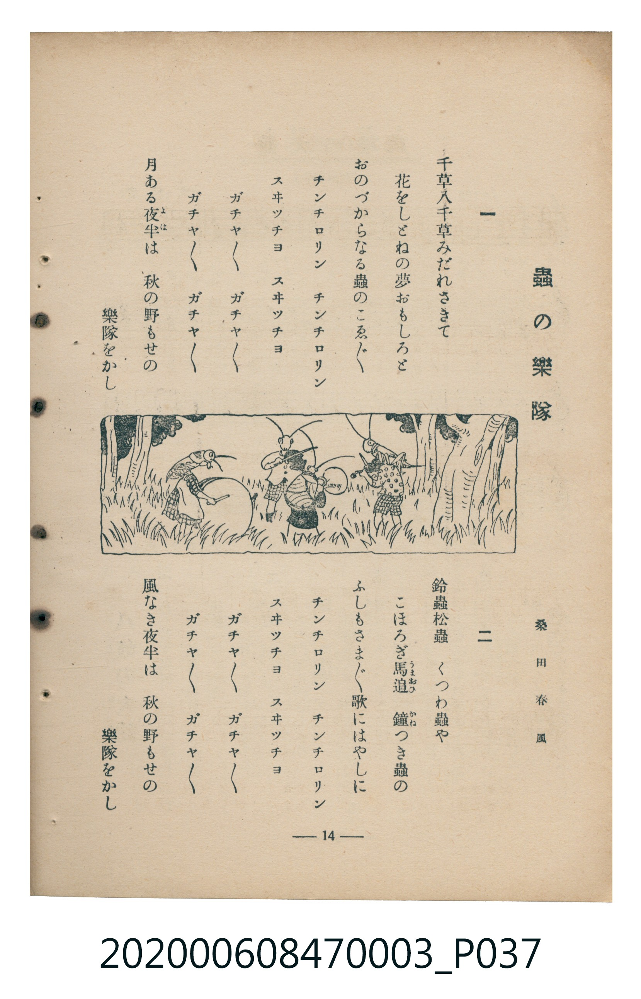

# 蟲の樂隊（蟲之樂隊）

<audio controls src="mushi_no_gakutai.mp3"></audio>

- 臺灣教育會公認『新定兒童唱歌』尋常科第三學年用（第二學期・第1首）
- 國立臺灣歷史博物館典藏（典藏號：2020.006.0847.0003）

## 說明

【曲目說明】
・出處：臺灣教育會公認、臺北新高堂發行《新定兒童唱歌》尋常科第三學年用（昭和6年／1931年），
第二學期第 1 首〈蟲の樂隊〉（蟲之樂隊），原書第 13–14 頁（掃描檔 P036.jpg–P037.jpg）。
・詞曲：桑田春風 作詞／田村虎藏 作曲。
・調性與拍號：ホ調（E 大調），2/4 拍，速度標示「愉快ニ」（設定為 != 108）。
・背景與曲風：描寫秋夜原野上百花盛開，鈴蟲、松蟲、轡蟲（くつわ蟲）、蟋蟀、馬追蟲、鐘叩蟲（鐘つき蟲）
組成熱鬧的秋蟲樂隊，穿插「チンチロリン」「スヰツチヨ」「ガチヤガチヤ」等擬聲詞，生動活潑。
・版本說明：本檔案為原書單聲部五線譜（附移動 Do 階名片假名）之忠實數位化版本。

・編曲說明（鋼琴伴奏版）：
1. 前奏 (Intro, 4 小節)：引用「チンチロリン」與結尾「秋の野もせの樂隊をかし」的清脆動機揭開秋夜序幕。
2. 主歌伴奏 (MushiNoGakutai, 24 小節 × 2 段)：右手演奏包含擬聲詞十六分音符連奏的生動旋律；
左手以輕巧的八分音符分解和弦與斷奏呼應秋蟲合奏。

## 歌詞

```text
一　千草八千草みだれさきて
花をしとねの夢おもしろと
おのづからなる蟲のこゑごゑ
チンチロリン　チンチロリン
スヰツチヨ　スヰツチヨ
ガチヤガチヤガチヤガチヤ　ガチヤガチヤガチヤガチヤ
月ある夜半（よは）は　秋の野もせの
樂隊をかし

二　鈴蟲松蟲　くつわ蟲や
こほろぎ馬追（うまおひ）　鐘（かね）つき蟲の
ふしもさまざま　歌にはやしに
チンチロリン　チンチロリン
スヰツチヨ　スヰツチヨ
ガチヤガチヤガチヤガチヤ　ガチヤガチヤガチヤガチヤ
風なき夜半は　秋の野もせの
樂隊をかし
```

## ABC

```abc
X:1
T:蟲の樂隊（蟲之樂隊）
C:TMD (Chen, Chih-Han / aguai)
M:2/4
L:1/16
Q:1/4=108
K:E
V:V1 name="Piano" snm="Pia"
[V:V1]
B,2 E2 E2 E2 | F2 G F E2 F2 | G2 B2 B2 G2 | B2 B2 G2 z2 |
B2 B2 B2 B2 | c3 c c2 c2 | B2 G2 F2 E2 | F2 F2 B,2 z2 |
C3 C C2 C2 | E2 E2 B,2 B,2 | E3 F G4 | F2 F2 B,2 B,2 |
E2 F G F2 z2 | E2 F G F2 z2 | G2 C2 B,2 z2 | G2 C2 B,2 z2 |
G G G G F F F F | E E E E F F F F | G2 A2 B2 B2 | e2 c2 B4 |
E3 F G4 | F2 F2 B,2 B,2 | E2 F2 G2 B2 | G2 F2 E2 z2 |
```

## TMD 檔案連結

- [主旋律 TMD 檔案](mushi_no_gakutai.tmd)
- [鋼琴伴奏 TMD 檔案](mushi_no_gakutai_piano.tmd)

## 分析

```text
================================================================================
📊 TMD Song Profile: [ 蟲の樂隊（蟲之樂隊） ]
================================================================================
⏱  Duration:       0:26 (26.7s), 24 measures total
🎼 Key & Tempo:    首調基準 E, != 108.0 BPM, <2/4>
   - 分析範圍：      由實際發聲的音符與和弦推測調性；播放脈絡另行呈現
🎤 人聲音域:    B3 (MIDI 59) – E5 (MIDI 76) [跨度: 17 個半音 / 1.4 個八度, 難度: challenging]
   - 最低音:  B3 in [MushiNoGakutai #1 @ m.1, 0:00]
   - 最高音: E5 in [MushiNoGakutai #1 @ m.20, 0:21]
   - 適合: soprano, mezzo-soprano, contralto, tenor, baritone, bass
🏛  結構:      MushiNoGakutai (26.7s)
⚡ 編曲密度:        Peak 1 軌道同時演奏
🗝  調性診斷：       B 大調（純淨自然大調，未偵測到可信轉調）
   - 風格氣質:    純淨自然大調（陽光明朗、易唱易記，無明顯調外色彩）
   - 轉調歷程:    全曲維持單一推測調性（未偵測到可信轉調）
   - 核心骨幹音:  B, F#, E, G#, C#
   - 調性數值:    B 大調 [相關度: 0.83, 穩定度: Moderate, 自然音純度: 98.9%]
   - 候選調性 (K-S): B 大調 (0.83), E 大調 (0.78), G# 小調 (0.62)
   - 五度圈歷程:   +5
   - 各段落調性細節:
     • [MushiNoGakutai #1]: B 大調 (r: 0.83, 自然音純度: 98.9%, 調外音: A)

  [ 五度圈游移軌跡 ]
               C  
         F            G  
      Bb               D  
      Eb               A  
         Ab           E  
            Db      [B ]*
               F# 
     (* = active key center)

  [ 十二半音累積音高分佈 ]
     C  :                            0.0%
     C# : ███████████               12.4%
     D  :                            0.0%
     D# :                            0.0%
     E  : █████████████████         19.1%
     F  :                            0.0%
     F# : ████████████████████      21.9%
     G  :                            0.0%
     G# : █████████████████         18.5%
     A  : █                          1.1%
     A# :                            0.0%
     B  : ████████████████████████  27.0%
--------------------------------------------------------------------------------
Assignment 軌道音域：
  - Piano         : B3 – E5 (17 個半音 / 1.4 個八度, 97 個音符)
================================================================================
```


## 原書掃描頁






