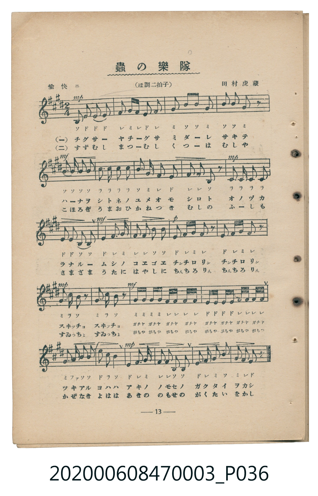
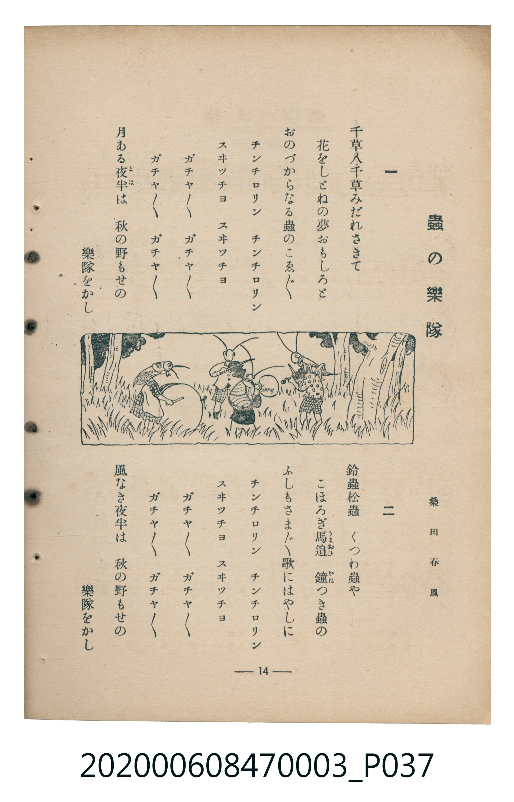

# 蟲の樂隊（蟲之樂隊）

> Re:Shōka 使用 AI 協助辨識與重建樂譜，可能會有錯誤。歡迎回報。

- **鋼琴伴奏版**：<br><audio controls src="mushi_no_gakutai.mp3"></audio>
- **NEUTRINO 歌聲合成版**：<br><audio controls src="mushi_no_gakutai_neutrino.mp3"></audio>

- 臺灣教育會公認『新定兒童唱歌』尋常科第三學年用（第二學期・第1首）
- 國立臺灣歷史博物館典藏（典藏號：2020.006.0847.0003）

## 說明


- 出處：臺灣教育會公認、臺北新高堂發行《新定兒童唱歌》尋常科第三學年用（昭和6年／1931年），
第二學期第 1 首〈蟲の樂隊〉（蟲之樂隊），原書第 13–14 頁（掃描檔 P036.jpg–P037.jpg）。
- 詞曲：桑田春風 作詞／田村虎藏 作曲。
- 調性與拍號：ホ調（E 大調），2/4 拍，速度標示「愉快ニ」（設定為 != 108）。
- 背景與曲風：描寫秋夜原野上百花盛開，鈴蟲、松蟲、轡蟲（くつわ蟲）、蟋蟀、馬追蟲、鐘叩蟲（鐘つき蟲）
組成熱鬧的秋蟲樂隊，穿插「チンチロリン」「スヰツチヨ」「ガチヤガチヤ」等擬聲詞，生動活潑。
- 版本說明：本檔案為原書單聲部五線譜（附移動 Do 階名片假名）之忠實數位化版本。

### 編曲說明（鋼琴伴奏版）：

1. 前奏 (Intro, 4 小節)：引用「チンチロリン」與結尾「秋の野もせの樂隊をかし」的清脆動機揭開秋夜序幕。
2. 主歌伴奏 (MushiNoGakutai, 24 小節 × 2 段)：右手演奏包含擬聲詞十六分音符連奏的生動旋律；
左手以輕巧的八分音符分解和弦與斷奏呼應秋蟲合奏。


## 歌詞

```text
一　千草八千草みだれさきて
花をしとねの夢おもしろと
おのづからなる蟲のこゑごゑ
チンチロリン　チンチロリン
スヰツチヨ　スヰツチヨ
ガチヤガチヤガチヤガチヤ　ガチヤガチヤガチヤガチヤ
月ある夜半（よは）は　秋の野もせの
樂隊をかし

二　鈴蟲松蟲　くつわ蟲や
こほろぎ馬追（うまおひ）　鐘（かね）つき蟲の
ふしもさまざま　歌にはやしに
チンチロリン　チンチロリン
スヰツチヨ　スヰツチヨ
ガチヤガチヤガチヤガチヤ　ガチヤガチヤガチヤガチヤ
風なき夜半は　秋の野もせの
樂隊をかし
```

## ABC

```abc
X:1
T:蟲の樂隊（蟲之樂隊）
M:2/4
L:1/16
Q:1/4=108
K:E
V:V1 name="Piano" snm="Pia"
[V:V1]
B,2 E2 E2 E2 | F2 G F E2 F2 | G2 B2 B2 G2 | B2 B2 G2 z2 |
w: 1.~ち ぐ さ _ | や ち _ ぐ さ | み だ _ れ | さ き て
w: 2.~す ず む し | ま つ _ む し | く つ _ わ | む し や
B3 B B2 B2 | c3 c c2 c2 | B3 G F2 E2 | F2 F2 B,2 z2 |
w: 1.~は _ な を | し と ね の | ゆ め お も | し ろ と
w: 2.~こ ほ ろ ぎ | う ま お ひ | か ね つ き | む し の
C3 C C2 C2 | E2 E2 B,2 B,2 | E4 F3 G | F2 F2 B2 B2 |
w: 1.~お の づ か | ら な る _ | む し の | こ ゑ ご ゑ
w: 2.~ふ _ し も | さ ま ざ ま | う た に | は や し に
E2 F G F2 z2 | E2 F G F2 z2 | G3 c B2 z2 | G3 c B2 z2 |
w: 1.~ちん ち ろ りん | ちん ち ろ りん | ス ヰツ チヨ | ス ヰツ チヨ
w: 2.~ちん ち ろ りん | ちん ち ろ りん | ス ヰツ チヨ | ス ヰツ チヨ
G G G G F F F F | E E E E F F F F | G3 A B2 B2 | e2 c2 B4 |
w: 1.~ガチヤ ガチヤ ガチヤ ガチヤ ガチヤ ガチヤ ガチヤ ガチヤ | ガチヤ ガチヤ ガチヤ ガチヤ ガチヤ ガチヤ ガチヤ ガチヤ | つ き あ る | よ は は
w: 2.~ガチヤ ガチヤ ガチヤ ガチヤ ガチヤ ガチヤ ガチヤ ガチヤ | ガチヤ ガチヤ ガチヤ ガチヤ ガチヤ ガチヤ ガチヤ ガチヤ | か ぜ な き | よ は は
E3 F G4 | F2 F2 B,2 B,2 | E3 F G2 B2 | G2 F2 E2 z2 |
w: 1.~あ き の | の も せ の | が く た い | を か し
w: 2.~あ き の | の も せ の | が く た い | を か し
```

## TMD 檔案連結

- [主旋律 TMD 檔案](mushi_no_gakutai.tmd) [[在 TMD Studio 編輯](https://tmdlang.github.io/Tmd-TS/#tmd=s7IKdvYPcrWy4qpTUCpJTLdSSM7PyUlNLsnMz7MqzsjMK0nNjM_KTMmPL87Iz05Ugisry88pzU21Si9KTEmNN443MjAyiDcwMIs3sDAxBzIMjBFKi_NLi5JTrYqTM_Lzc-JLUitKkvLzsxHyBUX5Zal5iXlANQVFIBtTwIoQClLLMlNSQdKpKZkl-UWZiTlI7kgtKga7FWxJfElRYl5xclFmAcgDCFUlGalAxybmZeYi64WIQt2Vk5mWipAC2pKemWeVm5qZlYnFyVDpksRMYLCAgqY8MT43MTMvJzEvRYlLS0vhxfxNjxvXPVvR9HJW1_s9HUDuk53dMG6ngpYWl6KtgqGBBZe9rYIrl42RvokdyPAX7bueNy5-NnXmi6ZNz-Y0P21d82JV7-OGvmfTNjxdN-tp66Tnq5c-nbLx2dqexw39Tzd0P92x4_nyic_XrHmyo_Pp2h1Pd255PmUF0D6QyK4eoMizOfMfN-8Gcg1fLpsGtBnshadzup-v7obatXb70_5NT3tnPe9c-XLJiqetO15M7weaAGG8mDn__Z5ZoMjVA0auHihygQwDY7BJXPpaCrbUAlwKCgqPGyY8m73p-ex1L1atejaj73HDRLBo8-6n7btezJwKdAmO8GkEij_tmQ4MpZerZzxd0PR85p4XC4FB1IUt3LrxhNuzGWufTuoxA_Lf7-k3tDQ2BLM63-_pAblEQQE5XIFsBUMFYLA-bgDFLzy6HzcA1aPHONCEp33zn83eAdZl_KhhsqGJwssFjSA7-5qf9fc_WzVFIcDA2EwvqyAdKAtkmoOYQK2PG5qgwfBi5Txg-ACD4dnCic-nbHg2Y-nLRSsUnuydA5QAuhckNHfii5l9wIgDiQLVIuldtf9Zw_IXHe3Punshsfq4eTZQEOgAV4WnS5aDmSBnApOiAlANkPWyYf7TXcuerZj5fMmuxw09z1o6n-5f_bi5-3EDULbjxYq1wKB93rRLAZKSUV3a3PNs5nqQbbM3Ad0IcnJ__9P1q58v7366ZA4wJF629z3Z0fV85r4XXRufz579clo3yMKOLaCAbGh8NncfhPFi70IgA2jb48b-x41LHjf1g7lAmxpfzO9-Mb8ByHi5bM2L_Xsh6l9OmPG0fyVEC5AN0tLYC9ECjcCtLc86Jjxv2_hyzfLns1qA7gHKwmKp5_nK_c_6JwH9-ri58XHzZjC59nHzKhC7AZjOeh437XzcvOFxcwtYagVMcA2YC3QejNHQ-3xt57PJa140bgLHTc_zKfOfdk99tmX3s70TEcH0vLPj2RxgEgaldlAYzVkDTAbPFnYAQxWSWp5OWwc04mXziie7pjzfPuvF2jkgj80Euns30DgFl3yFl7P6nk7ofd7Z_rSxHcgAehSY7J7uX_B0_bJnU3c82dv7tGcaxBqQtdBcBjEcmBuAjnvauuLZtHZgVD3ZsRbEWDXvxdr1wKwHKgM29D5r78SRLMFmPdkBjIGGp73NL3o7n7auhjAeN-5_3LjgcVPP48apwOB_3LgMpBQY0Y-bJj1unP64ccXjxrXA7PJ0yaLHjV2Pm5pAgk1AdSvAzgMKNa573Lj0cWP34yagYaseN4EiCSw4-XHTxMeNU4AkJAQxY6kBUxCsFD3iGtBEIIowIhJL1AJ1ElYGMu7ZHGCybQK6HpTke0HVwOMmoMh6UPptBAZxAzD1AX0FzArgMJgNZIO1QUoRUFgBpaeDhEDZDRwvwEQCCeMXE9YAyec79z7fMhuef57sXgoM5WdztgLTz4slS0Hpe18fMJSfLpn1cteeZ3M6X2xb_H7P7Bftq563bHu5ecvL-fuBaoBhC0xjz9YuebF1-9O9e15M2As0ClvQNmIEIlAE3eOggm7OCmB6BvoeWBg_65sNtAIWAD1AHz-bvhSR_2e1QHwLcSGwpAC6EJhO4clrF7C8boAUC7AyoQG5KHjc1AJJM5MfN-4Gp6E-SHEALjLaHjfuAycnSJHRACwRwOLAYF0LjgRo6QAN-MeNW8EpERgXwHQL1DkNRDY0gGqNxtWgKGtqAaff1UMg8QHDEpR1GnshYU9BgkMrlYElBaxU7sEsg4GySGVwD7D4B1YsTye0PN3TDySfrQCmvx5goQGuuydBamQ498meLU-XAtselCa-5y0Lgb4nM9kBPU95YwYKFLT0ubh8S4HNaL9898TsUmBz0SogMzEv36HGoKYaXCHZWGjZgRnY2lLg5gYwdNZtVdAwUXi6of_5-gYdeHEMkgU2QIANHU0sWoFWQ40FmmAFSq3AFLYBiLcC2XsUaoDkEogokAeTAYnOB-IGiGjzGpAISEfTWiCvDWgekrG7eoDGNs4E4llABUAtjdNByhv3ATHIaJCxCNF-hGjjerCxEDlgnkIYW6NgGg_0EgjWKBgpaBgrGGmqauhqAvlGQBFjBVMgNAYpA9MGCjVgbT6GIBsWAvEEIJ6qoAs2v0VBAyQI1A0TB6naD8QLgCqA1ROYPxWIe4F4mUI8zDQjkDg2fwHNWwI2D8NfIPP60XwFMg9_1O7qAUetKfaoNSI6aoFuAEdXFxBvArtiO7iA6gBioN-a-8ARuwyIgWHUtApIL4KqAmYwsDpQ0INkQLr6gLgVyFuNGdmTgXg3UAoUYGBDG0FpAhLlQMsbwZY3dgMx0FhQdAODFilQGtdBLGrcCrYIlBRAQdWEiH5gWOgCoSko1oEBDYpmoKAZWNAMKmgGhHCVxlBBI2iSMQKlIGC6AGqKh-iKh2mLByFEggFG5nqwCnACAQZK0ySQNpCTQKLA1ghIHOSPdWDxpjaIeFMjSBzoW6C7QX4B-QAUHitAEQ7S3wXVvw6kbik4PBAJCyg_GSq_G5SQYCEJFIea37gPaj44NIHi3VDxtSBxbGEKtXcrwjeQUCWU_HZ04kt-xkQnv5XQpLcaXrIsANdnoOTVB01am4F4BRBvAdMgNaAiHloAgdIgqJTHKY6REEG5FpTopoFpREIEFl6Nq6GJbD04F0ICaTVYZOHjJlAKBmUCYLg3Aau8yTjF4UkSVBgB0xQQgdi6ChpGKAkPmujACdUQJAmWACVIUCrEEEGUV02d0GQHil9IhAINRyQ_YPIBuQ3osKaJQHoKmIa7Fly0AZ0LSkNg94Kch0cOqWTDFnZgm-dDbV4NsRlH-JFsM95E-HT2bHzVmwmxibBpJzCtAFsHzZAUtBwcotjEIC2FxXgYxCrDVhU2TXjcuBgSGu3gYMEmBmxNAtnApiROBrHKEOWmMUoRaQopAnEIgiFUEJg8wRCemjUg1a8hDnmk4hMYvOD0Am6UAWMc3CyDFkZ45aCNNUSLFxsLaDXRKmlkKlKhPfz9SqClMgWcS82w51JToqsKYHkCako2LQLVFqDSHlgngJsv_dB6YhG45gAV_NCaA9wcWQQUA7Y7IA2ZpjVADCqcgE25piVgNZuALGDtA272YGRLUHNkDhCDOkNg_cBmEahwA2JIRdEErjpANTGsfbIOqKoJSM8Gs8GZEYhBTT1QBQPOnsDWAsTo6Qg74VnOBKX9YhgHbLGAmivg3AWSh2UnkGp4qwVcw2AoABkAbAYDsyRy7QFpiYJLa1BhC_QCqB5B9RzYPpAUkrp1kLoGw4NAdT1Qdf0gddi8iVyLIDVL5kCbTxiBSwv7a7m4dO0UULtUYEcBRZW5AA)]
- [鋼琴伴奏 TMD 檔案](mushi_no_gakutai_piano.tmd) [[在 TMD Studio 編輯](https://tmdlang.github.io/Tmd-TS/#tmd=s7IKdvYPcrWy4tLSUngxf9PjxnXPVjS9nNX1fk8HkPtkZzeE-7h598vuPc8nbHmyZ8vTpf3POzve7-lU0NLiUrRVMDSw4LK3VXDlsjHSN7HjqlNQetG-63nj4mdTZ75o2vRsTvPT1jUvVvU-buh7Nm3D03WznrZOer566dMpG5-t7Xnc0P90Q_fTHTueL5_4fM2aJzs6n67d8XTnludTVgBdABLZ1QMUeTZnPtAFQK7hy2XTgDYrgWx5Oqf7-epuqF1rtz_t3_S0d9bzzpUvl6x42rrjxfR-oAkQxouZ89_vmWVkYGSgZ2BgpmdgYWIOZBgYg03i0tdSsKUW4FJQUHjcMOHZ7E3PZ697sWrVsxl9jxsmgkWbdz9t3_Vi5lSgS3CETyNQ_GnPdGAovVw94-mCpucz97xYCAyiLmzh1o0n3J7NWPt0Uo8ZkP9-T7-hpbEhmNX5fk8PyCUKCsjhCmQrGCoAg_VxAyjG4QngcQNQPUoagJjwtG_-s9k7wLqMHzVMNjRReLmgEWRnX_Oz_v5nq6YoBBgYm-llFaQDZYFMcxATqPVxQxM0GF6snAcMH2AwPFs48fmUDc9mLH25aIXCk71zgBJA94KE5k58MbMPGHEgUaBaJL2r9j9rWP6io_1Zdy8kVh83zwYKAh3gqvB0yXIwE-RMYFJUAKoBsl42zH-6a9mzFTOfL9n1uKHnWUvn0_2rHzd3P24AynZA0i-K-55vXwG0ExJ5QBWY6R5oKyQcDfUUnnb2AsUVNDzzSorydRRMFJ5u6H--vkETqObpnqnA6ABa-bi58XHzZjC59nHzKhC7oRfoh-dbJzzdsA-o4PnybmC4v2zve9zU9LhxNiIOmiY9bgRKTQeqfz6r5dmO1hctbU-7pz5bOf9Z_9qX07qBGp8umfN0V__TnVOhHlBQMNJTeLJjNzCRQNysoOFbWpyR6ZfvnphdWpKYqaNgBHOlwuHpCkYKz9ZtBTu3f_Ozzu5ne6YA9TztaX06YfWzyWteNG4CxsrT3sanrWufdrS9nL_5-ZplLxsWg8JiVsvzKfNBrpne_XRf9_s9syHWA8HT7cuARj3ZvfTFnqlPty8HqnzauhquHch4sXwxMIE-3bMMFJPTtoNsnLjnWXsn0D_AFPd0QgdQBOofyvMkFCho6XNxgaPJKiAzMS8_yMOhxqCmGuxoGwstOzCjBpgXNIwUjDVVNXQ1gWFjABQxVjCLVzCNB7MNgWLGCqZgUSMgDyjGVYtirA8OY-MVog1jYcYADYw2y4VzEZLRprEIPghDLUCNQjwewFaYgfP7jgZgPCtowKJeB55NQbJAnwBLGk0sWoGBBjUWaIIVMHs0Kjxu2gDEW4HsPUC3Pm5eAhEF8mAyINH5QNwAEW1eAxIB6WhaC-S1Ac1DMnZXD9DYxplAPAuoAKilcTpIeeM-IAYZDTIWIdqPEG1cDzYWIve4qQVhbA0oKA3BsAYYTRrAuIJEKCj6QFFnCoTGIGVgGhTGIG0-hiAbFgLxBCCeqqALNr9FQQMkCNQNEwep2g_EC4AqHjf1gPlTgbgXiJcpxMNMMwKJY_MX0LwlYPMw_AUyrx_NVyDz8Eftrh5w1Jpij1ojoqMW6AZwdHUB8SawK7aDS8QOIAb6rbkPHLHLgBgYRk2rgPQiqCpgwQZWBwp6kAxIVx8QtwJ5qzEjezIQ7wZKgQIMbGgjKE1AohxoeSPY8sZuIAYaC4puYNAiBUrjOohFjVvBFoGSAiiomhDRDwwLXSA0BcU6MKBB0QwUNAMLmkEFzYAQrhKc4cE5HpJkjGBZUwOYVcG64mHa4kEIkWCAkbkerAKcQICB0jQJpA3kJJDo48YVIHGQP9aBxZvaIOJNjSBxoG-B7gb5BeQDUHisAEU4SH8XVP86kLql4PBAJCyg_GSo_G5QQoKFJFAcan7jPqj54NAEindDxdeCxLGFKdTerQjfQEKVUPLb0Ykv-RkTnfxWQpPeanjJsgAUv-Dk1QdNWpuBeAUQbwHTIDWgqhVaAIHSIKh2xSmOkRBBuRaU6KaBaURCBBZejauhiWw9OBdCAmk1WGTh4yZQCgZlAmC4NwGr6ck4xeFJElQYAdMUEIHYuqBaBjnhQRMdOKFiVkEYIojyqqkTmuxA8QuJUKDhiOQHTD4gtwEd1jQRSE8B03DXgos2oHNBaQjsXpDz8MghlWzYwg5s83yozashNuMIP5JtxpsIn86eja96MyE2ETbtBKaVDY-bmyEpaDk4RLGJrQGzF-NhEKsMW1XYNOFx42JIaLSDgwWbWA-Y3YKHQawyRLlpjFJEmkKKQByCYAgVBCZPMISnZg1I9WuIQx6p-AQGLzi9gIK4BRjjoFCBFYJ45SABCCzJ8LGAVhOtkkamIhXaw9-vBFoqU8C51Ax7LjUluqoAliegpmTTIlBtASrtgXUCuPnSD60nFoFrDlDBD605wM2RRUAxYLsD0pBpWgPEoMIJ2JRrWgJWswnIAtY-4GYPRrYENUfmAPEqWM0JbBaBCjcghlQUTeCqA1QTw9on64CqmoD0bDAbnBmBGNTUA1Uw4OwJbC1AjJ6OsBOe5UxQ2i-GccAWC6i5As5dIHlYdgKphrdawDUMhgLULgtS4wXU6ASV1qDCFugFUD2C6jmwfSApJHXrIHUNhgeB6nqg6vpB6rB5E7kWQWqWzIE2nzAClxb24-hRYe27EdujwpNwUXp4QArcPwF19dB7fHB5tB4gSe1_khxiAmSYxMIouDysg4rsUlCxj6actJYhSQ7DEWJGmCGG2oMmGFzoTQW8rkLrqBPXb4fxSSsMyYk2qDApoYVrhEHXTgE8iqEAZKDmjWgfoCosokZgUWUuAA)]

## 分析

```text
================================================================================
📊 TMD Song Profile: [ 蟲の樂隊（蟲之樂隊） ]
================================================================================
⏱  Duration:       0:26 (26.7s), 24 measures total
🎼 Key & Tempo:    首調基準 E, != 108.0 BPM, <2/4>
   - 分析範圍：      由實際發聲的音符與和弦推測調性；播放脈絡另行呈現
🎤 人聲音域:    B3 (MIDI 59) – E5 (MIDI 76) [跨度: 17 個半音 / 1.4 個八度, 難度: challenging]
   - 最低音:  B3 in [MushiNoGakutai #1 @ m.1, 0:00]
   - 最高音: E5 in [MushiNoGakutai #1 @ m.20, 0:21]
   - 適合: soprano, mezzo-soprano, contralto, tenor, baritone, bass
🏛  結構:      MushiNoGakutai (26.7s)
⚡ 編曲密度:        Peak 1 軌道同時演奏
🗝  調性診斷：       B 大調（純淨自然大調，未偵測到可信轉調）
   - 風格氣質:    純淨自然大調（陽光明朗、易唱易記，無明顯調外色彩）
   - 轉調歷程:    全曲維持單一推測調性（未偵測到可信轉調）
   - 核心骨幹音:  B, F#, E, G#, C#
   - 調性數值:    B 大調 [相關度: 0.84, 穩定度: Moderate, 自然音純度: 99.4%]
   - 候選調性 (K-S): B 大調 (0.84), E 大調 (0.79), G# 小調 (0.61)
   - 五度圈歷程:   +5
   - 各段落調性細節:
     • [MushiNoGakutai #1]: B 大調 (r: 0.84, 自然音純度: 99.4%, 調外音: A)

  [ 五度圈游移軌跡 ]
               C  
         F            G  
      Bb               D  
      Eb               A  
         Ab           E  
            Db      [B ]*
               F# 
     (* = active key center)

  [ 十二半音累積音高分佈 ]
     C  :                            0.0%
     C# : ██████████                11.2%
     D  :                            0.0%
     D# :                            0.0%
     E  : ██████████████████        20.2%
     F  :                            0.0%
     F# : ████████████████████      22.5%
     G  :                            0.0%
     G# : ████████████████          18.0%
     A  :                            0.6%
     A# :                            0.0%
     B  : ████████████████████████  27.5%
--------------------------------------------------------------------------------
Assignment 軌道音域：
  - Piano         : B3 – E5 (17 個半音 / 1.4 個八度, 97 個音符)
================================================================================
```


## 原書掃描頁






